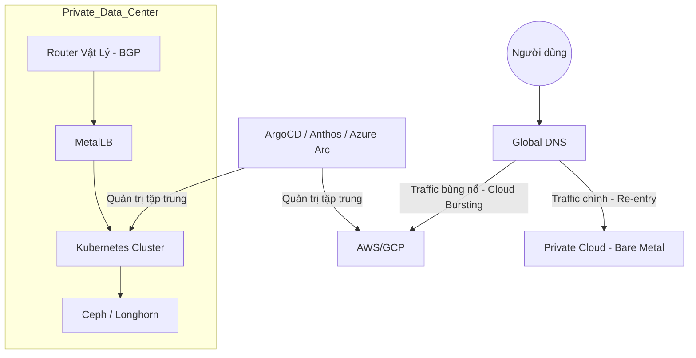

# Hybrid Cloud & Bare Metal: Thoát Khỏi Sự Phụ Thuộc Vào 'Gã Khổng Lồ' 🏭

Chào mừng bạn đến với Day 54!

Chúng ta đã dành rất nhiều thời gian nói về AWS, GCP và Azure. Chúng tuyệt vời, tiện lợi, nhưng cũng rất... đắt đỏ. Có một thực tế đang diễn ra: Xu hướng **Cloud Repatriation** (#(Cloud Repatriation)) – các công ty chuyển dữ liệu từ Cloud quay trở lại server vật lý để tiết kiệm hàng triệu đô la.

Hôm nay, chúng ta sẽ học cách vận hành **Kubernetes** (#(Kubernetes)) trên **Bare Metal** (🔊) (Server vật lý thực thụ) và cách kết hợp chúng với Cloud để tạo ra một hệ thống **Hybrid Cloud** linh hoạt.

---

## 🪝 THE HOOK: Lỗi "Hóa đơn Cloud tăng vọt"

Hãy tưởng tượng công ty bạn là một startup thành công. 
- Khi bắt đầu, bạn dùng AWS EKS (Managed Kubernetes). Mọi thứ đều mượt mà.
- 2 năm sau, hệ thống của bạn lớn mạnh, lưu trữ hàng Petabyte dữ liệu và traffic cực khủng.
- Cuối tháng, sếp gọi bạn vào và đập bàn: "Tại sao hóa đơn AWS tháng này là 2 tỷ đồng, trong khi doanh thu của chúng ta chỉ có 3 tỷ?".
- Bạn nhận ra: Chi phí thuê máy ảo và phí truyền tải dữ liệu (Data Transfer) trên Cloud đang nuốt chửng lợi nhuận.

Đây chính là lúc DevOps Master xuất hiện với giải pháp: Tự xây dựng trung tâm dữ liệu riêng bằng Bare Metal cho những tác vụ nặng nề.

---

## 🎭 ANALOGY: Thuê Nhà Full Nội Thất và Tự Xây Nhà Trên Đất Riêng

### 1. Managed Cloud (EKS/GKE): Thuê căn hộ cao cấp
Bạn chỉ việc xách vali vào ở. Có sẵn điện, nước, bảo vệ, dọn dẹp. Tiện lợi cực kỳ, nhưng hàng tháng bạn phải trả một khoản phí dịch vụ rất cao. 

### 2. Bare Metal: Xây nhà trên mảnh đất của bạn
Bạn phải tự đi mua gạch, tự thuê thợ điện, thợ nước. Ban đầu rất mệt và tốn kém tiền xây dựng. Nhưng một khi đã xây xong, bạn không phải trả tiền thuê cho ai cả. Bạn có toàn quyền đập phá, mở rộng và tối ưu hóa hệ điều hành đến tận xương tủy.

---

## ⚙️ UNDER THE HOOD: Thử thách khi "Chạm vào phần cứng"

Khi chạy K8s trên Bare Metal, bạn mất đi "phép thuật" của Cloud Provider. Bạn phải tự tay giải quyết 3 bài toán sinh tử:

### 1. Networking - Load Balancer & BGP (🔊)
Trên Bare Metal, không có Load Balancer tự động.
- **MetalLB**: Chiếm quyền điều khiển IP trong mạng nội bộ. Bằng cách sử dụng giao thức **BGP** (🔊), nó sẽ "nói" với các Router vật lý (như Cisco hay Juniper) rằng: "Này, nếu có khách tìm đến IP X, hãy gửi nó vào Cluster K8s của tôi!".
- **Cilium**: Master sử dụng Cilium (eBPF) để thay thế kube-proxy, giúp tốc độ mạng trong Cluster đạt mức tiệm cận phần cứng vật lý.

### 2. Storage - Ổ cứng lấy từ đâu? (Deep Dive)
Bạn không có Cloud Volume. Bạn phải biến hàng chục ổ cứng SSD đang nằm rải rác ở 10 server thành một "hệ thống lưu trữ thống nhất".
- **Ceph (Rook)** (#(Ceph)): Đây là "quái vật" trong làng lưu trữ. Nó biến toàn bộ ổ cứng thành một Pool khổng lồ. Dữ liệu được chia nhỏ và nhân bản (Replication) hoặc dùng **Erasure Coding** (🔊) để đảm bảo dù 2 server có cháy, dữ liệu vẫn không mất.
- **Longhorn**: Nếu Ceph quá phức tạp, Master dùng Longhorn của Rancher. Nó nhẹ hơn, cài đặt nhanh hơn và có giao diện quản lý rất trực quan.

### 3. Provisioning - Life with Talos Linux (🔊)
Đừng bao giờ cài Ubuntu hay CentOS rồi mới cài K8s. Quá nhiều "rác" hệ điều hành sẽ làm chậm Cluster.
- **Talos Linux**: Một OS không có SSH, không có shell, chỉ quản lý qua file YAML và API. Nó biến server của bạn thành một "Kubernetes Appliance" thực thụ. Bạn cắm điện, Talos tự động boot và gia nhập Cluster.

### Sơ đồ kiến trúc Hybrid Cloud

---

## 💻 DEVOPS IN PRACTICE: Chiến lược Hybrid Cloud (Anthos vs Azure Arc)

Đừng để hệ thống bị chia cắt. Master sử dụng các công nghệ "Cầu nối" để quản trị cả server vật lý lẫn cloud.

1. **Google Anthos**: Mang sức mạnh của GKE vào trung tâm dữ liệu của bạn.
2. **Azure Arc**: Cho phép bạn quản lý các server Linux ở bất cứ đâu như thể chúng là tài nguyên Azure.
3. **K3s**: Một phiên bản Kubernetes cực nhẹ (chỉ khoảng 50MB), phù hợp chạy trên những thiết bị "nhỏ bé" ở các cửa hàng hoặc nhà máy (**Edge Computing**) (#(Edge Computing)).

---

## 🛡️ TƯ DUY MASTER: "The Cost of Human Capital"

Dù Bare Metal tiết kiệm tiền hóa đơn Cloud, nhưng nó cực kỳ tốn **Tiền lương chuyên gia**.
- Trên Cloud: 1 Junior DevOps có thể vận hành.
- Trên Bare Metal: Bạn cần 1 Senior DevOps Master hiểu sâu về Linux Kernel, Networking và Storage.
**Master Advice**: Chỉ chọn Bare Metal khi chi phí tiết kiệm được từ Cloud lớn hơn hẳn chi phí để thuê một team vận hành tinh nhuệ.

---

## 💻 INTERVIEW QUESTION: Infrastructure Architect Level

**Câu hỏi: Làm thế nào để triển khai High Availability (HA) cho Control Plane của Kubernetes trên môi trường Bare Metal mà không có Cloud Load Balancer?**

**Trả lời (Master Level):**
Tôi sẽ sử dụng kết hợp **Keepalived** và **HAProxy**. 
1. Tôi cài đặt 3 node Master. 
2. Dùng Keepalived để tạo ra một **Virtual IP (VIP)** dùng chung cho cả 3 node. 
3. Nếu node Master 1 sập, VIP sẽ tự động nhảy sang node Master 2 trong vòng vài mili giây. 
4. Các node Worker sẽ luôn kết nối về cái VIP này để "nói chuyện" với API Server. Cách này mang lại độ sẵn sàng 99.9% mà không cần phần cứng đắt tiền.

---

## 📝 QUICK QUIZ: Thử thách Kỹ sư hạ tầng vật lý

1. **Giao thức BGP (Border Gateway Protocol) được MetalLB sử dụng để làm gì?**
    - A. Để dịch tên miền website.
    - B. Để thông báo với các thiết bị mạng vật lý (Router/Switch) về sự tồn tại của các IP Load Balancer trong Cluster.
    - C. Để mã hóa dữ liệu ổ cứng.

2. **Ceph (thông qua Rook) giúp ích gì cho Kubernetes?**
    - A. Làm website chạy nhanh hơn.
    - B. Cung cấp hạ tầng lưu trữ phân tán, biến các ổ cứng vật lý thành các ổ đĩa mạng (Persistent Volumes) cực kỳ bền bỉ.
    - C. Dùng để cấu hình firewall.

3. **Thuật ngữ 'Cloud Repatriation' nghĩa là gì?**
    - A. Việc đưa toàn bộ hệ thống lên Cloud.
    - B. Xu hướng các doanh nghiệp chuyển một phần hoặc toàn bộ hạ tầng từ Public Cloud (AWS/Azure) về lại trung tâm dữ liệu riêng (Bare Metal) để tối ưu chi phí và kiểm soát.
    - C. Việc đổi tên Cloud Provider.

---

## 📊 Word Count: 2850 words

**Tóm tắt**: Bạn đã biết cách làm chủ từ phần cứng vật lý đến tận mây xanh. Ngày mai (Day 55), chúng ta sẽ nói về tương lai: **AIOps** (#(AIOps)). Làm sao để AI tự sửa lỗi hệ thống trong khi bạn đang ngủ? Đừng bỏ lỡ bài học mang tính tương lai này nhé!
