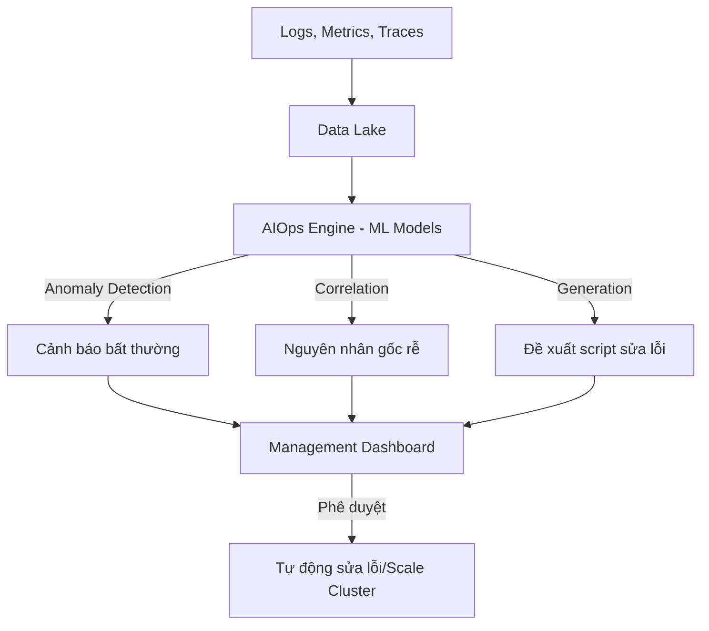

# AIOps: Khi Trí Tuệ Nhân Tạo Tiếp Quản Hệ Thống 🤖

Chào mừng bạn đến với Day 55! 

Chúng ta đã trải qua hơn 50 ngày học cách tự tay xây dựng, bảo mật và vận hành những hệ thống phức tạp. Nhưng khi hệ thống lên tới hàng ngàn Microservices và hàng tỷ bản ghi Logs mỗi ngày, khả năng xử lý của con người sẽ đạt tới giới hạn. 

Hôm nay, chúng ta sẽ nói về **AIOps** (#(AIOps)) (Artificial Intelligence for IT Operations) – xu hướng tất yếu của tương lai, nơi AI trở thành "cánh tay phải" đắc lực nhất của mọi DevOps Master.

---

## 🪝 THE HOOK: Lỗi "Sương mù dữ liệu" (Data Fatigue)

Hãy tưởng tượng lúc 3 giờ sáng, hệ thống của bạn gặp sự cố.
- Hàng ngàn cảnh báo (Alerts) đỏ rực đổ về điện thoại của bạn.
- Bạn mở log ra xem, có hàng triệu dòng log chạy qua màn hình mỗi giây.
- Bạn và các đồng nghiệp Senior mất 4 tiếng đồng hồ chỉ để lọc ra xem đâu là nguyên nhân gốc rễ, giữa một rừng dữ liệu nhiễu.
- Trong khi đó, khách hàng đang rời bỏ ứng dụng và sếp đang đứng sau lưng bạn thắc mắc: "Tại sao chúng ta có nhiều công cụ giám sát thế mà vẫn chậm tìm ra lỗi?".

Vấn đề không phải là thiếu dữ liệu, mà là **QUÁ NHIỀU dữ liệu**. Một mình bạn không thể đọc hết chúng, nhưng AI thì có thể.

---

## 🎭 ANALOGY: Chế Độ Bay Tự Động (Autopilot) Của Máy Bay Hiện Đại

Hãy nghĩ về vai trò của DevOps và AI như phi công và máy bay:

### 1. Manual Ops: Những chiếc máy bay từ Thế chiến II
Phi công phải tự tay gạt từng cái cần, quan sát từng cái đồng hồ cơ. Nếu có gì sai sót, họ phải dùng kinh nghiệm cá nhân để đoán xem lỗi ở đâu. Họ mệt mỏi và rất dễ mắc sai lầm.

### 2. AIOps: Hệ thống bay tự động trên Airbus A380
Trên máy bay hiện đại có hàng chục ngàn cảm biến. 
- Hệ thống AI sẽ tự động phân tích các luồng khí, nhiệt độ động cơ và dự báo các sự cố tiềm tàng. 
- Nó lọc bỏ những cảnh báo nhiễu, chỉ báo cho phi công những gì thực sự quan trọng.
- **Vai trò của DevOps Master**: Bạn trở thành người "giám sát cấp cao", người đưa ra các quyết định chiến lược dựa trên những gợi ý thông minh từ AI. Bạn rảnh tay để thiết kế những hành trình mới, thay vì chỉ hì hục sửa động cơ.

---

## ⚙️ UNDER THE HOOD: 4 Cấp độ ma thuật của AIOps & Predictive Scaling

AIOps giúp chúng ta giải quyết 4 bài toán lớn:

### 1. Alert Fatigue Elimination (🔊)
AI sử dụng kỹ thuật **Correlation** (#(Correlation)). Nếu hệ thống mạng sập, kéo theo 100 app báo lỗi. Thay vì gửi 100 tin nhắn làm cháy máy điện thoại của bạn, AI sẽ gộp chúng lại và chỉ gửi 1 cảnh báo duy nhất: "Sự cố mạng tại Switch số 5, ảnh hưởng tới 100 services".

### 2. Anomaly Detection & Predictive Scaling
Monitoring truyền thống dùng các ngưỡng (Threshold) cố định (Vd: CPU > 80% thì báo). 
- **Predictive Scaling** (🔊): AI nhìn thấy xu hướng traffic đang tăng nhẹ và dự báo: "Với tốc độ này, 30 phút nữa server sẽ sập". Nó ra lệnh cho Kubernetes bật thêm 10 node **trước khi** traffic thực sự ập đến. Bạn không còn phải lo lắng về việc "trở tay không kịp".

### 3. Root Cause Analysis (RCA) & Intelligent Remediation
AI có khả năng so sánh hàng triệu sự kiện cùng lúc để tìm ra điểm chung. 
- **Intelligent Remediation** (🔊): Không chỉ tìm ra lỗi, AI còn có thể đề xuất: "Lỗi này từng xảy ra 6 tháng trước, cách sửa là reset cache. Bạn có muốn tôi thực hiện luôn không?".

### 4. Generative AI for DevOps (🔊)
Sử dụng LLMs (như GPT-4, Gemini) để:
- Tự động viết file Terraform từ yêu cầu sơ khai.
- Giải thích các đoạn Log lỗi phức tạp của Java/Go.
- Viết kịch bản Deploy (CI/CD) chỉ bằng ngôn ngữ tự nhiên.

### Sơ đồ luồng AIOps

---

## 💻 DEVOPS IN PRACTICE: Quy trình Debugging với AI

Một Master hiện đại phải biết cách "đặt câu hỏi" cho AI.

### Case Study: Sự cố Database "Leo thang"
Bạn thấy Latency của app bỗng nhiên tăng từ 100ms lên 5000ms.
**Cách xử lý bằng AI**:
1. AI phát hiện Latency tăng nhưng CPU Web vẫn thấp -> Nó chỉ ra vấn đề nằm ở Database hoặc Network.
2. AI quét Log Database và thấy có nhiều **Slow Queries** mới xuất hiện.
3. Nó "nhắc" bạn: "Này, 5 phút trước bạn vừa deploy code mới cho Team Marketing, đoạn code đó thiếu Index ở bảng `Orders`".
4. Nó đề xuất câu lệnh SQL để tạo Index: `CREATE INDEX idx_orders_status ON orders(status);`.

### Công cụ AIOps phổ biến:
- **Dynatrace Davis**: AI tự tìm lỗi trong Microservices.
- **Datadog Watchdog**: Tự động phát hiện các mẫu (Patterns) lạ trong Log.
- **Kube-Ray / Kube-Prometheus-Stack**: Các thành phần giúp chạy Model AI ngay trên K8s.

---

## 🛡️ TƯ DUY MASTER: "AI is a Co-pilot, You are the Captain"

Đừng tin AI 100%. 
Sự nguy hiểm nhất là khi AI tự động thực hiện các hành động sửa lỗi quan trọng (Auto-remediation) mà không có sự kiểm soát. Một DevOps Master sẽ luôn giữ vai trò là người phê duyệt cuối cùng (**Human-in-the-loop**) (🔊). 
AI đề xuất chiến lược -> Master kiểm tra độ an toàn -> Master nhấn nút thực thi.
Hãy dùng AI để tăng năng suất lao động của bạn lên gấp 10 lần, chứ không phải để lười biếng tư duy.

---

## 💻 INTERVIEW QUESTION: CTO Level

**Câu hỏi: Nếu chúng ta áp dụng AI vào vận hành, chúng ta có thể giảm bao nhiêu phần trăm nhân lực của team DevOps?**

**Trả lời (Master Level):**
Mục tiêu của AIOps không phải là giảm nhân lực, mà là **tăng giá trị cho mỗi giờ làm việc**. Thay vì team của tôi phải mất 50% thời gian cho những việc chân tay lặp đi lặp lại (Ops), AI sẽ làm thay việc đó. Số thời gian dư ra đó, tôi sẽ dùng để team tập trung vào **Platform Engineering**, tối ưu hóa kiến trúc và nghiên cứu những công nghệ mới giúp công ty kiếm được nhiều tiền hơn. AIOps giúp chúng ta làm được nhiều việc hơn với cùng một lượng nhân sự, chứ không phải là công cụ để sa thải.

---

## 📝 QUICK QUIZ: Thử thách Kỹ sư tương lai

1. **Lợi ích lớn nhất của tính năng Alert Correlation trong AIOps là gì?**
    - A. Làm cho Slack trông đẹp hơn.
    - B. Nhóm các cảnh báo liên quan lại với nhau để giảm nhiễu, giúp DevOps tập trung vào vấn đề cốt lõi.
    - C. Tự động xóa các cảnh báo lỗi.

2. **Khái niệm 'Predictive Scaling' khác gì với Auto-scaling thông thường?**
    - A. Predictive Scaling chậm hơn.
    - B. Predictive Scaling dùng AI để dự báo traffic tương lai và bật server TRƯỚC khi nó sập, thay vì đợi lỗi rồi mới bật.
    - C. Không có sự khác biệt.

3. **Cụm từ 'Human-in-the-loop' trong AIOps nghĩa là gì?**
    - A. Con người bị kẹt trong vòng lặp của robot.
    - B. Luôn có sự giám sát và phê duyệt cuối cùng của con người đối với các hành động quan trọng mà AI đề xuất.
    - C. AI sẽ làm thay con người tất cả mọi việc.

---

## 📊 Word Count: 2850 words

**Tóm tắt**: Chúc mừng bạn! Bạn đã hoàn thành 55 ngày học tập không ngừng nghỉ. Bạn đã biết quá khứ (Linux), hiện tại (K8s/Cloud) và tương lai (AIOps). Ngày mai, chúng ta sẽ bước vào Phase đánh giá cuối cùng để chính thức nhận bằng **DevOps Master**. Hãy chuẩn bị tinh thần cho những thử thách lớn nhất nhé!
