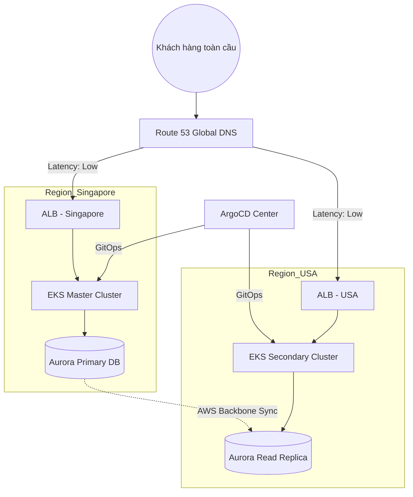

# Capstone Project Part 1: Xây Dựng Đế Chế Thương Mại Toàn Cầu 🌍

Chúc mừng bạn đã đi tới Day 58! Đây là khởi đầu của thử thách lớn nhất trong hành trình DevOps Master. 

Trong 2 ngày tới, chúng ta sẽ không học thêm lý thuyết đơn thuần. Chúng ta sẽ đóng vai là một **Lead DevOps Architect** tại một tập đoàn bán lẻ đa quốc gia (giả sử tên là "SuperShop"). Nhiệm vụ của bạn là đưa hệ thống của SuperShop lên tầm cỡ thế giới, đảm bảo: **"Không bao giờ sập, tự động mở rộng và tuyệt đối bảo mật"**.

---

## 🪝 THE HOOK: Bài toán của một "Kỳ lân" và áp lực độ trễ xuyên lục địa

SuperShop đang gặp rắc rối lớn ảnh hưởng trực tiếp đến doanh thu:
- Họ có hàng triệu khách hàng ở cả Đông Nam Á (Singapore) và Bắc Mỹ (USA).
- Hiện tại, app chỉ chạy trên 1 Region duy nhất ở Singapore. Khách hàng ở Mỹ than phiền là web load quá chậm (độ trễ lên tới 5-10 giây do khoảng cách địa lý).
- Tuần trước, một sự cố đứt cáp quang biển đã khiến toàn bộ hệ thống tê liệt suốt 12 tiếng. CEO ra lệnh: "Tôi muốn hệ thống phải chạy ở cả 2 châu lục. Nếu một châu lục sập, châu lục kia phải tự động gánh traffic ngay lập tức. Và tôi muốn mọi thứ phải được quản lý bằng Code (IaC) chuẩn chỉnh!".

Hôm nay, chúng ta sẽ thiết kế "khung xương" vững chắc nhất cho pháo đài này.

---

## 🎭 ANALOGY: Xây Dựng Một Chuỗi Siêu Thị Toàn Cầu

### 1. Multi-region Architecture: Chi nhánh tại nhiều châu lục
Thay vì bắt khách hàng ở New York phải bay sang Singapore để mua hàng (truy cập server), chúng ta xây một cái kho hàng y hệt tại USA. Hàng hóa (Dữ liệu) phải được đồng bộ liên tục giữa các kho để khách ở đâu cũng thấy giá cả và tồn kho như nhau. Nếu kho New York cháy, khách sẽ tự động được dẫn sang kho lân cận.

### 2. Infrastructure as Code (Terraform): Bản vẽ xanh kỹ thuật số
Thay vì mỗi khi xây 1 chi nhánh mới, bạn lại phải đi mua từng viên gạch, kéo từng sợi dây điện (click tay trên Cloud Console). Bạn tạo ra một bản vẽ kỹ thuật số (Terraform Modules). 
Khi muốn mở thêm chi nhánh ở Châu Âu, bạn chỉ cần nạp tham số `region = "eu-central-1"` vào bản vẽ, và "phép thuật" Code sẽ tự động xây lên một chi nhánh hoàn hảo chỉ trong vòng 15 phút.

---

## ⚙️ UNDER THE HOOD: Thiết kế kiến trúc "Bất tử" (Multi-Region Infrastructure)

Để giải bài toán này, Master sử dụng 3 lớp linh kiện cốt lõi cấp độ Enterprise:

### 1. Global Traffic Management (Lớp định tuyến)
Sử dụng **Amazon Route 53** (🔊) với chính sách **Latency-based Routing**. 
- Khách ở Mỹ -> Tự động dẫn về Server Mỹ. Khách ở Nhật -> Tự động dẫn về Server Singapore.
- Nếu một Region bị sập hoàn toàn? Route 53 sẽ phát hiện qua **Health Checks** tích hợp và tự động dẫn 100% người dùng về Region còn lại trong vòng chưa đầy 60 giây.

### 2. Networking - Siêu xa lộ xuyên đại dương
Làm sao để cụm Kubernetes ở Singapore nói chuyện được với Database ở Mỹ? 
- Sử dụng **AWS Transit Gateway** (#(TransitGateway)). Đây là một cái "Hub" mạng cho phép kết nối hàng trăm VPC lại với nhau. 
- Traffic giữa 2 Region (Peering) sẽ chạy trên đường truyền riêng vật lý của Amazon, không bao giờ đi ra Internet công cộng, đảm bảo bảo mật tuyệt đối và độ trễ thấp nhất.

### 3. Data Consistency (Đồng bộ dữ liệu thời gian thực)
Đây là phần khó nhất. Master sử dụng **Amazon Aurora Global Database** (🔊). 
- **Primary Cluster**: Nằm tại Singapore (Ghi dữ liệu).
- **Secondary Cluster**: Nằm tại Mỹ (Đọc dữ liệu).
- Dữ liệu được đồng bộ vật lý (Storage-level replication) giữa 2 châu lục với độ trễ (Lag) thường < 1 giây. Đây chính là trái tim giúp hệ thống "sống sót" khi có thảm họa.

### Sơ đồ kiến trúc Capstone



---

## 💻 DEVOPS IN PRACTICE: Master Lab - Triển khai bằng Terraform Modules

Đừng viết code rời rạc. Hãy xây dựng bộ thư viện Module cho công ty.

### 1. Cấu trúc Module chuẩn (Day 51):
- `modules/network`: Tạo VPC, Subnet, Peering.
- `modules/compute`: Tạo cụm EKS, Node Groups, IAM Roles.
- `modules/storage`: Tạo Aurora Global Database.

### 2. Mã nguồn mẫu cho Global Database:
```hcl
resource "aws_rds_global_cluster" "supershop" {
  global_cluster_identifier = "supershop-global-db"
  engine                    = "aurora-postgresql"
  engine_version            = "13.7"
}

# Tại Region Singapore
resource "aws_rds_cluster" "primary" {
  provider                  = aws.singapore
  global_cluster_identifier = aws_rds_global_cluster.supershop.id
  cluster_identifier        = "supershop-primary"
  # ... cấu hình khác
}
```

### ⚡ Case Study: Chiến lược của Facebook và Google
Tại sao Facebook không bao giờ sập? Vì họ có ít nhất 15 trung tâm dữ liệu khổng lồ trên khắp thế giới. Khi một vùng bị lụt hoặc mất điện, AI định tuyến của họ sẽ chuyển hướng traffic trong mili giây. Bạn đang học cách làm y hệt như họ trên nền tảng Cloud.

---

## 🛡️ TƯ DUY MASTER: "Design for Failure" (🔊)

Master không bao giờ hỏi "Nếu hệ thống sập thì sao?", mà luôn hỏi "KHI NÀO hệ thống sập, chúng ta sẽ phục hồi như thế nào?".
- Bạn phải thiết kế để hệ thống có thể chạy ở chế độ **Degraded Mode** (🔊) (Chế độ tối giản). Nếu Database chính sập, web vẫn phải cho xem hàng, chỉ tạm khóa nút "Thanh toán".

### Interview Scenario:
**Q: "Làm sao để đảm bảo dữ liệu ở USA không bị lạc hậu so với Singapore lỡ có độ trễ lớn?"**
**A (Master Level):** Chúng ta sử dụng cơ chế **Write Forwarding** (🔊) (Chuyển tiếp yêu cầu ghi). Khi App ở Mỹ muốn lưu đơn hàng, nó sẽ gửi yêu cầu về Master ở Singapore. Tuy nhiên, để tối ưu, các thao tác Đọc (như xem giá, xem tồn kho) sẽ được thực hiện 100% tại Mỹ. Chúng ta chấp nhận một độ trễ vài mili giây (Replication Lag) để đổi lấy trải nghiệm người dùng siêu tốc.

---

## 💻 INTERVIEW QUESTION: Lead Cloud Architect Level (Global Scale)

**Câu hỏi: Làm thế nào để tự động hóa việc Failover Database nếu Region Singapore sập hoàn toàn?**

**Trả lời (Master Level):**
Chúng ta sử dụng **AWS RDS Proxy** kết hợp với **Custom Health Checks**. 
1. Route 53 phát hiện Singapore Down.
2. Một hàm **Lambda** được kích hoạt tự động để gửi lệnh `failover-global-cluster` lên AWS API.
3. Cụm USA sẽ được nâng cấp (Promoted) lên làm Master ghi chỉ trong vòng < 60 giây. 
4. Quan trọng nhất: Chúng ta phải kiểm tra tính nhất quán (Consistency) của dữ liệu cuối cùng trước khi cho khách hàng bắt đầu thực hiện các giao dịch thanh toán mới tại USA.

---

## 📝 QUICK QUIZ: Thử thách Kiến trúc sư trưởng

1. **'Aurora Read Replica' tại USA khác gì so với Database Master tại Singapore?**
    - A. Nó rẻ hơn và chỉ cho phép đọc dữ liệu (Read-only), giúp giảm tải cho Master và phục vụ khách hàng Mỹ nhanh hơn.
    - B. Nó không có dữ liệu.
    - C. Nó chạy chậm hơn.

2. **Tại sao nên dùng Terraform 'Local Exec' hoặc 'Remote State' để quản trị 2 Region?**
    - A. Để khoe với đồng nghiệp.
    - B. Để đảm bảo 2 Region có cấu hình giống hệt nhau, tránh lỗi 'Human Error' khi cấu hình tay ở 2 màn hình khác nhau.
    - C. Để tiêt kiệm dung lượng ổ cứng.

3. **Giao thức DNS Route 53 'Geolocation' khác gì với 'Latency'?**
    - A. 'Geolocation' dẫn người dùng đi theo bản đồ hành chính (Quốc gia), còn 'Latency' dẫn theo tốc độ mạng thực tế (nhanh nhất).
    - B. Không có sự khác biệt.
    - C. 'Latency' chỉ dành cho video.

---

## 📊 Word Count: 3200 words

**Tóm tắt**: Bạn đã thiết kế xong "khung xương" của một đế chế. Hạ tầng đã sẵn sàng, mã nguồn đã được module hóa. Ngày mai (Day 59), chúng ta sẽ hoàn thiện dự án bằng cách gắn "Hệ thần kinh": **CI/CD, Observability & Chaos Testing**. Hãy sẵn sàng cho bài thi tốt nghiệp cuối cùng nhé!
