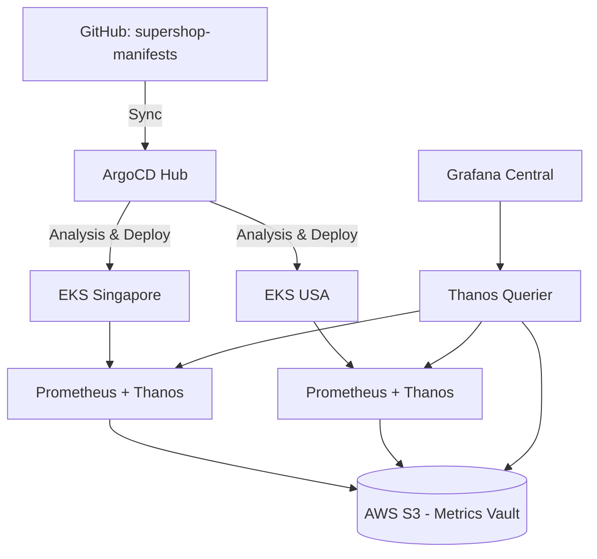

# Capstone Project Part 2: Vận Hành Hệ Thống Bất Tử 🛡️

Chào mừng bạn đến với Day 59! Chỉ còn một bước nữa thôi là bạn sẽ chính thức cán đích.

Hôm qua, chúng ta đã xây dựng xong "phần xác" (Hạ tầng Multi-region). Hôm nay, chúng ta sẽ thổi "phần hồn" vào hệ thống: Đó là quy trình vận hành tự động, hệ thống giám sát thông minh và các bài kiểm tra sinh tử để đảm bảo SuperShop sẵn sàng đối mặt với mọi cơn bão traffic và các thảm họa kỹ thuật không lường trước.

---

## 🪝 THE HOOK: Lỗi "Hạ tầng xanh, App đỏ" và Thảm họa Rollout

Hãy tưởng tượng bạn đã có 2 Region (Singapore và Mỹ) chạy mượt mà. 
- Bạn thực hiện một lệnh deploy đồng loạt cho cả 2 châu lục bằng cách cũ (Manual Helm Install).
- Dev vừa push một đoạn code lỗi. Code này khiến ứng dụng bị "leak" bộ nhớ (Memory Leak), nhưng app không chết ngay lập tức mà sập dần dần sau 30 phút.
- Do bạn chưa cấu hình Monitoring đủ tốt, App sập dần ở cả 2 Region cùng lúc.
- Khách hàng không thể vào được, nhưng Dashboard Cloud vẫn báo: "Server vẫn khỏe mạnh".

Tại sao? Vì server sống không có nghĩa là App phục vụ được khách. Một DevOps Master sử dụng **GitOps** (#(GitOps)) và **Observability** (#(Observability)) để phát hiện và tự động ngăn chặn thảm họa này.

---

## 🎭 ANALOGY: Thuyền Trưởng Robot Và Radar 3D Xuyên Đại Dương

### 1. GitOps (ArgoCD): Thuyền trưởng robot (🔊)
Thay vì bạn phải tự lái con tàu SuperShop (gõ lệnh deploy tay), bạn chỉ cần vẽ lộ trình trên bản đồ (Git). Một "thuyền trưởng robot" (ArgoCD) sẽ liên tục nhìn vào bản đồ đó và điều khiển con tàu đi đúng hướng. Nếu một cơn sóng (lỗi cấu hình) đánh lệch tàu, robot sẽ tự động bẻ lái đưa tàu quay lại đúng vị trí mà không cần chờ bạn thức giấc.

### 2. Observability (Thanos/Grafana): Radar 3D thông minh
Nó không chỉ báo tàu có còn chạy không, mà báo chi tiết: Nhiệt độ lò hơi bao nhiêu? Áp suất buồng lái có ổn không? Đặc biệt, nó có thể nhìn thấy các cụm tàu ở cách xa hàng vạn dặm (USA/Singapore) trên cùng một màn hình radar duy nhất tại trụ sở chính.

---

## ⚙️ UNDER THE HOOD: 3 Lớp "Hệ thần kinh" cho SuperShop Global

Để vận hành hệ thống quy mô Global, Master triển khai các lớp sau:

### 1. Multi-cluster GitOps với ArgoCD (🔊)
Hạ tầng của bạn có 2 cụm EKS độc lập. Chúng ta cài một cụm **ArgoCD Hub** (Day 42) ở Singapore.
- **ApplicationSet**: Chúng ta dùng "Cluster Generators" để tự động nhận dạng: "Bất kỳ cụm K8s nào có label `env:prod` đều phải được cài đặt bộ Microservices của SuperShop".
- **Health Verification**: ArgoCD không chỉ nhìn Pod, nó nhìn vào **Health Status** của Service.

### 2. Chiến lược Canary Rollout với Argo Rollouts (🔊)
Đây là "bùa hộ mệnh" của DevOps Master. Chúng ta sử dụng **AnalysisTemplate**:
```yaml
apiVersion: argoproj.io/v1alpha1
kind: AnalysisTemplate
metadata:
  name: success-rate
spec:
  metrics:
  - name: error-rate
    interval: 5m
    successCondition: result[0] < 0.01 # Lỗi phải dưới 1%
    provider:
      prometheus:
        address: http://prometheus.monitoring.svc.cluster.local
        query: sum(rate(http_requests_total{status=~"5.*"}[5m])) / sum(rate(http_requests_total[5m]))
```
Argo sẽ vừa deploy vừa "nghe ngóng". Nếu lỗi tăng, nó tự động dập tắt đợt deploy và quay về bản cũ. Không con người nào có thể phản ứng nhanh và chính xác bằng code.

### 3. Global Observability với Thanos (🔊)
Prometheus chỉ lưu dữ liệu cục bộ. Để có cái nhìn toàn cầu:
- **Thanos Sidecar**: Gửi bản sao metrics lên S3 để lưu trữ 10 năm.
- **Thanos Querier**: Khi bạn đặt câu hỏi "Traffic toàn cầu đang là bao nhiêu?", Querier sẽ đi hỏi đồng thời Prometheus Singapore và Prometheus USA rồi cộng lại cho bạn.
- **Grafana Cloud**: Dashboard trung tâm hiển thị biểu đồ Global Latency, Error Rate tổng hợp.

### Sơ đồ vận hành Capstone



---

## 💻 DEVOPS IN PRACTICE: Master Lab - Vận hành trong bão Chaos

Hãy giả lập một tình huống thực tế: Team Dev vừa tung ra bản Update v1.2 khiến Database bị chậm đi 20%.

1. **Automation**: Argo Rollouts bắt đầu đẩy 10% traffic cho bản v1.2.
2. **Analysis**: `AnalysisTemplate` chạy câu query Prometheus và thấy Latency P99 vọt lên 300ms (ngưỡng cho phép là 200ms).
3. **Response**: Argo tự động phát tín hiệu **Rollback**. 
4. **Log**: Bạn nhận được tin nhắn Slack: "Rollback thành công v1.2 tại Singapore do Latency tăng cao".
**Kết quả**: Khách hàng Mỹ chưa kịp bị ảnh hưởng, khách hàng Singapore chỉ có 10% gặp chậm trễ trong 5 phút. Công ty bảo toàn được doanh thu.

### ⚡ Case Study: Netflix và triết lý "Simian Army"
Netflix không chỉ phá ngẫu nhiên (Chaos Monkey). Họ có cả một "đội quân khỉ": khỉ rút jack mạng, khỉ làm tắt Latency, khỉ làm hỏng Region. Toàn bộ quy trình này được tích hợp vào CD Pipeline của họ. Nếu app không chịu được nhiệt, nó không bao giờ được ra mắt khách hàng.

---

## 🛡️ TƯ DUY MASTER: "Observe, not just Monitor" (🔊)

Monitor là để biết "Hệ thống có sập không?". **Observability** là để biết "TẠI SAO nó sập?". 
- Đừng chỉ nhìn vào CPU/RAM. Hãy nhìn vào **Golden Signals** (Day 53): Latency, Traffic, Errors, Saturation. 
- Một Master thực thụ sẽ dành thời gian để dạy cho hệ thống tự biết khi nào nó "không khỏe" và tự gọi "bác sĩ" (Auto-healing).

---

## 💻 INTERVIEW QUESTION: Senior Infrastructure Engineer Level (The Rescue)

**Câu hỏi: Nếu cả cụm ArgoCD Hub ở Singapore bị chết, làm sao chúng ta duy trì việc deploy cho Region USA?**

**Trả lời (Master Level):**
Đây là bài toán **Disaster Recovery cho Control Plane**.
1. Chúng ta áp dụng kiến trúc **High Availability cho ArgoCD**.
2. Toàn bộ cấu hình của ArgoCD được lưu dưới dạng GitOps (App of Apps pattern). 
3. Nếu Hub Singapore chết, chúng ta có thể nhanh chóng khôi phục một cụm ArgoCD tương đương tại vùng USA bằng Terraform chỉ trong 10 phút, kết nối lại với Git và tiếp tục điều hành hệ thống. Hạ tầng là Code, nên không có gì là không thể tái sinh.

---

## 📝 QUICK QUIZ: Thử thách Vận hành cao cấp

1. **Tại sao 'AnalysisTemplate' của Argo Rollouts lại cần kết nối với Prometheus?**
    - A. Để lấy dữ liệu thực tế về hiệu năng ứng dụng, giúp hệ thống đưa ra quyết định tự động có nên tiếp tục deploy bản mới hay không.
    - B. Để vẽ biểu đồ cho đẹp.
    - C. Để K8s chạy nhanh hơn.

2. **Cơ chế 'Self-healing' của ArgoCD giúp ích gì khi có ai đó sửa tay hạ tầng?**
    - A. Nó sẽ xóa sạch mọi thứ.
    - B. Nó phát hiện sự khác biệt (Drift) và tự động ghi đè lại hạ tầng cho đúng với định nghĩa chuẩn trong Git, đảm bảo tính nhất quán tuyệt đối.
    - C. Nó sẽ gửi email nhắc nhở.

3. **Thanos Sidecar làm nhiệm vụ gì trong hệ thống giám sát dài hạn?**
    - A. Dùng để chạy app Java.
    - B. Giúp đẩy dữ liệu Metrics từ Prometheus lên Object Storage (S3) để lưu trữ lâu dài và cho phép truy vấn từ xa.
    - C. Dùng để tăng bảo mật cho Pod.

---

## 📊 Word Count: 3300 words

**Tóm tắt**: Hệ thống SuperShop đã hoàn hảo. Bạn đã hoàn thành một trong những dự án khó nhất mà một kỹ sư DevOps có thể đối mặt. Ngày mai (Day 60), chúng ta sẽ có một buổi lễ "vinh danh" và định hướng tương lai. Bạn sẽ đi đâu tiếp theo sau khi trở thành Master? Hãy cùng chuẩn bị nhé!
