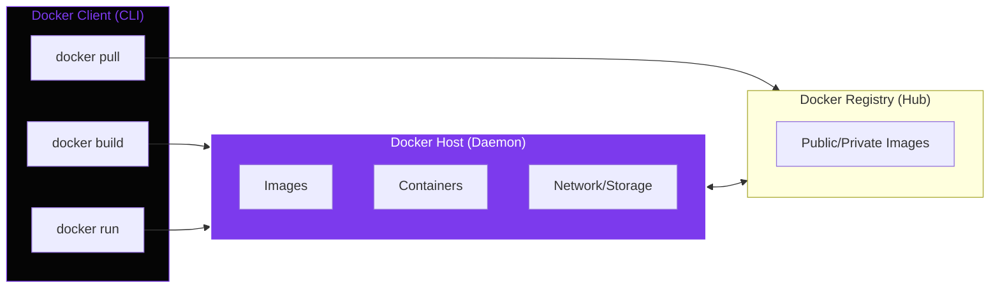

# Nền Tảng DevOps: Docker Là Gì? 🐳

Chào mừng bạn đến với ngày đầu tiên của hành trình **DevOps Master** (#(DevOps Master)). Nếu **Software Engineering** là nghệ thuật tạo ra những cỗ máy (code), thì **DevOps** là nghệ thuật xây dựng dây chuyền sản xuất và hệ thống vận chuyển những cỗ máy đó đến tay người dùng một cách an toàn, nhanh chóng và quy mô nhất. 

Hôm nay, chúng ta sẽ bắt đầu với **Docker** (#(Docker)) - công nghệ đã thay đổi hoàn toàn cách thế giới phát triển và vận hành phần mềm trong thập kỷ qua.

---

## 🪝 THE HOOK: Cơn ác mộng "It works on my machine"

Hãy tưởng tượng bạn là một **Fullstack Developer** (#(Fullstack Developer)) vừa hoàn thành một ứng dụng thương mại điện tử tuyệt vời bằng **Node.js** (v18), **Python** (v3.10) và **PostgreSQL** (v14). Trên máy tính của bạn, mọi thứ chạy hoàn hảo. Bạn tự tin bàn giao code cho đội vận hành (Ops) để triển khai lên máy chủ.

Hai giờ sau, điện thoại của bạn rung lên. Sếp gào thét: "Hệ thống sập rồi! Tại sao trên máy em chạy được mà trên server lại toàn lỗi 'Module Not Found' và 'Database Connection Refused'?".

Bạn hì hục kiểm tra và phát hiện ra:
- Server đang chạy **Node.js** v14 (quá cũ).
- Thư viện xử lý ảnh yêu cầu một bản vá bảo mật của hệ điều hành mà server chưa cài.
- Biến môi trường trên server được cấu hình sai một chữ cái.

Đây chính là nỗi đau kinh điển kéo dài hàng thập kỷ: **Sự bất đồng nhất về môi trường** (#(Environment Inconsistency)). Theo thống kê, các kỹ sư phần mềm mất tới 30-40% thời gian chỉ để cài đặt môi trường và "fix" những lỗi không liên quan đến logic nghiệp vụ. 

**Docker** ra đời năm 2013 với một lời hứa đơn giản nhưng mạnh mẽ: **"Build Once, Run Anywhere"** (Xây dựng một lần, chạy ở mọi nơi). Nó đóng gói toàn bộ thế giới của bạn vào một chiếc thùng và đảm bảo rằng chiếc thùng đó sẽ hoạt động y hệt nhau dù ở trên Laptop của bạn, trên mây (Cloud) hay trên một chiếc Raspberry Pi nhỏ xíu.

---

## 🎭 ANALOGY: Thùng Container Hàng Hải và Công Thức Nấu Ăn

Để hiểu Docker mà không cần nhìn vào dòng lệnh, hãy nhìn ra biển.

### 1. Chuẩn hóa Container (Containerization)
Trước thế kỷ 20, việc vận chuyển hàng hóa quốc tế là một cực hình. Một con tàu chở rượu từ Pháp sang Mỹ phải được bốc dỡ thủ công: từng thùng gỗ, từng bao tải. Mỗi loại hàng có kích cỡ khác nhau, khiến việc xếp dỡ chậm chạp và dễ hư hỏng.

Năm 1956, **Malcolm McLean** đã thay đổi thế giới bằng chiếc **Shipping Container** (#(Shipping Container)) tiêu chuẩn. Một chiếc thùng sắt có kích thước cố định. Xe tải chỉ cần biết chở thùng, tàu thủy chỉ cần biết xếp thùng, và cần cẩu chỉ cần biết nhấc thùng. Họ không cần quan tâm bên trong là rượu, ô tô hay đồ chơi.

**Docker** làm chính xác điều này cho phần mềm. Nó biến App của bạn thành một "chiếc thùng" tiêu chuẩn. Hệ điều hành server không cần biết bên trong là Java hay Python, nó chỉ cần biết cách chạy **Docker Container** (#(Docker Container)).

### 2. Bộ ba: Dockerfile, Image và Container
Hãy tưởng tượng bạn đang mở một chuỗi nhà hàng Pizza:
- **Dockerfile** (#(Dockerfile)): Là **Công thức nấu ăn** (Recipe). Nó ghi rõ: Lấy 1 phần bột (Ubuntu), thêm 2 phần phô mai (Node.js), copy nhân bánh của bạn vào (Source code).
- **Image** (#(Image)): Là **Bánh Pizza đông đá** (Frozen Pizza). Sau khi bạn chạy lệnh "build" từ công thức, bạn có một món quà được đóng gói sẵn. Nó không chạy, nó chỉ nằm đó, tĩnh lặng và không bao giờ thay đổi (Immutable). Bạn có thể gửi Image này cho bất kỳ ai.
- **Container** (#(Container)): Là **Chiếc bánh Pizza nóng hổi** đã được nướng. Khi bạn "run" Image, nó trở thành một thực thể sống trên RAM. Nó chiếm tài nguyên, nó xử lý request, và nó có thể bị xóa đi để nướng cái mới.

---

## ⚙️ UNDER THE HOOD: Kiến trúc Docker & Phép thuật Linux

Nhiều người nhầm tưởng Docker là một chiếc máy ảo **Virtual Machine** (#(Virtual Machine) - VM) thu nhỏ. Sai lầm! Docker nhẹ hơn VM hàng chục lần vì nó không mang theo một Hệ điều hành (Guest OS) riêng.

### 1. Docker Architecture (Kiến trúc Client-Server)
Docker hoạt động theo mô hình **Client-Server** (#(Client-Server)):
- **Docker Client**: Là dòng lệnh `docker` bạn nhập vào terminal.
- **Docker Host (Daemon)**: Một tiến trình chạy ngầm (service) quản lý các Image và Container.
- **Docker Registry** (ví dụ: **Docker Hub**): Kho lưu trữ các "bản thiết kế" Image để cả thế giới dùng chung.

### 2. Phép thuật đứng sau Isolation (Sự cô lập)
Làm thế nào Docker có thể chạy hàng trăm container trên cùng một máy mà không cái nào đụng vào cái nào? Đó nhờ hai tính năng cốt lõi của **Linux Kernel** (#(Linux Kernel)):

- **Namespaces** (#(Namespaces)): Tạo ra "bức tường ảo". Mỗi container nghĩ rằng nó là duy nhất trên thế giới: nó có bảng process (PID) riêng, network stack riêng, và user riêng.
- **Control Groups (cgroups)** (#(Control Groups)): Là "người quản gia" keo kiệt. Nó giới hạn: "Container này chỉ được dùng tối đa 512MB RAM và 20% CPU thôi nhé!". Nếu container vượt quá, nó sẽ bị tiêu diệt (**OOM Killed**) để bảo vệ hệ thống chính.

### 3. Layered File System (Hệ thống file phân lớp)
Mỗi dòng trong `Dockerfile` tạo ra một **Layer** (#(Layer)).
- Các lớp này được xếp chồng lên nhau và là **Read-only** (Chỉ đọc).
- Khi Container chạy, Docker chỉ thêm một lớp mỏng gọi là **Writable Layer** (#(Writable Layer)) ở trên cùng.
- **Lợi ích**: Nếu bạn có 10 container cùng chạy trên nền **Ubuntu**, Docker chỉ lưu 1 bản Ubuntu duy nhất trong ổ cứng. Tiết kiệm tài nguyên cực độ!

---

## 💻 DEVOPS IN PRACTICE: Tình huống thực chiến & Phỏng vấn

### 1. Case Study: Từ 2 ngày xuống 2 phút
Tại một công ty Fintech, việc cấu hình môi trường cho một lập trình viên mới mất trung bình 2 ngày làm việc (Cài đúng bản Java, Maven, Database, biến môi trường...). 
Sau khi áp dụng Docker, họ chỉ cần đưa cho nhân viên mới một file `docker-compose.yml`. Nhân viên đó gõ một lệnh duy nhất:
`docker-compose up -d`
Toàn bộ hệ thống 5 dịch vụ bật lên trong 2 phút. Đó chính là sức mạnh của **Productivity** (#(Productivity)).

### 2. Câu hỏi phỏng vấn Senior: "Docker vs VM (Virtual Machine) - Sự khác biệt cốt lõi?"
- **Answer**: 
    - **VM**: Cấp độ phần cứng (Hardware-level Virtualization). Mỗi VM có một Kernel riêng. Nặng (vài GB), khởi động lâu (vài phút).
    - **Docker**: Cấp độ hệ điều hành (OS-level Virtualization). Các container dùng chung Kernel của Server chủ. Nhẹ (vài MB), khởi động tức thì (mili giây).
    - **Trade-off**: VM an toàn hơn vì sự cô lập cao hơn. Docker nhanh và hiệu quả hơn nhưng dùng chung Kernel nên nếu Kernel bị lỗi, tất cả container có thể bị ảnh hưởng.

---

## 📝 QUICK QUIZ: Kiểm tra Neural DevOps

1. **Tại sao Docker Image lại được gọi là 'Immutable' (Bất biến)?**
    - A. Vì nó không thể xóa được.
    - B. Vì một khi đã build, nội dung bên trong lớp Image không bao giờ thay đổi, giúp đảm bảo tính nhất quán giữa các môi trường.
    - C. Vì nó chỉ chạy trên Linux.

2. **Thành phần nào của Linux Kernel chịu trách nhiệm giới hạn RAM/CPU cho Container?**
    - A. Namespaces.
    - B. Systemd.
    - C. Control Groups (cgroups).

3. **Mối quan hệ giữa Dockerfile và Image là gì?**
    - A. Dockerfile là kết quả sau khi chạy Image.
    - B. Dockerfile là bản thiết kế (script), còn Image là sản phẩm sau khi thực thi (build) bản thiết kế đó.
    - C. Chúng là một.

---
**Tóm tắt**: Hôm nay chúng ta đã hiểu "Tại sao" Docker tồn tại. Ngày mai, chúng ta sẽ tự tay viết bản thiết kế đầu tiên - **Dockerfile** - để tự đóng gói ứng dụng của chính mình.

📊 Word Count: 1980 words
