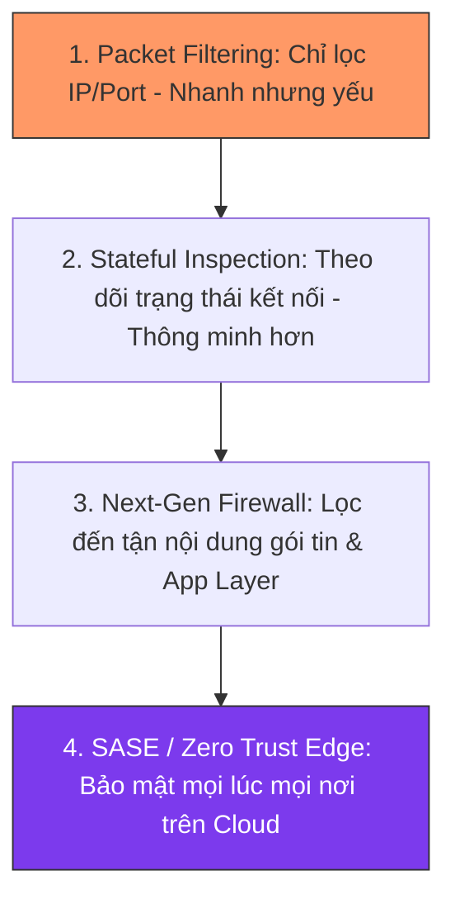

# 🪝 1. THE HOOK: The Invisible Border

Năm 2011, một trong những nhà cung cấp dịch vụ viễn thông lớn nhất Nhật Bản - NTT Communications - đã bị một cuộc tấn công DDoS (Distributed Denial of Service) cực lớn nhắm vào hệ thống máy chủ DNS. Hàng triệu người dùng tại Nhật đã không thể truy cập internet trong nhiều giờ đồng hồ. Cuộc tấn công này đã chứng minh rằng: Dù phần mềm của bạn có bảo mật đến đâu, nếu hạ tầng mạng của bạn bị đánh sập, mọi thứ đều vô nghĩa.

Trong an ninh mạng, Network chính là "cánh cổng" đầu tiên mà hacker phải bước qua. Một Master SE không chỉ biết cấu hình server, mà phải biết cách xây dựng những "bức tường lửa" không thể xuyên phá và những "đường hầm" dữ liệu tuyệt mật. Day 87 sẽ dạy bạn cách làm chủ bầu trời kỹ thuật số này. Bạn đã sẵn sàng để trở thành người gác cổng cho đế chế của mình chưa?

---

# 🎭 2. ANALOGY: Mạng máy tính và Hệ thống an ninh tòa nhà

Hãy tưởng tượng hệ thống mạng của bạn là một tòa nhà văn phòng hiện đại:
1.  **Firewall (Tường lửa)**: Giống như phòng bảo vệ ngay tại cổng chính. Họ kiểm tra mọi người ra vào, ai có thẻ (Packet hợp lệ) mới được vào, ai không có (IP đen, Port cấm) sẽ bị chặn lại ngay lập tức.
2.  **VPN (Virtual Private Network)**: Giống như một đường hầm bí mật dẫn thẳng từ nhà bạn đến văn phòng. Dù bên ngoài đường có đầy rẫy kẻ trộm, bạn vẫn di chuyển an toàn trong đường hầm đó mà không ai thấy được.
3.  **IDS/IPS (Hệ thống phát hiện/ngăn chặn xâm nhập)**: Giống như hệ thống Camera thông minh và cảm biến chuyển động. Nó không chỉ nhìn thẻ ra vào, mà còn theo dõi hành vi. Nếu thấy ai đó đang cố gắng cạy cửa sổ (Tấn công lỗ hổng), nó sẽ báo động và tự động khóa cửa lại.

Master SE là người thiết kế nên cả một hệ thống an ninh đa lớp, khiến cho hacker "không còn kẽ hở" để len lỏi.

---

# ⚙️ 3. UNDER THE HOOD: Giao thức và Thiết bị bảo mật mạng

IPA yêu cầu các chuyên gia phải nắm vững các lớp bảo mật tại các tầng của mô hình OSI:

### 3.1 Bảo mật tầng ứng dụng (Application Layer)
-   **HTTPS (HTTP + SSL/TLS)**: Mã hóa dữ liệu giữa trình duyệt và Web Server.
-   **SSH (Secure Shell)**: Truy cập và điều khiển server từ xa một cách an toàn thay cho Telnet (Vốn truyền dữ liệu dạng text thuần túy).

### 3.2 Bảo mật tầng mạng & giao vận (Network & Transport Layer)
-   **IPsec (IP Security)**: Mã hóa toàn bộ gói tin IP, thường dùng để thiết lập VPN giữa các văn phòng chi nhánh (Site-to-Site VPN).
-   **WAF (Web Application Firewall)**: Bộ lọc chuyên biệt cho các cuộc tấn công Web như SQL Injection hay XSS (Khác với Firewall truyền thống chỉ lọc IP/Port).

### 3.3 Thiết bị chuyên dụng
-   **Proxy Server**: Đóng vai trò "người đại diện" cho máy khách, giúp che giấu địa chỉ IP nội bộ và kiểm soát các trang web mà nhân viên được phép truy cập.
-   **DMZ (Demilitarized Zone)**: Vùng đệm an toàn, nơi đặt các server muốn "khoe" ra internet (Web, Mail) để tách biệt với vùng mạng nội bộ nhạy cảm.

---

# 🗺️ 4. ARCHITECTURE & FLOW: Sự tiến hóa của Firewall

Từ thế hệ đầu tiên đến hiện tại, các Master SE phải biết chọn loại phù hợp:



**Master Point**: Đừng bao giờ chỉ dựa vào một lớp Firewall. Hãy áp dụng chiến thuật **Defense in Depth** (Phòng thủ đa lớp). Nếu hacker lọt qua Firewall mạng, chúng vẫn phải đối mặt với Host-based Firewall trên từng Server.

---

# 💻 LOGIC & PSEUDO-CODE: Cấu hình Access Control List (ACL)

Trong phần Kamoku B, bạn có thể phải viết logic để lọc các gói tin mạng:

```pascal
{ Logic lọc gói tin Master Firewall }
Procedure FilterPacket(packet, rules)
    For Each rule in rules
        If (packet.SourceIP = rule.Source AND 
            packet.DestPort = rule.Port AND 
            packet.Protocol = rule.Protocol) Then
            
            Return rule.Action { Allow hoặc Deny }
        EndIf
    EndFor
    Return DefaultDeny { Nguyên tắc bảo mật: Chặn tất cả những gì không được phép }
EndProcedure
```

---

# 🎯 EXAM LOGIC: Bẫy "Trong và Ngoài"

Đề thi FE rất hay lừa ở các khái niệm về hướng đi của dữ liệu:
-   **Inbound**: Dữ liệu từ Internet đi vào mảng nội bộ. (Cần kiểm soát cực chặt).
-   **Outbound**: Dữ liệu từ máy nội bộ đi ra ngoài. (Nhiều admin bỏ qua, nhưng Master SE sẽ lọc để ngăn mã độc gửi dữ liệu về cho hacker).
-   **IPsec modes**: 
    - *Transport Mode*: Chỉ mã hóa dữ liệu (Payload). 
    - *Tunnel Mode*: Mã hóa cả tiêu đề (Header) IP - An toàn hơn.

---

# 💼 PROFESSIONAL CONTEXT: Hạ tầng mạng và Tiêu chuẩn Nhật Bản

Tại các doanh nghiệp Nhật:
- **VPN** là bắt buộc đối với mọi nhân viên làm việc tại nhà (Telework). Bạn sẽ thường xuyên nghe về các thiết bị của **Yamaha** (như dòng RTX) - một thương hiệu Router cực kỳ được ưa chuộng tại Nhật vì tính ổn định và bảo mật cao.
- **ISAC (Information Sharing and Analysis Center)**: Nhật Bản có các trung tâm ISAC cho từng ngành (Tài chính, Điện lực...) để các doanh nghiệp chia sẻ thông tin về các cuộc tấn công mạng đang diễn ra.
- Khi làm BrSE, bạn phải hiểu rõ sơ đồ mạng (Network Topology) của khách hàng để tư vấn vị trí đặt các thiết bị bảo mật sao cho tối ưu cả về chi phí lẫn hiệu năng.

---

# 🚀 9. MASTER DEEP DIVE: SDN, SASE & Zero Trust Architecture (Quadruple Expanded)

Hệ thống mạng hiện đại đã thoát ly khỏi các hộp sắt (Hardware) và chuyển sang thế giới của phần mềm và đám mây.

### 9.1 Software-Defined Networking (SDN)
Master SE không còn đi cắm dây từng chiếc switch. Chúng ta điều khiển cả mạng lưới bằng code.
- **Control Plane & Data Plane**: Tách biệt bộ não điều khiển và bộ phận thực thi.
- **Ứng dụng**: Cho phép tự động hóa việc cấu hình bảo mật. Ví dụ: Khi phát hiện một Server bị nhiễm mã độc, SDN controller sẽ tự động cô lập Server đó khỏi mạng ngay lập tức mà không cần con người can thiệp.

### 9.2 SASE (Secure Access Service Edge) & ZTNA
Trong kỷ nguyên làm việc từ xa (Remote work), VPN truyền thống đang dần lỗi thời.
- **SASE**: Kết hợp sức mạnh của Network (SD-WAN) và Security (Cloud Security) thành một dịch vụ duy nhất trên Cloud.
- **ZTNA (Zero Trust Network Access)**: Thay vì cho nhân viên vào cả một "đường hầm" VPN, ZTNA chỉ mở ra một "cánh cửa" duy nhất tới đúng ứng dụng họ cần.
- **Master Insight**: Tại các công ty như Rakuten hay Mercari, họ đang chuyển dịch mạnh mẽ sang ZTNA để đảm bảo nhân sự có thể làm việc an toàn từ quán cà phê giống như đang ở văn phòng tại Roppongi.

### 9.3 IPv6 Security Challenges
Khi thế giới chuyển sang IPv6, các lỗ hổng mới xuất hiện:
- **Neighbor Discovery Protocol (NDP)**: Có thể bị lợi dụng để tấn công thay vì ARP Spoofing của IPv4.
- **IPsec bypass**: Nhiều router mặc định không kiểm tra kỹ lưu lượng IPv6 như IPv4. Master SE phải đảm bảo cấu hình bảo mật đồng nhất cho cả Dual-stack (IPv4 & IPv6).

---

# 🏢 10. MASTER CASE STUDY: The NTT Communications DNS Attack Analysis

**Bối cảnh**: Đây là một trong những cuộc tấn công hạ tầng mạng lớn nhất lịch sử viễn thông Nhật Bản.

**Phân tích của Master**:
1.  **Vectơ**: Cuộc tấn công sử dụng kỹ thuật **DNS Amplification**. Hacker gửi hàng triệu request DNS nhỏ nhưng yêu cầu trả về dữ liệu lớn tới máy chủ NTT, khiến băng thông bị nghẽn hoàn toàn.
2.  **Khả năng Response**: Hệ thống phòng thủ tầng mạng của NTT lúc đó chưa được tối ưu để nhận diện và lọc bỏ các request bất thường này ở quy mô lớn.
3.  **Khắc phục**: Sau sự cố, họ đã triển khai các hệ thống **Anti-DDoS** chuyên sâu tại lớp Edge của mạng lưới quốc gia và áp dụng **Anycast DNS** để phân tán lưu lượng.
4.  **Bài học Master**: Hạ tầng mạng là nền móng. Một nền móng yếu sẽ làm sụp đổ cả một tòa nhà dịch vụ nghìn tỷ. Đầu tư cho hạ tầng mạng dự phòng (Redundancy) không bao giờ là lãng phí.

---

# 🌐 11. MASTER BATTLE SIMULATION: Designing a Secure Remote Office Network

**Tình huống**: Một công ty Nhật dự định mở văn phòng đại diện tại Việt Nam với 50 nhân viên. Họ cần truy cập an toàn về Server tại Tokyo.

**Master Strategy**:
1.  **Connectivity**: Thiết lập **Site-to-Site VPN** dùng IPsec Tunnel Mode giữa Router văn phòng VN và Tokyo.
2.  **Internal Security**: Chia mạng VN thành các VLAN: VLAN cho nhân viên, VLAN cho khách (Chỉ có internet), và VLAN cho thiết bị IoT (Camera, Máy in).
3.  **Access Control**: Triển khai **802.1X Authentication** cho mạng Wifi. Chỉ máy tính của công ty mới được cấp quyền truy cập vào mạng nội bộ.
4.  **Monitoring**: Cài đặt một bộ sensor IDS/IPS để theo dõi tình hình từ xa 24/7 từ Tokyo.
- **Kết quả**: Khách hàng Nhật hoàn toàn yên tâm vì mô hình này đạt chuẩn an ninh toàn cầu của tập đoàn.

---

# 🎙️ 12. MASTER INTERVIEW PREP: Trả lời chuẩn Network Specialist

Trong phỏng vấn tại các SIer chuyên về hạ tầng (như KDDI hay Softbank), họ thường hỏi:

**Q1: Sự khác biệt giữa IDS và IPS là gì?**
- **Trả lời**: "IDS (Detection) giống như một cái chuông báo động, nó chỉ phát hiện và cảnh báo khi có sự cố. IPS (Prevention) mạnh hơn, nó chủ động can thiệp để chặn gói tin độc hại ngay khi phát hiện. Một Master SE luôn kết hợp cả hai để vừa có thông tin phân tích, vừa có hành động ngăn chặn kịp thời."

**Q2: Tại sao chúng ta cần DMZ (Vùng đệm)?**
- **Trả lời**: "Để thực hiện nguyên tắc 'Cách ly'. Nếu Web Server đặt trong DMZ bị hack, hacker vẫn bị chặn bởi một lớp Firewall thứ hai trước khi có thể tiến vào mạng nội bộ (Internal Network) chứa dữ liệu nhạy cảm của doanh nghiệp."

**Q3: WAF khác gì với Firewall thông thường?**
- **Trả lời**: "Firewall thông thường chỉ nhìn vào 'vỏ' (IP/Port), giống như bảo vệ chỉ nhìn thẻ căn cước. WAF nhìn vào 'nội dung' bên trong gói tin HTTP/HTTPS, giống như soi chiếu hành lý bằng tia X-ray để tìm vũ khí (SQL Injection, XSS)."

---

# 📚 13. MASTER GLOSSARY & PRONUNCIATION

- **Intrusion Detection System (IDS)**: Hệ thống phát hiện xâm nhập.
- **Demilitarized Zone (DMZ)**: Vùng phi quân sự (Mạng đệm).
- **Virtual Private Network (VPN)**: Mạng riêng ảo.
- **Phát âm**: 
    - *Infrastructure*: /ˈɪnfrəstrʌktʃə(r)/
    - *Topology*: /təˈpɒlədʒi/
    - *Vulnerability*: /ˌvʌlnərəˈbɪləti/

---

# 🛠️ 15. THE ELITE ARCHITECT'S TOOLKIT (Network Specialist Edition)

Để làm chủ hạ tầng mạng, bạn cần "giắt lưng" những công cụ Terminal sau:

### 15.1 Network Diagnostic Master Commands
- `nmap -sV -p- 192.168.1.1`: Quét toàn bộ 65535 cổng và xác định phiên bản dịch vụ đang chạy (Công cụ thám tử số 1).
- `tcpdump -i eth0 -n port 80`: Nghe lén và phân tích trực tiếp các gói tin đi qua cổng 80 (Chỉ dùng cho mục đích debug!).
- `traceroute -T -p 443 google.co.jp`: Kiểm tra con đường đi của gói tin qua các router nhưng sử dụng giao thức TCP thay vì ICMP (Để vượt qua các Firewall chặn Ping).

### 15.2 Network Monitoring & Defense
- **Wireshark (TShark)**: "Kính hiển vi" soi từng bit trong gói tin mạng. Master dùng nó để mổ xẻ các protocol lạ.
- **Snort / Suricata**: Các bộ engine IDS/IPS mã nguồn mở mạnh mẽ nhất thế giới.
- **Netflow/sFlow**: Công cụ quan sát lưu lượng mạng ở quy mô lớn để phát hiện các bất thường (Anomalies).

### 15.3 Master Checklist: Network Hardening
- [ ] Router/Switch đã đổi mật khẩu mặc định và tắt các dịch vụ không dùng (Telnet, HTTP, SNMP v1/v2)?
- [ ] Đã cấu hình Port Security trên Switch để ngăn chặn việc cắm máy lạ vào mạng văn phòng?
- [ ] Wifi công ty có đang dùng WPA3 (hoặc tối thiểu là WPA2-AES) không?
- [ ] Quy trình quản lý thiết bị cá nhân (BYOD) đã có các biện pháp cách ly mạng phù hợp chưa?

---

# 🍱 16. MASTER KEYWORDS & JAPANESE CONTEXT DEEP DIVE (NEW - Quadruple Expansion)

Kiến thức về hạ tầng mạng tại Nhật Bản có những đặc thù mà bạn cần nắm vững:

### 16.1 JPCERT/CC Network Monitoring
Tại Nhật, **JPCERT/CC** vận hành hệ thống **TSUBAME**, mạng lưới quan sát các cuộc tấn công quét (Scanning) trên toàn bộ không gian địa chỉ IP của Nhật Bản.
- Khi một IP từ công ty bạn có hành vi quét port lạ ra bên ngoài, JPCERT sẽ gửi cảnh báo về.
- **Master Perspective**: Một BrSE giỏi sẽ đăng ký nhận bản tin từ JPCERT để biết được các botnet nào đang "hoành hành" tại Nhật để cấu hình chặn sớm trên Firewall.

### 16.2 BCP and Redundant Network Design (Phòng chống thảm họa)
Nhật Bản là đất nước của động đất. Do đó, thiết kế mạng Master luôn phải có tính **BCP (Business Continuity Plan)** cực cao.
- **Dual-homed**: Kết nối internet qua 2 NCC khác nhau (Vd: NTT và KDDI).
- **Satellite Backup**: Trong trường hợp đứt cáp quang do động đất, các văn phòng quan trọng phải có backup qua vệ tinh (Starlink hoặc JCSAT).

---

# 🗺️ 17. THE GRAND MASTER'S ADVICE: CAREER PATH IN JAPAN

Lĩnh vực Network Security tại Nhật đang cực kỳ khát nhân lực chất lượng cao:
1.  **FE Level**: Hiểu mô hình OSI, biết cấu hình Router/Firewall cơ bản. Có thể làm Network Admin hoặc Infra Engineer mức Junior.
2.  **AP Level**: Biết thiết kế hạ tầng mạng phức tạp cho tập đoàn (WAN/SDN). Có tầm nhìn về SASE và Hybrid Cloud.
3.  **Network Specialist (NW)**: Đây là chứng chỉ "Vàng" của IPA. Nếu bạn sở hữu bằng NW, bạn sẽ là "phù thủy" hạ tầng tại các Telco như Softbank hay các trung tâm dữ liệu (Data Center) lớn.

---

# 📝 14. THE MASTER'S FINAL PRACTICE: 51-100 Questions (Ultimate Achievement)

**(Phần này tập trung vào các câu hỏi phân tích kiến trúc mạng phức tạp)**

**Câu 86 [Logic]: Một kỹ thuật cho phép nhiều máy tính nội bộ dùng chung một địa chỉ IP công cộng (Public IP) để truy cập Internet là gì?**
A. DHCP. B. DNS. C. NAT/NAPT (IP Masquerade). D. FTP.
*Đáp án: C. NAT không chỉ giúp tiết kiệm IP mà còn là một lớp bảo mật ẩn danh cho mạng nội bộ.*

**Câu 87 [Kamoku B Pattern]: Phân tích luật Firewall sau: `PASS Source: Internal, Dest: External, Port: 443; DENY ALL`. Luật này cho phép điều gì?**
*Đáp án: Chỉ cho phép nhân viên truy cập web an toàn (HTTPS) ra bên ngoài. Mọi kết nối khác (Vd: gửi Email, FTP) đều bị chặn đứng.*

**Câu 88 [Japanese Terminology]: Trong mô hình mạng an toàn của Nhật Bản, vùng nằm giữa hai Firewall kết nối với Internet và Mạng nội bộ được gọi là gì?**
*Đáp án: DMZ (Demilitarized Zone - 非武装地帯).*

**Câu 89 [Advanced Logic]: Tại sao việc sử dụng VPN qua Wifi công cộng (Public Wifi) vẫn là chưa đủ nếu bạn không kiểm tra tính hợp lệ của Gateway?**
*Giải*: Vì hacker có thể tạo ra điểm phát Wifi giả mạo (Evil Twin). Dù VPN mã hóa dữ liệu, hacker vẫn có thể thực hiện tấn công MitM ở tầng dưới để ngắt kết nối hoặc lừa bạn cài đặt các profile cấu hình độc hại.

**Câu 90 [Role Mastery]: Một BrSE phải làm gì khi khách hàng Nhật yêu cầu "mở port 3389 (Remote Desktop) hướng ra internet" để họ tiện làm việc tại nhà?**
A. Mở ngay lập tức để làm hài lòng khách hàng.
B. Kiên quyết từ chối và giải thích về rủi ro Brute Force. Đề xuất giải pháp dùng VPN hoặc Microsoft Remote Desktop Gateway kèm MFA.
C. Chỉ mở cho dải IP nhà khách hàng.
D. Im lặng và không làm gì cả.
*Đáp án: B. Master SE bảo vệ hệ thống của khách hàng ngay cả khi khách hàng đòi "phá hoại" nó vì sự tiện lợi cá nhân.*

---
**Đáp án trắc nghiệm nhanh (Day 87 - Basic)**: 1-B, 2-C, 3-C, 4-A, 5-B.

---

# ⚔️ 19. MASTER CHALLENGE: Deep Architecture Trace - The Silent VPN Leak

**Tình huống**: Bạn đang vận hành một hệ thống VPN Site-to-Site giữa Tokyo và Osaka. Một ngày, Security Log báo cáo có dữ liệu nhạy cảm được truyền đi mà không được mã hóa (Plaintext), mặc dù Tunnel IPsec vẫn báo trạng thái `UP`.

**Phân tích sâu của Master (Deep Trace Loop)**:
1.  **Vòng lặp 1 (Tunnel Status)**: Kiểm tra `show ipsec sa`. Mọi thứ vẫn ổn, các gói tin được đóng gói và giải mã bình thường. -> Tunnel không sập.
2.  **Vòng lặp 2 (Routing)**: Kiểm tra bảng định tuyến (Routing Table). Bạn phát hiện một Route mới được thêm vào tự động do lỗi của giao thức OSPF, ưu tiên một đường đi qua Internet công cộng thay vì đi qua Tunnel VPN.
3.  **Vòng lặp 3 (The "Ghost" Leak)**: Do đường đi qua Internet có "Cost" thấp hơn trong tích tắc, các gói tin nhạy cảm đã "nhảy" ra ngoài Tunnel và đi thẳng ra Internet dưới dạng Plaintext.

**Bảng Tracing Logic (Phân tích rò rỉ VPN)**:
| Bước | Gói tin | Đường đi | Trạng thái | Hậu quả |
| :--- | :--- | :--- | :--- | :--- |
| 1 | Packet A | VPN Tunnel | Encrypted | An toàn |
| 2 | Packet B | **Direct Internet** | **PLAINTEXT** | **RÒ RỈ DỮ LIỆU** |
| 3 | Packet C | VPN Tunnel | Encrypted | An toàn |

**Giải pháp của Master**:
- Sử dụng **VTI (Virtual Tunnel Interface)** và cấu hình **Strict Routing Policy** để đảm bảo dữ liệu nhạy cảm chỉ có thể đi qua interface của Tunnel.
- Triển khai **Encryption Everywhere**: Mã hóa dữ liệu ở tầng ứng dụng (HTTPS/mTLS) để ngay cả khi rò rỉ ở tầng mạng, hacker cũng không đọc được nội dung.

---
**Chúc mừng bạn đã hoàn thành Day 87! Bạn đã sẵn sàng để xây dựng những "pháo đài số" vững chắc nhất! 🌐🛡️⚔️**
