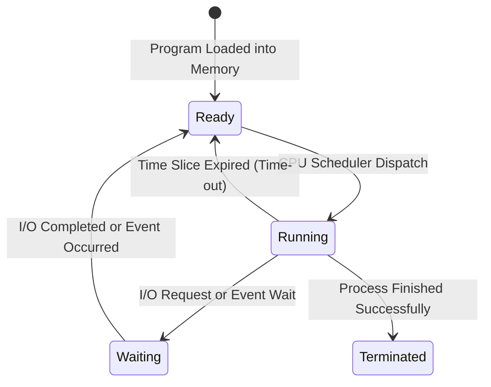

# 🪝 1. THE HOOK: Người Nhạc Trưởng Trong Một Dàn Nhạc Hỗn Loạn

Hãy tưởng tượng bạn đang xem một dàn nhạc giao hưởng đang biểu diễn tại nhà hát **Suntory Hall** hùng vĩ ở Tokyo. Có hàng trăm nhạc công (Các tiến trình - Processes) đang chơi các loại nhạc cụ khác nhau (Bàn phím, Màn hình, Loa, RAM, Disk, Card Mạng). Nếu không có vị Nhạc trưởng tài ba (Hệ điều hành - Operating System) đứng ở trung tâm để từng giây từng phút điều phối nhịp điệu, người thổi sáo sẽ át tiếng người đánh đàn, và mọi thứ sẽ trở thành một thảm họa âm thanh hỗn độn, đứt quãng và vô nghĩa. 

Hệ điều hành chính là vị Nhạc trưởng quyền lực nhất trong thế giới máy tính. Nó không chỉ đơn thuần là một phần mềm, nó là thực thể quyết định xem ai được "biểu diễn" (sử dụng CPU) vào lúc nào, trong bao lâu, và lấy "nguyên liệu" (tài nguyên hệ thống) từ đâu mà không gây xung đột với người khác. Nếu OS của bạn tồi, cả hệ thống sẽ bị "đơ" (Lag), bị "chết" (Crash) hoặc tệ hơn là rò rỉ toàn bộ thông tin cá nhân của người dùng. Trong kỳ thi **FE Master**, am hiểu về nội tại của OS là bước chuyển mình từ một người biết gõ code đơn thuần thành một kỹ sư hệ thống thực thụ, người có khả năng tối ưu hóa từng mili giây thực thi của ứng dụng trên nền tảng phần cứng.

---

# 🎭 2. ANALOGY: Văn Phòng Công Chứng Phố Shinjuku, Tokyo

Hệ điều hành giống như một văn phòng công chứng cực kỳ bận rộn giữa lòng Tokyo:

1.  **Process Management** (Tiến trình): Chính là các **Khách hàng** đang đứng xếp hàng chờ đợi. Mỗi khách hàng có một hồ sơ riêng gọi là **PCB** (Process Control Block) lưu trữ mọi thông tin: Họ là ai, họ đang làm đến bước nào, họ cần bao nhiêu RAM để hoàn thành công việc.
2.  **CPU Scheduling** (Điều phối): Là **Nhân viên lễ tân** quyền lực ngồi ở bàn quầy. Người này sẽ gọi tên khách hàng tiếp theo dựa trên các quy tắc thông minh: "Ai đến trước làm trước" (FCFS) hoặc "Ai có thẻ VIP (độ ưu tiên cao) thì được ưu tiên xử lý trước".
3.  **Memory Management**: Là **Cánh tay robot quản lý kho hồ sơ**. Làm sao để sắp xếp hàng nghìn hồ sơ vào các kệ tủ (RAM) một cách gọn gàng nhất. Khi kệ tủ RAM đầy, nó biết cách "tạm cất" những hồ sơ chưa dùng tới vào kho ngầm (Ổ cứng/Virtual Memory) để nhường chỗ cho khách mới.
4.  **Deadlock** (Bế tắc): Giống như tình huống: Khách hàng A đang giữ Giấy khai sinh và chờ mượn Chứng minh thư của khách hàng B. Trong khi khách hàng B đang giữ Chứng minh thư và chờ mượn Giấy khai sinh của khách hàng A. Cả hai cứ nhìn chằm chằm vào nhau mãi mãi (System Hang) và không ai làm được việc gì tiếp theo. Đó là thảm họa của sự bế tắc logic.

---

# ⚙️ 3. UNDER THE HOOD: Deep Dive vào Chức Năng Cốt Lõi của OS

Trong giáo trình **IPA Syllabus**, bạn phải nắm vững 3 trụ cột sau đây để có thể vượt qua mọi câu hỏi hóc búa:

### 3.1 Quản lý Tiến trình (Process Management - プロセス管理)
Một chương trình nằm trên ổ cứng là một "thực thể tĩnh/chết", nhưng khi được nạp vào bộ nhớ RAM và bắt đầu thực thi, nó trở thành một "Tiến trình" (Process - thực thể sống).
- **Trạng thái tiến trình (States)**: 
    1. **Ready** (実行可能): Đã nạp xong xuôi, chỉ chờ CPU rảnh là nhảy vào "chiến" ngay lập tức.
    2. **Running** (実行中): Đang trực tiếp chiếm hữu CPU để tính toán các phép tính logic.
    3. **Waiting/Blocked** (待機/ブロック): Đang chờ I/O hoàn thành (Ví dụ: chờ người dùng nhập phím, chờ tải xong gói tin từ internet).
- **Context Switching**: Quá trình OS lưu lại trạng thái (Thanh ghi, PC) của tiến trình cũ và nạp trạng thái tiến trình mới. Nếu việc này diễn ra quá nhiều, máy sẽ chạy chậm đi đáng kể do lãng phí thời gian quản lý (Overhead). Đây là lý do tại sao một máy tính có 1000 tiến trình sẽ chạy chậm hơn máy có 10 tiến trình.

### 3.2 Thuật toán Điều phối CPU (CPU Scheduling)
Làm sao để công bằng giữa các tiến trình? Một kỹ sư Master phải hiểu sâu các thuật toán sau:
-   **FCFS (First-Come, First-Served)**: Ai đến trước làm trước. Đơn giản nhất nhưng dễ gây ra hiện tượng "Convoy Effect" nếu gặp tiến trình quá dài đứng đầu hàng.
-   **Round Robin (ラウンドロビン)**: Mỗi tiến trình được chạy trong một khoảng thời gian cực ngắn được gọi là **Time Slice** (Quanta). Sau đó phải quay lại hàng đợi. Đây là bí quyết giúp máy tính hiện đại chạy hàng trăm App cùng lúc siêu mượt mà.
-   **Shortest Job First (SJF)**: Ưu tiên việc nào làm nhanh nhất. Giúp tối ưu hóa thời gian chờ đợi trung bình của toàn bộ hệ thống.
-   **Priority Scheduling**: Ưu tiên theo cấp độ (Ví dụ: Các tiến trình của Hệ điều hành luôn có ưu tiên cao hơn Web Browser).

### 3.3 Quản lý Bộ nhớ ảo (Virtual Memory - 仮想メモリ)
- **Concept**: OS "lừa" CPU rằng máy có rất nhiều RAM vật lý bằng cách tận dụng một phần ổ cứng (Page File/Swap) làm RAM giả.
- **Paging** (ページング): Chia bộ nhớ thành các "trang" nhỏ 4KB. Giúp giảm thiểu tối đa hiện tượng phân mảnh bộ nhớ (Fragmentation).
- **Thrashing** (スラッシング): Cơn ác mộng kinh hoàng khi RAM thực tế quá ít so với nhu cầu, OS phải liên tục tráo đổi dữ liệu với ổ cứng, dẫn đến CPU hoạt động 100% nhưng máy vẫn "đứng hình" hoàn toàn.

---

# ⚔️ 4. THE DEADLOCK: Cơn Ác Mộng Của Lập Trình Viên Hệ Thống

**Deadlock** (デッドロック) xảy ra khi 4 điều kiện sau đây đồng thời tồn tại và không thể tự giải quyết:
1.  **Mutual Exclusion**: Tài nguyên chỉ được dùng bởi 1 người (Ví dụ: Ổ đĩa băng từ hoặc File ghi).
2.  **Hold and Wait**: Đang giữ tài nguyên A và lại đi chờ đợi tài nguyên B.
3.  **No Preemption**: Không ai có quyền "cướp" tài nguyên của người khác đang chiếm hữu.
4.  **Circular Wait**: Chờ đợi vòng tròn khép kín kiểu A đợi B, B đợi C, C lại đợi A.

**Giải pháp của Master**: Sử dụng thuật toán **Banker's Algorithm** (Kiểm tra xem việc cấp phát tài nguyên có dẫn đến trạng thái không an toàn hay không). Trong lập trình ứng dụng, một kỹ sư giỏi luôn biết cách giải phóng tài nguyên ngay khi xong việc để tránh kẹt hệ thống (Resource Cleanup).

---

# 🚀 5. MASTER DEEP DIVE: System Calls và Shell Scripting

### 5.1 System Call (システムコール) - Cánh cửa vào "Cung cấm"
Tại sao App Chrome hay Game không thể tự tiện tắt máy tính hay xóa file hệ thống? Vì lý do bảo mật và ổn định.
- Khi App muốn làm bất cứ việc gì liên quan đến phần cứng, nó phải "gửi yêu cầu" qua một **System Call**.
- CPU chuyển sang **Kernel Mode** (Chế độ đặc quyền tối cao, có thể chạm vào mọi thanh ghi phần cứng).
- OS thực thi và trả kết quả về cho App ở **User Mode**. Đây là lớp lá chắn bảo vệ an toàn nhất cho dữ liệu của người dùng.

### 5.2 Shell Scripting - Tự động hóa đỉnh cao cho Kỹ sư Nhật
Tại các tập đoàn IT khổng lồ của Nhật Bản như **NTT**, **Softbank** hay **KDDI**, kỹ sư master không bao giờ làm việc thủ công và lặp đi lặp lại.
- **Shell**: Lớp vỏ bọc quanh nhân Kernel, nhận lệnh văn bản từ người dùng (Bash, Zsh, PowerShell).
- **Scripting**: Viết một file chứa hàng loạt câu lệnh (Script) để hệ thống tự động hóa việc sao lưu (Backup), kiểm tra sức khỏe server (Monitoring) và tự động Deploy code vào lúc 2 giờ sáng mà không cần con người phải thức trắng đêm.

---

# 🏛 *BỔ SUNG MASTER*: Lịch sử và Cuộc chiến Hệ Điều Hành

### 6.1 Cuộc chiến Apple vs Microsoft (Thập niên 90)
Ít ai biết rằng, thế giới OS đã từng là một chiến trường khốc liệt. **Steve Jobs** (Apple) tiên phong trong việc mang giao diện đồ họa (GUI) tới người dùng phổ thông, trong khi **Bill Gates** (Microsoft) lại thắng nhờ chiến lược cấp phép hệ điều hành (Windows) cho mọi hãng phần cứng. Điều này đã định hình thế giới IT hiện nay: Apple kiểm soát cả cứng và mềm để đạt độ mượt mà, còn Windows thống trị nhờ tính tương thích cực cao.

### 6.2 Nhân Monolithic vs Microkernel
- **Monolithic** (Linux, Windows): Mọi thứ nằm chung trong 1 khối. Chạy rất nhanh nhờ giao tiếp trực tiếp nhưng nếu một bộ phận hỏng (ví dụ Driver Card mạng) có thể làm sập cả máy (Blue Screen).
- **Microkernel** (QNX, L4): Chia nhỏ mọi thứ. Cực kỳ an toàn (Hỏng driver này thì khởi động lại riêng nó). Đây là lựa chọn hàng đầu cho các hệ thống nhúng trong xe hơi tự lái của **Toyota** hay **Honda**.

### 6.3 50 Lệnh Linux Cần Thuộc Lòng (Master Cheat Sheet)
Dành cho kỹ sư thi FE, bạn cần biết ít nhất:
- `ls`, `cd`, `pwd`: Điều hướng thư mục.
- `cp`, `mv`, `rm`: Quản lý file.
- `ps`, `top`, `kill`: Quản lý tiến trình.
- `grep`, `cat`, `less`: Xử lý văn bản.
- `chmod`, `chown`: Quản lý quyền hạn.

---

# 🗺️ 7. ARCHITECTURE & FLOW: Vòng Đời Tiến Trình (Process Life Cycle)



---

# 💻 8. LOGIC & PSEUDO-CODE: Mô phỏng điều phối Round Robin Master

```text
■ Simulate_RoundRobin(Queue: procs, int: time_slice)
| While (procs is not empty)
| | Process: p ← procs.POP_front()
| | int: work_time ← MIN(p.remaining_time, time_slice)
| | p.remaining_time ← p.remaining_time - work_time
| | Sleep(work_time) // Giả lập CPU đang tính toán
| | If (p.remaining_time > 0)
| | | // Hết giờ nhưng chưa xong, cho vào cuối hàng để đợi lượt sau
| | | procs.PUSH_back(p)
| | Else
| | | // Đã hoàn thành công việc
| | | Display("Process " + p.id + " completed.")
| | End If
| End While
```

---

# 🎯 9. EXAM LOGIC: Trọng Tâm IPA Syllabus Nhật Bản

Đề thi FE Nhật Bản thường ra các câu hỏi xoay quanh:
1. **Lợi ích của Paging**: Giúp tăng hiệu quả sử dụng RAM vật lý và ngăn chặn phân mảnh bộ nhớ bên trong.
2. **Thuật toán LRU (Least Recently Used)**: Khi RAM đầy, trang nào "Lâu không dùng nhất" sẽ bị đẩy ra ngoài. Bạn cần nắm vững cách đẩy và nạp trang để giải các bài tập thực tế.

---

# 💼 10. PROFESSIONAL CONTEXT: Tầm Quan Trọng Với Kỹ Sư Tại Nhật

1.  **Performance Tuning**: SE Master phải biết dùng các công cụ như `top`, `ps -ef` để tìm xem "con" App nào đang ngốn CPU/RAM bất thường để xử lý trước khi nó làm sập server của khách hàng Nhật.
2.  **Embedded & IoT**: Khi phát triển hệ thống cho thiết bị gia dụng **Panasonic** hay xe hơi, quản lý tài nguyên OS cực kỳ hạn hẹp là một thử thách nghệ thuật đòi hỏi trình độ kỹ thuật thượng thừa.

---

---

# 📝 10. MASTER PRACTICE: Câu Hỏi Ôn Luyện

**Câu 1: "Inter-process Communication" (IPC) là gì?**
A. Một loại virus mới.
B. Cơ chế giúp các tiến trình trao đổi dữ liệu an toàn.
C. Việc các máy tính nói chuyện với nhau qua mạng.
D. Tên một hãng sản xuất CPU.
*Đáp án: B.*

**Câu 2: Hiện tượng "Zombie Process" là gì?**
A. Tiến trình chạy rất chậm.
B. Tiến trình bị nhiễm virus.
C. Tiến trình đã kết thúc nhưng vẫn còn mục ghi trong bảng tiến trình vì tiến trình cha chưa đọc trạng thái kết thúc của nó.
D. Tiến trình tự nhân bản.
*Đáp án: C.*

**Câu 3: Sự khác biệt giữa Web Server và Application Server ở mức độ OS?**
A. App server tốn nhiều RAM hơn và chạy nhiều logic phức tạp hơn.
B. Web server chỉ dùng để xem phim.
C. Không cái nào dùng OS.
D. Giống hệt nhau.
*Đáp án: A.*

**Câu 4: "Critical Section" là gì?**
A. Phần ổ cứng chứa dữ liệu quan trọng nhất.
B. Mật khẩu admin.
C. Virus.
D. Đoạn code truy cập vào tài nguyên dùng chung mà tại đó chỉ một tiến trình được phép chạy tại 1 thời điểm.
*Đáp án: D.*

**Câu 5: Tại sao Docker Container lại nhẹ hơn máy ảo (VM)?**
A. Vì nó miễn phí.
B. Vì nó dùng chung nhân OS với máy vật lý, chỉ cô lập tài nguyên mức ứng dụng.
C. Vì nó không cần RAM.
D. Vì nó đẹp hơn.
*Đáp án: B.*

**Câu 6: Hệ thống file (File System) nào phổ biến nhất trên Windows 11?**
A. FAT32.
B. EXT4.
C. APFS.
D. NTFS.
*Đáp án: D.*

---

