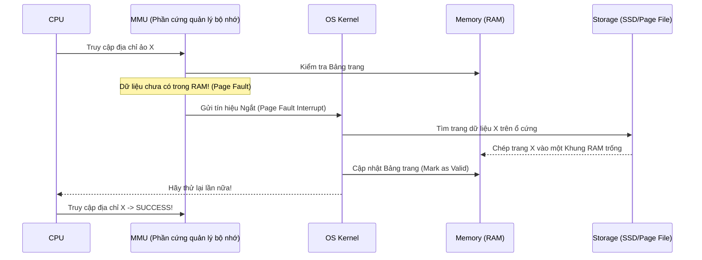

# 🪝 1. THE HOOK: Trò Đùa Của Những Con Số

Bạn đang sở hữu một chiếc máy tính đời mới với 8GB RAM. Bạn mở Chrome với 50 tab, mở thêm một bộ phim 4K dung lượng 10GB, và chạy cả một phần mềm thiết kế đồ họa nặng nề. Theo logic toán học đơn thuần, máy tính của bạn lẽ ra phải nổ tung hoặc báo lỗi "Out of Memory" ngay lập tức vì tổng dung lượng cần thiết vượt xa 8GB.

Nhưng không! Mọi thứ vẫn chạy, dù có thể hơi lag một chút. Máy tính đã làm cách nào để "nhồi nhét" 20GB dữ liệu vào một cái hộp chỉ chứa được 8GB? 

Câu trả lời nằm ở một trong những phát kiến vĩ đại nhất của khoa học máy tính: **(Virtual Memory)** (Bộ nhớ ảo). Hệ điều hành đã đóng vai một ảo thuật gia đại tài, đánh lừa cả bạn lẫn các ứng dụng rằng chúng đang có một không gian bộ nhớ vô tận, trong khi thực tế nó chỉ đang "vung tay múa chân" điều phối dữ liệu cực kỳ tinh vi giữa RAM và ổ cứng.

---

# 🎭 2. ANALOGY: Thư Viện Khổng Lồ Và Chiếc Bàn Đọc Nhỏ

Hãy tưởng tượng bạn là một học giả đang nghiên cứu tại một thư viện có hàng triệu cuốn sách (Dữ liệu trên ổ cứng/HDD/SSD), nhưng chiếc bàn làm việc của bạn (RAM) chỉ đủ chỗ cho đúng 5 cuốn sách mở cùng lúc.

1.  **Sách trên kệ**: Là toàn bộ dữ liệu của ứng dụng. Bạn không cần đọc hết 500 trang sách cùng một lúc, bạn chỉ cần đọc vài trang mà bạn đang xem.
2.  **Chiếc bàn đọc**: Chỉ những "trang sách" nào bạn đang thực sự đọc mới được thủ thư (Hệ điều hành) mang từ kệ lên bàn.
3.  **Paging (Phân trang)**: Thay vì bê nguyên một cuốn sách dày 1000 trang lên bàn, thủ thư chỉ xé nhỏ cuốn sách thành từng trang và mang đúng trang bạn cần lên.
4.  **Swapping (Hoán đổi)**: Khi bàn đã đầy mà bạn muốn đọc trang mới, thủ thư sẽ cất một trang bạn ít dùng nhất về kệ để lấy chỗ cho trang mới.

---

# 📝 10. MASTER PRACTICE: Câu Hỏi Ôn Luyện

**Câu 1: Mục đích chính của Bộ nhớ ảo (Virtual Memory) là gì?**
A. Biến ổ cứng thành RAM vĩnh viễn không bao giờ hỏng.
*Giải thích: Nó giúp mở rộng không gian địa chỉ ảo.
B. Cho phép chạy các chương trình lớn hơn dung lượng RAM vật lý thực tế.
C. Làm cho CPU chạy nhanh hơn.
D. Tăng tốc độ đường truyền internet.
*Đáp án: B.*

**Câu 2: "Page Fault" xảy ra khi nào?**
A. Khi ổ cứng bị hỏng.
B. Khi máy tính bị virus tấn công.
*Giải thích: Khi không tìm thấy trang trong RAM, hệ thống phải nạp từ đĩa.
C. Khi CPU truy cập một trang bộ nhớ mà trang đó hiện không nằm trong RAM.
D. Khi người dùng xóa một file quan trọng.
*Đáp án: C.*

**Câu 3: Bộ phận phần cứng nào chịu trách nhiệm chuyển đổi từ địa chỉ ảo sang địa chỉ vật lý?**
A. ALU
B. Bàn phím
*Giải thích: MMU là đơn vị quản lý bộ nhớ phần cứng.
C. MMU (Memory Management Unit)
D. Card màn hình
*Đáp án: C.*

**Câu 4: Hiện tượng "Thrashing" dẫn đến kết quả gì?**
A. Dung lượng ổ cứng tăng lên.
B. Mạng internet bị ngắt.
*Giải thích: Do Page Fault xảy ra quá dày đặc.
C. Hiệu suất hệ thống giảm thê thảm do mất quá nhiều thời gian cho việc hoán đổi trang (swapping) thay vì thực thi lệnh.
D. Máy tính chạy siêu nhanh.
*Đáp án: C.*

**Câu 5: Tại sao thuật toán LRU lại được ưu tiên hơn FIFO?**
A. Vì nó không tốn pin.
B. Vì nó được Apple phát minh.
*Giải thích: LRU tối ưu dựa trên tính cục bộ.
C. Vì nó dựa trên hành vi thực tế của chương trình: dữ liệu vừa dùng có khả năng cao sẽ dùng lại, dữ liệu lâu không dùng thì ít quan trọng hơn.
D. Vì nó dễ lập trình hơn.
*Đáp án: C.*

**Câu 6: Page Fault xảy ra khi nào?**
A. Khi địa chỉ ảo yêu cầu không có trong RAM.
B. Khi người dùng tắt máy.
C. Khi CPU bị quá nhiệt.
D. Khi RAM bị hỏng vật lý.
*Đáp án: A.*

---

# ⚙️ 3. UNDER THE HOOD: Cấu Trúc Phân Trang (Paging)

Trong kỳ thi **(FE)**, bạn cần hiểu rõ cơ chế chuyển đổi địa chỉ, vì đây là câu hỏi thường xuyên xuất hiện ở mức độ Specialist.

### 3.1 Địa chỉ ảo (Virtual Address) vs Địa chỉ vật lý (Physical Address)
-   **Virtual Address**: Là con số mà ứng dụng nhìn thấy. Ứng dụng luôn tưởng rằng mình được sở hữu bộ nhớ từ địa chỉ 0 đến vô cùng.
-   **Physical Address**: Là địa chỉ thực sự của ô nhớ trên thanh RAM.

### 3.2 Page và Frame
Hệ điều hành chia bộ nhớ thành các khối có kích thước bằng nhau (thường là 4KB).
-   **Page (Trang)**: Khối bộ nhớ trong không gian ảo.
-   **Frame (Khung trang)**: Khối bộ nhớ tương ứng trong RAM vật lý.

### 3.3 Page Table (Bảng trang)
Đây là cuốn "sổ tay" của Kernel dùng để ghi chép: "Trang số 5 của Chrome đang nằm ở Khung RAM số 102". Nếu Trang số 6 không nằm trong RAM, bảng trang sẽ đánh dấu là **(Invalid)**.

### 3.4 MMU & TLB - Những người vận chuyển siêu tốc
Việc tra cứu Bảng trang trong RAM mỗi khi truy cập dữ liệu sẽ làm hệ thống chậm đi 2 lần. Do đó, các kỹ sư Nhật đã tích hợp:
- **MMU (Memory Management Unit)**: Chip phần cứng chuyên dụng để dịch địa chỉ thần tốc.
- **TLB (Translation Lookaside Buffer)**: Một bộ đệm cực nhanh bên trong MMU, lưu trữ các bản dịch địa chỉ gần đây nhất. Nó giống như việc "nhớ mặt" khách quen thay vì phải kiểm tra CMND mỗi lần họ vào cửa.

### 3.5 Bảng trang đa cấp (Multi-level Page Table)
Để quản lý 4GB RAM với trang 4KB, ta cần bảng trang tới 1 triệu hàng (tốn 4MB RAM). Với máy tính 64-bit, con số này là khổng lồ. 
- **Giải pháp**: Chia bảng trang thành nhiều cấp (như mục lục sách). Chỉ những trang nào đang dùng mới được tạo bảng trang cấp dưới, giúp tiết kiệm bộ nhớ cực lớn cho hệ thống.

---

# 🗺️ 4. ARCHITECTURE & FLOW: Quy Trình Xử Lý Lỗi Trang (Page Fault)

Chuyện gì xảy ra khi CPU yêu cầu một dữ liệu mà nó chưa có trong RAM? Đó là hiện tượng **(Page Fault)**.



Mỗi lần Page Fault xảy ra, máy tính sẽ bị chậm lại đáng kể vì tốc độ ổ cứng rất thấp. Nếu Page Fault xảy ra liên tục (do RAM quá ít so với nhu cầu), máy tính sẽ rơi vào trạng thái "đứng hình" gọi là **(Thrashing)**.

---

# 💻 5. LOGIC & PSEUDO-CODE: Thuật Toán Thay Thế Trang (FIFO vs LRU)

Khi RAM đầy (tất cả các Frame đã bị chiếm), hệ điều hành buộc phải chọn một "nạn nhân" để đuổi về ổ cứng.

### 1. FIFO (First-In, First-Out)
Thằng nào vào RAM trước thì đi ra trước. 
-   **Nhược điểm**: Có thể đuổi nhầm một trang đang rất quan trọng chỉ vì nó lỡ vào sớm.

### 2. LRU (Least Recently Used)
Đuổi trang mà lâu nhất rồi không ai sờ tới. Đây là thuật toán thông minh nhất và được dùng rộng rãi.

```text
// Mã giả LRU đơn giản
FUNCTION ReplacePage(new_page)
    IF ram_full THEN
        victim_page = FIND_LEAST_RECENTLY_USED_PAGE()
        WRITE_BACK_TO_DISK(victim_page)
        REMOVE_FROM_RAM(victim_page)
    END IF
    LOAD_FROM_DISK(new_page)
    MARK_AS_USED_NOW(new_page)
ENDFUNCTION
```

**Tư duy Master**: Việc thiết kế thuật toán thay thế trang ảnh hưởng trực tiếp đến độ mượt mà của Windows hay macOS mà bạn đang dùng.

---

# 🎯 6. EXAM LOGIC: Tính Toán Địa Chỉ Trong Kỳ Thi FE

Đề thi thường yêu cầu bạn đổi từ Địa chỉ ảo sang Địa chỉ vật lý. Đừng hoảng sợ, hãy nhớ công thức:

**Virtual Address = (Page Number) + (Offset)**

1.  **Chuyển đổi địa chỉ ảo**: Đề thi thường yêu cầu bạn đổi từ Địa chỉ ảo sang Địa chỉ vật lý. Đừng hoảng sợ, hãy nhớ công thức: **Virtual Address = (Page Number) + (Offset)**.
2.  **Belady's Anomaly (Nghịch lý Belady)**: Đây là một cái "bẫy" cực kỳ phổ biến trong FE. Thông thường, tăng RAM (thêm Frame) sẽ giảm Page Fault. Nhưng với thuật toán **FIFO**, có những trường hợp tăng Frame lại làm tăng Page Fault! Thuật toán **LRU** không bao giờ bị lỗi này.
3.  **Thrashing**: Nguyên nhân là do mức độ đa chương (Multiprogramming) quá cao, mỗi tiến trình không có đủ số trang tối thiểu để hoạt động, dẫn đến việc CPU chỉ lo đi hoán đổi trang mà không tính toán được gì.

**Bẫy thường gặp**: Hãy để ý đơn vị K (Kilo), M (Mega), G (Giga). Luôn đổi về lũy thừa của 2 để tính cho nhanh. Ví dụ 1KB = 1024 bytes, không phải 1000.

---

# 💼 7. PROFESSIONAL CONTEXT: Từ Hệ Điều Hành Đến Bộ Nhớ Cache Của Web

Tư duy bộ nhớ ảo hiện hữu trong mọi ngóc ngách của công nghệ hiện đại:

1.  **V8 Engine (Node.js/Chrome)**: Quản lý bộ nhớ Heap của Javascript. Khi bạn tạo quá nhiều Object mà không xóa, bộ nhớ ảo sẽ phình to dẫn đến hiện tượng **(Memory Leak)** (Rò rỉ bộ nhớ).
2.  **Image Lazy Loading**: Web chỉ load ảnh khi bạn cuộn tới nó. Đây chính là "Paging" ở tầng giao diện. Đừng bê cả nghìn tấm ảnh lên "bàn đọc" của trình duyệt cùng lúc.
3.  **Docker & Virtualization**: Mỗi Container tưởng rằng mình có toàn bộ RAM, nhưng thực tế Linux Kernel đang dùng các kỹ thuật cgroup và namespace (anh em của Virtual Memory) để phân chia tài nguyên ảo mượt mà.

---

# 🎨 11. MASTER DEEP-DIVE: Page Replacement Algorithms in Depth

Hãy so sánh chi tiết:
-   **FIFO**: Tệ nhất, vì nó có thể đẩy trang "hot" ra ngoài chỉ vì nó vào trước (Nghịch lý Belady).
-   **LRU**: Tốt, nhưng tốn chi phí quản lý (cần Stack hoặc Counter).
-   **Clock Algorithm**: Bản rút gọn của LRU. Nó dùng 1 bit duy nhất để đánh dấu xem trang có được dùng gần đây không. Kim đồng hồ quay vòng, nếu thấy bit = 0 thì đẩy đi, nếu bit = 1 thì đổi thành 0 và bỏ qua.

---

# 💼 12. PROFESSIONAL CONTEXT: Vấn đề 4GB RAM trên Windows 32-bit

Nhiều người thắc mắc tại sao máy 4GB RAM 32-bit chỉ nhận được 3.2GB? Đó là vì 32-bit chỉ đánh địa chỉ được tối đa $2^{32} \approx 4.2$ tỷ byte. OS phải dành một phần địa chỉ này để giao tiếp với phần cứng (Video RAM, PCI Bus). Do đó, RAM thực tế còn lại cho ứng dụng bị thu hẹp. Đây là lý do thế giới phải chuyển sang 64-bit.

---