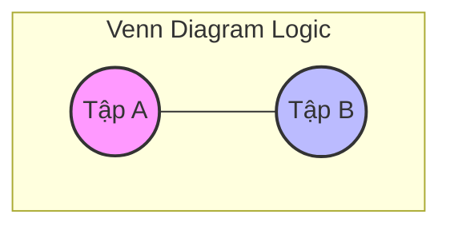

# 🪝 1. THE HOOK: Trò Chơi Sinh Tử Của Những Câu Lệnh IF

Hãy tưởng tượng bạn đang viết code cho một hệ thống điều khiển tàu điện ngầm tại Tokyo. 
`IF (Tàu đang chạy AND Cửa mở) THEN (Dừng khẩn cấp)`.

Nếu bạn viết sai logic: `IF (Tàu đang chạy OR Cửa mở)`, hệ thống sẽ dừng ngay cả khi cửa đóng nhưng tàu đang chạy, gây ra thảm họa giao thông. Sai lầm trong logic không chỉ dẫn đến "Bug" mà còn có thể trả giá bằng sinh mạng. Trong kỳ thi **FE** (基本情報), **Discrete Mathematics** (離散数学 - Risan Suugaku) [Toán rời rạc] chính là công cụ giúp bạn thiết kế những hệ thống "không thể sai" bằng cách mô hình hóa mọi thứ thành những mệnh đề logic rành mạch.

---

# 🎭 2. ANALOGY: Chiếc Công Tắc Và Bóng Đèn

Toán rời rạc trong IT giống như việc điều khiển các bóng đèn bằng hệ thống công tắc.
-   **Logic mệnh đề**: Là quy tắc bật/tắt. "Nếu công tắc A bật VÀ công tắc B bật thì đèn sáng".
-   **Tập hợp** (Sets): Là các nhóm đồ vật. "Nhóm các bóng đèn màu đỏ", "Nhóm các bóng đèn tiết kiệm điện".
-   **Xác suất/Tổ hợp**: Là việc tính toán xem có bao nhiêu cách lắp đặt hệ thống công tắc khác nhau.

Toán học thông thường (Toán liên tục) xử lý những thứ như "1.5 lít nước", nhưng IT chỉ xử lý những thứ "rời rạc": Có hoặc Không, 0 hoặc 1, Đúng hoặc Sai.

---

# ⚙️ 3. UNDER THE HOOD: Logic Mệnh Đề Và Bảng Chân Trị

Trong kỳ thi **FE**, bạn phải thuộc lòng các phép toán logic sau:

### 3.1 Các phép toán cơ bản (Logical Operations)
-   **AND** (論理積 - Ronri Seki): Chỉ Đúng khi cả hai cùng Đúng.
-   **OR** (論理和 - Ronri Wa): Đúng khi ít nhất một cái Đúng.
-   **NOT** (否定 - Hitei): Đảo ngược giá trị (Đúng thành Sai và ngược lại).
-   **XOR** (排他的論理和 - Haitateki Ronri Wa): Đúng khi hai cái KHÁC nhau. (Cực kỳ quan trọng trong mã hóa và checksum).

### 3.2 Cổng Logic vạn năng (NAND & NOR)
Trong sản xuất chip, người ta rất thích hai loại cổng này:
- **NAND** (NOT AND): Chỉ Sai khi cả hai cùng Đúng.
- **NOR** (NOT OR): Chỉ Đúng khi cả hai cùng Sai.
**Tư duy Master**: Bạn có thể tạo ra MỌI cổng logic khác (AND, OR, NOT) chỉ bằng cách kết hợp các cổng NAND. Đây là lý do tại sao bộ nhớ Flash được gọi là **NAND Flash**.

### 3.2 Bảng chân trị (Truth Table - 真理値表)
Đây là cách chúng ta liệt kê mọi trường hợp có thể xảy ra:

| P | Q | P AND Q | P OR Q | P XOR Q |
| :--- | :--- | :--- | :--- | :--- |
| 0 | 0 | 0 | 0 | 0 |
| 0 | 1 | 0 | 1 | 1 |
| 1 | 0 | 0 | 1 | 1 |
| 1 | 1 | 1 | 1 | 0 |

### 3.3 Định luật De Morgan (ド・モルガンの法則)
Một kiến thức "vàng" để rút gọn code:
-   `NOT (A AND B)` tương đương với `(NOT A) OR (NOT B)`
-   `NOT (A OR B)` tương đương với `(NOT A) AND (NOT B)`

---

# 🗺️ 4. ARCHITECTURE & FLOW: Sơ Đồ Venn (Venn Diagram)

Sơ đồ Venn giúp chúng ta trực quan hóa các **Tập hợp** (集合 - Shuugou).



-   **Giao** (Intersection - 積集合): Phần chung giữa A và B (Tương ứng phép AND). Symbol: $A \cap B$.
-   **Hợp** (Union - 和集合): Toàn bộ phần của A và B (Tương ứng phép OR). Symbol: $A \cup B$.
-   **Hiệu** (Difference - 差集合): Những phần thuộc A nhưng KHÔNG thuộc B. Symbol: $A \setminus B$.
-   **Phần bù** (Complement - 補集合): Những phần không thuộc tập hợp (Tương ứng phép NOT). Symbol: $\bar{A}$.
-   **Symmetric Difference** (Hiệu đối xứng): Những phần thuộc A hoặc B nhưng KHÔNG thuộc phần chung. (Chính là phép XOR trên tập hợp).

---

# 💻 5. LOGIC & PSEUDO-CODE: Tối Ưu Điều Kiện IF

Hiểu toán rời rạc giúp bạn viết code cực sạch. Hãy xem ví dụ tối ưu logic:

**Code cũ (Rối rắm):**
```javascript
if (!(age >= 18 && hasID === true)) {
    denyEntry();
}
```

**Code mới (Áp dụng De Morgan):**
```javascript
if (age < 18 || hasID === false) {
    denyEntry();
}
```
*Dễ đọc hơn, đúng không? Trình biên dịch và CPU cũng xử lý nhanh hơn khi điều kiện đơn giản.*

---

# 🎯 6. EXAM LOGIC: Bài toán xác suất & Đồ thị trong đề thi FE

### 6.1 Cơ bản về Lý thuyết Đồ thị (Graph Theory)
Trong tin học, đồ thị là cấu trúc dữ liệu mô phỏng các mối quan hệ (Mạng xã hội, Bản đồ Google Maps).
- **Đỉnh (Vertex)**: Nút chứa dữ liệu.
- **Cạnh (Edge)**: Đường nối giữa các đỉnh.
- **Bậc của đỉnh**: Số lượng cạnh nối vào đỉnh đó.

### 6.2 Bài toán xác suất thực tế (IPA Style)
Bạn sẽ gặp các câu hỏi như: "Xác suất để một hệ thống có 3 server hoạt động liên tục trong 1 năm là bao nhiêu, biết xác suất hỏng của 1 server là 0.01?".
**Lời giải**: 
- Xác suất 1 server KHÔNG hỏng: $1 - 0.01 = 0.99$.
- Xác suất cả 3 server KHÔNG hỏng: $0.99^3 \approx 0.97$.

---

# 🎨 7. MASTER DEEP-DIVE: Đại số Boole nâng cao

Hãy cùng khám phá các phép toán logic phức tạp hơn:
-   **NAND/NOR**: Đây được gọi là "Universal Gates" vì từ chúng, ta có thể tạo ra bất kỳ cổng logic nào khác (AND, OR, NOT). Trong sản xuất chip, việc chỉ dùng 1 loại cổng NAND giúp giảm chi phí cực lớn.
-   **Bản đồ Karnaugh (K-Map)**: Công cụ giúp rút gọn biểu thức logic một cách trực quan mà không cần dùng đến quá nhiều công thức đại số.

---

# 💼 8. PROFESSIONAL CONTEXT: Tại sao DEV giỏi cần giỏi Toán?

Toán rời rạc không dạy bạn cách gõ code nhanh hơn, nó dạy bạn cách **Tư duy Logic**. 
- Khi bạn thiết kế Database, bạn dùng Lý thuyết Tập hợp. 
- Khi bạn tối ưu hóa thuật toán tìm kiếm, bạn dùng Lý thuyết Đồ thị. 
- Khi bạn lập trình AI/Data Science, bạn dùng Xác suất Thống kê.

---

# ❓ 9. Q&A: GIẢI ĐÁP THẮC MẮC CHUYÊN SÂU (Math Edition)

**Hỏi: Tại sao toán học trong FE lại tập trung vào xác suất?**
*Trả lời*: Vì trong quản trị hệ thống (Performance Management), bạn cần tính toán **MTBF** (Mean Time Between Failures) và **MTTR** (Mean Time To Repair). Đây đều là các đại lượng xác suất giúp bạn dự đoán độ tin cậy của hệ thống.

**Hỏi: Tổ hợp (Combination) và Chỉnh hợp (Permutation) khác nhau thế nào?**
*Trả lời*: Chỉnh hợp QUAN TÂM ĐẾN THỨ TỰ (Ví dụ: Đặt mật khẩu). Tổ hợp KHÔNG QUAN TÂM THỨ TỰ (Ví dụ: Chọn 3 người vào 1 đội).

---

---

# 📝 10. MASTER PRACTICE: Câu Hỏi Ôn Luyện

**Câu 1: X と Y の排他的論理和 (XOR) が「1」になるのはどのような場合か？**
A. X と Y がともに 「0」 の場合
B. X と Y の値が異なる場合
C. X が 「1」 であれば Y の値に関わらず
*Giải thích: XOR trả về 1 khi hai đầu vào khác nhau.
D. X と Y がともに 「1」 の場合
*Đáp án: B.*

**Câu 2: ド・モルガンの法則に従い、 「NOT (A OR B)」 と等価な式はどれか？**
A. (NOT A) AND (NOT B)
B. NOT A
*Giải thích: Phủ định của Hợp là Giao của các Phủ định.
C. (NOT A) OR (NOT B)
D. A AND B
*Đáp án: A.*

**Câu 3: 集合 A = {1, 2, 3} と B = {3, 4, 5} の積集合 (Intersection) はどれか？**
A. {3}
B. 空集合
*Giải thích: Phần chung duy nhất là 3.
C. {1, 2, 4, 5}
D. {1, 2, 3, 4, 5}
*Đáp án: A.*

**Câu 4: Phép toán logic nào được dùng để đảo ngược trạng thái của một bit?**
A. AND
B. NOT
C. OR
D. XOR với 0
*Đáp án: B.*

**Câu 5: Biểu thức logic nào sau đây tương đương với `NOT (A AND B)`?**
A. `NOT A`
B. `A OR B`
C. `(NOT A) OR (NOT B)`
D. `(NOT A) AND (NOT B)`
*Đáp án: C.*

**Câu 6: Cho A = {1, 2, 3, 4} và B = {3, 4, 5, 6}. Tập hợp A - B (Hiệu) là?**
A. {1, 2}
B. {5, 6}
C. {3, 4}
D. {1, 2, 3, 4, 5, 6}
*Giải thích: Lấy các phần tử thuộc A nhưng không thuộc
*Đáp án: A.*

---

# 💼 7. PROFESSIONAL CONTEXT: Tại Sao SE Tại Nhật Cần Giỏi Toán?

Ở các tập đoàn lớn Nhật Bản, bạn sẽ gặp:
1.  **Thiết kế Database**: Phép JOIN trong SQL thực chất là các phép toán trên tập hợp (Intersection, Union). Nếu không hiểu toán, bạn sẽ viết những câu Query chạy mất 10 phút thay vì 1 giây.
2.  **Software Testing**: Để đảm bảo code không có bug, kỹ sư dùng kỹ thuật **Boundary Value Analysis** (Phân tích giá trị biên) dựa trên các tập hợp số rời rạc.
3.  **AI & Big Data**: Các thuật toán Machine Learning thực chất là sự kết hợp khổng lồ của xác suất và thống kê rời rạc.

---