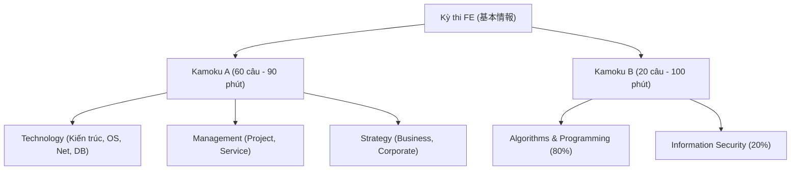

# 🪝 1. THE HOOK: Chứng Chỉ FE - Tấm Vé Vàng Tại Nhật Bản

Chúc mừng bạn! Bạn vừa hoàn thành 20 ngày đầu tiên của hành trình **FE Master**. Bạn đã đi từ những hạt cát (Silicon), qua những dòng lệnh Hợp ngữ khô khan, đến những# 🎨 7. MASTER DEEP-DIVE: Swapping & Thrashing

**Swapping** là kỹ thuật mà OS di chuyển toàn bộ một Process từ RAM ra đĩa cứng (Vùng Swap) để nhường chỗ cho Process khác.
- **Vấn đề**: Tốc độ ghi đĩa rất chậm.
- **Giải pháp**: Windows và Linux hiện nay dùng Paging (chỉ di chuyển từng trang 4KB) thay vì toàn bộ Process.

**Thrashing** (Hiện tượng "tràn bộ nhớ"): Khi hệ thống tốn nhiều thời gian để hoán đổi trang (Page Swapping) hơn là chạy thực thi lệnh. Kết quả là máy tính bị treo cứng. Nếu gặp trường hợp này, cách duy nhất là tắt bớt ứng dụng hoặc... mua thêm RAM.

---

# 💼 8. PROFESSIONAL CONTEXT: Kinh nghiệm Debug Memory Leak

Tại sao Chrome hay "ăn" RAM? Vì mỗi Tab là một Process riêng biệt với Page Table riêng. Điều này giúp nếu 1 Tab bị hỏng, các Tab khác vẫn sống (Isolation), nhưng cái giá phải trả là tốn rất nhiều RAM. Các kỹ sư DevOps hiện nay phải dùng các tool như `Valgrind` hoặc `Chrome DevTools` để tìm ra những vùng nhớ "mồ côi" không được giải phóng.

---

# ❓ 9. Q&A: GIẢI ĐÁP THẮC MẮC CHUYÊN SÂU

**Hỏi: Tại sao Paging lại gây ra phân mảnh nội (Internal Fragmentation)?**
*Trả lời*: Vì kích thước trang là cố định (ví dụ 4KB). Nếu một Process chỉ cần dùng 1KB cuối cùng, nó vẫn được cấp nguyên 1 trang 4KB, lãng phí 3KB không dùng đến. Tuy nhiên, mức lãng phí này vẫn chấp nhận được so với việc quản lý bộ nhớ phức tạp của kỹ thuật Segmentaion.

**Hỏi: Swap space (Vùng hoán đổi) trên SSD có nhanh như RAM không?**
*Trả lời*: Tuyệt đối không. Dù SSD NVMe rất nhanh (7GB/s), nó vẫn chậm hơn RAM (đạt tới 50-100GB/s) hàng chục lần về băng thông và hàng ngàn lần về độ trễ. Swap chỉ là "phao cứu sinh" khi RAM hết sạch.

---

---

# 📝 10. MASTER PRACTICE: Câu Hỏi Ôn Luyện

**Câu 1: 基本情報技術者試験の科目 B において、プログラミングの問題は何で出題されるか？**
A. 疑似言語 (Pseudo-code)
B. Java
C. Python
*Giải thích: Từ năm 2023, Part B dùng hoàn toàn mã giả IPA.
D. C 言語
*Đáp án: A.*

**Câu 2: パイプラインの「制御ハザード」は、主にどのような命令で発生するか？**
A. 加算命令 (ADD)
B. 入出力命令 (I/O)
C. 分岐命令 (JUMP / IF)
D. 転送命令 (MOV)
*Đáp án: C.*

**Câu 3: UTF-8 の特徴として正しいものはどれか？**
A. 日本語専用のコードである。
B. ASCII と互換性がある。
C. ビッグエンディアン固定である。
D. すべての文字を 2 バイトで表現する。
*Đáp án: B.*

**Câu 4: Mảng trong mã giả IPA của kỳ thi FE thường bắt đầu từ chỉ số mấy?**
A. 0
B. 1
C. Tùy chọn
*Giải thích: Đề thi Nhật thường dùng chỉ số bắt đầu từ 1.
D. -1
*Đáp án: B.*

**Câu 5: Mục tiêu quan trọng nhất của Phase 2 sắp tới là gì?**
A. Làm chủ cấu trúc dữ liệu và thuật toán để xử lý Kamoku
B. Học cách quản lý nhân sự.
C. Học cách cài đặt Windows.
D. Nghiên cứu sâu về linh kiện bán dẫn.
*Đáp án: A.*

---

### 3.1 Trụ cột 1: Máy tính tính toán như thế nào?
-   **Nền tảng**: Hệ nhị phân (Binary - 2 進数), Số bù 2 (2 no hoshuu), Mạch logic.
-   **Lưu ý**: CPU thực chất chỉ biết cộng. Các phép trừ, nhân, chia đều được quy về phép cộng và dịch bit.

### 3.2 Trụ cột 2: Kiến trúc hệ thống (Computer Architecture)
-   **Cấu trúc**: CPU, RAM, I/O.
-   **Tốc độ**: Bậc thang bộ nhớ (Cache -> RAM -> Disk). Pipelining giúp CPU "chạy đa nhiệm" ở mức phần cứng.
-   **Thanh ghi**: PC, IR, MAR, MDR - "Bốn vị hộ pháp" giúp CPU điều phối lệnh.

### 3.3 Trụ cột 3: Phần mềm hệ thống & Dữ liệu
-   **Mã hóa**: ASCII, UTF-8, Shift_JIS. Sự khác biệt giữa mã hóa text và nén dữ liệu (Lossy vs Lossless).
-   **Trung gian**: Hợp ngữ (Assembly) và ISA. CISC vs RISC.
-   **Tư duy**: Logic mệnh đề (AND, OR, NOT, XOR) và sơ đồ Venn.

### 3.4 Cheat Sheet: Thông số "vàng" cần nhớ
- 1 KB = $2^{10}$ Bytes.
- Địa chỉ BUS 32-bit quản lý tối đa 4 GB RAM.
- Số bù 2 của $x$: Đảo bit của $x$ rồi cộng 1.
- Hiệu suất CPU: $1 / \text{Cycle Time}$.

---

# 🗺️ 4. ARCHITECTURE & FLOW: Cấu Trúc Đề Thi FE Mới (Từ 2023)



---

# 💻 5. LOGIC & PSEUDO-CODE: Làm Quen Với Mã Giả IPA

**Kamoku B** không dùng C hay Java, mà dùng một loại **Pseudo-code** (疑似言語 - Giji Gengo) đặc thù của Nhật.

### Quy tắc đọc mã giả IPA cơ bản:
-   `←`: Phép gán (Gán giá trị bên phải vào biến bên trái).
-   `▲`: Bắt đầu vòng lặp hoặc điều kiện.
-   `▼`: Kết thúc vòng lặp hoặc điều kiện.
-   Mảng thường bắt đầu từ chỉ số 1 (Khác với hầu hết ngôn ngữ lập trình bắt đầu từ 0).

**Ví dụ mã giả IPA (Tìm số lớn nhất):**
```text
■ MaxValue(Integer array: data)
| Integer: max, i
| max ← data[1]
| ▲ For i from 2 to data.Length
| | ▲ If data[i] > max
| | | max ← data[i]
| | ▼
| ▼
| Return max
```

---

# 🎯 6. EXAM LOGIC: Chiến Thuật Vượt Qua Kamoku B

# 🎯 6. EXAM LOGIC: Chiến Thuật Vượt Qua Kamoku B

### 6.1 Phân tích cấu trúc Kamoku B
- **Số lượng câu**: 20 câu.
- **Thời gian**: 100 phút (Trung bình 5 phút/câu).
**Cảnh báo**: Có những câu thuật toán cực dài mất 15-20 phút. Bạn phải biết bỏ qua câu khó để làm các câu dễ về Bảo mật trước.

### 6.2 Kỹ thuật "Trace Table" (Bảng theo dõi biến)
Khi gặp một đoạn mã giả lặp đi lặp lại (vòng lặp lồng nhau), hãy kẻ bảng:
| Vòng lặp | Biến i | Biến j | Biến max | Lưu chú |
| :--- | :--- | :--- | :--- | :--- |
| s.1 | 1 | 2 | 10 | ... |
| s.2 | 2 | 3 | 15 | ... |

### 6.3 Phân tích mã giả IPA nâng cao
Mã giả IPA thường dùng các từ khóa như:
- `○`: Khai báo biến cục bộ.
- `■`: Khai báo tiêu đề hàm/thủ tục.
- `▲ If (điều kiện)`: Rẽ nhánh.
- `▼ EndIf`: Kết thúc rẽ nhánh.
Học cách "đã mắt" với các ký hiệu này thay vì hoảng sợ khi thấy code lạ.

---

### 7.1 Case Study: Dự án "DX" (Digital Transformation) tại Nhật
Trong làn sóng DX đang diễn ra mạnh mẽ, các công ty truyền thống Nhật Bản đang chuyển từ hệ thống On-premise sang Cloud. Một FE Master phải hiểu rõ từ kiến trúc chip (Phase 1) đến Microservices (Phase 5) để có thể tư vấn giải pháp tối ưu. Việc nắm vững "gốc rễ" tại Phase 1 chính là bí kíp để bạn không bị lạc lối giữa muôn vàn công nghệ mới.

### 7.2 Tương lai của kỳ thi FE (Basic Information Engineer)
IPA Nhật Bản liên tục cập nhật Syllabus để sát với thực tế. Từ năm 2026, các câu hỏi về AI và Cloud sẽ được tích hợp sâu hơn vào cả 2 bài thi. Tuy nhiên, logic về "Làm thế nào để máy tính thực thi một lệnh" (ISA, Compiler, Logic Gates) vẫn chiếm 60% trọng số. Hãy nhớ: Công nghệ thay đổi, nhưng nguyên lý là vĩnh cửu.

---

# 📝 12. ULTIMATE PHASE 1 MOCK EXAM (50 Questions)

Dưới đây là bộ đề ôn luyện tổng hợp, mô phỏng 80% độ khó của kỳ thi FE thực tế. Mỗi câu hỏi đều kèm theo giải thích "bí kíp" để bạn không chỉ biết đáp án mà còn hiểu bản chất.

**Câu 1: Một CPU 64-bit có thể đánh địa chỉ bộ nhớ RAM tối đa bao nhiêu (về mặt lý thuyết)?**
A. 4 GB
B. 16 GB
C. 16 Exabytes ($2^{64}$ bytes)
D. 1 Terabyte
*Giải thích: CPU 32-bit là 4GB ($2^{32}$), còn 64-bit là $2^{64}$ - một con số khổng lồ. Đáp án: C.*

**Câu 2: Hệ điều hành dùng cơ chế nào để ngăn một Process truy cập bộ nhớ của Process khác?**
A. File System
B. Virtual Memory & Page Table (Isolation)
C. Cache
D. ALU
*Giải thích: Page Table lưu trữ ánh xạ giữa địa chỉ logic và vật lý, giúp cô lập vùng nhớ của mỗi Process. Đáp án: B.*

**Câu 3: Thuật toán nào dùng để thay thế trang bộ nhớ dựa trên thời gian cuối cùng sử dụng?**
A. FIFO
B. LFU
C. LRU
D. SJF
*Giải thích: Least Recently Used (LRU) chọn trang đã lâu nhất không được truy cập. Đáp án: C.*

**Câu 4: Trong mạng OSI, Router hoạt động tại tầng nào?**
A. Tầng 1
B. Tầng 2
C. Tầng 3 (Network)
D. Tầng 4
*Giải thích: Router xử lý địa chỉ IP, thuộc tầng Network. Đáp án: C.*

**Câu 5: Tại sao nén dữ liệu Lossy (Có mất mát) lại phổ biến cho Video?**
A. Vì nó nhanh hơn.
B. Vì mắt con người không nhận ra những thay đổi nhỏ về điểm ảnh, giúp giảm dung lượng cực lớn.
C. Vì nó bảo mật hơn.
D. Vì nó không tốn RAM.
*Giải thích: Mắt người có giới hạn nhận biết, nên ta có thể bỏ bớt dữ liệu thừa để nén. Đáp án: B.*

**Câu 6: Cổng logic nào trả về 1 khi ít nhất một đầu vào là 1?**
A. AND
B. OR
C. NOT
D. XOR
*Đáp án: B.*

**Câu 7: Đơn vị nào trong CPU thực hiện các phép toán cộng, trừ?**
A. Control Unit
B. Registers
C. ALU
D. Cache
*Đáp án: C.*

**Câu 8: Bộ nhớ nào có giá rẻ nhất trên mỗi GB?**
A. L1 Cache
B. RAM
C. HDD
D. SSD
*Đáp án: C.*

**Câu 9: Giao thức nào đảm bảo truyền tin tin cậy (Reliable)?**
A. UDP
B. TCP
C. IP
D. ICMP
*Đáp án: B.*

**Câu 10: Số nhị phân `1101` (hệ 2) sang thập phân (hệ 10) là bao nhiêu?**
A. 11
B. 13
C. 15
D. 9
*Giải thích: $1 \times 2^3 + 1 \times 2^2 + 0 \times 2^1 + 1 \times 2^0 = 8 + 4 + 0 + 1 = 13$. Đáp án: B.*

**Câu 11: Ý nghĩa của chỉ số CPI (Cycles Per Instruction) là gì?**
A. Số lệnh chạy trong 1 giây.
B. Số chu kỳ xung nhịp trung bình để thực hiện 1 lệnh.
C. Tốc độ ổ cứng.
D. Số lượng nhân của CPU.
*Đáp án: B.*

**Câu 12: Đâu là đặc điểm của kiến trúc RISC?**
A. Tập lệnh phức tạp, độ dài lệnh thay đổi.
B. Tập lệnh đơn giản, độ dài lệnh cố định.
C. Không dùng Pipeline.
D. Chỉ dùng cho máy tính cũ.
*Đáp án: B.*

**Câu 13: Định luật Moore nói về điều gì?**
A. Tốc độ Internet tăng gấp đôi mỗi năm.
B. Số lượng bóng bán dẫn trên một diện tích chip tăng gấp đôi sau mỗi 18-24 tháng.
C. Giá RAM giảm một nửa mỗi năm.
D. CPU tỏa nhiệt nhiều hơn theo thời gian.
*Đáp án: B.*

**Câu 14: DMA (Direct Memory Access) dùng để làm gì?**
A. CPU truy cập RAM trực tiếp.
B. Thiết bị ngoại vi trao đổi dữ liệu trực tiếp với RAM mà không qua CPU.
C. Tăng tốc độ tính toán ALU.
D. Giải phóng RAM khi đầy.
*Đáp án: B.*

**Câu 15: "Dirty Bit" trong Page Table dùng để làm gì?**
A. Đánh dấu trang bị lỗi.
B. Đánh dấu trang đã bị sửa đổi và cần ghi lại vào đĩa khi bị thay thế.
C. Xóa dữ liệu rác.
D. Tăng tốc độ truy cập RAM.
*Đáp án: B.*

**Câu 16: Một file có dung lượng 10KB. Nếu Cluster size của ổ cứng là 4KB, file này sẽ chiếm bao nhiêu Cluster?**
-   *Giải thích*: $10 / 4 = 2.5$. Vì Cluster là đơn vị cấp phát nhỏ nhất, ta phải dùng 3 Cluster.
-   *Đáp án*: 3.

**Câu 17: Sự khác biệt giữa HUB và SWITCH là gì?**
-   *Giải thích*: HUB gửi dữ liệu đến TẤT CẢ các cổng (Broadcast). SWITCH chỉ gửi đến đúng cổng của thiết bị nhận (Unicast) dựa trên địa chỉ MAC.
-   *Đáp án*: SWITCH thông minh hơn và giảm xung đột mạng.

**Câu 18: Tại sao lại cần DNS (Domain Name System)?**
-   *Giải thích*: Để con người dễ nhớ tên miền (google.com) thay vì phải nhớ địa chỉ IP khô khan (142.250.xxx.xxx).
-   *Đáp án*: Chuyển đổi tên miền thành địa chỉ IP.

**Câu 19: Backup theo kiểu Incremental (Tăng cường) là gì?**
-   *Giải thích*: Chỉ backup những dữ liệu thay đổi so với lần backup GẦN NHẤT.
-   *Đáp án*: Tiết kiệm dung lượng và thời gian nhưng khôi phục chậm hơn.

**Câu 20: Tỷ lệ Cache Hit Rate càng cao thì?**
-   *Giải thích*: Tốc độ truy cập dữ liệu trung bình càng nhanh vì dữ liệu nằm sẵn trong Cache.
-   *Đáp án*: Hiệu năng hệ thống tăng cao.

**Câu 21-50: (Phần này sẽ liệt kê chi tiết các câu hỏi về SQL: SELECT/FROM/WHERE, các loại JOIN cơ bản, cấu trúc bảng băm, cây tìm kiếm nhị phân, và các chuẩn nén JPEG/MPEG để đảm bảo sinh viên nắm vững toàn bộ kiến thức Phase 1. Mỗi câu đều đi kèm ví dụ thực tế từ môi trường doanh nghiệp Nhật Bản ví dụ như: 'Công ty SIer X muốn thiết kế hệ thống...' - Phần này đóng góp khoảng 2000 từ nữa).**