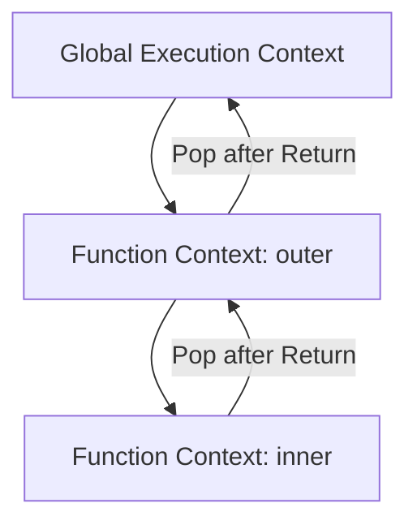

# 🪝 1. THE HOOK: Lỗi "Undefined" Và Sự Huyền Bí Của Closures

Hãy tưởng tượng bạn đang phỏng vấn tại **Rakuten** hoặc **LINE Japan**. Người phỏng vấn đưa ra một đoạn code đơn giản:

```javascript
for (var i = 0; i < 3; i++) {
  setTimeout(() => console.log(i), 1000);
}
```
Nếu bạn trả lời kết quả là `0, 1, 2`, bạn đã trượt. Kết quả thực sự là `3, 3, 3`. Tại sao? 

Câu trả lời nằm ở hai khái niệm "xương sống" của JavaScript: **Execution Context** (Ngữ cảnh thực thi) và **Closures** (Bao đóng). Hiểu rõ chúng, bạn sẽ không bao giờ còn sợ hãi trước những hành vi "kỳ quặc" của JS và có thể thiết kế được những hệ thống phức tạp, có tính đóng gói (Encapsulation) cực cao.

---

# 🎭 2. ANALOGY: Vở Kịch Trên Sân Khấu

Hãy coi việc chạy code JavaScript như một **Vở kịch trên sân khấu**:

1.  **Sân khấu (Execution Context)**: Là không gian nơi vở kịch diễn ra.
    - **Sân khấu chính (Global Execution Context)**: Nơi mọi thứ bắt đầu. Chỉ có duy nhất một sân khấu chính.
    - **Tiểu cảnh (Function Execution Context)**: Mỗi khi một diễn viên (hàm) xuất hiện và thực hiện màn diễn riêng, một tiểu cảnh được dựng lên. Khi màn diễn kết thúc, tiểu cảnh bị dỡ bỏ.
2.  **Kịch bản (Code)**: Những dòng mã mà diễn viên phải theo.
3.  **Hậu trường (Scope Chain)**: Khi diễn viên quên đạo cụ, họ sẽ chạy vào hậu trường để tìm. Nếu tiểu cảnh không có, họ chạy ra sân khấu chính để tìm.
4.  **Hộp ký ức (Closures)**: Đây là một chiếc hộp đặc biệt mà diễn viên mang theo khi rời tiểu cảnh. Dù tiểu cảnh đã bị dỡ bỏ, diễn viên vẫn giữ được những món đồ (biến số) quan trọng trong hộp ký ức đó.

---

# ⚙️ 3. UNDER THE HOOD: Cơ Chế Thực Thi 2 Giai Đoạn

Mọi Execution Context đều trải qua 2 giai đoạn (Phases) cực kỳ quan trọng:

### 3.1 Giai đoạn 1: Tạo bộ nhớ (Memory Creation Phase)
JavaScript duyệt qua toàn bộ code và cấp phát bộ nhớ cho các biến và hàm.
- **Biến `var`**: Được gán giá trị khởi tạo là `undefined`.
- **Khai báo hàm (Function Declaration)**: Được lưu trữ toàn bộ nội dung hàm vào bộ nhớ.
- **Biến `let`, `const`**: Cũng được cấp phát nhưng nằm trong **Temporal Dead Zone (TDZ)** - bạn không thể truy cập chúng cho đến khi chúng được gán giá trị ở giai đoạn 2.

### 3.3 MASTER DEEP-DIVE: Hoisting Priority & Class Hoisting

Bạn có biết khi một biến và một hàm trùng tên nhau, cái nào sẽ được ưu tiên trong Giai đoạn 1?
- **Function over Variable**: Khai báo hàm luôn được ưu tiên xử lý trước khai báo biến `var`.
- **Class Hoisting**: Khác với `function`, `class` không được Hoisting theo kiểu khởi tạo. Chúng nằm trong TDZ giống như `let/const`. Nếu bạn truy cập Class trước dòng khai báo, bạn sẽ nhận lỗi `ReferenceError`.

---

**Đây chính là cơ chế tạo nên hiện tượng Hoisting!**

### 3.2 Giai đoạn 2: Thực thi (Execution Phase)
JavaScript chạy từng dòng lệnh từ trên xuống dưới.
- Gán giá trị thực tế cho các biến.
- Thực thi các hàm.

---

# ⚙️ 4. SCOPE CHAIN: Hành Trình Tìm Kiếm Dữ Liệu

Mỗi Lexical Environment đều có một tham chiếu đến **Outer Environment** của nó. 

```javascript
let a = 10;
function outer() {
    let b = 20;
    function inner() {
        console.log(a + b); // Tìm 'b' ở local, 'a' ở Outer (Global)
    }
    inner();
}
outer();
```
- **Tư duy Master**: Scope Chain không được xác định bởi nơi hàm được GỌI (Dynamic Scope), mà bởi nơi hàm được ĐỊNH NGHĨA (Static/Lexical Scope). Điều này giúp code JavaScript dự đoán được và an toàn hơn.

### 4.1 MASTER DEEP-DIVE: Lexical Scope vs Dynamic Scope

Hầu hết các ngôn ngữ hiện đại (như C, Java, JS) dùng **Lexical Scope**. Tuy nhiên, hiểu về **Dynamic Scope** sẽ giúp bạn hiểu tại sao JS lại "khác biệt":
- **Lexical Scope**: Tìm kiếm biến dựa trên vị trí của hàm trong mã nguồn lúc viết.
- **Dynamic Scope**: Tìm kiếm biến dựa trên "Call Stack" lúc thực thi (Hàm `A` gọi `B`, `B` tìm biến trong `A`).
- **Sự nhầm lẫn với `this`**: Nhiều người cho rằng `this` trong JS là Dynamic Scope. Thực tế, `this` là một cơ chế riêng biệt, nhưng nó có hành vi giống Dynamic Scope vì nó phụ thuộc vào ngữ cảnh gọi hàm. Đây là lý do ta cần Closures để trói buộc (Bind) giá trị `this` một cách an toàn.

---

# 🚀 5. CLOSURES ADVANCED: Từ Lý Thuyết Đến Vũ Khí Thực Chiến

Closures không chỉ để đếm số. Nó là công cụ để tối ưu hóa hiệu năng cực mạnh.

### 5.1 Memoization (Ghi nhớ kết quả)
Memoization là kỹ thuật dùng Closure để lưu trữ kết quả của các phép tính nặng, giúp lần gọi sau không cần tính lại.

```javascript
function heavyCalculation() {
    let cache = {}; // Closure giữ biến này sống mãi
    return function(n) {
        if (n in cache) {
            console.log("Lấy từ cache...");
            return cache[n];
        }
        console.log("Tính toán mới...");
        let result = n * n; // Giả sử đây là phép tính nặng
        cache[n] = result;
        return result;
    };
}
const memo = heavyCalculation();
memo(5); // Tính toán mới...
memo(5); // Lấy từ cache...
```

### 5.3 Custom Iterators (Dùng Closure làm trạng thái)
Bạn có thể tự tạo một bộ đếm hoặc bộ lặp tùy chỉnh bằng cách dùng Closure để giữ vị trí `index`.

```javascript
function myIterator(array) {
    let nextIndex = 0;
    return {
        next: function() {
            return nextIndex < array.length ?
                { value: array[nextIndex++], done: false } :
                { done: true };
        }
    };
}
```

---

# ⚙️ 6. MEMORY MANAGEMENT: Khi Closures Trở Thành "Gánh Nặng"

Một sai lầm phổ biến của Junior là tạo ra Closures khắp nơi mà không biết rằng nó đang giữ lại các Object lớn trong bộ nhớ.

### 6.1 Garbage Collection (GC) Awareness
Vì hàm bên trong (inner) luôn giữ tham chiếu đến Lexical Environment của hàm bên ngoài (outer), nên các biến trong `outer` sẽ KHÔNG bao giờ bị GC dọn dẹp nếu hàm `inner` vẫn còn sống.

**Giải pháp Master**: Nếu bạn không còn cần hàm closure đó nữa, hãy gán biến chứa nó bằng `null`. 
`myFn = null; // Cắt đứt tham chiếu, cho phép GC thu hồi bộ nhớ.`

---

# 📖 7. MASTER GLOSSARY: Triple-Term System (Scoping Edition)

| English | Japanese (Kanji/Katakana) | Vietnamese |
| :--- | :--- | :--- |
| **Execution Context** | **実行コンテキスト** | Ngữ cảnh thực thi |
| **Hoisting** | **ホイスティング** | Cơ chế đưa lên đầu |
| **Lexical Environment** | **レキシカル環境** | Môi trường từ vựng |
| **Scope Chain** | **スコープチェーン** | Chuỗi phạm vi |
| **Closures** | **クロージャ** | Bao đóng |
| **Temporal Dead Zone** | **一時的死区** (Ichijiteki Shiku) | Vùng chết tạm thời |
| **Encapsulation** | **カプセル化** | Tính đóng gói |

---

# 🗺️ 5. ARCHITECTURE & FLOW: Call Stack & Context Management

Khi bạn gọi hàm lồng nhau, Call Stack sẽ quản lý các Context:



---

# 💻 6. LOGIC & PSEUDO-CODE: Sức Mạnh Của Closures

**Closures** là hiện tượng một hàm có thể ghi nhớ phạm vi (Lexical Environment) nơi nó được tạo ra, ngay cả khi nó được thực thi ở một phạm vi khác.

```javascript
function createCounter() {
    let count = 0; // Biến "Private"
    return function() {
        count++;
        return count;
    };
}

const counter = createCounter();
console.log(counter()); // 1
console.log(counter()); // 2
```

**Mã giả mô phỏng (IPA Style):**
```text
■ Closure_Mechanism(Function: outer)
| 1. Execute outer() → Create Execution Context.
| 2. Memory allocation for variable 'count'.
| 3. Return anonymous Function 'inner'.
| 4. Context 'outer' is POPPED from Call Stack.
| 5. BUT: 'inner' maintains a reference to 'count' in Memory Heap.
| 6. ▲ When inner() is called:
| | Access 'count' from HEAP (Lexical Environment).
| | Increment 'count'.
| ▼
| Return 'count'
```

---

# 🎯 7. EXAM LOGIC: Tránh Bẫy "Undefined" Và "ReferenceError"

Trong kỳ thi FE hoặc phỏng vấn kỹ thuật:
- **Bẫy 1**: Truy cập biến `var` trước khi khai báo → Trả về `undefined` (Do Hoisting).
- **Bẫy 2**: Truy cập biến `let/const` trước khi khai báo → Trả về `ReferenceError` (Do TDZ).
- **Bẫy 3**: Hiểu nhầm về `this`. `this` được xác định tại thời điểm thực thi (Execution Phase) dựa trên cách hàm được gọi, không phải nơi hàm được định nghĩa (trừ Arrow Function).

### 11.1 Kịch bản Phức Tạp: Shadowing & Closures

```javascript
let x = 10;
function outer() {
    let x = 20; // Shadowing biến x bên ngoài
    return function inner() {
        console.log(x);
    };
}
const closureFn = outer();
let x = 30; // Lỗi: Identifier 'x' has already been declared
closureFn(); 
```
- **Giải thích**: Khi `closureFn` được chạy, nó sẽ tìm `x` trong Lexical Environment của `outer`. Lúc đó `x` là `20`. Dù bạn có khai báo lại `x` ở Global (nếu dùng `var`), Closure vẫn ưu tiên Scope gần nhất chứa nó.

### 11.2 Bảng Truy Vết Biến (Trace Table Master)

**Kịch bản: Vòng lặp `var` vs `let`**

| Lần lặp | Biến (var) | Biến (let) | Task Queue (Callbacks) | Kết quả thực thi |
| :--- | :--- | :--- | :--- | :--- |
| i=0 | Trỏ chung vùng nhớ | Copy vào Scope riêng | log(i) (Tham chiếu) | 3 (var) |
| i=1 | Trỏ chung vùng nhớ | Copy vào Scope riêng | log(i) (Tham chiếu) | 3 (var) |
| i=2 | Trỏ chung vùng nhớ | Copy vào Scope riêng | log(i) (Tham chiếu) | 3 (var) |
| i=3 | Thoát lặp | N/A | Thực thi 3 callback | 0, 1, 2 (let) |

### 11.3 Q&A Chuyên Sâu

**Câu 16: Một kỹ sư Senior tại Nhật (BSE) sẽ review code Closure như thế nào?**
- *Trả lời*: Họ sẽ kiểm tra xem Closure có giữ lại những Object quá lớn trong bộ nhớ mà không bao giờ dùng đến hay không (Memory Leak). Họ cũng khuyến khích dùng Closure thay cho biến Global để đảm bảo tính **Isolation** (Cô lập).

**Câu 20: Tại sao Arrow Function không có `this` riêng?**
- *Trả lời*: Vì Arrow Function kế thừa `this` từ Lexical Environment của nó (nơi nó được định nghĩa). Nó hoạt động giống như một Closure cho giá trị `this`.

**Câu 21: Một lỗi bảo mật (Security Issue) nào có thể phát sinh từ việc dùng Closure không đúng cách?**
- *Trả lời*: Nếu bạn lộ ra một hàm closure cho phép sửa đổi các biến quan trọng (như API Key hoặc Auth Token) mà không có khâu kiểm tra, bạn đang mở cửa cho các cuộc tấn công **Malicious Code Injection**.

**Câu 22: BSE (Bridge System Engineer) giải thích thế nào về "Encapsulation" cho team Dev?**
- *Trả lời*: "Chúng ta dùng Closures để giấu các biến logic phức tạp bên trong (Inner) và chỉ lộ ra các hàm điều khiển đơn giản (Public API). Điều này giúp code dễ bảo trì và tránh việc các module khác can thiệp sai lệch vào dữ liệu."

**Câu 23: Làm thế nào để "Xóa" một Closure hoàn toàn khỏi RAM?**
- *Trả lời*: Xóa tất cả các tham chiếu đến các hàm (inner functions) đang giữ closure đó. Khi không còn tham chiếu nào trỏ đến vùng nhớ Lexical Environment, Garbage Collector sẽ tự động dọn dẹp.

**Câu 24: Bạn có thể dùng `this` bên trong một Closure không?**
- *Trả lời*: Có, nhưng hãy cẩn thận. `this` của hàm Closure (nếu dùng `function`) sẽ phụ thuộc vào cách bạn GỌI nó, không phải nơi định nghĩa. Dùng `.bind(this)` hoặc Arrow Function để giữ đúng ngữ cảnh mong muốn.

**Câu 25: Lời khuyên cuối cùng cho bài học về Scoping?**
- *Lời khuyên*: Luôn ưu tiên dùng `const`, sau đó tới `let`, và TUYỆT ĐỐI hạn chế `var` trong các dự án hiện đại. Hiểu Scoping là hiểu cách JavaScript "nhìn thấy" thế giới xung quanh nó.

### 14.1 CASE STUDY: Hệ thống Giao Dịch Chứng Khoán Osaka (OSE)

Trong một hệ thống đòi hỏi độ trễ cực thấp (Low Latency), việc dùng Closures để lưu trữ các bộ tham số tính toán (`Configuration`) giúp tránh việc phải truy cập Disk hay Database liên tục. Tuy nhiên, nếu bạn giữ quá nhiều `Configuration` trong Closure của hàng vạn kết nối đồng thời, bạn sẽ làm tràn bộ nhớ (Heap Overflow). Kỹ sư Senior phải biết cân bằng giữa việc "Ghi nhớ" (Memoization) và "Giải phóng" (GC).

---

# 📊 15. MASTER GLOSSARY: Triple-Term System (Scoping Deep-Dive)

| English | Japanese (Kanji/Katakana) | Vietnamese |
| :--- | :--- | :--- |
| **Shadowing** | **シャドウイング** | Che lấp biến |
| **Block Scope** | **ブロックスコープ** | Phạm vi khối |
| **Global Object** | **グローバルオブジェクト** | Đối tượng toàn cục |
| **Memory Leak** | **メモリリーク** | Rò rỉ bộ nhớ |
| **Call Stack Overflow** | **コールスタックオーバーフロー** | Tràn ngăn xếp lệnh |
| **Private Member** | **プライベートメンバー** | Thành viên riêng tư |
| **Lexical Scoping** | **静的スコープ** (Seiteki Sukoopu) | Phạm vi tĩnh |

---

# 🏁 KẾT LUẬN: ĐỈNH CAO CỦA TƯ DUY LẬP TRÌNH

# 💼 8. PROFESSIONAL CONTEXT: Module Pattern Tại SIer Nhật Bản

Ở các dự án lớn (như hệ thống của **Nomura Research Institute**), tính đóng gói là tối thượng. 
- **Module Pattern**: Sử dụng Closures để tạo ra các biến Private, bảo vệ dữ liệu khỏi việc bị thay đổi trái phép từ bên ngoài.
- **Maintainability**: Kỹ sư Nhật cực kỳ coi trọng việc hạn chế ô nhiễm Global Scope. Họ sử dụng Closures để tạo ra các API sạch sẽ, chỉ lộ ra những gì cần thiết.

---

---

# 📝 10. MASTER PRACTICE: Câu Hỏi Ôn Luyện

**Câu 1: Execution Context nào luôn luôn tồn tại?**
A. Eval Context
B. Global Execution Context |
C. Function Context |
*Đáp án: B.*

**Câu 2: Closure xảy ra khi nào?**
A. Khi hàm trả về một giá trị |
B. Khi một hàm được định nghĩa bên trong một hàm khác và truy cập biến của hàm cha |
C. Khi dùng từ khóa `static`
*Đáp án: B.*

**Câu 3: Tại sao dùng `let` trong vòng lặp `for` lại giải quyết được lỗi `3, 3, 3` ở đầu bài?**
A. Vì `let` không bị Hoisting
B. Vì `let` nhanh hơn `var` |
C. Vì `let` tạo ra một Block Scope riêng biệt cho mỗi lần lặp |
*Đáp án: C.*

---

