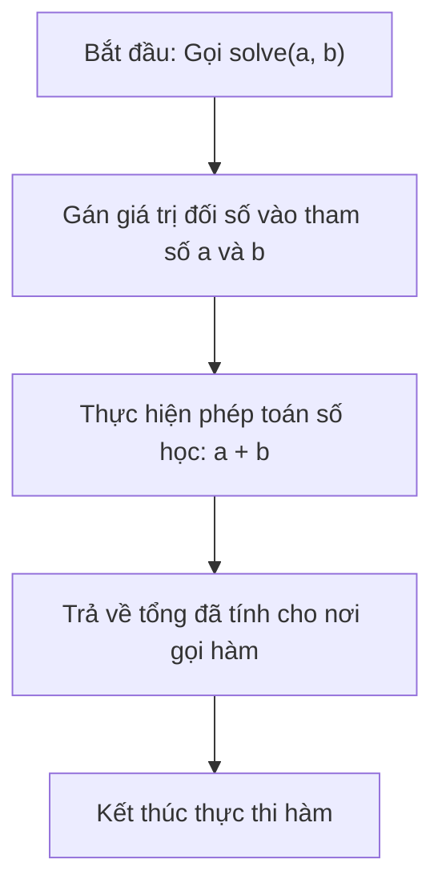
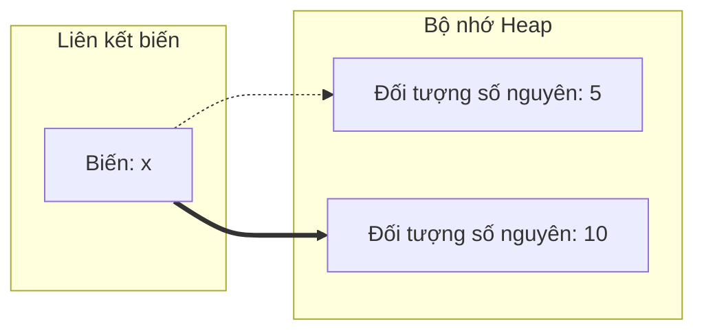

# Day 1: Giới thiệu Python & Phép toán Cơ bản

Chào mừng bạn đến với khóa học **Python, Học máy & Học sâu**! Lộ trình học tập này được thiết kế để đưa bạn đi từ một người mới bắt đầu lập trình đến hiểu rõ và xây dựng các mô hình Học máy & Học sâu tiên tiến hoàn toàn ngay trên trình duyệt của bạn.

---

### 🎯 Mục tiêu học tập
Sau khi kết thúc bài học này, bạn sẽ có thể:
- Giải thích lý do tại sao Python là ngôn ngữ được ưa chuộng nhất cho lập trình tổng quát, khoa học dữ liệu và AI.
- Khai báo biến và hiểu cơ chế gán kiểu động (dynamic typing) của Python.
- Thực hiện các phép toán số học cơ bản bằng các toán tử của Python.
- Viết và gọi một hàm Python đơn giản nhận đối số và trả về kết quả.

---

### 🧩 Khái niệm cốt lõi (Tại sao)
#### 1. Tại sao lại là Python?
Python là một ngôn ngữ lập trình bậc cao, thông dịch, nổi tiếng với sự rõ ràng và cú pháp đơn giản. Thay vì phải viết những đoạn mã khai báo dài dòng phức tạp, Python cho phép lập trình viên thể hiện các khái niệm với ít dòng mã hơn so với C++ hoặc Java. Trong lĩnh vực khoa học dữ liệu và AI, Python là tiêu chuẩn tuyệt đối nhờ hệ sinh thái thư viện mạnh mẽ (NumPy, Scikit-Learn, PyTorch, v.v.).

#### 2. Biến: Vùng nhớ tạm thời
Một **biến (variable)** là một vùng nhớ được đặt tên trong bộ nhớ máy tính dùng để lưu trữ dữ liệu. Trong Python, các biến được tạo ra ngay khi bạn gán giá trị cho chúng bằng toán tử gán (`=`). Python sử dụng cơ chế **gán kiểu động (dynamic typing)**, nghĩa là bạn không cần chỉ định trước kiểu dữ liệu của biến (như `int` hay `float`); trình thông dịch sẽ tự động nhận diện tại thời điểm chạy (runtime).

#### 3. Hàm: Khối mã tái sử dụng
Một **hàm (function)** là một khối mã lệnh có cấu trúc, được tổ chức để thực hiện một hành động cụ thể và có khả năng tái sử dụng. Hàm giúp chương trình của bạn có tính mô-đun cao hơn và giúp tái sử dụng mã nguồn một cách tối đa.

---

### 🔁 Logic và hoạt động
Khi bạn định nghĩa một hàm như `solve(a, b)` để cộng hai số, luồng điều khiển hoạt động như sau:



Quy trình này đảm bảo rằng các giá trị đầu vào được nhận, được xử lý toán học và kết quả được đưa lại cho nơi đã gọi hàm.

---

### 📝 Ví dụ minh họa có chú thích
Dưới đây là một đoạn mã Python minh họa cách khai báo biến, các toán tử số học và định nghĩa một hàm đơn giản.

```python
# --- Biến và Phép gán ---
x = 15  # Gán số nguyên 15 cho biến x
y = 4.0  # Gán số thực 4.0 cho biến y

# --- Các toán tử số học ---
addition = x + y          # 19.0 (số nguyên + số thực sẽ trả về số thực)
subtraction = x - y       # 11.0
multiplication = x * y    # 60.0
division = x / y          # 3.75 (luôn trả về kết quả phép chia dưới dạng số thực)
floor_division = x // y   # 3.0 (phép chia lấy phần nguyên, làm tròn xuống số nguyên gần nhất)
modulo = x % y            # 3.0 (chia lấy số dư)
exponentiation = x ** 2   # 225 (lũy thừa: x mũ 2)

# --- Định nghĩa hàm ---
def calculate_area(width, height):
    """
    Tính diện tích hình chữ nhật.
    Docstring này giải thích mục đích của hàm.
    """
    area = width * height  # Phép tính trung gian lưu vào biến cục bộ
    return area           # Thoát khỏi hàm và trả về kết quả

# Gọi hàm và lưu kết quả trả về
result = calculate_area(5, 10)
print(result)  # Đầu ra: 50
```

---

### ❌ Các lỗi thường gặp
#### Lỗi 1: Thụt lề không chính xác (IndentationError)
```python
def solve(a, b):
# Thiếu thụt lề ở dòng bên dưới
return a + b
```
```text
IndentationError: expected an indented block after function definition on line 1
```
```python
def solve(a, b):
    return a + b  # Thụt lề vào 4 khoảng trắng
```
> Python sử dụng khoảng trắng thụt lề (thay vì cặp ngoặc nhọn `{}`) để xác định ranh giới khối mã, thiếu thụt lề sẽ dẫn đến lỗi cú pháp IndentationError.

#### Lỗi 2: Cộng/trừ các kiểu dữ liệu không tương thích (TypeError)
```python
x = "5"
y = 3
result = x + y
```
```text
TypeError: can only concatenate str (not "int") to str
```
```python
# Chuyển đổi chuỗi thành số nguyên trước (Ép kiểu)
result = int(x) + y  # result sẽ là 8
```
> Python là ngôn ngữ định kiểu mạnh (strongly typed), nó không tự động thực hiện phép toán trên các kiểu dữ liệu không tương thích như chuỗi chữ và số nguyên mà cần thực hiện ép kiểu tường minh.

#### Lỗi 3: Chia cho số không (ZeroDivisionError)
```python
result = 10 / 0
```
```text
ZeroDivisionError: division by zero
```
```python
# Kiểm tra số chia trước khi thực hiện phép chia
divisor = 0
result = 10 / divisor if divisor != 0 else 0
```
> Phép chia cho số 0 là không xác định trong toán học và sẽ làm chương trình bị dừng đột ngột. Hãy luôn kiểm tra số chia trước khi thực hiện phép chia.

---

### 💡 Mẹo & Cách viết tối ưu
- **Gán giá trị cho nhiều biến đồng thời:** Bạn có thể gán giá trị cho nhiều biến trên cùng một dòng:
  ```python
  a, b, c = 1, 2, 3
  ```
- **Toán tử gán kết hợp:** Thay vì viết `x = x + 5`, bạn có thể viết gọn là `x += 5`:
  ```python
  x = 10
  x += 5  # x lúc này là 15
  ```
- **Docstrings:** Luôn viết tài liệu mô tả cho hàm của bạn bằng cặp 3 dấu nháy kép `"""` ngay sau khai báo hàm. Điều này rất quan trọng để mã nguồn dễ đọc và tự động tạo tài liệu hướng dẫn sau này.

---

### 🧠 Đi sâu phân tích (Cơ chế bên dưới)
<details>
<summary>Cách Python xử lý Biến và Đối tượng (Click để mở rộng)</summary>

Trong Python, mọi thứ đều là đối tượng (object). Khi bạn viết `x = 5`, Python thực hiện:
1. Tạo một đối tượng đại diện cho số nguyên `5` trong bộ nhớ.
2. Liên kết tên biến `x` đến đối tượng số nguyên đó.

Nếu sau đó bạn gán `x = 10`, tên biến `x` sẽ được liên kết lại với đối tượng số nguyên mới là `10`. Đối tượng `5` ban đầu không còn biến nào tham chiếu tới và sẽ được dọn dẹp khỏi bộ nhớ bởi trình thu gom rác tự động (garbage collector) của Python.


Cơ chế quản lý tham chiếu này giải thích tại sao biến trong Python mang tính động và không cần khai báo kiểu cố định trước.
</details>

---

### 🏋️ Bài tập thực hành
Hãy hoàn thành hàm `solve(a, b)` để trả về tổng của hai tham số `a` và `b`.

```python
def solve(a, b):
    # Viết mã của bạn tại đây
    return None
```

#### Gợi ý
1. Sử dụng toán tử cộng `+`.
2. Đừng chỉ in kết quả ra màn hình; bạn phải trả về nó bằng từ khóa `return`.

---

### ✅ Tự kiểm tra
1. Kết quả hiển thị của `print(10 // 3)` là gì?
2. Giá trị của `x` sau khi chạy đoạn mã `x = 2; x **= 3` là bao nhiêu?
3. Lỗi gì sẽ xảy ra nếu bạn quên thụt lề bên trong một hàm?

<details>
<summary>Click để xem đáp án</summary>

1. **`3`**: Phép chia lấy phần nguyên `//` chia hai số và làm tròn xuống số nguyên gần nhất.
2. **`8`**: Phép toán `x **= 3` tương đương với `x = x ** 3` (2 lũy thừa 3), tức là `2 * 2 * 2 = 8`.
3. **`IndentationError`**: Python sử dụng thụt lề để xác định ranh giới khối mã, thiếu thụt lề sẽ dẫn đến lỗi cú pháp IndentationError.
</details>

---

### 📌 Tóm tắt
- Python là ngôn ngữ dễ đọc, gán kiểu động và có hệ sinh thái phong phú phục vụ Học máy.
- Các biến đóng vai trò là tham chiếu trỏ đến các đối tượng trong bộ nhớ.
- Các toán tử số học chuẩn bao gồm `+`, `-`, `*`, `/`, `//` (chia lấy phần nguyên), `%` (chia lấy dư) và `**` (lũy thừa).
- Hàm được định nghĩa bằng từ khóa `def`, yêu cầu các khối mã thụt lề và trả về giá trị cho nơi gọi bằng từ khóa `return`.
