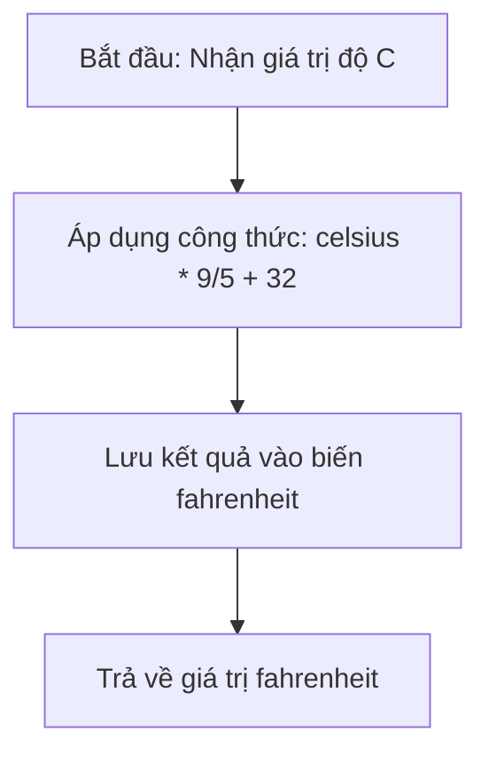

# Day 2: Biến & Các kiểu Dữ liệu Cơ bản

Trong Python, việc hiểu rõ về biến và các kiểu dữ liệu là nền tảng cốt lõi để viết nên các chương trình mạnh mẽ. Khác với các ngôn ngữ gán kiểu tĩnh, Python cung cấp sự linh hoạt để lưu trữ động các loại thông tin khác nhau, trong khi vẫn thực thi các quy tắc nghiêm ngặt bên dưới để ngăn chặn các hoạt động không logic.

---

### 🎯 Mục tiêu học tập
Sau khi kết thúc bài học này, bạn sẽ có thể:
- Xác định và làm việc với bốn kiểu dữ liệu nguyên thủy cơ bản: `int`, `float`, `str`, và `bool`.
- Hiểu và giải thích được cơ chế gán kiểu động (dynamic typing) và tham chiếu đối tượng của Python.
- Chuyển đổi giá trị giữa các kiểu dữ liệu khác nhau bằng cách ép kiểu rõ ràng (`int()`, `float()`, `str()`, `bool()`).
- Định dạng chuỗi hiển thị linh hoạt bằng cách sử dụng f-string (formatted string literals).

---

### 🧩 Khái niệm cốt lõi (Tại sao)
#### 1. Tại sao kiểu dữ liệu lại quan trọng?
Máy tính lưu trữ tất cả thông tin dưới dạng nhị phân (các số 0 và 1). Máy tính cần biết *cách* diễn giải các chuỗi nhị phân đó. Ví dụ, biểu diễn nhị phân của một số được lưu trữ khác với một ký tự trong văn bản. Việc xác định kiểu dữ liệu giúp Python biết các phép toán nào là hợp lệ (ví dụ: bạn có thể cộng hai số nhưng không thể trừ một chuỗi chữ).

#### 2. Gán kiểu động: Nhãn dán, không phải Hộp chứa
Trong các ngôn ngữ gán kiểu tĩnh như C++ hoặc Java, các biến là các hộp chứa cố định một kiểu dữ liệu duy nhất. Trong Python, các biến đóng vai trò là các **nhãn dán (tham chiếu/con trỏ)** trỏ đến các đối tượng trong bộ nhớ. Kiểu dữ liệu thuộc về bản thân đối tượng (chính giá trị đó), chứ không thuộc về tên biến. Điều này cho phép một biến trỏ đến một số nguyên tại thời điểm này, và trỏ đến một chuỗi chữ tại thời điểm sau.

#### 3. Chèn biến vào chuỗi (f-string)
Khi xây dựng giao diện người dùng hoặc báo cáo số liệu, chúng ta thường cần đưa các giá trị của biến vào trong câu chữ. Thay vì sử dụng phép cộng chuỗi thủ công bất tiện như `"Nhiệt độ là " + str(temp) + " độ"`, Python cung cấp **f-string** để nhúng các biểu thức trực tiếp bên trong chuỗi thông qua cặp dấu ngoặc nhọn `{}`.

---

### 🔁 Logic và hoạt động
Việc đổi độ Celsius sang Fahrenheit bao gồm nhận vào một số (số nguyên hoặc số thực), thực hiện theo công thức toán học và trả về kết quả. Quy trình được mô tả như hình dưới đây:



Bên dưới hệ thống, ngay cả khi chúng ta truyền vào một số nguyên Celsius, phép chia số thực của Python (`9/5` trả về `1.8`) sẽ tự động chuyển kết quả của biến `fahrenheit` thành kiểu số thực (`float`).

---

### 📝 Ví dụ minh họa có chú thích
Dưới đây là cách khai báo các biến với các kiểu dữ liệu khác nhau, kiểm tra kiểu, ép kiểu và định dạng chuỗi:

```python
# --- 1. Khai báo các kiểu dữ liệu nguyên thủy ---
age = 25                  # kiểu 'int' (số nguyên)
price = 19.99             # kiểu 'float' (số thực)
course_name = "Python"    # kiểu 'str' (chuỗi văn bản)
is_active = True          # kiểu 'bool' (boolean: True hoặc False)

# --- 2. Gán lại giá trị với kiểu dữ liệu khác (Dynamic Re-assignment) ---
x = 42                    # x trỏ đến một đối tượng số nguyên
x = "Hello"               # Giờ đây x trỏ đến một đối tượng chuỗi. Điều này hoàn toàn hợp lệ trong Python!

# --- 3. Ép kiểu rõ ràng (Explicit Type Casting) ---
str_number = "100"
converted_int = int(str_number)      # Đổi chuỗi "100" thành số nguyên 100
converted_float = float(20)          # Đổi số nguyên 20 thành số thực 20.0
to_string = str(3.14)                # Đổi số thực 3.14 thành chuỗi "3.14"

# --- 4. Giá trị chân trị (Truthiness) và Ép kiểu Boolean ---
# Hầu hết mọi đối tượng đều có thể ép kiểu sang bool. Chỉ các giá trị rỗng/bằng 0 mới là False.
print(bool(0))            # False
print(bool(""))           # False (chuỗi rỗng)
print(bool(5))            # True
print(bool("Hello"))      # True

# --- 5. Định dạng chuỗi với f-string ---
name = "Alice"
score = 98.5
message = f"Học viên {name} đạt {score}% điểm trong kỳ thi."
print(message)            # Đầu ra: Học viên Alice đạt 98.5% điểm trong kỳ thi.
```

---

### ❌ Các lỗi thường gặp
#### Lỗi 1: Lỗi cộng chuỗi với số không tường minh (TypeError)
Cố gắng cộng chuỗi trực tiếp với một số nguyên mà không ép kiểu số nguyên đó thành chuỗi.
```python
current_year = 2026
message = "Năm hiện tại là " + current_year
```
**Thông báo lỗi thực tế:**
```text
TypeError: can only concatenate str (not "int") to str
```
**Mã nguồn đúng:**
```python
# Sử dụng f-string (khuyên dùng)
message = f"Năm hiện tại là {current_year}"

# Hoặc ép kiểu rõ ràng
message = "Năm hiện tại là " + str(current_year)
```
> Python là ngôn ngữ định kiểu mạnh (strongly typed), nó không tự động đổi số thành chuỗi khi thực hiện toán tử cộng `+`.

#### Lỗi 2: Sử dụng từ khóa đặt trước để đặt tên biến (SyntaxError)
Sử dụng các từ mang ý nghĩa cú pháp đặc biệt trong Python làm tên biến.
```python
class = "Giới thiệu về AI"
```
**Thông báo lỗi thực tế:**
```text
SyntaxError: invalid syntax
```
**Mã nguồn đúng:**
```python
class_name = "Giới thiệu về AI"
```
> Các từ khóa đặt trước (reserved keywords) như `class`, `def`, `if`, `import` và `for` không thể dùng làm tên biến.

#### Lỗi 3: Sai số dấu phẩy động (Floating Point Precision)
Mặc định rằng các phép toán số thập phân luôn chính xác tuyệt đối.
```python
result = (0.1 + 0.2) == 0.3
print(result)
```
**Đầu ra thực tế:**
```text
False  (Phép toán 0.1 + 0.2 thực tế trả về 0.30000000000000004)
```
**Mã nguồn đúng:**
```python
# Kiểm tra xem khoảng cách giữa hai giá trị có đủ nhỏ hay không (sử dụng sai số epsilon)
is_equal = abs((0.1 + 0.2) - 0.3) < 1e-9
```
> Máy tính lưu trữ số thực dưới dạng phân số nhị phân (tiêu chuẩn IEEE 754), do đó không thể biểu diễn chính xác hoàn toàn các số thập phân hệ cơ số 10 như 0.1, 0.2 hay 0.3.

---

### 💡 Mẹo & Cách viết tối ưu
- **Tên hằng số:** Python không hỗ trợ hằng số thực sự (biến không thể bị thay đổi giá trị). Thay vào đó, lập trình viên sử dụng quy ước viết hoa toàn bộ tên biến (`PI = 3.14159`, `MAX_USERS = 100`) để báo hiệu rằng giá trị này không nên thay đổi trong suốt chương trình.
- **Viết số lớn dễ đọc:** Bạn có thể sử dụng dấu gạch dưới `_` để phân tách trực quan các chữ số:
  ```python
  one_billion = 1_000_000_000
  ```
- **Kiểm tra kiểu dữ liệu:** Để kiểm tra xem biến có khớp với một kiểu cụ thể hay không, nên dùng `isinstance(var, type)` thay vì `type(var) == type`:
  ```python
  is_integer = isinstance(age, int)  # True
  ```

---

### 🧠 Đi sâu phân tích (Cơ chế bên dưới)
<details>
<summary>Giá trị đối tượng và Định danh đối tượng (Click để mở rộng)</summary>

Khi bạn gán giá trị cho một biến, Python cấp phát vùng nhớ cho đối tượng đó và trả về địa chỉ tham chiếu của nó.
- **Giá trị (`==`)**: Kiểm tra xem giá trị của hai đối tượng có bằng nhau hay không.
- **Định danh (`is`)**: Kiểm tra xem hai biến có trỏ đến cùng một địa chỉ ô nhớ hay không.

Để tối ưu hóa hiệu năng, Python lưu trữ sẵn các số nguyên nhỏ (thường từ `-5` đến `256`) và các chuỗi văn bản ngắn trong bộ nhớ cache. Cơ chế này được gọi là **interning**.

```python
a = 256
b = 256
print(a == b)  # True
print(a is b)  # True (trỏ cùng tới đối tượng được cache)

c = 1000
d = 1000
print(c == d)  # True
print(c is d)  # False (giá trị giống nhau nhưng nằm ở hai ô nhớ khác nhau)
```
Bạn có thể xem địa chỉ bộ nhớ thực tế bằng hàm `id()`:
```python
print(id(c))  # Ví dụ: 140356230491024
```
</details>

---

### 🏋️ Bài tập thực hành
Hoàn thành hàm `c_to_f(celsius)` để đổi nhiệt độ từ độ C (Celsius) sang độ F (Fahrenheit) và trả về kết quả đó.

Công thức chuyển đổi từ độ C ($C$) sang độ F ($F$) là:
$$F = \left(C \times \frac{9}{5}\right) + 32$$

```python
def c_to_f(celsius):
    # Hoàn thành hàm để đổi độ C sang độ F
    fahrenheit = None
    return fahrenheit
```

#### Gợi ý
1. Bạn có thể nhân `celsius` với `9/5` (hoặc `1.8`), sau đó cộng thêm `32`.
2. Hãy đảm bảo bạn trả về giá trị đã tính bằng từ khóa `return` thay vì in nó ra màn hình.

---

### ✅ Tự kiểm tra
1. Nếu `x = 5.8`, kết quả của phép chuyển đổi `int(x)` là gì?
2. Hàm `type(True)` trả về kết quả nào?
3. Làm thế nào để chèn biến `name` và `age` vào chuỗi bằng f-string?

<details>
<summary>Click để xem đáp án</summary>

1. **`5`**: Ép kiểu số thực sang số nguyên bằng `int()` sẽ loại bỏ phần thập phân (cắt bỏ phần đuôi hướng về số 0) thay vì làm tròn số.
2. **`<class 'bool'>`**: `True` và `False` là các đối tượng thuộc lớp Boolean.
3. **`f"Tên: {name}, Tuổi: {age}"`**: Đặt tên biến trong dấu ngoặc nhọn bên trong chuỗi ký tự được bắt đầu bằng chữ `f`.
</details>

---

### 📌 Tóm tắt
- Python sử dụng cơ chế gán kiểu động (kiểu liên kết với giá trị, không phải tên biến) và gán kiểu mạnh (không tự động thực hiện phép toán trên kiểu dữ liệu không tương thích).
- Các kiểu dữ liệu cơ bản bao gồm số nguyên (`int`), số thực (`float`), chuỗi văn bản (`str`), và giá trị logic (`bool`).
- Sử dụng `type()` để kiểm tra kiểu đối tượng và `int()`, `float()`, `str()`, `bool()` để ép kiểu rõ ràng.
- f-string là cách hiện đại, trực quan để định dạng chuỗi bằng cách nhúng các biểu thức trực tiếp vào trong ngoặc nhọn `{}`.
