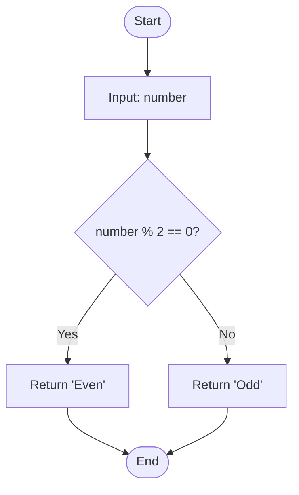

# Day 3: Cấu trúc rẽ nhánh & Điều kiện

### 🎯 Mục tiêu học tập
- Hiểu rõ logic boolean, toán tử so sánh và toán tử logic trong Python.
- Làm chủ cú pháp và cấu trúc của các câu lệnh `if`, `elif`, và `else`.
- Giải thích được tầm quan trọng của việc thụt lề (indentation) để phân định khối lệnh.
- Áp dụng cấu trúc rẽ nhánh để giải quyết bài tập kiểm tra tính chẵn lẻ của số.

### 🧩 Khái niệm cốt lõi (Tại sao)
Chương trình không nên lúc nào cũng chạy theo một đường thẳng duy nhất. Các ứng dụng thực tế luôn yêu cầu logic ra quyết định. Ví dụ: xác thực mật khẩu người dùng có chính xác không, kiểm tra tài khoản ngân hàng có đủ số dư trước khi rút tiền không, hoặc xếp loại học lực dựa trên điểm số. Cấu trúc rẽ nhánh đóng vai trò là "bộ não" đưa ra quyết định của chương trình, xác định nhánh mã nguồn nào sẽ được thực thi dựa trên dữ liệu động.

### 🔁 Logic và hoạt động
Cấu trúc rẽ nhánh hoạt động bằng cách đánh giá các biểu thức trả về giá trị boolean (`True` hoặc `False`). Python đánh giá các điều kiện này một cách tuần tự từ trên xuống dưới. Điều kiện đầu tiên được đánh giá là `True` sẽ kích hoạt khối mã liên kết với nó, và toàn bộ phần còn lại của chuỗi điều kiện sẽ bị bỏ qua.

Dưới đây là sơ đồ dòng chảy (flowchart) minh họa cách hoạt động của logic kiểm tra tính chẵn lẻ (chẵn vs. lẻ):



### 📝 Ví dụ minh họa có chú thích

```python
# 1. Câu lệnh if đơn giản
temperature = 25
if temperature > 20:
    print("It's a warm day.")  # Được thực thi vì temperature > 20 là True

# 2. Cấu trúc if-else
score = 75
if score >= 80:
    print("Pass with distinction")
else:
    print("Pass")  # Được thực thi vì score nhỏ hơn 80

# 3. Chuỗi điều kiện if-elif-else
age = 15
if age >= 18:
    ticket_price = 10  # Người lớn trả $10
elif age >= 12:
    ticket_price = 7   # Thanh thiếu niên trả $7
else:
    ticket_price = 5   # Trẻ em trả $5
print(f"Ticket price: ${ticket_price}")

# 4. Cấu trúc rẽ nhánh lồng nhau (Nested)
username = "admin"
logged_in = True
if logged_in:
    if username == "admin":
        print("Welcome, administrator!")  # Được thực thi: lồng bên trong logged_in
    else:
        print("Welcome, user!")
else:
    print("Please log in.")

# 5. Các toán tử logic (and, or, not)
has_id = True
has_ticket = False
if has_id or has_ticket:
    print("Access granted.")  # Được thực thi vì toán tử 'or' chỉ yêu cầu ít nhất một điều kiện True
```

### ❌ Các lỗi thường gặp

Wrong code:
```python
x = 10
if x > 5
    print("Greater than 5")
```
Traceback:
```text
SyntaxError: expected ':'
```
Correct code:
```python
x = 10
if x > 5:
    print("Greater than 5")
```
> Python bắt buộc phải có dấu hai chấm `:` ở cuối câu lệnh điều kiện để bắt đầu một khối mã mới.

Wrong code:
```python
x = 10
if x > 5:
print("Greater than 5")
```
Traceback:
```text
IndentationError: expected an indented block after 'if' statement on line 2
```
Correct code:
```python
x = 10
if x > 5:
    print("Greater than 5")
```
> Python sử dụng khoảng thụt lề (thường là 4 khoảng trắng) để nhóm các câu lệnh trong cùng một khối mã điều kiện.

Wrong code:
```python
x = 5
if x = 5:
    print("Five")
```
Traceback:
```text
SyntaxError: invalid syntax. Maybe you meant '==' or ':=' instead of '='?
```
Correct code:
```python
x = 5
if x == 5:
    print("Five")
```
> Một dấu bằng `=` được dùng cho phép gán biến. Để so sánh bằng, bạn phải sử dụng toán tử so sánh hai dấu bằng `==`.

### 💡 Mẹo & Cách viết tối ưu
- **So sánh chuỗi liên tiếp (Chained comparisons):** Trong Python, bạn có thể viết các phép so sánh chuỗi một cách tự nhiên. Ví dụ: `18 < age < 65` kiểm tra xem `age` có nằm trong khoảng từ 18 đến 65 hay không, cách viết này ngắn gọn và trực quan hơn `age > 18 and age < 65`.
- **Toán tử ba ngôi (Ternary Operator):** Đối với các phép gán đơn giản, hãy sử dụng định dạng toán tử ba ngôi trên một dòng: `status = "Adult" if age >= 18 else "Minor"`.
- **Giá trị chân lý (Truthiness):** Mọi đối tượng trong Python đều mang một giá trị boolean ngầm định. Các tập hợp rỗng (`[]`, `{}`, `()`), số không (`0`, `0.0`), `None`, và chuỗi rỗng (`""`) sẽ được đánh giá là `False`. Tất cả các giá trị khác đều là `True`.
- **So sánh Boolean ngầm định:** Tránh so sánh trực tiếp các biến boolean với `True` hoặc `False`. Hãy viết `if is_valid:` thay vì `if is_valid == True:`.

### 🧠 Đi sâu phân tích (Cơ chế bên dưới)
<details><summary>Đánh giá ngắn mạch - Short-Circuit Evaluation (Click để mở rộng)</summary>

Khi đánh giá các toán tử logic `and` và `or`, Python sử dụng cơ chế **đánh giá ngắn mạch (short-circuit evaluation)**:
- Đối với biểu thức `and`, nếu toán hạng bên trái được đánh giá là `False`, Python sẽ ngay lập tức trả về `False` mà không cần đánh giá toán hạng bên phải.
- Đối với biểu thức `or`, nếu toán hạng bên trái được đánh giá là `True`, Python sẽ ngay lập tức trả về `True` mà không cần đánh giá toán hạng bên phải.

Cơ chế tối ưu hóa này giúp tăng tốc độ thực thi và cho phép viết các mẫu mã nguồn an toàn, chẳng hạn như kiểm tra sự tồn tại của đối tượng trước khi truy cập thuộc tính của nó:
```python
# An toàn: nếu user là None, điều kiện thứ hai sẽ không bao giờ bị đánh giá, giúp tránh lỗi AttributeError
if user is not None and user.is_active:
    print("User is active")
```
</details>

### 🏋️ Bài tập thực hành
Hãy hoàn thành hàm `is_even_or_odd(number)` để trả về chuỗi `"Even"` nếu số đầu vào là số chẵn, và `"Odd"` nếu số đầu vào là số lẻ.

Hãy tham khảo mẫu mã nguồn ban đầu trong trình biên tập để bắt đầu.

### ✅ Tự kiểm tra
<details><summary>Click để xem câu hỏi và câu trả lời</summary>

1. **Câu hỏi:** `bool("")` được đánh giá là gì?
   - **Trả lời:** `False`, vì chuỗi rỗng được coi là "falsy" trong Python.
2. **Câu hỏi:** Trong biểu thức `True or print("Hello")`, từ "Hello" có được in ra không?
   - **Trả lời:** Không, do cơ chế đánh giá ngắn mạch. Toán hạng bên trái là `True`, nên biểu thức `or` trả về `True` ngay lập tức mà không cần đánh giá toán hạng bên phải.
</details>

### 📌 Tóm tắt
- Cấu trúc rẽ nhánh thực thi các nhánh mã khác nhau dựa trên kết quả đánh giá boolean.
- Việc thụt lề đầu dòng là bắt buộc; đó là quy tắc cú pháp để xác định khối mã.
- Các chuỗi điều kiện phức tạp được xây dựng bằng cách kết hợp `if`, `elif`, và `else`.
- Giá trị chân lý (Truthiness) cho phép sử dụng các giá trị phi boolean làm điều kiện (ví dụ: kiểm tra danh sách rỗng).
- Đánh giá ngắn mạch trì hoãn đánh giá các biểu thức phía sau để tối ưu hiệu năng và đảm bảo an toàn.

