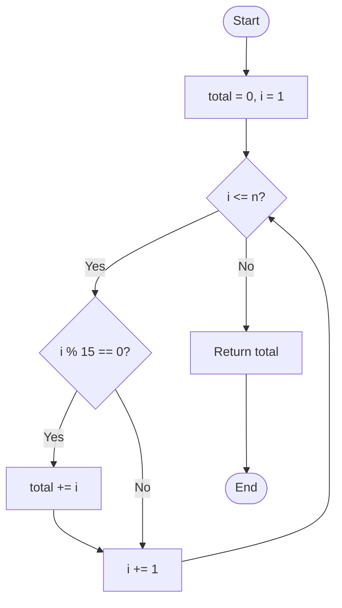

# Day 4: Vòng lặp & Cấu trúc lặp

### 🎯 Mục tiêu học tập
- Giải thích sự khác biệt giữa vòng lặp `for` (lặp xác định) và vòng lặp `while` (lặp không xác định).
- Sử dụng hàm `range()` để tạo các dãy số.
- Kiểm soát luồng thực thi vòng lặp bằng `break` và `continue`.
- Triển khai vòng lặp kết hợp với các bộ lọc điều kiện để giải quyết bài toán tính tổng tích lũy.

### 🧩 Khái niệm cốt lõi (Tại sao)
Máy tính cực kỳ xuất sắc trong việc thực hiện các tác vụ lặp đi lặp lại hàng triệu lần mà không mệt mỏi. Việc viết các chỉ thị lặp thủ công vừa không hiệu quả, khó bảo trì, lại dễ phát sinh lỗi. Vòng lặp cho phép chúng ta thực thi một khối mã nhiều lần.
- **Vòng lặp `for`** được sử dụng cho *lặp xác định*, nghĩa là bạn biết trước vòng lặp sẽ chạy bao nhiêu lần (ví dụ: duyệt qua danh sách tên, hoặc một phạm vi số).
- **Vòng lặp `while`** được sử dụng cho *lặp không xác định*, nghĩa là vòng lặp tiếp tục chạy cho đến khi một điều kiện cụ thể chuyển thành `False` (ví dụ: chờ người dùng nhập "exit", hoặc đọc các dòng từ tệp tin cho đến khi hết).

### 🔁 Logic và hoạt động
Vòng lặp liên tục kiểm tra một biểu thức điều kiện. Nếu điều kiện được đáp ứng (đánh giá là `True`), khối mã bên trong vòng lặp sẽ được thực thi. Nếu không, chương trình thoát khỏi vòng lặp và tiếp tục thực thi các dòng mã tiếp theo.

Dưới đây là sơ đồ dòng chảy (flowchart) minh họa logic của bài tập tính tổng tích lũy `sum_multiples(n)`, nơi chúng ta lặp từ `1` đến `n` và cộng dồn các số chia hết cho 15:



### 📝 Ví dụ minh họa có chú thích

```python
# 1. Lặp xác định sử dụng vòng lặp for và hàm range()
# range(5) tạo ra dãy số từ 0 đến 4 (không bao gồm số 5)
for i in range(5):
    print(f"Iteration {i}")

# 2. Duyệt qua một cấu trúc tuần tự (danh sách - list)
fruits = ["apple", "banana", "cherry"]
for fruit in fruits:
    print(f"I like {fruit}")

# 3. Lặp không xác định sử dụng vòng lặp while
countdown = 3
while countdown > 0:
    print(countdown)
    countdown -= 1  # Quan trọng: giảm countdown để tránh vòng lặp vô hạn
print("Blast off!")

# 4. Kiểm soát thực thi vòng lặp: break
# break thoát khỏi vòng lặp ngay lập tức
for num in range(1, 10):
    if num == 5:
        break  # Dừng vòng lặp khi num bằng 5
    print(num)  # In ra 1, 2, 3, 4

# 5. Kiểm soát thực thi vòng lặp: continue
# continue bỏ qua phần còn lại của lượt lặp hiện tại và chuyển sang lượt tiếp theo
for num in range(1, 6):
    if num == 3:
        continue  # Bỏ qua việc in số 3
    print(num)  # In ra 1, 2, 4, 5
```

### ❌ Các lỗi thường gặp

Wrong code:
```python
n = 5
for i in n:
    print(i)
```
Traceback:
```text
TypeError: 'int' object is not iterable
```
Correct code:
```python
n = 5
for i in range(n):
    print(i)
```
> Kiểu số nguyên (int) không phải là đối tượng lặp được. Để lặp lại một số lần cụ thể, bạn phải bọc số nguyên đó trong hàm `range()`.

Wrong code:
```python
i = 1
while i <= 3:
    print(i)
    # Thiếu lệnh tăng biến đếm (i += 1)
```
Traceback:
```text
TimeoutError: Execution exceeded maximum time limit of 5.0 seconds
```
Correct code:
```python
i = 1
while i <= 3:
    print(i)
    i += 1
```
> Điều kiện của vòng lặp `while` cuối cùng phải trở thành False. Việc quên cập nhật biến được sử dụng trong điều kiện sẽ tạo ra một vòng lặp vô hạn.

Wrong code:
```python
# Cố gắng in các số từ 1 đến 5 (bao gồm cả 5)
for i in range(1, 5):
    print(i)
```
Traceback:
```text
1
2
3
4
```
Correct code:
```python
# Giới hạn trên không được bao gồm, vì vậy hãy dùng 6 để lấy đến 5
for i in range(1, 6):
    print(i)
```
> Hàm `range(start, stop)` của Python không bao gồm giá trị `stop`. Để lặp đến `n`, bạn phải đặt giới hạn dừng là `n + 1`.

### 💡 Mẹo & Cách viết tối ưu
- **`enumerate()` để lấy cả chỉ số và giá trị:** Khi duyệt qua một danh sách và bạn cần cả phần tử lẫn chỉ số của nó, hãy sử dụng `enumerate()`:
  ```python
  names = ["Alice", "Bob"]
  for index, name in enumerate(names):
      print(f"{index}: {name}")
  ```
- **`zip()` để lặp song song nhiều danh sách:** Để lặp qua hai danh sách có cùng độ dài cùng một lúc, hãy ghép cặp chúng bằng `zip()`:
  ```python
  items = ["Apple", "Phone"]
  prices = [1.2, 800]
  for item, price in zip(items, prices):
      print(f"{item} costs ${price}")
  ```
- **Mệnh đề `else` trong vòng lặp:** Vòng lặp trong Python có thể có khối `else`. Khối này *chỉ* chạy khi vòng lặp kết thúc bình thường mà không gặp bất kỳ lệnh `break` nào. Điều này rất hữu ích cho các hoạt động tìm kiếm.
  ```python
  for x in range(3):
      print(x)
  else:
      print("Success!")  # Chạy vì không gặp lệnh break nào
  ```

### 🧠 Đi sâu phân tích (Cơ chế bên dưới)
<details><summary>Bộ lặp (Iterators) và Đối tượng lặp được (Iterables) (Click để mở rộng)</summary>

Bên dưới tầng giao diện, vòng lặp `for` trong Python không sử dụng các biến đếm chỉ số đơn giản. Nó hoạt động dựa trên khái niệm **Iterables** (Đối tượng lặp được) và **Iterators** (Bộ lặp):
1. Một **Iterable** là bất kỳ đối tượng nào có khả năng trả về từng phần tử của nó tại một thời điểm (ví dụ: list, tuple, string, hoặc đối tượng `range`). Các đối tượng Iterable triển khai phương thức `__iter__`.
2. Khi vòng lặp `for` bắt đầu, nó gọi hàm `iter(iterable)` để lấy đối tượng **Iterator**.
3. Vòng lặp sau đó liên tục gọi `next(iterator)` để lấy phần tử tiếp theo.
4. Khi không còn phần tử nào nữa, bộ lặp sẽ ném ra ngoại lệ `StopIteration`. Vòng lặp `for` sẽ bắt lấy ngoại lệ này và kết thúc vòng lặp một cách êm đẹp.

Bạn có thể tự mô phỏng cơ chế này bằng tay:
```python
nums = [10, 20]
it = iter(nums)      # Lấy iterator
print(next(it))      # Output: 10
print(next(it))      # Output: 20
# print(next(it))    # Lệnh này sẽ ném ra StopIteration
```
</details>

### 🏋️ Bài tập thực hành
Hãy hoàn thành hàm `sum_multiples(n)` để tính tổng của tất cả các số nguyên từ `1` đến `n` (bao gồm cả `n`) chia hết cho cả `3` và `5` (tức là bội số của `15`).

Hãy tham khảo mẫu mã nguồn ban đầu trong trình biên tập để bắt đầu.

### ✅ Tự kiểm tra
<details><summary>Click để xem câu hỏi và câu trả lời</summary>

1. **Câu hỏi:** Kết quả đầu ra của `list(range(2, 10, 3))` là gì?
   - **Trả lời:** `[2, 5, 8]`. Dãy số bắt đầu từ 2, dừng trước 10, và tăng tiến 3 đơn vị mỗi bước.
2. **Câu hỏi:** Sự khác biệt giữa `break` và `continue` là gì?
   - **Trả lời:** `break` kết thúc hoàn toàn vòng lặp, chuyển đến phần mã phía sau vòng lặp. `continue` chỉ bỏ qua phần còn lại của lượt lặp hiện tại và chuyển ngay đến chu kỳ lặp tiếp theo.
</details>

### 📌 Tóm tắt
- Vòng lặp `for` duyệt qua một chuỗi hoặc phạm vi đã biết trước.
- Vòng lặp `while` lặp lại mã chừng nào điều kiện vẫn còn là `True`.
- `range(start, stop, step)` tạo ra dãy số, ngoại trừ giá trị dừng `stop`.
- Sử dụng `break` để thoát vòng lặp sớm, và `continue` để bỏ qua phần còn lại của lượt lặp hiện tại.
- Về bản chất, các vòng lặp Python sử dụng các bộ lặp (iterator) và xử lý ngoại lệ `StopIteration` để dừng lặp.

