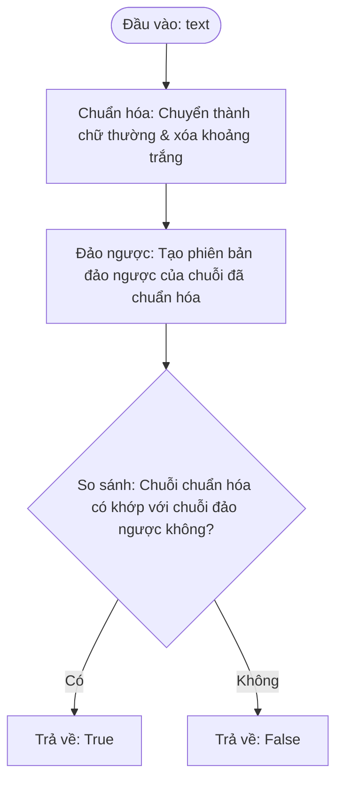

# Day 5: Định nghĩa & Sử dụng Hàm

### 🎯 Mục tiêu học tập
- Định nghĩa hàm tự chọn bằng từ khóa `def`, truyền tham số và sử dụng câu lệnh `return`.
- Giải thích hành vi trả về mặc định `None` của Python khi không có câu lệnh `return` cụ thể.
- Phân biệt phạm vi cục bộ (local scope) và phạm vi toàn cục (global scope), hiểu cách không gian tên (namespace) cô lập các biến.
- Viết mã nguồn dạng mô-đun hóa tối ưu và theo dõi luồng thực thi của hàm.

### 🧩 Khái niệm cốt lõi (Tại sao)
Trong lập trình, chúng ta thường cần thực thi một khối mã nhiều lần với các đầu vào khác nhau. Việc viết đi viết lại cùng một khối mã sẽ dẫn đến trùng lặp mã nguồn (duplicate code), làm cho chương trình khó bảo trì, khó gỡ lỗi và cập nhật.

Hàm giải quyết vấn đề này bằng cách đóng gói một khối mã vào một đơn vị có tên và có thể tái sử dụng. Chúng hoạt động như một "hộp đen" nhận đầu vào (đối số), xử lý và trả về kết quả (giá trị trả về). Hàm cho phép chúng ta chia nhỏ các bài toán phức tạp thành các tác vụ nhỏ hơn, dễ quản lý và dễ kiểm thử hơn.

### 🔁 Logic và hoạt động
Hàm trong Python được định nghĩa bằng từ khóa `def`, theo sau là tên hàm, các tham số trong dấu ngoặc đơn và dấu hai chấm (`:`). Thân hàm được thụt lề thụt dòng.

Dưới đây là sơ đồ luồng logic của quá trình kiểm tra chuỗi đối xứng:



- **Tham số (Parameters) và Đối số (Arguments)**: Tham số là biến được liệt kê trong định nghĩa hàm (ví dụ: `text` trong `is_palindrome(text)`). Đối số là giá trị thực tế được truyền vào hàm khi gọi hàm (ví dụ: `"radar"` trong `is_palindrome("radar")`).
- **Câu lệnh Return**: `return` thoát khỏi hàm ngay lập tức và trả về một giá trị cho nơi gọi. Nếu không viết câu lệnh `return` hoặc chỉ viết `return` trống, Python sẽ tự động trả về `None`.

### 📝 Ví dụ minh họa có chú thích
```python
# 1. Định nghĩa hàm cơ bản với giá trị tham số mặc định
def greet(name="Guest"):
    # Nếu không truyền name, giá trị mặc định "Guest" sẽ được sử dụng
    return f"Hello, {name}!"

print(greet("Alice"))  # Kết quả: Hello, Alice!
print(greet())         # Kết quả: Hello, Guest! (sử dụng giá trị mặc định)

# 2. Giá trị trả về ngầm định None khi bỏ qua return
def print_sum(a, b):
    result = a + b
    print(f"Sum is: {result}")
    # Không có câu lệnh return ở đây!

value = print_sum(3, 4)
print(value)  # Kết quả: None (giá trị trả về ngầm định)

# 3. Phạm vi cục bộ (Local) và phạm vi toàn cục (Global)
message = "I am global"  # Biến toàn cục

def check_scope():
    message = "I am local"  # Biến cục bộ che khuất (shadowing) biến toàn cục
    print(f"Inside function: {message}")

check_scope()           # In ra: Inside function: I am local
print(f"Outside function: {message}")  # In ra: Outside function: I am global
```

### ❌ Các lỗi thường gặp
**Lỗi 1: Truy cập biến cục bộ ở phạm vi toàn cục**
```python
def calculate_area(radius):
    area = 3.14 * radius * radius
    return area

calculate_area(5)
print(area)
```
```text
NameError: name 'area' is not defined
```
```python
def calculate_area(radius):
    area = 3.14 * radius * radius
    return area

my_area = calculate_area(5)
print(my_area)
```
> Biến được định nghĩa trong hàm (phạm vi cục bộ) không thể truy cập từ bên ngoài hàm. Để sử dụng kết quả, bạn phải trả về nó bằng `return` và lưu giá trị đó vào một biến mới ở bên ngoài.

**Lỗi 2: Thao tác tính toán trên giá trị None mặc định**
```python
def add_five(number):
    result = number + 5

output = add_five(10)
print(output * 2)
```
```text
TypeError: unsupported operand type(s) for *: 'NoneType' and 'int'
```
```python
def add_five(number):
    result = number + 5
    return result

output = add_five(10)
print(output * 2)
```
> Nếu một hàm không có câu lệnh `return` rõ ràng, nó sẽ ngầm trả về `None`. Bạn không thể thực hiện các phép toán số học trên giá trị `None`.

**Lỗi 3: Thay đổi giá trị biến toàn cục mà không khai báo global**
```python
count = 0

def increment():
    count = count + 1

increment()
```
```text
UnboundLocalError: cannot access local variable 'count' where it is not associated with a value
```
```python
count = 0

def increment():
    global count
    count = count + 1

increment()
```
> Python mặc định coi các biến được gán giá trị bên trong hàm là biến cục bộ. Nếu bạn muốn thay đổi biến toàn cục mà không khai báo từ khóa `global`, Python sẽ báo lỗi UnboundLocalError khi cố đọc biến cục bộ đó trước khi gán.

### 💡 Mẹo & Cách viết tối ưu
- **Đảo ngược bằng Slice**: Đảo ngược chuỗi hay danh sách cực kỳ ngắn gọn trong Python bằng kỹ thuật slicing `[::-1]`.
- **Nguyên lý đơn nhiệm (Single Responsibility)**: Thiết kế các hàm nhỏ, tập trung và chỉ thực hiện duy nhất một nhiệm vụ. Nếu hàm xử lý quá nhiều việc, hãy chia nhỏ thành các hàm phụ trợ (helper functions).
- **Mẫu trả về sớm (Return Early)**: Dùng điều kiện kiểm tra biên và trả về kết quả sớm để loại bỏ các trường hợp đặc biệt, giúp giảm độ thụt dòng và làm cho logic chính của hàm dễ đọc hơn.
- **Docstrings**: Sử dụng chuỗi ba dấu nháy (`"""`) ngay dưới dòng định nghĩa hàm để giải thích chức năng, tham số đầu vào và giá trị trả về của hàm.

### 🧠 Đi sâu phân tích (Cơ chế bên dưới)
<details>
<summary>Không gian tên (Namespaces) và Đệ quy</summary>

- **Không gian tên và Phạm vi biến (Quy tắc LEGB)**: Python sử dụng không gian tên để lưu trữ và quản lý biến. Khi tìm kiếm một biến, Python sẽ duyệt qua các phạm vi theo thứ tự sau:
  1. **L**ocal: Bên trong hàm hiện tại.
  2. **E**nclosing: Trong các phạm vi bao quanh của các hàm lồng nhau (nếu có).
  3. **G**lobal: Ở cấp độ module/tệp hiện tại.
  4. **B**uilt-in: Các từ khóa/hàm dựng sẵn của Python (như `print`, `len`).
- **Đệ quy và Call Stack (Ngăn xếp gọi hàm)**: Đệ quy là khi một hàm tự gọi lại chính nó. Mỗi lần hàm được gọi, Python sẽ tạo ra một khung thực thi (frame) mới trên call stack để theo dõi các biến cục bộ và điểm thực thi. Nếu hàm đệ quy không có hoặc không đạt được điều kiện dừng (base case), call stack sẽ bị đầy và phát sinh lỗi `RecursionError` (tràn bộ nhớ ngăn xếp).
</details>

### 🏋️ Bài tập thực hành
Hãy hoàn thành hàm `is_palindrome(text)` để kiểm tra xem chuỗi đầu vào `text` có phải là một chuỗi đối xứng (đọc xuôi hay đọc ngược đều giống nhau) hay không. Lưu ý bỏ qua khoảng trắng và không phân biệt chữ hoa/thường.

**Gợi ý:**
1. Chuyển đổi toàn bộ chuỗi đầu vào thành chữ thường bằng phương thức `lower()`.
2. Loại bỏ tất cả khoảng trắng bằng phương thức `replace(" ", "")`.
3. So sánh chuỗi đã làm sạch với phiên bản đảo ngược của chính nó bằng kỹ thuật slicing `[::-1]`.

### ✅ Tự kiểm tra
<details>
<summary>Click để xem câu hỏi và đáp án</summary>

**Câu hỏi 1:** Một hàm sẽ trả về giá trị gì nếu không khai báo từ khóa `return` rõ ràng?
- **Đáp án:** Hàm trả về giá trị `None` (một đối tượng thuộc lớp `NoneType`).

**Câu hỏi 2:** Nêu điểm khác biệt giữa phạm vi cục bộ (local scope) và phạm vi toàn cục (global scope).
- **Đáp án:** Biến khai báo bên trong hàm thuộc phạm vi cục bộ và chỉ có thể truy cập được từ bên trong hàm đó. Biến khai báo ở thân chính của tệp tin thuộc phạm vi toàn cục, có thể được đọc ở bất kỳ đâu nhưng chỉ có thể sửa đổi giá trị bên trong hàm nếu sử dụng từ khóa `global`.
</details>

### 📌 Tóm tắt
- Hàm được khai báo bằng `def`, nhận tham số và trả về kết quả qua `return`.
- Nếu bỏ qua `return`, hàm trong Python sẽ trả về giá trị mặc định là `None`.
- Biến cục bộ tồn tại trong không gian tên cục bộ của hàm và không thể truy cập từ bên ngoài.
- Đệ quy là việc hàm tự gọi chính nó và luôn yêu cầu một điều kiện dừng để tránh vòng lặp vô hạn.
