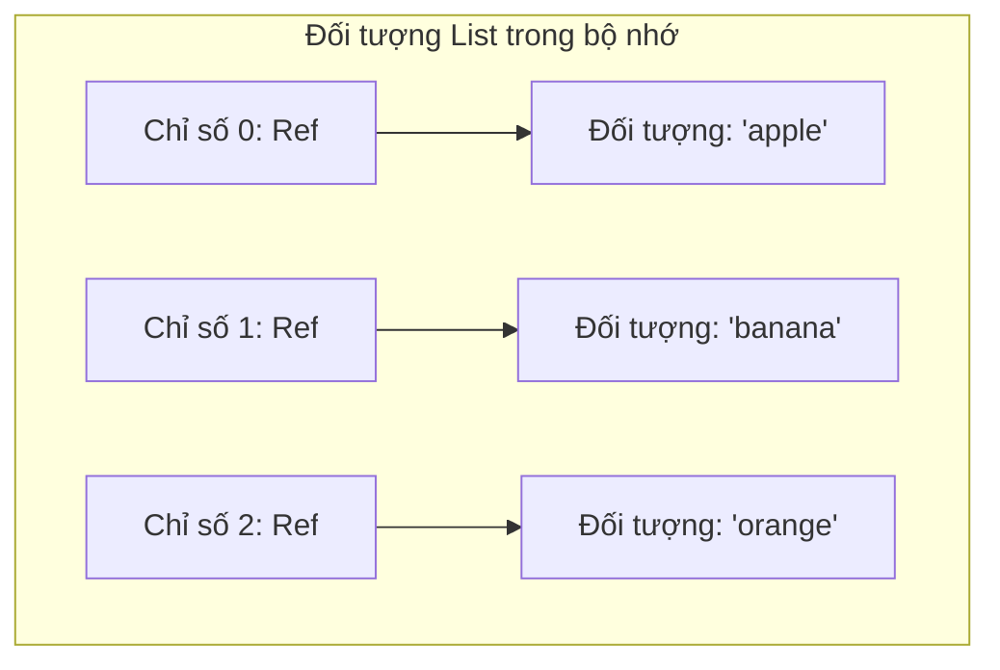

# Day 6: List & Tuple

### 🎯 Mục tiêu học tập
- Phân biệt giữa danh sách (list - có thể thay đổi) và tuple (không thể thay đổi) và xác định thời điểm thích hợp để sử dụng từng loại.
- Truy xuất và sửa đổi các phần tử bằng cách sử dụng chỉ số (index) từ 0 và chỉ số âm.
- Sử dụng cú pháp cắt lát (slicing notation `start:stop:step`) để trích xuất các chuỗi con một cách an toàn.
- Thực hiện các thao tác chuỗi như thêm phần tử (`append`), loại bỏ phần tử (`remove`) và sắp xếp (`sorted`, `sort`).

### 🧩 Khái niệm cốt lõi (Tại sao)
Khi viết chương trình, chúng ta thường cần lưu trữ một tập hợp các mục có liên quan với nhau thay vì chỉ lưu trữ các giá trị đơn lẻ.

Python cung cấp hai kiểu dữ liệu chuỗi tuần tự (sequence) tích hợp sẵn để lưu trữ tập hợp:
1. **List (`list`)**: Tập hợp các phần tử có thứ tự và có thể thay đổi (mutable). Bạn có thể thêm, bớt, sắp xếp hoặc sửa đổi các phần tử sau khi tạo. List rất lý tưởng cho các tập hợp thay đổi theo thời gian (ví dụ: danh sách mua sắm hoặc danh sách công việc cần làm).
2. **Tuple (`tuple`)**: Tập hợp các phần tử có thứ tự nhưng không thể thay đổi (immutable). Một khi đã được tạo, bạn không thể thay đổi giá trị, thêm mới hoặc sắp xếp lại các phần tử của nó. Tuple giúp đảm bảo an toàn dữ liệu (ví dụ: đảm bảo một cặp tọa độ cố định `(latitude, longitude)` hoặc cấu hình hệ thống không bị thay đổi ngoài ý muốn), đồng thời có tốc độ xử lý nhanh hơn và tiết kiệm bộ nhớ hơn so với list.

### 🔁 Logic và hoạt động
Không giống như mảng (array) trong một số ngôn ngữ lập trình cấp thấp nơi các phần tử được lưu trữ trong một khối bộ nhớ liên tục, một list trong Python thực chất là một mảng các tham chiếu (con trỏ) trỏ đến các đối tượng Python được lưu trữ ở các vị trí khác nhau trong bộ nhớ (vùng nhớ heap).



- **Chỉ số (Indexing)**: Các phần tử có thể được truy cập bằng chỉ số của chúng, bắt đầu từ `0` cho phần tử đầu tiên. Python cũng hỗ trợ chỉ số âm, bắt đầu từ `-1` cho phần tử cuối cùng.
- **Cắt lát (Slicing)**: Bạn có thể trích xuất một phần của chuỗi bằng cú pháp slicing: `sequence[start:stop:step]`. Thao tác này tạo ra một chuỗi mới mà không làm thay đổi chuỗi gốc.

### 📝 Ví dụ minh họa có chú thích
```python
# 1. List có thể thay đổi (mutable)
fruits = ["apple", "banana"]
fruits.append("orange")  # Thêm "orange" vào cuối: ['apple', 'banana', 'orange']
fruits[1] = "mango"      # Sửa phần tử ở chỉ số 1: ['apple', 'mango', 'orange']
print(fruits)

# 2. Tuple không thể thay đổi (immutable)
coordinates = (40.7128, -74.0060)
# coordinates[0] = 34.0522  # Dòng này sẽ gây lỗi TypeError!

# 3. Chỉ số & Cắt lát (Slicing)
numbers = [10, 20, 30, 40, 50]
print(numbers[0])    # Kết quả: 10 (phần tử đầu tiên)
print(numbers[-1])   # Kết quả: 50 (phần tử cuối cùng)
print(numbers[1:4])  # Kết quả: [20, 30, 40] (chỉ số từ 1 đến sát 4)
print(numbers[::-1]) # Kết quả: [50, 40, 30, 20, 10] (đảo ngược danh sách)
```

### ❌ Các lỗi thường gặp
**Lỗi 1: Chỉ số vượt quá phạm vi (Index out of range)**
```python
fruits = ["apple", "banana"]
print(fruits[2])
```
```text
IndexError: list index out of range
```
```python
fruits = ["apple", "banana"]
print(fruits[-1])
```
> Chỉ số hợp lệ nằm trong khoảng từ `0` đến `len(list) - 1`. Việc truy cập vào một chỉ số lớn hơn hoặc bằng chiều dài của danh sách sẽ phát sinh lỗi IndexError.

**Lỗi 2: Cố gắng thay đổi phần tử của Tuple**
```python
point = (1, 2)
point[0] = 9
```
```text
TypeError: 'tuple' object does not support item assignment
```
```python
point = (9, 2)
```
> Tuple là kiểu dữ liệu bất biến. Nếu bạn cần một phiên bản tuple đã sửa đổi, bạn phải tạo một tuple mới với các giá trị mới.

**Lỗi 3: Gán giá trị trả về của các phương thức sửa đổi trực tiếp (in-place)**
```python
numbers = [3, 1, 2]
sorted_numbers = numbers.sort()
print(sorted_numbers[0])
```
```text
TypeError: 'NoneType' object is not subscriptable
```
```python
numbers = [3, 1, 2]
sorted_numbers = sorted(numbers)
print(sorted_numbers[0])
```
> Các phương thức như `list.sort()` và `list.append()` sửa đổi trực tiếp danh sách gốc và trả về giá trị `None`. Để có được một danh sách đã sắp xếp mới, hãy sử dụng hàm dựng sẵn `sorted()`.

### 💡 Mẹo & Cách viết tối ưu
- **Cắt lát an toàn**: Kỹ thuật cắt lát (slicing) rất linh hoạt. Truy cập chỉ số vượt biên thông qua cắt lát không gây ra lỗi, nó chỉ trả về các phần tử thực tế hiện có (ví dụ: `fruits[1:100]`).
- **Giải nén (Unpacking)**: Bạn có thể dễ dàng gán các phần tử của list hoặc tuple cho các biến riêng lẻ: `x, y = coordinates`. Bạn cũng có thể gom các phần tử còn lại bằng toán tử dấu sao: `first, *rest = [1, 2, 3, 4]`.
- **Kiểm tra sự tồn tại**: Sử dụng toán tử `in` để kiểm tra xem một phần tử có tồn tại trong list hoặc tuple hay không: `if "apple" in fruits:`.
- **Loại bỏ trùng lặp**: Bạn có thể loại bỏ các phần tử trùng lặp trong danh sách bằng cách chuyển đổi nó sang kiểu set, rồi chuyển ngược lại thành list: `unique_list = list(set(original_list))`.

### 🧠 Đi sâu phân tích (Cơ chế bên dưới)
<details>
<summary>Tham chiếu, Bí danh (Aliasing) và Độ phức tạp thuật toán</summary>

- **Biến là Tham chiếu (Bí danh - Aliasing)**: Trong Python, việc gán `list_b = list_a` không sao chép danh sách, nó chỉ sao chép tham chiếu (con trỏ) trỏ tới cùng một đối tượng danh sách trong bộ nhớ. Mọi thay đổi qua `list_b` đều ảnh hưởng trực tiếp tới `list_a`. Để tạo bản sao độc lập, hãy sử dụng `list_a.copy()`.
- **Độ phức tạp thời gian (Big O)**:
  - **Truy xuất qua chỉ số**: $O(1)$ (thời gian hằng số), vì danh sách được lưu trữ dưới dạng một mảng các con trỏ liên tục, toán học chỉ số giúp trỏ trực tiếp đến địa chỉ bộ nhớ.
  - **Thêm vào cuối (append)**: $O(1)$ amortized (thời gian hằng số được phân bổ), do bộ nhớ được cấp phát dư sẵn theo từng khối.
  - **Chèn/Xóa (ở chỉ số 0 hoặc ở giữa)**: $O(n)$ (thời gian tuyến tính), vì Python phải dịch chuyển toàn bộ các phần tử phía sau trong bộ nhớ.
  - **Kiểm tra tồn tại (`in`)**: $O(n)$, vì trong trường hợp xấu nhất Python phải quét danh sách một cách tuần tự từ đầu đến cuối.
</details>

### 🏋️ Bài tập thực hành
Hãy hoàn thành hàm `unique_sort(numbers)` để loại bỏ tất cả các phần tử trùng lặp khỏi danh sách `numbers` đầu vào và trả về một danh sách mới đã sắp xếp tăng dần.

**Gợi ý:**
1. Sử dụng hàm `set()` để dễ dàng loại bỏ các số bị trùng lặp.
2. Chuyển đổi tập hợp (set) đó trở lại thành danh sách bằng hàm `list()`.
3. Sắp xếp danh sách theo thứ tự tăng dần bằng hàm `sorted()` và trả về kết quả.

### ✅ Tự kiểm tra
<details>
<summary>Click để xem câu hỏi và đáp án</summary>

**Câu hỏi 1:** Sự khác biệt về độ phức tạp thời gian giữa việc thêm một phần tử vào cuối danh sách (append) và chèn một phần tử vào chỉ số 0 (insert) là gì?
- **Đáp án:** Thêm vào cuối (append) mất thời gian $O(1)$ vì không có phần tử nào cần dịch chuyển. Chèn ở chỉ số 0 mất thời gian $O(n)$ vì mọi phần tử trong danh sách phải dịch chuyển sang phải một vị trí.

**Câu hỏi 2:** Làm thế nào để tạo một tuple chỉ chứa duy nhất một phần tử?
- **Đáp án:** Bạn phải thêm một dấu phẩy ở cuối phần tử (ví dụ: `single_element_tuple = (5,)`). Viết `(5)` không có dấu phẩy sẽ được hiểu là số nguyên 5 đặt trong dấu ngoặc đơn thông thường.
</details>

### 📌 Tóm tắt
- List là chuỗi tuần tự có thể thay đổi (mutable); tuple là chuỗi tuần tự bất biến (immutable).
- Truy cập các phần tử bằng chỉ số (từ 0 đến $N-1$, hoặc từ $-1$ đến $-N$ cho chỉ số âm).
- Cắt lát (slicing) giúp lấy ra chuỗi con mà không thay đổi chuỗi ban đầu.
- Lưu ý hiện tượng đồng danh (aliasing) khi sao chép danh sách và hiểu sự khác biệt về độ phức tạp giữa append ($O(1)$) và insert/remove ($O(n)$).
