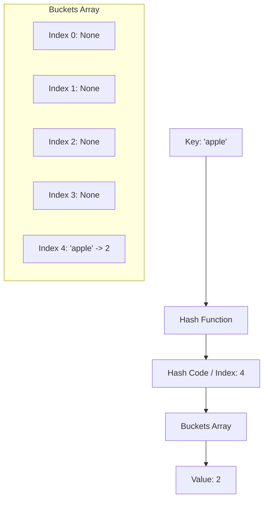

# Day 7: Dictionary & Set

Dictionary lưu trữ dữ liệu dưới dạng các cặp **key-value**. Set là tập hợp không có thứ tự chứa các phần tử **độc nhất** (không trùng lặp).

### 🎯 Mục tiêu học tập
- Giải thích cấu trúc ánh xạ key-value và tại sao dictionary lại hiệu quả hơn so với việc tìm kiếm trong list.
- Truy cập các giá trị trong dictionary một cách an toàn bằng phương thức `get()` để tránh lỗi runtime.
- Hiểu được tính độc nhất (không trùng lặp) của set và thực hiện các phép toán tập hợp (hợp, giao, hiệu).
- Phân tích cơ chế băm (hashing) bên trong và hiểu lý do tại sao các phần tử phải ở dạng hashable.

### 🧩 Khái niệm cốt lõi (Tại sao)
- **Dictionary**: Trong các cấu trúc dữ liệu dạng danh sách (list), việc tìm kiếm một phần tử đòi hỏi phải duyệt qua từng phần tử một, điều này sẽ rất chậm đối với các tập dữ liệu lớn. Dictionary giải quyết vấn đề này bằng cách liên kết một khóa (key) duy nhất với một giá trị (value) (tương tự như cách tra từ điển thực tế bằng cách tìm một từ để xem nghĩa của nó).
- **Set (Tập hợp)**: Đôi khi chúng ta chỉ quan tâm đến tính duy nhất và kiểm tra sự tồn tại (membership testing) của phần tử chứ không quan tâm đến thứ tự. Set lưu trữ các phần tử độc nhất và hỗ trợ các phép toán tập hợp toán học (ví dụ: tìm bạn chung giữa hai người dùng).

### 🔁 Logic và hoạt động
Dưới đây là quy trình tìm kiếm bằng mã băm (hash lookup) giúp tối ưu hóa tốc độ tìm kiếm:

Đối với Set, chúng cũng sử dụng cấu trúc bảng băm tương tự nhưng chỉ lưu trữ các key mà không có value đi kèm, nhằm đảm bảo thời gian kiểm tra sự tồn tại và tính độc nhất của phần tử là $O(1)$.

### 📝 Ví dụ minh họa có chú thích
```python
# 1. Khởi tạo và chỉnh sửa Dictionary
student = {
    "name": "Alice",
    "grade": "A",
    "skills": ["Python", "Git"]
}
student["age"] = 20  # Thêm một cặp key-value mới
student["grade"] = "A+"  # Cập nhật giá trị cho key hiện có

# 2. Truy cập an toàn
# Sử dụng dấu ngoặc vuông trực tiếp trên key không tồn tại sẽ gây ra KeyError
# student["major"]  # Gây lỗi!
major = student.get("major", "Undecided")  # Trả về giá trị mặc định "Undecided" một cách an toàn

# 3. Set và tính độc nhất
unique_numbers = {1, 2, 3, 3, 2, 1}
print(unique_numbers)  # Output: {1, 2, 3} (các phần tử trùng lặp tự động bị loại bỏ)

# 4. Các phép toán trên Set
group_a = {"Python", "SQL", "HTML"}
group_b = {"Python", "Git", "C++"}

# Phép hợp (Union): các phần tử có mặt ở ít nhất một trong hai set
print(group_a | group_b)  # {'Python', 'SQL', 'HTML', 'Git', 'C++'}

# Phép giao (Intersection): các phần tử có mặt ở cả hai set
print(group_a & group_b)  # {'Python'}

# Phép hiệu (Difference): các phần tử thuộc group_a nhưng không thuộc group_b
print(group_a - group_b)  # {'SQL', 'HTML'}
```

### ❌ Các lỗi thường gặp
**Lỗi 1: Truy cập trực tiếp key không tồn tại**
```python
info = {"name": "Bob"}
print(info["age"])
```
```text
KeyError: 'age'
```
```python
info = {"name": "Bob"}
print(info.get("age", 0))  # Đúng: Sử dụng get() với giá trị dự phòng mặc định
```
> Truy cập một key không tồn tại bằng dấu ngoặc vuông sẽ gây ra lỗi KeyError. Sử dụng phương thức `get()` sẽ tránh được lỗi này bằng cách trả về `None` hoặc một giá trị mặc định được chỉ định.

**Lỗi 2: Sử dụng đối tượng có thể thay đổi (mutable) như list làm key của dictionary hoặc phần tử của set**
```python
bad_dict = {[1, 2]: "numbers"}
```
```text
TypeError: unhashable type: 'list'
```
```python
good_dict = {(1, 2): "numbers"}  # Đúng: Sử dụng tuple (đối tượng bất biến)
```
> Key của dictionary và phần tử của set phải là các đối tượng băm được (hashable). Các đối tượng mutable như list có thể bị thay đổi giá trị, làm cho mã băm của chúng không ổn định, vì vậy Python cấm sử dụng chúng làm key.

**Lỗi 3: Chỉnh sửa dictionary khi đang duyệt (loop) qua nó**
```python
data = {"a": 1, "b": 2}
for key in data:
    if data[key] == 1:
        del data[key]
```
```text
RuntimeError: dictionary changed size during iteration
```
```python
data = {"a": 1, "b": 2}
for key in list(data.keys()):  # Đúng: Duyệt qua một bản sao của danh sách key
    if data[key] == 1:
        del data[key]
```
> Việc thay đổi cấu trúc (thêm hoặc xóa key) của một dictionary trong khi đang lặp qua nó sẽ làm mất hiệu lực của trạng thái vòng lặp bên trong, dẫn đến lỗi runtime.

### 💡 Mẹo & Cách viết tối ưu
- **Dictionary Comprehension**: Tạo dictionary một cách nhanh chóng: `{x: x**2 for x in range(5)}`
- **Tạo giá trị mặc định**: Thay vì kiểm tra `if key not in dict`, hãy sử dụng `dict.setdefault(key, default)` hoặc thư viện `collections.defaultdict`.
- **Tốc độ kiểm tra sự tồn tại**: Phép kiểm tra `item in set` cực kỳ nhanh ($O(1)$) so với `item in list` ($O(n)$) do set sử dụng cơ chế tìm kiếm dựa trên bảng băm.

### 🧠 Đi sâu phân tích (Cơ chế bên dưới)
<details><summary>Tính Hashable, Thuật toán băm và Độ phức tạp tìm kiếm</summary>

Dictionary và Set trong Python được triển khai dựa trên cấu trúc **bảng băm (hash table)**.
1. Khi bạn chèn một key, Python tính toán giá trị băm của nó bằng hàm `hash(key)`. Số nguyên thu được sẽ được ánh xạ tới một chỉ mục (index) trong mảng nội bộ.
2. Nếu hai key khác nhau cho ra cùng một chỉ mục (gọi là *xung đột mã băm - hash collision*), Python sử dụng phương pháp *open addressing* (cụ thể là dò tìm giả ngẫu nhiên - pseudo-random probing) để tìm ô trống tiếp theo.
3. Vì việc tìm kiếm liên quan đến việc tính toán trực tiếp chỉ mục thông qua hàm băm, độ phức tạp thời gian trung bình cho các thao tác chèn, xóa và tìm kiếm là **$O(1)$**.
4. Để một đối tượng có tính chất băm được (hashable), nó phải là đối tượng **bất biến (immutable)** (hoặc có giá trị băm không thay đổi trong suốt vòng đời của nó) và hỗ trợ so sánh bằng (`__eq__`). Đây là lý do tại sao `tuple` có thể được dùng làm key, còn `list` thì không.
</details>

### 🏋️ Bài tập thực hành
Hãy hoàn thành hàm `count_words(words)` để nhận vào một danh sách các chuỗi (`words`) và trả về một dictionary chứa tần suất xuất hiện của từng từ có trong danh sách.

```python
def count_words(words):
    # Hoàn thành hàm để đếm tần suất xuất hiện của mỗi từ trong danh sách.
    # Trả về một dictionary với key là các từ và value là số lần xuất hiện của chúng.
    freq = {}
    return freq
```

### ✅ Tự kiểm tra
1. Kết quả trả về của `{"a": 1}.get("b", 0)` là gì?
2. Nếu `s = {1, 2}` và chúng ta chạy `s.add(2)`, độ dài của `s` sẽ là bao nhiêu?
<details><summary>Xem đáp án</summary>

1. Trả về `0` vì key `"b"` không tồn tại trong dictionary, do đó trả về giá trị mặc định dự phòng.
2. Độ dài vẫn là `2` (tập hợp vẫn là `{1, 2}`) vì set chỉ lưu các phần tử độc nhất; thêm một phần tử đã tồn tại sẽ không có hiệu lực.
</details>

### 📌 Tóm tắt
- Dictionary ánh xạ các key độc nhất tới các value tương ứng. Set lưu trữ các phần tử độc nhất và không trùng lặp.
- Sử dụng `get()` khi truy xuất giá trị của dictionary để tránh lỗi `KeyError`.
- Set hỗ trợ các phép toán tập hợp toán học: Hợp (`|`), Giao (`&`), và Hiệu (`-`).
- Cả dictionary và set đều dựa trên bảng băm cho hiệu năng tìm kiếm $O(1)$, yêu cầu các key/phần tử phải là đối tượng bất biến (hashable).
