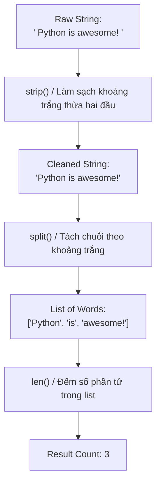

# Day 8: Xử lý Chuỗi ký tự

Python cung cấp hỗ trợ tích hợp rất mạnh mẽ để thao tác và làm việc với văn bản (str).

### 🎯 Mục tiêu học tập
- Thực hiện các thao tác xử lý chuỗi phổ biến bao gồm tách chuỗi (split), nối chuỗi (join), cắt khoảng trắng thừa (strip) và thay thế (replace).
- Áp dụng kỹ thuật cắt chuỗi (slicing) để trích xuất các phần cụ thể của một chuỗi.
- Giải thích khái niệm tính bất biến (immutability) của chuỗi trong Python và ảnh hưởng của nó đến bộ nhớ.
- Mô tả cơ chế String Interning (lưu trữ nội bộ/caching chuỗi) nhằm tối ưu hóa hiệu năng.

### 🧩 Khái niệm cốt lõi (Tại sao)
- **Chuỗi ký tự (String)** là một tập hợp các ký tự kế tiếp nhau. Chúng ta thường xuyên cần đọc, kiểm tra tính hợp lệ, làm sạch và định dạng văn bản.
- Python coi chuỗi ký tự là đối tượng **bất biến (immutable)**. Một khi đã được tạo ra trong bộ nhớ, giá trị của chuỗi không thể thay đổi tại chỗ (in-place). Nếu chúng ta muốn thay đổi nội dung của chuỗi, chúng ta buộc phải tạo ra một chuỗi mới. Cơ chế này giúp đảm bảo an toàn luồng (thread safety), bảo mật (ví dụ: khi dùng chuỗi làm key cho dictionary) và tối ưu hóa hiệu năng.

### 🔁 Logic và hoạt động
Dưới đây là quy trình xử lý để đếm số lượng từ trong một câu sử dụng kết hợp `strip()` và `split()`:


### 📝 Ví dụ minh họa có chú thích
```python
# 1. Tách chuỗi và Nối chuỗi
text = "apple,banana,orange"
fruits = text.split(",")  # Tách chuỗi bằng dấu phẩy: ['apple', 'banana', 'orange']
joined = " - ".join(fruits)  # Nối các phần tử: 'apple - banana - orange'

# 2. Cắt khoảng trắng và Thay thế
dirty = "   hello world! \n"
clean = dirty.strip()  # Loại bỏ khoảng trắng và xuống dòng ở hai đầu: 'hello world!'
replaced = clean.replace("world", "Python")  # Thay thế chuỗi con: 'hello Python!'

# 3. Cắt chuỗi (Slicing)
# chuoi[start:stop:step]
message = "PythonProgram"
print(message[0:6])   # 'Python' (các ký tự từ index 0 đến 5)
print(message[6:])    # 'Program' (các ký tự từ index 6 đến hết chuỗi)
print(message[::-1])  # 'margorPnohtyP' (đảo ngược chuỗi bằng cách sử dụng step -1)

# 4. Minh họa tính bất biến (Immutability)
s = "cat"
# s[0] = "b" # Gây lỗi TypeError!
s = "b" + s[1:] # Tạo một chuỗi hoàn toàn mới: "bat"
```

### ❌ Các lỗi thường gặp
**Lỗi 1: Cố gắng sửa đổi trực tiếp một ký tự trong chuỗi**
```python
name = "Jello"
name[0] = "H"
```
```text
TypeError: 'str' object does not support item assignment
```
```python
name = "Jello"
name = "H" + name[1:]  # Đúng: Tạo dựng một chuỗi mới
```
> Chuỗi ký tự trong Python là đối tượng bất biến. Bạn không thể sửa đổi chúng trực tiếp tại chỗ; thay vào đó, bạn phải xây dựng một chuỗi mới chứa các thay đổi mong muốn.

**Lỗi 2: Gọi phương thức `split()` nhưng nghĩ rằng nó thay đổi trực tiếp chuỗi gốc**
```python
line = "one two three"
line.split()
print(line)  # Mong muốn in ra chuỗi đã tách, nhưng vẫn in ra chuỗi gốc ban đầu
```
```text
one two three
```
```python
line = "one two three"
words = line.split()  # Đúng: Gán danh sách được trả về vào một biến mới
print(words)
```
> Các phương thức của chuỗi như `split()` không thay đổi trực tiếp chuỗi ban đầu (vì chuỗi là bất biến). Chúng trả về một danh sách hoặc chuỗi mới, do đó bạn cần gán kết quả đó vào một biến.

**Lỗi 3: Sai thứ tự cú pháp khi sử dụng `join()`**
```python
words = ["Python", "is", "fun"]
joined = words.join(" ")
```
```text
AttributeError: 'list' object has no attribute 'join'
```
```python
words = ["Python", "is", "fun"]
joined = " ".join(words)  # Đúng: Gọi phương thức join trên chuỗi phân tách
```
> Phương thức `join()` thuộc lớp chuỗi (str), không phải lớp danh sách (list). Chuỗi dùng làm ký tự phân tách là đối tượng gọi phương thức, và danh sách các chuỗi cần nối được truyền vào làm đối số.

### 💡 Mẹo & Cách viết tối ưu
- **Kiểm tra chuỗi con**: Sử dụng toán tử `in` để kiểm tra nhanh một chuỗi có chứa chuỗi con hay không: `"Py" in "Python"` (trả về `True`).
- **Chuỗi phương thức (Method Chaining)**: Vì các phương thức chuỗi trả về chuỗi mới, bạn có thể viết nối tiếp chúng: `text.strip().lower().replace(" ", "-")`.
- **F-string**: Sử dụng f-string để định dạng chuỗi dễ đọc và tối ưu hiệu năng hơn: `f"Hello {name}, you are {age} years old."`.

### 🧠 Đi sâu phân tích (Cơ chế bên dưới)
<details><summary>Tính bất biến trong bộ nhớ và String Interning</summary>

Chuỗi ký tự trong Python được tối ưu hóa rất mạnh mẽ bên dưới hệ thống:
1. **Tính bất biến**: Do chuỗi không bao giờ thay đổi, Python có thể tái sử dụng chúng một cách an toàn trong bộ nhớ.
2. **String Interning (Lưu trữ nội bộ)**: Đối với các chuỗi hằng số ngắn được xác định tại thời điểm biên dịch (thường là các chuỗi giống như tên biến hoặc chỉ chứa chữ và số), Python chỉ lưu trữ *duy nhất một bản sao* trong một dictionary nội bộ toàn cục (gọi là intern pool).
3. Nếu bạn tạo hai biến khác nhau cùng có giá trị là `"hello"`, chúng sẽ cùng trỏ tới một địa chỉ ô nhớ duy nhất. Bạn có thể kiểm tra điều này bằng toán tử `is`: `a = "hello"; b = "hello"; a is b` sẽ trả về `True`.
4. Việc tối ưu hóa này giúp tiết kiệm đáng kể bộ nhớ và đẩy nhanh tốc độ so sánh chuỗi, vì so sánh hai chuỗi đã được intern thực chất chỉ là so sánh con trỏ địa chỉ ô nhớ ($O(1)$) thay vì phải so sánh từng ký tự một ($O(n)$).
</details>

### 🏋️ Bài tập thực hành
Hãy hoàn thành hàm `count_words_in_sentence(sentence)` để chia chuỗi bằng các khoảng trắng và trả về tổng số lượng từ của câu đầu vào.

```python
def count_words_in_sentence(sentence):
    # Hoàn thành hàm để đếm số lượng từ trong câu.
    # Các từ được phân tách bằng khoảng trắng. Bỏ qua các câu rỗng.
    count = 0
    return count
```

### ✅ Tự kiểm tra
1. Phương thức `"  hello  ".strip()` trả về kết quả gì?
2. Nếu `text = "Python"`, thì `text[1:4]` sẽ là gì?
<details><summary>Xem đáp án</summary>

1. Trả về `"hello"` sau khi đã cắt bỏ các khoảng trắng thừa ở hai đầu.
2. Trả về `"yth"` (các ký tự ở index 1, 2, và 3).
</details>

### 📌 Tóm tắt
- Chuỗi ký tự trong Python là các chuỗi bất biến; mọi thao tác thay đổi đều tạo ra chuỗi mới.
- Các phương thức chuỗi phổ biến bao gồm `split()`, `join()`, `strip()`, và `replace()`.
- Sử dụng cú pháp cắt chuỗi (`[start:stop:step]`) để trích xuất một phần hoặc đảo ngược chuỗi.
- Python sử dụng cơ chế String Interning để tối ưu hóa bộ nhớ và tăng tốc độ so sánh các chuỗi bất biến giống nhau.
