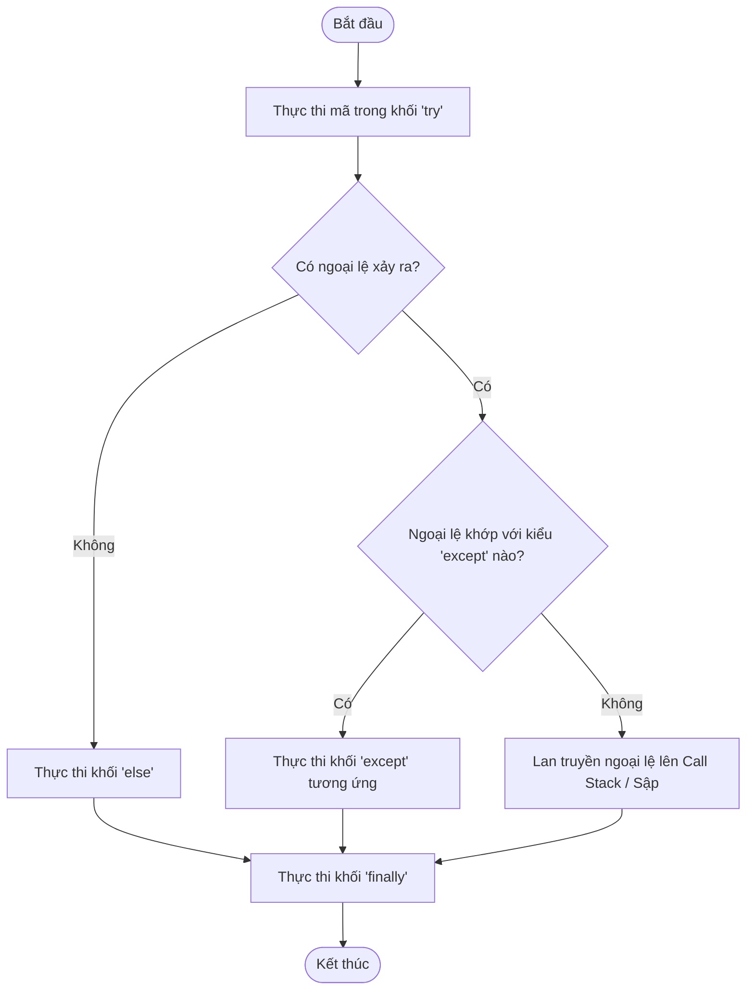

# Day 10: Xử lý Ngoại lệ (try-except)

Cho dù mã nguồn được viết tốt đến đâu thì lỗi vẫn có thể xảy ra. Người dùng có thể nhập dữ liệu không hợp lệ, một tệp tin có thể bị thiếu, hoặc phép chia cho 0 có thể xảy ra. Nếu không được xử lý, những lỗi này (được gọi là **ngoại lệ - exception** trong Python) sẽ làm crash (sập) chương trình. Xử lý ngoại lệ cho phép mã nguồn dự đoán trước lỗi, dừng hoạt động một cách an toàn, giải phóng tài nguyên và tiếp tục chạy.

### 🎯 Mục tiêu học tập
- Phân biệt giữa Lỗi cú pháp (Syntax Error) và Ngoại lệ thời gian chạy (Runtime Exception).
- Viết khối lệnh `try-except` để bắt và xử lý các ngoại lệ cụ thể (`ValueError`, `ZeroDivisionError`, `TypeError`).
- Sử dụng khối lệnh `else` và `finally` để quản lý luồng xử lý thành công và các quy trình dọn dẹp tài nguyên.
- Chủ động kích hoạt ngoại lệ bằng từ khóa `raise`.
- Định nghĩa các lớp ngoại lệ tùy chỉnh (custom exception) phục vụ cho việc xử lý lỗi theo nghiệp vụ riêng biệt.

### 🧩 Khái niệm cốt lõi (Tại sao)
Một **Ngoại lệ (Exception)** là một sự kiện được kích hoạt trong quá trình thực thi chương trình làm gián đoạn luồng chỉ thị thông thường.

Nếu không được xử lý, Python sẽ dừng thực thi và đưa ra Traceback (thông tin truy vết lỗi). Tuy nhiên, trong các ứng dụng thực tế (như máy chủ web hoặc ứng dụng di động), việc sập chương trình là không thể chấp nhận được. Chúng ta bọc mã nguồn có nguy cơ gây lỗi trong khối `try`. Nếu lỗi xảy ra, quyền kiểm soát được chuyển sang khối `except` tương ứng, ngăn chương trình bị sập.

Python cung cấp bốn khối lệnh chính để quản lý lỗi:
1. `try`: Chứa mã nguồn có khả năng gây ra ngoại lệ.
2. `except`: Xử lý lỗi nếu ngoại lệ xảy ra khớp với loại được chỉ định.
3. `else`: Chỉ chạy mã nguồn này nếu **không** có ngoại lệ nào xảy ra trong khối `try`.
4. `finally`: Luôn chạy **vô điều kiện** ở cuối cùng, bất kể lỗi có xảy ra hay không (cực kỳ hữu ích để dọn dẹp tài nguyên).

### 🔁 Logic và hoạt động
Sơ đồ dưới đây minh họa cách Python điều hướng luồng kiểm soát qua cấu trúc try-except-else-finally khi một ngoại lệ được kích hoạt hoặc bỏ qua.



### 📝 Ví dụ minh họa có chú thích

Dưới đây là cách bạn xử lý nhiều ngoại lệ và chạy các quy trình dọn dẹp trong Python:

```python
def process_data(val):
    # Cấu trúc đầy đủ try-except-else-finally
    try:
        # Chuyển đổi dữ liệu nhập sang số nguyên. Có thể gây lỗi ValueError.
        num = int(val)
        # Phép toán chia. Có thể gây lỗi ZeroDivisionError.
        result = 100 / num
    except ValueError as e:
        # Chỉ chạy nếu xảy ra lỗi ValueError (ví dụ: truyền vào chuỗi 'abc')
        print(f"Lỗi chuyển đổi: {e}")
        result = None
    except ZeroDivisionError as e:
        # Chỉ chạy nếu xảy ra lỗi ZeroDivisionError (khi truyền vào số 0)
        print(f"Lỗi tính toán: {e}")
        result = None
    else:
        # Chỉ chạy khi khối 'try' chạy thành công mà không gặp bất kỳ ngoại lệ nào
        print(f"Tính toán thành công. Kết quả: {result}")
    finally:
        # Luôn luôn chạy, bất kể có lỗi hay không. Dùng để reset trạng thái.
        print("Hoàn tất lượt xử lý dữ liệu.")
    return result

# --- Chủ động ném ngoại lệ ---
def set_age(age):
    if age < 0:
        # Chủ động kích hoạt ngoại lệ nếu dữ liệu nhập vi phạm quy tắc nghiệp vụ
        raise ValueError("Tuổi không được là số âm!")
    print(f"Tuổi đã đặt là: {age}")
```

### ❌ Các lỗi thường gặp

**Mistake 1: Sử dụng khối except chung chung không khai báo loại lỗi (bare except)**
```python
try:
    # Viết sai chính tả tên hàm print
    prnt("Hello")
except:
    print("An error occurred")
```
```text
NameError: name 'prnt' is not defined
```
```python
try:
    print("Hello")
except Exception as e:
    print(f"An unexpected error occurred: {e}")
```
> Việc sử dụng `except:` trống sẽ bắt tất cả các ngoại lệ, bao gồm cả lỗi cú pháp, lỗi viết sai chính tả, và các yêu cầu dừng hệ thống (như KeyboardInterrupt), khiến việc tìm lỗi (debug) trở nên cực kỳ khó khăn. Bạn nên luôn bắt các kiểu ngoại lệ cụ thể hoặc sử dụng `except Exception as e` để bắt các lỗi chạy chương trình thông thường trong khi vẫn cho phép các lỗi hệ thống/cú pháp lan truyền.

**Mistake 2: Truy cập vào các biến được khởi tạo sau dòng mã gây lỗi**
```python
try:
    value = int("invalid")
    result = value + 10
except ValueError:
    print(f"Failed. Result was: {result}")
```
```text
NameError: name 'result' is not defined
```
```python
result = None
try:
    value = int("invalid")
    result = value + 10
except ValueError:
    print("Failed to convert value.")
```
> Nếu một ngoại lệ được ném ra bên trong khối `try`, luồng xử lý sẽ ngay lập tức nhảy tới khối `except`. Bất kỳ biến nào được lên lịch định nghĩa sau dòng bị lỗi (như `result`) sẽ không tồn tại, dẫn đến lỗi `NameError` bên trong khối xử lý lỗi.

### 💡 Mẹo & Cách viết tối ưu
- **EAFP (Easier to Ask for Forgiveness than Permission - Dễ xin thứ lỗi hơn xin phép)**: Phong cách của Python ưa chuộng việc bọc các hành động trong `try-except` hơn là viết các câu lệnh `if` dài dòng để kiểm tra an toàn trước khi chạy (LBYL - Look Before You Leap). Cách viết này nhanh hơn khi ngoại lệ hiếm khi xảy ra và tránh được tình trạng tranh chấp tài nguyên (race conditions).
- **Bắt các lỗi cụ thể trước**: Nếu bạn đang xử lý nhiều ngoại lệ, hãy đặt các lớp con cụ thể hơn ở phía trên và các lớp cha chung (như `Exception`) ở phía dưới.
- **Dọn dẹp trong khối `finally`**: Luôn thực hiện việc giải phóng tài nguyên (đóng kết nối cơ sở dữ liệu, giải phóng khóa lock, thiết lập lại socket mạng) trong khối `finally` để đảm bảo chúng luôn được thực thi ngay cả khi chương trình bị crash hoặc trả về kết quả sớm.

### 🧠 Đi sâu phân tích (Cơ chế bên dưới)
<details>
<summary>Sự lan truyền ngoại lệ & Ngoại lệ tùy chỉnh</summary>

#### Call Stack & Sự lan truyền lỗi
Khi một ngoại lệ xảy ra bên trong một hàm, môi trường chạy của Python sẽ tìm kiếm trình xử lý `try-except` phù hợp trong phạm vi của hàm đó. Nếu không tìm thấy, hàm sẽ thoát ra và ngoại lệ sẽ lan truyền ngược lại hàm gọi nó. Quá trình lan truyền này lặp đi lặp lại dọc theo **Call Stack** (chuỗi các cuộc gọi hàm đang hoạt động). Nếu ngoại lệ chạm tới gốc của chương trình mà vẫn không được bắt, Python sẽ dừng lại và đưa ra traceback. Cơ chế này cho phép xử lý lỗi tập trung ở cấp cao nhất thay vì làm rối mọi hàm con bằng các đoạn kiểm tra lỗi.

#### Ngoại lệ tùy chỉnh (Custom Exceptions)
Trong các hệ thống lớn, các ngoại lệ tích hợp sẵn của Python đôi khi không đủ mô tả chi tiết lỗi. Bạn có thể tự định nghĩa các ngoại lệ của riêng mình bằng cách kế thừa lớp `Exception` có sẵn của Python:
```python
class InsufficientFundsError(Exception):
    """Ném ra khi số tiền rút khỏi tài khoản ngân hàng vượt quá số dư."""
    def __init__(self, balance, amount):
        super().__init__(f"Không thể rút ${amount}. Số dư hiện tại: ${balance}")
        self.balance = balance
        self.amount = amount
```
Việc ném ra lớp ngoại lệ tùy chỉnh này giúp cung cấp các cảnh báo logic nghiệp vụ rõ ràng cho các mô-đun khác.
</details>

### 🏋️ Bài tập thực hành
Hãy hoàn thành hàm `safe_divide(a, b)`:
1. Cố gắng trả về kết quả của phép chia `a / b`.
2. Nếu `b` bằng `0`, bắt lỗi `ZeroDivisionError` và trả về chuỗi `"ZeroDivisionError"`.
3. Nếu `a` hoặc `b` không phải là số hợp lệ (dẫn đến không khớp kiểu dữ liệu), bắt lỗi `TypeError` và trả về chuỗi `"TypeError"`.

Tham khảo khung code ban đầu ở khung bên phải để viết giải pháp của bạn.

### ✅ Tự kiểm tra
<details>
<summary>1. Khối lệnh "finally" có thực thi không nếu hàm trả về (return) sớm từ bên trong khối "try"?</summary>
Có. Ngay cả khi bạn có câu lệnh `return` bên trong khối `try` hoặc `except`, Python vẫn sẽ thực thi khối `finally` *trước khi* thực sự trả giá trị về cho hàm gọi.
</details>

<details>
<summary>2. Sự khác biệt giữa "except Exception as e" và "except:" trống là gì?</summary>
`except Exception as e` sẽ bắt tất cả các ngoại lệ kế thừa từ lớp cơ sở `Exception` (bao gồm hầu hết các lỗi logic thời gian chạy). Trong khi đó, `except:` trống sẽ bắt tuyệt đối mọi thứ, bao gồm cả các ngoại lệ cấp hệ thống như `SystemExit` và `KeyboardInterrupt` (Ctrl+C). Những lỗi này thường không nên bị chặn lại vì điều đó ngăn cản người dùng tắt một script đang bị treo.
</details>

### 📌 Tóm tắt
- Sử dụng `try-except` để bắt các ngoại lệ và ngăn chặn chương trình bị crash.
- **Cú pháp**: `try` chạy mã, `except` xử lý lỗi, `else` chạy khi thành công, `finally` luôn chạy.
- **Raise**: Sử dụng `raise ValueError("msg")` để chủ động kích hoạt các ngoại lệ.
- **Sự lan truyền**: Các ngoại lệ không được xử lý sẽ bong bóng truyền lên Call Stack cho đến khi được xử lý hoặc làm sập chương trình.
