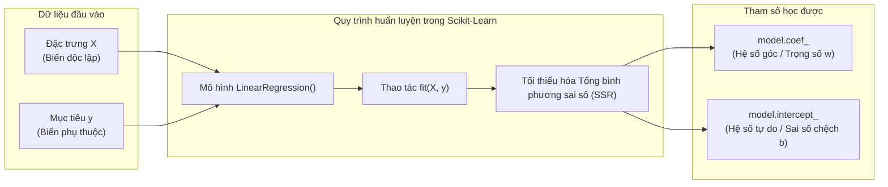

# Day 11: Hồi quy Tuyến tính với NumPy và Scikit-Learn

### 🎯 Mục tiêu học tập
- Giải thích được khái niệm cơ bản của Hồi quy tuyến tính và cách nó mô hình hóa mối quan hệ giữa các biến.
- Xác định được các thành phần của một mô hình hồi quy tuyến tính: đặc trưng (features $X$), mục tiêu (target $y$), hệ số hồi quy (`coef_`), và sai số chệch (`intercept_`).
- Triển khai và huấn luyện một mô hình Hồi quy Tuyến tính Đơn giản sử dụng thư viện Scikit-Learn.
- Giải thích được các tham số của mô hình sau khi huấn luyện để đưa ra dự báo cho dữ liệu mới.

### 🧩 Khái niệm cốt lõi (Tại sao)
Trong nhiều tình huống thực tế, chúng ta muốn dự đoán một giá trị số liên tục (chẳng hạn như giá nhà, nhiệt độ hoặc doanh số bán hàng) dựa trên một hoặc nhiều đặc điểm của đối tượng. Đây được gọi là bài toán **hồi quy (regression)**.
**Hồi quy tuyến tính (Linear Regression)** là thuật toán đơn giản và nền tảng nhất cho các bài toán hồi quy. Nó giả định rằng biến mục tiêu $y$ có thể được mô hình hóa bằng một tổ hợp tuyến tính (mối quan hệ đường thẳng) của các đặc trưng đầu vào $X$.
Tại sao chúng ta sử dụng hồi quy tuyến tính?
1. **Dễ giải thích**: Không giống như các mô hình hộp đen phức tạp, hồi quy tuyến tính cho thấy rõ ràng mục tiêu thay đổi bao nhiêu khi một đặc trưng thay đổi.
2. **Hiệu suất tính toán**: Thuật toán này đơn giản về mặt toán học và tốc độ huấn luyện rất nhanh.
3. **Mô hình cơ sở (Baseline)**: Nó đóng vai trò là điểm khởi đầu để đánh giá và so sánh các thuật toán phức tạp hơn.

### 🔁 Logic và hoạt động
Thuật toán tìm kiếm "đường thẳng khớp nhất" (best-fit line) bằng cách giảm thiểu khoảng cách thẳng đứng (sai số) giữa các điểm dữ liệu thực tế và đường thẳng dự đoán. Quá trình này được gọi là **Phương pháp Bình phương Cực tiểu (Ordinary Least Squares - OLS)**.



Phương trình toán học cho hồi quy tuyến tính đơn giản là:
$$y = w \cdot x + b$$
- $y$ là giá trị mục tiêu được dự đoán.
- $x$ là đặc trưng đầu vào.
- $w$ (hệ số góc/hệ số hồi quy) quyết định độ dốc của đường thẳng. Trong Scikit-Learn, giá trị này được lưu trữ trong `model.coef_`.
- $b$ (sai số chệch/hệ số tự do) là giá trị của $y$ khi $x = 0$. Trong Scikit-Learn, giá trị này được lưu trữ trong `model.intercept_`.

### 📝 Ví dụ minh họa có chú thích
Dưới đây là cách chuẩn bị dữ liệu, huấn luyện mô hình và kiểm tra các tham số của nó:
```python
import numpy as np
from sklearn.linear_model import LinearRegression

# 1. Chuẩn bị dữ liệu huấn luyện (X phải là mảng 2D, y phải là mảng 1D)
# X: Diện tích nhà (đơn vị: nghìn feet vuông)
X = np.array([[1.2], [1.6], [2.1], [2.4], [2.9]])
# y: Giá nhà tương ứng (đơn vị: trăm nghìn USD)
y = np.array([2.5, 3.2, 4.1, 4.9, 5.8])

# 2. Khởi tạo mô hình
model = LinearRegression()

# 3. Khớp mô hình vào dữ liệu (Bước huấn luyện)
model.fit(X, y)

# 4. Truy cập các tham số đã học
print("Hệ số góc (coef_):", model.coef_)       # Output: array([1.947]) -> Với mỗi 1000 sqft tăng thêm, giá nhà tăng khoảng ~195 nghìn USD
print("Hệ số tự do (intercept_):", model.intercept_) # Output: ~0.142 -> Giá nhà cơ bản khi diện tích bằng 0

# 5. Dự đoán trên dữ liệu mới (đầu vào phải là mảng 2D)
new_houses = np.array([[1.8], [2.5]])
predictions = model.predict(new_houses)
print("Dự đoán:", predictions) # Output: array([3.647, 5.010])
```

### ❌ Các lỗi thường gặp

**Lỗi 1: Truyền mảng 1D cho tập đặc trưng X**
```python
import numpy as np
from sklearn.linear_model import LinearRegression
X = np.array([1.0, 1.5, 2.0, 2.5, 3.0]) # Mảng 1D
y = np.array([2.0, 3.1, 3.8, 5.0, 6.2])
model = LinearRegression()
model.fit(X, y)
```
```text
ValueError: Expected 2D array, got 1D array instead:
array=[1.  1.5 2.  2.5 3. ].
Reshape your data either using array.reshape(-1, 1) if your data has a single feature or array.reshape(1, -1) if it contains a single sample.
```
```python
import numpy as np
from sklearn.linear_model import LinearRegression
X = np.array([[1.0], [1.5], [2.0], [2.5], [3.0]]) # Mảng 2D
y = np.array([2.0, 3.1, 3.8, 5.0, 6.2])
model = LinearRegression()
model.fit(X, y)
```
> Các bộ ước lượng (estimator) của Scikit-Learn yêu cầu ma trận đặc trưng `X` phải là mảng 2D có dạng `(n_samples, n_features)`. Ngay cả khi chỉ có một đặc trưng duy nhất, nó vẫn phải được định dạng dưới dạng một vector cột 2D.

**Lỗi 2: Dự đoán trước khi huấn luyện mô hình**
```python
import numpy as np
from sklearn.linear_model import LinearRegression
model = LinearRegression()
model.predict(np.array([[2.0]]))
```
```text
sklearn.exceptions.NotFittedError: This LinearRegression instance is not fitted yet. Call 'fit' with appropriate arguments before using this estimator.
```
```python
import numpy as np
from sklearn.linear_model import LinearRegression
X = np.array([[1.0], [2.0], [3.0]])
y = np.array([2.0, 4.0, 6.0])
model = LinearRegression()
model.fit(X, y) # Huấn luyện trước!
model.predict(np.array([[2.0]]))
```
> Bạn luôn phải gọi phương thức `fit(X, y)` trước khi sử dụng `predict()` để mô hình có thể học được các tham số tối ưu từ dữ liệu.

**Lỗi 3: Không khớp số lượng mẫu giữa X và y**
```python
import numpy as np
from sklearn.linear_model import LinearRegression
X = np.array([[1.0], [2.0], [3.0]])
y = np.array([2.0, 4.0]) # Chỉ có 2 mẫu
model = LinearRegression()
model.fit(X, y)
```
```text
ValueError: Found input variables with inconsistent numbers of samples: [3, 2]
```
```python
import numpy as np
from sklearn.linear_model import LinearRegression
X = np.array([[1.0], [2.0], [3.0]])
y = np.array([2.0, 4.0, 6.0]) # Số lượng mẫu trùng khớp
model = LinearRegression()
model.fit(X, y)
```
> Số lượng hàng trong `X` (số mẫu) phải hoàn toàn bằng với số phần tử trong `y`.

### 💡 Mẹo & Cách viết tối ưu
- **Đổi hình dạng cột (Reshaping)**: Nếu bạn có một mảng NumPy 1D `arr` và cần chuyển nó thành vector cột 2D cho Scikit-Learn, hãy sử dụng `arr.reshape(-1, 1)`. Giá trị `-1` yêu cầu NumPy tự động tính toán số hàng dựa trên chiều dài của mảng.
- **Điểm R-squared**: Bạn có thể đánh giá nhanh hiệu suất của mô hình trên dữ liệu huấn luyện bằng `model.score(X, y)`. Đối với hồi quy tuyến tính, phương thức này trả về Hệ số xác định ($R^2$), thể hiện tỷ lệ biến động của mục tiêu được giải thích bởi các đặc trưng (dao động từ 0 đến 1).
- **Hồi quy Đa biến**: Lớp `LinearRegression` cũng xử lý đồng thời nhiều đặc trưng một cách dễ dàng. Nếu $X$ có kích thước `(n_samples, 3)`, `model.coef_` sẽ chứa 3 hệ số hồi quy tương ứng với từng đặc trưng.

### 🧠 Đi sâu phân tích (Cơ chế bên dưới)
<details><summary>Hàm mất mát Phương pháp Bình phương Cực tiểu (OLS) và Phương trình (Click để mở rộng)</summary>

Hồi quy tuyến tính tối ưu hóa các tham số $w$ và $b$ bằng cách giảm thiểu **Tổng bình phương các phần dư (RSS)**, hay chính là trung bình của bình phương các sai lệch giữa giá trị dự đoán và giá trị thực tế. Đây được gọi là hàm mất mát **Sai số bình phương trung bình (MSE)**:

$$J(w, b) = \frac{1}{2m} \sum_{i=1}^{m} \left( (w x^{(i)} + b) - y^{(i)} \right)^2$$

Trong đó $m$ là số lượng mẫu, $x^{(i)}$ là đặc trưng của mẫu thứ $i$, và $y^{(i)}$ là giá trị mục tiêu thực tế của mẫu thứ $i$.

#### Nghiệm dạng đóng (Phương trình chuẩn - Normal Equation)
Đối với hồi quy tuyến tính tổng quát, trong đó $\theta$ đại diện cho tất cả các hệ số (bao gồm cả hệ số tự do), chúng ta có thể giải tìm các tham số tối ưu bằng toán học chỉ trong một bước thông qua **Phương trình chuẩn**:

$$\theta = (X^T X)^{-1} X^T y$$

Mặc dù rất đẹp mắt về mặt toán học, việc tính toán ma trận nghịch đảo $(X^T X)^{-1}$ có thể rất chậm nếu số lượng đặc trưng cực kỳ lớn (ví dụ: > 10.000) vì phép nghịch đảo ma trận có độ phức tạp tính toán xấp xỉ $\mathcal{O}(n^3)$. Trong những trường hợp đó, các thuật toán tối ưu hóa lặp như Gradient Descent (Cực tiểu hóa độ dốc) sẽ được ưu tiên sử dụng.
</details>

### 🏋️ Bài tập thực hành
Hãy hoàn thành hàm `train_model(X, y)` để khởi tạo mô hình Scikit-Learn `LinearRegression`, huấn luyện nó bằng các đặc trưng `X` và mục tiêu `y` được cung cấp, sau đó trả về đối tượng mô hình đã huấn luyện.

```python
import numpy as np
from sklearn.linear_model import LinearRegression

# Đặc trưng (Features): Diện tích nhà (đơn vị: nghìn feet vuông)
X = np.array([[1.0], [1.5], [2.0], [2.5], [3.0]])
# Mục tiêu (Target): Giá nhà (đơn vị: trăm nghìn USD)
y = np.array([2.0, 3.1, 3.8, 5.0, 6.2])

def train_model(X, y):
    # Tạo một đối tượng LinearRegression, fit dữ liệu X và y, sau đó trả về mô hình đã huấn luyện
    model = None
    return model
```

### ✅ Tự kiểm tra
1. Nếu mô hình của bạn chỉ có một đặc trưng, kích thước (shape) của `model.coef_` là gì và kiểu dữ liệu (type) của `model.intercept_` là gì?
2. Nếu `model.coef_` là `[2.5]` và `model.intercept_` là `1.0`, giá trị mục tiêu dự đoán cho giá trị đặc trưng đầu vào là `4.0` là bao nhiêu?
<details><summary>Đáp án</summary>

1. `model.coef_` là một mảng NumPy 1D có kích thước `(1,)` chứa hệ số hồi quy. `model.intercept_` là một số thực (`float`).
2. Công thức dự đoán là $y = w \cdot x + b$. Ở đây, $y = 2.5 \cdot (4.0) + 1.0 = 10.0 + 1.0 = 11.0$.
</details>

### 📌 Tóm tắt
- **Hồi quy tuyến tính** khớp một đường thẳng $y = w x + b$ để dự đoán các giá trị số liên tục.
- Scikit-Learn yêu cầu các đặc trưng `X` là mảng 2D và mục tiêu `y` là mảng 1D.
- Các hệ số học được lưu trữ trong `model.coef_` và hệ số tự do nằm ở `model.intercept_`.
- Sử dụng `model.fit(X, y)` để huấn luyện và `model.predict(X_new)` để đưa ra dự báo.
