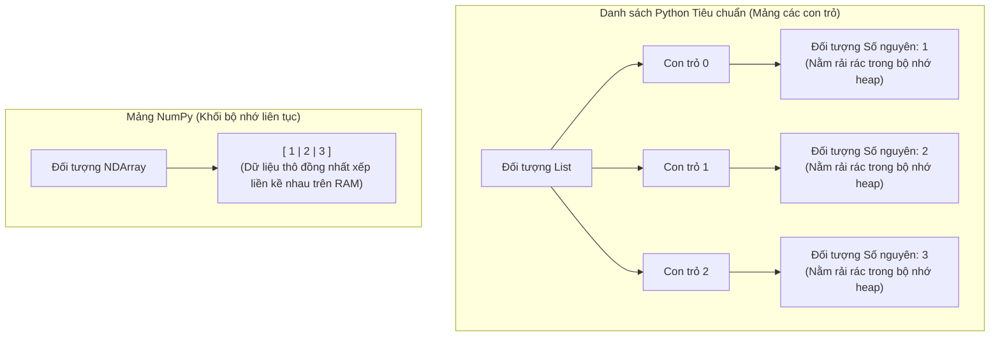

# Day 12: Mảng NumPy & Các phép toán Vector

### 🎯 Mục tiêu học tập
- Giải thích được NumPy là gì và tại sao nó vượt trội hơn danh sách (list) Python tiêu chuẩn đối với các tính toán số học.
- Mô tả được các thuộc tính chính của mảng NumPy, bao gồm `shape`, `ndim`, và `dtype`.
- Tạo được mảng NumPy bằng cách sử dụng các hàm hỗ trợ như `np.zeros()`, `np.ones()`, và `np.eye()`.
- Thực hiện được các phép toán vector hóa, cơ chế broadcasting (lan truyền) và nhân ma trận.

### 🧩 Khái niệm cốt lõi (Tại sao)
Trong khoa học dữ liệu và học máy, chúng ta liên tục làm việc với các tập hợp số lớn (ma trận, vector và tensor).
Mặc dù Python tiêu chuẩn có kiểu dữ liệu list, nhưng chúng không được thiết kế cho các tính toán toán học hiệu năng cao.
List trong Python là các mảng chứa con trỏ trỏ đến các đối tượng nằm rải rác trong bộ nhớ, điều này gây ra độ trễ (overhead) lớn do việc kiểm tra kiểu dữ liệu và tra cứu vùng nhớ liên tục.
**NumPy** (Numerical Python) cung cấp **ndarray** (mảng N chiều), có các đặc điểm:
1. **Nhanh**: Được triển khai bằng ngôn ngữ C, tận dụng cách bố trí bộ nhớ liên tục và các tối ưu hóa cấp độ CPU (vector hóa và SIMD).
2. **Tiết kiệm bộ nhớ**: Lưu trữ dữ liệu đồng nhất (cùng kiểu dữ liệu), tránh việc tốn dung lượng cho các đối tượng Python phức tạp.
3. **Tiện lợi**: Hỗ trợ các phép toán toán học trên toàn bộ mảng mà không cần viết các vòng lặp rõ ràng.

### 🔁 Logic và hoạt động
Lý do chính khiến NumPy chạy cực nhanh là cấu trúc **bố trí bộ nhớ liên tục** (contiguous memory layout) so với danh sách dạng con trỏ của Python.



Bằng cách lưu trữ các giá trị liền kề nhau trong bộ nhớ, CPU có thể nạp chúng vào bộ nhớ đệm (cache) nhanh hơn nhiều. Hơn nữa, các phép toán của NumPy đều được **vector hóa** (vectorized) — chúng thực thi các vòng lặp cấp mã máy được biên dịch bằng C thay vì chạy qua trình thông dịch Python, cho phép phần cứng thực hiện các phép toán song song SIMD (Single Instruction Multiple Data - Một chỉ thị nhiều dữ liệu).

### 📝 Ví dụ minh họa có chú thích

Dưới đây là cách tạo, kiểm tra thuộc tính và thực hiện tính toán với mảng NumPy:

```python
import numpy as np

# 1. Tạo mảng và kiểm tra thuộc tính
arr = np.array([[1, 2, 3], [4, 5, 6]], dtype=np.float32)
print("Mảng:\n", arr)
print("Kích thước (Shape):", arr.shape)    # Output: (2, 3) -> 2 hàng, 3 cột
print("Số chiều (Dimensions):", arr.ndim) # Output: 2 -> Mảng 2 chiều
print("Kiểu dữ liệu (Data Type):", arr.dtype) # Output: float32

# 2. Các hàm hỗ trợ tạo mảng có sẵn
zeros_arr = np.zeros((2, 2))  # Tạo một ma trận không (zeros) kích thước 2x2
ones_arr = np.ones((3, 1))    # Tạo một vector cột 3x1 chứa toàn số 1
identity_matrix = np.eye(3)   # Tạo một ma trận đơn vị kích thước 3x3

# 3. Phép toán vector hóa (Không cần vòng lặp!)
a = np.array([1, 2, 3])
b = np.array([10, 20, 30])
print("Phép cộng:", a + b)       # Output: [11, 22, 33]
print("Phép nhân với số vô hướng:", a * 3) # Output: [3, 6, 9]

# 4. Cơ chế Broadcasting (Thực hiện phép toán trên các mảng khác kích thước)
matrix = np.array([[1, 2, 3], [4, 5, 6]]) # Kích thước (2, 3)
row_vector = np.array([10, 20, 30])      # Kích thước (3,)
# row_vector được tự động kéo giãn thành kích thước (2, 3) để khớp với matrix
print("Tổng sau khi Broadcast:\n", matrix + row_vector) 
# Output:
# [[11, 22, 33]
#  [14, 25, 36]]

# 5. Phép nhân ma trận
A = np.array([[1, 2], [3, 4]])
B = np.array([[5, 6], [7, 8]])
# Sử dụng toán tử @ hoặc np.dot() để nhân ma trận
print("Tích ma trận:\n", A @ B)
# Output:
# [[19, 22]
#  [43, 50]]
```

### ❌ Các lỗi thường gặp

**Lỗi 1: Sử dụng phép nhân từng phần tử (*) khi muốn thực hiện nhân ma trận**
```python
import numpy as np
A = np.array([[1, 2], [3, 4]])
B = np.array([[5, 6], [7, 8]])
# Ý định thực hiện nhân ma trận
result = A * B
```
```text
# Không có lỗi nào xảy ra, nhưng kết quả là nhân từng phần tử tương ứng:
# [[ 5, 12]
#  [21, 32]]
```
```python
import numpy as np
A = np.array([[1, 2], [3, 4]])
B = np.array([[5, 6], [7, 8]])
# Phép nhân ma trận đúng cách
result = A @ B
```
> Trong NumPy, toán tử dấu sao `*` thực hiện nhân từng phần tử tương ứng (element-wise multiplication). Để thực hiện nhân ma trận thực sự (tích vô hướng), bạn phải sử dụng toán tử `@` hoặc hàm `np.dot(A, B)`.

**Lỗi 2: Gọi các phương thức của list như .append() trên mảng NumPy**
```python
import numpy as np
arr = np.array([1, 2, 3])
arr.append(4)
```
```text
AttributeError: 'numpy.ndarray' object has no attribute 'append'
```
```python
import numpy as np
arr = np.array([1, 2, 3])
arr = np.append(arr, 4) # Tạo ra một mảng mới
```
> Mảng NumPy có kích thước cố định trong bộ nhớ. Bạn không thể thêm (append) phần tử trực tiếp trên đối tượng cũ (in-place). Các hàm như `np.append()` sẽ cấp phát và trả về một mảng hoàn toàn mới, đây là một thao tác khá tốn tài nguyên.

**Lỗi 3: Không tương thích kích thước khi thực hiện lan truyền (broadcasting)**
```python
import numpy as np
matrix = np.array([[1, 2], [3, 4]]) # Kích thước (2, 2)
vec = np.array([10, 20, 30])        # Kích thước (3,)
result = matrix + vec
```
```text
ValueError: operands could not be broadcast together with shapes (2,2) (3,) 
```
```python
import numpy as np
matrix = np.array([[1, 2], [3, 4]]) # Kích thước (2, 2)
vec = np.array([10, 20])            # Kích thước (2,)
result = matrix + vec
```
> Để cơ chế broadcasting có thể hoạt động, kích thước ở các chiều tương ứng tính từ phải qua của các mảng phải bằng nhau, hoặc một trong các mảng phải có kích thước bằng 1 ở chiều đó.

### 💡 Mẹo & Cách viết tối ưu
- **Tránh dùng vòng lặp**: Bất cứ khi nào bạn định viết một vòng lặp `for` để duyệt qua các phần tử của một mảng NumPy, hãy dừng lại và tìm kiếm một giải pháp vector hóa thay thế. Vòng lặp trong Python rất chậm, trong khi các phép toán vector hóa được thực thi ở mức mã máy đã được biên dịch và tối ưu.
- **Các trục (axis) trong NumPy**: Nhiều hàm thu gọn (như `np.sum()`, `np.mean()`) nhận vào đối số `axis`. `axis=0` thực hiện phép toán dọc theo các hàng (thu gọn hàng, giữ lại cột), trong khi `axis=1` thực hiện phép toán dọc theo các cột (thu gọn cột, giữ lại hàng).
- **Views (Góc nhìn) và Copies (Bản sao)**: Việc cắt mảng (ví dụ: `sub_arr = arr[0:2]`) chỉ tạo ra một **view** (chia sẻ cùng vùng nhớ với mảng gốc), chứ không tạo ra bản sao mới. Thay đổi giá trị trên `sub_arr` sẽ thay đổi giá trị trên mảng gốc `arr`. Nếu muốn có một bản sao hoàn toàn độc lập, hãy sử dụng `arr[0:2].copy()`.

### 🧠 Đi sâu phân tích (Cơ chế bên dưới)
<details><summary>Quản lý bước nhảy bộ nhớ (Strides): Row-major (C) và Column-major (Fortran) (Click để mở rộng)</summary>

Bên dưới lớp vỏ đa chiều, một mảng ndarray thực tế được lưu trữ dưới dạng một khối bộ nhớ phẳng 1D liên tục. Để coi khối bộ nhớ 1D này là 2D hoặc 3D, NumPy sử dụng thuộc tính **strides** (bước nhảy bộ nhớ).
Strides là một tuple các số nguyên thể hiện số byte cần nhảy qua trong mỗi chiều để di chuyển tới phần tử tiếp theo.

Đối với một mảng 2D chứa các số thực float 32-bit (mỗi số chiếm 4 byte) có kích thước `(3, 3)`:
- **C-Contiguous (Row-major - Ưu tiên dòng)**: Các phần tử của cùng một hàng được lưu trữ cạnh nhau.
  - Thứ tự trong bộ nhớ: `[0,0], [0,1], [0,2], [1,0], [1,1], [1,2], [2,0], [2,1], [2,2]`
  - Strides: `(12, 4)` -> Để di chuyển xuống hàng tiếp theo (cùng một cột), cần nhảy qua 12 byte (3 phần tử). Để di chuyển sang cột tiếp theo bên phải (cùng một hàng), cần nhảy qua 4 byte (1 phần tử).
- **F-Contiguous (Column-major - Ưu tiên cột)**: Các phần tử của cùng một cột được lưu trữ cạnh nhau.
  - Thứ tự trong bộ nhớ: `[0,0], [1,0], [2,0], [0,1], [1,1], [2,1], [0,2], [1,2], [2,2]`
  - Strides: `(4, 12)` -> Để di chuyển xuống hàng tiếp theo, nhảy qua 4 byte. Để di chuyển sang cột tiếp theo bên phải, nhảy qua 12 byte.

Hiểu về strides giải thích lý do tại sao phép chuyển vị ma trận (`arr.T`) trong NumPy lại diễn ra tức thì: NumPy hoàn toàn không di chuyển bất kỳ dữ liệu nào trong bộ nhớ vật lý; nó chỉ đơn giản là hoán đổi các giá trị trong tuple strides!
</details>

### 🏋️ Bài tập thực hành
Hãy hoàn thành hàm `matrix_operations(n)` để thực hiện các thao tác sau:
1. Tạo một ma trận đơn vị kích thước $n \times n$ bằng `np.eye(n)`.
2. Nhân ma trận đó với 5 để co giãn (scale) tỷ lệ.
3. Tính và trả về tổng các hàng của ma trận đã nhân bằng cách sử dụng `np.sum(..., axis=1)`.

```python
import numpy as np

def matrix_operations(n):
    # 1. Tạo một ma trận đơn vị kích thước n x n bằng np.eye(n)
    # 2. Nhân ma trận với 5 để co giãn (scale) tỷ lệ
    # 3. Tính và trả về tổng các hàng của ma trận đã nhân bằng np.sum(..., axis=1)
    row_sums = None
    return row_sums
```

### ✅ Tự kiểm tra
1. Nếu bạn có một mảng với kích thước (shape) là `(3, 4, 5)`, thuộc tính `arr.ndim` sẽ trả về giá trị bao nhiêu?
2. Nếu `arr = np.array([1, 2])` và bạn thực hiện `arr + 10`, kết quả trả về sẽ là gì? Tại sao?
<details><summary>Đáp án</summary>

1. Hàm sẽ trả về `3` vì shape có ba chiều.
2. Nó sẽ trả về `[11, 12]` do cơ chế broadcasting. Số vô hướng `10` được tự động kéo giãn thành `[10, 10]` để khớp với hình dạng của mảng `arr`, sau đó thực hiện cộng từng phần tử tương ứng.
</details>

### 📌 Tóm tắt
- **NumPy** nhanh hơn list trong Python nhờ việc cấp phát bộ nhớ liên tục và thực thi các phép toán vector hóa viết bằng C.
- Thuộc tính `shape` mô tả kích thước các chiều, và `dtype` chỉ định kiểu dữ liệu đồng nhất của mảng.
- Phép toán vector hóa và cơ chế **broadcasting** cho phép tính toán giữa các mảng khác kích thước mà không cần dùng vòng lặp.
- Sử dụng `@` để nhân ma trận và chỉ định `axis` trong các hàm thu gọn để định hướng cho các phép tính toán.
