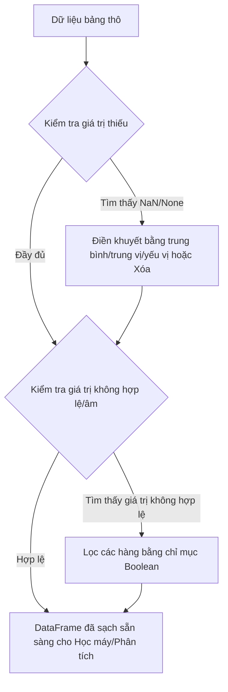

# Day 13: Pandas DataFrame & Làm sạch Dữ liệu

### 🎯 Mục tiêu học tập
- Phân biệt giữa Pandas Series và DataFrame.
- Sử dụng phương thức chỉ mục `.loc` và `.iloc` để lựa chọn hàng và cột.
- Lọc dữ liệu dạng bảng sử dụng chỉ mục boolean.
- Phát hiện và điền khuyết các giá trị thiếu sử dụng `.fillna()`.
- Tránh và khắc phục lỗi cảnh báo `SettingWithCopyWarning`.

### 🧩 Khái niệm cốt lõi (Tại sao)
Trong khoa học dữ liệu và học máy thực tế, các tập dữ liệu thô hiếm khi sạch sẽ. Chúng chứa các giá trị bị thiếu, bản ghi không hợp lệ hoặc định dạng không nhất quán. Mặc dù các mảng NumPy rất xuất sắc trong các tính toán toán học trên dữ liệu đồng nhất, chúng lại không được thiết kế để dễ dàng xử lý dữ liệu dạng bảng có nhãn và chứa nhiều kiểu dữ liệu khác nhau.

Pandas giới thiệu hai cấu trúc dữ liệu chính để giải quyết vấn đề này:
1. **Series**: Mảng một chiều có nhãn có khả năng lưu trữ bất kỳ kiểu dữ liệu nào (số nguyên, chuỗi, số thực, đối tượng Python). Nó đại diện cho một cột duy nhất của bảng.
2. **DataFrame**: Cấu trúc dữ liệu dạng bảng hai chiều có kích thước thay đổi được và có khả năng chứa các kiểu dữ liệu khác nhau với các trục được dán nhãn (hàng và cột). Nó đại diện cho toàn bộ một bảng.

Làm sạch dữ liệu là quá trình phát hiện và sửa chữa các bản ghi bị hỏng hoặc không chính xác từ một tập hợp bản ghi, bảng hoặc cơ sở dữ liệu. Bằng cách học cách làm sạch dữ liệu, bạn đảm bảo rằng mô hình học máy mà bạn huấn luyện sẽ nhận được dữ liệu đầu vào chất lượng cao, từ đó trực tiếp mang lại độ chính xác dự đoán tốt hơn.

### 🔁 Logic và hoạt động
Quy trình làm sạch dữ liệu bao gồm tải dữ liệu, xác định các khoảng trống hoặc bản ghi xấu, sửa chữa chúng và lọc bỏ các giá trị ngoại lệ hoặc các hàng không hợp lệ.



- **Điền khuyết (Imputation)**: Điền vào các giá trị bị thiếu (`NaN`) bằng các giá trị thay thế hợp lý về mặt thống kê (như giá trị trung bình của cột đó) giúp ngăn chặn các thuật toán phía sau bị lỗi.
- **Mặt nạ Boolean (Boolean Masking)**: Tạo một Series chứa các giá trị `True` / `False` tương ứng với việc hàng đó có đáp ứng điều kiện hay không, và sử dụng nó để chỉ chọn các hàng khớp với điều kiện.

### 📝 Ví dụ minh họa có chú thích
Hãy tạo một DataFrame, truy cập các giá trị cụ thể, điền khuyết dữ liệu bị thiếu và lọc ra các hàng không hợp lệ.

```python
import pandas as pd
import numpy as np

# 1. Tạo một Series và một DataFrame
names = pd.Series(["Alice", "Bob", "Charlie"], name="Name")
data = {
    "name": ["Alice", "Bob", "Charlie", "David"],
    "age": [25.0, np.nan, 30.0, 40.0],
    "salary": [50000.0, 60000.0, -1000.0, np.nan]
}
df = pd.DataFrame(data)
print(df)
# Kết quả:
#       name   age   salary
# 0    Alice  25.0  50000.0
# 1      Bob   NaN  60000.0
# 2  Charlie  30.0  -1000.0
# 3    David  40.0      NaN

# 2. Chọn dữ liệu bằng .loc (dựa trên nhãn) và .iloc (dựa trên vị trí số nguyên)
# Chọn giá trị ở nhãn hàng 1, cột 'name'
print(df.loc[1, "name"])  # Kết quả: 'Bob'

# Chọn giá trị ở hàng vị trí 1, cột vị trí 0
print(df.iloc[1, 0])      # Kết quả: 'Bob'

# 3. Kiểm tra các giá trị thiếu
print(df.isna())          # Trả về một DataFrame chứa các giá trị boolean chỉ định trạng thái thiếu

# 4. Điền khuyết các giá trị thiếu bằng giá trị trung bình của cột
age_mean = df["age"].mean()       # (25 + 30 + 40) / 3 = 31.666...
df["age"] = df["age"].fillna(age_mean)

salary_mean = df["salary"].mean() # (50000 + 60000 - 1000) / 3 = 36333.333...
df["salary"] = df["salary"].fillna(salary_mean)

# 5. Lọc bỏ các hàng có salary âm
cleaned_df = df[df["salary"] >= 0]
print(cleaned_df)
# Kết quả:
#     name        age        salary
# 0  Alice  25.000000  50000.000000
# 1    Bob  31.666667  60000.000000
# 3  David  40.000000  36333.333333
```

### ❌ Các lỗi thường gặp

**Lỗi 1: Chỉ mục liên kết (Chained Indexing) gây ra cảnh báo SettingWithCopyWarning**
```python
df = pd.DataFrame({'age': [20, 30, 40]})
df[df['age'] > 25]['age'] = 25
```
```text
SettingWithCopyWarning: 
A value is trying to be set on a copy of a slice from a DataFrame.
Try using .loc[row_indexer,col_indexer] = value instead
```
```python
df = pd.DataFrame({'age': [20, 30, 40]})
df.loc[df['age'] > 25, 'age'] = 25
```
> Chỉ mục liên kết trả về một bản sao tạm thời của DataFrame, nghĩa là các phép gán sẽ không sửa đổi dữ liệu gốc. Hãy sử dụng `.loc` để ghi trực tiếp vào DataFrame gốc.

**Lỗi 2: Kiểm tra các giá trị thiếu bằng toán tử so sánh bằng `== np.nan`**
```python
df = pd.DataFrame({'age': [20, np.nan, 40]})
missing = df[df['age'] == np.nan]
print(missing)
```
```text
Empty DataFrame
Columns: [age]
Index: []
```
```python
df = pd.DataFrame({'age': [20, np.nan, 40]})
missing = df[df['age'].isna()]
print(missing)
```
> Các giá trị NaN dấu phẩy động không bằng chính nó (`np.nan == np.nan` là False). Hãy sử dụng phương thức `.isna()` hoặc `.isnull()` để kiểm tra các giá trị thiếu.

**Lỗi 3: Cố gắng truy cập vị trí hàng bằng cách lựa chọn nhãn trên chỉ mục**
```python
df = pd.DataFrame({'age': [20, 30]}, index=['a', 'b'])
row = df.loc[0]
```
```text
KeyError: 0
```
```python
df = pd.DataFrame({'age': [20, 30]}, index=['a', 'b'])
row = df.iloc[0]
```
> `.loc` lựa chọn các hàng bằng tên nhãn tùy chỉnh (trong trường hợp này là `'a'` hoặc `'b'`). Để truy cập theo vị trí số nguyên, hãy sử dụng `.iloc`.

### 💡 Mẹo & Cách viết tối ưu
- **Sử dụng `.copy()`**: Khi chọn một tập con của một DataFrame mà bạn dự định sửa đổi, hãy nối thêm `.copy()` để tách nó ra khỏi DataFrame gốc và tránh các sửa đổi lan truyền ngược lại.
- **Xử lý các giá trị ngoại lệ**: Bạn có thể cắt các giá trị ngoại lệ giữa các khoảng phân vị bằng cách sử dụng `df['column'].clip(lower=min_val, upper=max_val)`.
- **Thao tác chuỗi**: Khi làm việc với văn bản, hãy truy cập các phương thức chuỗi vectơ hóa thông qua trình truy cập `.str`, ví dụ như `df['name'].str.strip()`.

### 🧠 Đi sâu phân tích (Cơ chế bên dưới)
<details><summary>BlockManager và ngữ nghĩa View (Xem) so với Copy (Bản sao) (Click để mở rộng)</summary>

Pandas quản lý dữ liệu dạng bảng trong nội bộ bằng cách sử dụng một đối tượng gọi là `BlockManager`. Thay vì lưu trữ dữ liệu theo từng hàng, nó nhóm các cột có cùng kiểu dữ liệu (ví dụ: float64, int64, object) thành các mảng NumPy 2D liên tiếp trong bộ nhớ gọi là các Block.

```
DataFrame
 ├── Nhãn cột: ['name', 'age', 'salary']
 └── BlockManager
      ├── FloatBlock: Các cột ['age', 'salary'] (mảng NumPy float64 2D)
      └── ObjectBlock: Cột ['name'] (mảng NumPy object 1D)
```

#### Tại sao xảy ra lỗi `SettingWithCopyWarning`
Khi bạn lập chỉ mục một DataFrame trong Python, Pandas quyết định trả về một *view* (một tham chiếu trỏ đến Block hiện có trong bộ nhớ) hoặc một *copy* (một khối bộ nhớ mới được phân bổ).

Nếu một lát cắt (slice) là một *view*, việc sửa đổi nó sẽ thay đổi DataFrame cha. Nếu nó là một *copy*, việc sửa đổi nó không thay đổi DataFrame cha. Trong chỉ mục liên kết như `df[df['age'] > 25]['age'] = 25`:
1. Lệnh `df[df['age'] > 25]` chạy trước, và Pandas tạo ra một DataFrame tạm thời. Do sự phức tạp của việc lập chỉ mục, đây có thể là một copy hoặc một view.
2. Phép gán `['age'] = 25` chạy tiếp theo trên DataFrame tạm thời này.
3. Pandas cảnh báo bạn vì nếu DataFrame tạm thời là một copy, phép gán của bạn sẽ bị hủy bỏ và không có tác dụng gì đối với `df` gốc.

Sử dụng `.loc[row_indexer, col_indexer]` đảm bảo rằng việc lựa chọn và gán được gửi tới `BlockManager` như một lệnh duy nhất, cho phép Pandas sửa đổi trực tiếp Block bên dưới trong bộ nhớ.
</details>

### 🏋️ Bài tập thực hành
Hãy hoàn thành hàm `clean_and_filter(df)` để:
1. Điền khuyết các giá trị thiếu trong cột `'age'` bằng giá trị trung bình của cột đó.
2. Điền khuyết các giá trị thiếu trong cột `'salary'` bằng giá trị trung bình của cột đó.
3. Lọc bỏ các hàng có `'salary'` nhỏ hơn `0`.
4. Trả về DataFrame đã được làm sạch.

```python
import pandas as pd

def clean_and_filter(df):
    # 1. Fill missing values in 'age' and 'salary' columns with the respective column mean
    # 2. Filter out rows where 'salary' is less than 0
    # 3. Return the cleaned DataFrame
    cleaned_df = None
    return cleaned_df
```

### ✅ Tự kiểm tra
1. Sự khác biệt giữa `.loc` và `.iloc` là gì?
2. Nếu `df` có cột `'price'` chứa các giá trị thiếu, cách an toàn nhất để thay thế chúng bằng `0` tại chỗ (in-place) mà không gây ra cảnh báo là gì?
<details><summary>Đáp án</summary>

1. `.loc` lập chỉ mục dữ liệu bằng cách sử dụng *nhãn* hàng và cột (tên), trong khi `.iloc` lập chỉ mục dữ liệu bằng cách sử dụng *vị trí số nguyên* hàng và cột (các chỉ số bắt đầu từ 0).
2. Sử dụng `.loc` để truy cập và gán trực tiếp, hoặc sử dụng `.fillna()` cùng phép gán:
   ```python
   df['price'] = df['price'].fillna(0)
   ```
</details>

### 📌 Tóm tắt
- **Series** đại diện cho một cột duy nhất và **DataFrame** đại diện cho một bảng dữ liệu 2D.
- Sử dụng `.loc` để lựa chọn dựa trên nhãn và `.iloc` để lựa chọn dựa trên vị trí.
- Luôn sử dụng `.isna()` để kiểm tra `NaN` và `.fillna()` để điền khuyết giá trị thiếu.
- Không bao giờ thực hiện các phép gán chỉ mục liên kết như `df[cond]['col'] = val`. Hãy sử dụng `df.loc[cond, 'col'] = val` thay thế.
