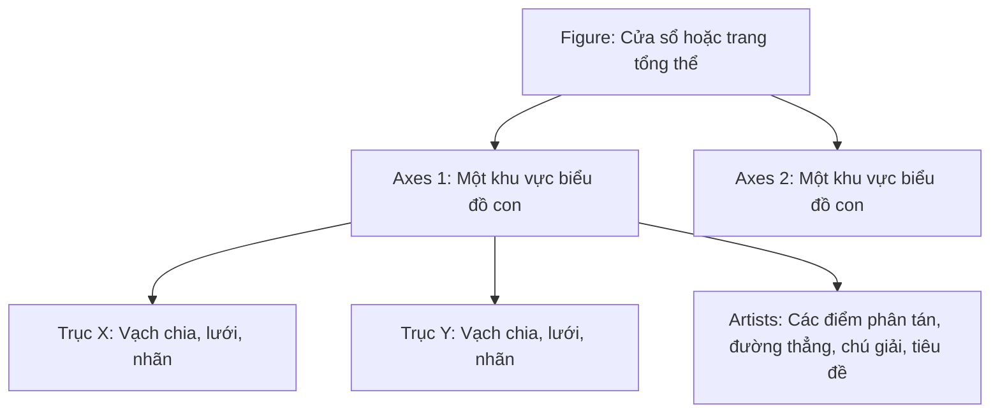

# Day 14: Trực quan hóa Dữ liệu với Matplotlib

### 🎯 Mục tiêu học tập
- So sánh sự khác biệt giữa hai phương pháp vẽ biểu đồ: dựa trên trạng thái (`pyplot`) và hướng đối tượng (OO) trong Matplotlib.
- Tạo biểu đồ phân tán (scatter plot), biểu đồ đường (line plot) và biểu đồ cột (bar plot).
- Tùy chỉnh biểu đồ với nhãn, tiêu đề, lưới tọa độ và chú giải tùy chỉnh.
- Xuất và lưu biểu đồ vào đĩa bằng phương thức `savefig()`.

### 🧩 Khái niệm cốt lõi (Tại sao)
Trực quan hóa dữ liệu là việc biểu diễn thông tin và dữ liệu dưới dạng đồ họa. Bằng cách sử dụng các yếu tố trực quan như biểu đồ, đồ thị và bản đồ, các công cụ trực quan hóa cung cấp một cách dễ tiếp cận để quan sát và hiểu các xu hướng, giá trị ngoại lệ và các mẫu hình trong dữ liệu.

Trong học máy và khoa học dữ liệu, trực quan hóa là cực kỳ thiết yếu cho:
1. **Phân tích khám phá dữ liệu (EDA - Exploratory Data Analysis)**: Trước khi đưa dữ liệu vào mô hình, bạn cần hiểu mối quan hệ giữa các đặc trưng (ví dụ: kiểm tra xem hai đặc trưng có tương quan tuyến tính với nhau hay không).
2. **Chẩn đoán mô hình**: Việc vẽ biểu đồ hàm mất mát (loss) của tập huấn luyện so với tập kiểm thử qua các kỷ nguyên (epoch) giúp phát hiện hiện tượng quá khớp (overfitting) hoặc chưa khớp (underfitting).
3. **Truyền đạt thông tin**: Các bên liên quan (stakeholders) hiểu các biểu đồ nhanh hơn nhiều so với việc nhìn vào các ma trận số thô.

Matplotlib là thư viện vẽ đồ thị nền tảng trong Python. Hầu hết các thư viện trực quan hóa Python khác (như Seaborn hoặc trình bao `.plot()` nội bộ của Pandas) đều được xây dựng trên nền tảng của Matplotlib. Học Matplotlib giúp bạn có toàn quyền kiểm soát ở mức độ chi tiết (low-level) đối với từng thành phần trong biểu đồ của mình.

### 🔁 Logic và hoạt động
Matplotlib tách biệt các đối tượng hình ảnh (Figure - cửa sổ/khung vẽ tổng thể) khỏi các trục tọa độ (Axes - các biểu đồ con chứa hệ tọa độ).



Matplotlib cung cấp hai giao diện chính để xây dựng các biểu đồ này:
1. **Giao diện dựa trên trạng thái Pyplot (`plt.plot`)**: Tự động theo dõi hình ảnh/trục tọa độ đang hoạt động và chuyển các lệnh vẽ biểu đồ tới chúng. Cách tiếp cận này đơn giản và nhanh chóng cho các tác vụ tương tác nhanh.
2. **Giao diện hướng đối tượng (OO - Object-Oriented Interface) (`fig, ax = plt.subplots()`)**: Bạn tạo rõ ràng các đối tượng Figure và Axes và gọi các phương thức trực tiếp trên chúng. Đây là phong cách được khuyến nghị cho các biểu đồ phức tạp hoặc lồng nhau vì nó tránh được xung đột trạng thái.

### 📝 Ví dụ minh họa có chú thích
Hãy so sánh cách tiếp cận dựa trên trạng thái và cách tiếp cận hướng đối tượng khi tạo các loại biểu đồ khác nhau.

```python
import matplotlib.pyplot as plt

# --- 1. Giao diện dựa trên trạng thái Pyplot (Biểu đồ đường) ---
plt.clf()  # Xóa bất kỳ hình ảnh nào đang hoạt động để bắt đầu mới

# Tọa độ dữ liệu
x_line = [1, 2, 3, 4, 5]
y_line = [2, 4, 6, 8, 10]

plt.plot(x_line, y_line, color="blue", marker="o", label="Tăng trưởng tuyến tính")
plt.xlabel("Giá trị đầu vào")
plt.ylabel("Giá trị đầu ra")
plt.title("Biểu đồ đường (Dựa trên trạng thái)")
plt.grid(True)
plt.legend()
plt.savefig("pyplot_line.png")  # Lưu biểu đồ dưới dạng PNG

# --- 2. Giao diện hướng đối tượng (Biểu đồ phân tán) ---
# Subplots trả về một đối tượng Figure và một đối tượng Axes (hoặc một mảng các Axes)
fig, ax = plt.subplots()

x_scatter = [5, 7, 8, 7, 2, 17, 2, 9, 4, 11]
y_scatter = [99, 86, 87, 88, 111, 86, 103, 87, 94, 78]

# Tạo biểu đồ phân tán trên Axes 'ax'
ax.scatter(x_scatter, y_scatter, color="orange", label="Điểm dữ liệu")

# Trong phong cách OO, các phương thức thường bắt đầu bằng tiền tố 'set_'
ax.set_xlabel("Tuổi đời ô tô (năm)")
ax.set_ylabel("Tốc độ tối đa (mph)")
ax.set_title("Tuổi đời xe so với Tốc độ (Phong cách OO)")
ax.grid(True)
ax.legend()

# Lưu biểu đồ thông qua đối tượng Figure
fig.savefig("oo_scatter.png")

# --- 3. Tạo biểu đồ cột ---
plt.clf()
categories = ["A", "B", "C", "D"]
values = [15, 24, 9, 32]

plt.bar(categories, values, color="green")
plt.title("Ví dụ biểu đồ cột")
plt.savefig("bar_chart.png")
```

### ❌ Các lỗi thường gặp

**Lỗi 1: Các biểu đồ bị đè lên nhau do không xóa hình ảnh cũ**
```python
import matplotlib.pyplot as plt
plt.plot([1, 2], [10, 20])
plt.savefig("plot1.png")
plt.plot([1, 2], [30, 40]) # Vẽ đè lên trên plot1!
plt.savefig("plot2.png")
```
```text
(Không có traceback lỗi, nhưng plot2.png chứa cả hai tập dữ liệu thay vì chỉ chứa tập dữ liệu thứ hai)
```
```python
import matplotlib.pyplot as plt
plt.plot([1, 2], [10, 20])
plt.savefig("plot1.png")
plt.clf() # Xóa hình ảnh hiện tại
plt.plot([1, 2], [30, 40])
plt.savefig("plot2.png")
```
> Matplotlib duy trì một trạng thái toàn cục trong `pyplot`. Nếu bạn không gọi `plt.clf()` hoặc `plt.close()`, các lệnh gọi tiếp theo tới `plot()` sẽ tiếp tục vẽ trên cùng một trục tọa độ đang hoạt động.

**Lỗi 2: Trộn lẫn các phương thức hướng đối tượng trên giao diện Pyplot dựa trên trạng thái**
```python
import matplotlib.pyplot as plt
plt.set_xlabel("Trục X")
```
```text
AttributeError: module 'matplotlib.pyplot' has no attribute 'set_xlabel'
```
```python
import matplotlib.pyplot as plt
plt.xlabel("Trục X") # hoặc ax.set_xlabel() nếu sử dụng giao diện OO
```
> Các thuộc tính trên `pyplot` được thiết lập trực tiếp bằng cách sử dụng các hàm (ví dụ: `plt.xlabel()`), trong khi trên các đối tượng `Axes`, chúng được thiết lập bằng các phương thức có tiền tố `set_` (ví dụ: `ax.set_xlabel()`).

### 💡 Mẹo & Cách viết tối ưu
- **Tránh việc nhãn bị cắt bỏ**: Đôi khi tiêu đề dài hoặc nhãn trục bị cắt ở rìa hình ảnh được lưu. Hãy luôn gọi `plt.tight_layout()` hoặc sử dụng tham số `bbox_inches='tight'` trong `savefig` để tự động điều chỉnh kích thước:
  ```python
  plt.savefig("plot.png", bbox_inches="tight")
  ```
- **Sử dụng DPI để có chất lượng in ấn tốt**: Theo mặc định, biểu đồ được lưu có thể trông mờ. Sử dụng đối số `dpi` (dots per inch) để tăng độ phân giải:
  ```python
  plt.savefig("high_res.png", dpi=300)
  ```
- **Ẩn các đường lưới phía sau cột**: Khi vẽ biểu đồ cột, các đường lưới có thể đè lên trên các cột biểu đồ. Sử dụng `ax.set_axisbelow(True)` để vẽ các đường lưới phía dưới các yếu tố đồ họa.

### 🧠 Đi sâu phân tích (Cơ chế bên dưới)
<details><summary>Kiến trúc của Matplotlib và Kết xuất Backend Không giao diện/Pyodide (Click để mở rộng)</summary>

Matplotlib bao gồm một kiến trúc ba lớp:
1. **Lớp kịch bản (Scripting Layer)**: Module `matplotlib.pyplot`, cung cấp giao diện đơn giản để người dùng xây dựng các biểu đồ.
2. **Lớp đồ họa (Artist Layer)**: Hệ thống phân cấp lớp đại diện cho tất cả các thành phần đồ họa trong một hình ảnh (ví dụ: `Figure`, `Axes`, `Axis`, `Line2D`, `Rectangle`). Lớp Artist biết cách bố cục và sắp xếp các thành phần này tương quan với nhau.
3. **Lớp nền tảng (Backend Layer)**: Công cụ kết xuất các lệnh vẽ lên một thiết bị hoặc định dạng tệp cụ thể.

#### Backend Tương tác so với Không tương tác
Trên một máy tính cá nhân tiêu chuẩn, Matplotlib phát hiện trình quản lý cửa sổ hệ điều hành của bạn và tải một backend GUI tương tác (như `TkAgg`, `QtAgg`, hoặc `MacOSX`) để tạo một cửa sổ bật lên hiển thị biểu đồ của bạn.

Tuy nhiên, trong môi trường không có giao diện đồ họa (headless) — chẳng hạn như máy chủ đám mây chạy tác vụ định kỳ (Cron job) hoặc môi trường hộp cát trình duyệt WebAssembly (như Pyodide):
- Không có máy chủ hiển thị hoặc hệ thống quản lý cửa sổ để mở một cửa sổ đồ họa.
- Matplotlib chuyển sang một backend không tương tác, thường là **Agg** (công cụ Anti-Grain Geometry).
- Backend Agg kết xuất các hình học cơ bản (đường thẳng, vòng tròn, văn bản) trực tiếp vào một vùng đệm pixel trong RAM.
- Khi `plt.savefig(filename)` được gọi, backend sẽ chuyển đổi vùng đệm này thành một định dạng tệp nén (như PNG) và ghi luồng byte trực tiếp vào đĩa (hoặc hệ thống tệp bộ nhớ ảo MEMFS của Pyodide).

Điều này cho phép bạn tạo ra các biểu đồ một cách liền mạch trong các quy trình tự động hoặc các môi trường thực thi Python chạy trong trình duyệt mà không cần bất kỳ phần cứng đầu ra hiển thị nào.
</details>

### 🏋️ Bài tập thực hành
Hãy hoàn thành hàm `save_scatter_plot(x, y, filename)` để:
1. Xóa mọi hình ảnh đang hoạt động hiện tại bằng cách sử dụng `plt.clf()`.
2. Tạo một biểu đồ phân tán của `x` so với `y` bằng cách sử dụng `plt.scatter(x, y)`.
3. Thêm các tiêu đề và nhãn sau:
   - Nhãn trục X: `'X-Axis'`
   - Nhãn trục Y: `'Y-Axis'`
   - Tiêu đề biểu đồ: `'Scatter Plot'`
4. Lưu hình ảnh vào đĩa bằng cách sử dụng `plt.savefig(filename)`.
5. Trả về `True` nếu thành công.

```python
import matplotlib.pyplot as plt

def save_scatter_plot(x, y, filename):
    # Viết mã của bạn ở đây
    return False
```

### ✅ Tự kiểm tra
1. Hàm nào được sử dụng để tạo các biểu đồ con trong Matplotlib và trả về cả đối tượng figure và axes?
2. Làm thế nào để xóa một hình ảnh trong Matplotlib nhằm ngăn các biểu đồ khác nhau đè lên nhau?
<details><summary>Đáp án</summary>

1. `plt.subplots()` (ví dụ: `fig, ax = plt.subplots()`).
2. Sử dụng `plt.clf()` để xóa hình ảnh hiện tại, hoặc `plt.close()` để đóng hoàn toàn hình ảnh đó.
</details>

### 📌 Tóm tắt
- Matplotlib sử dụng một **Figure** làm khung vẽ (canvas) và một hoặc nhiều **Axes** làm các biểu đồ riêng lẻ.
- Giao diện **Pyplot** hoạt động dựa trên trạng thái, trong khi API **Subplots** hoạt động theo hướng đối tượng.
- Sử dụng `plt.scatter()` cho biểu đồ phân tán, `plt.plot()` cho biểu đồ đường và `plt.bar()` cho biểu đồ cột.
- Luôn luôn xóa các hình ảnh bằng `plt.clf()` giữa các chuỗi vẽ biểu đồ liên tiếp trong API dựa trên trạng thái.
