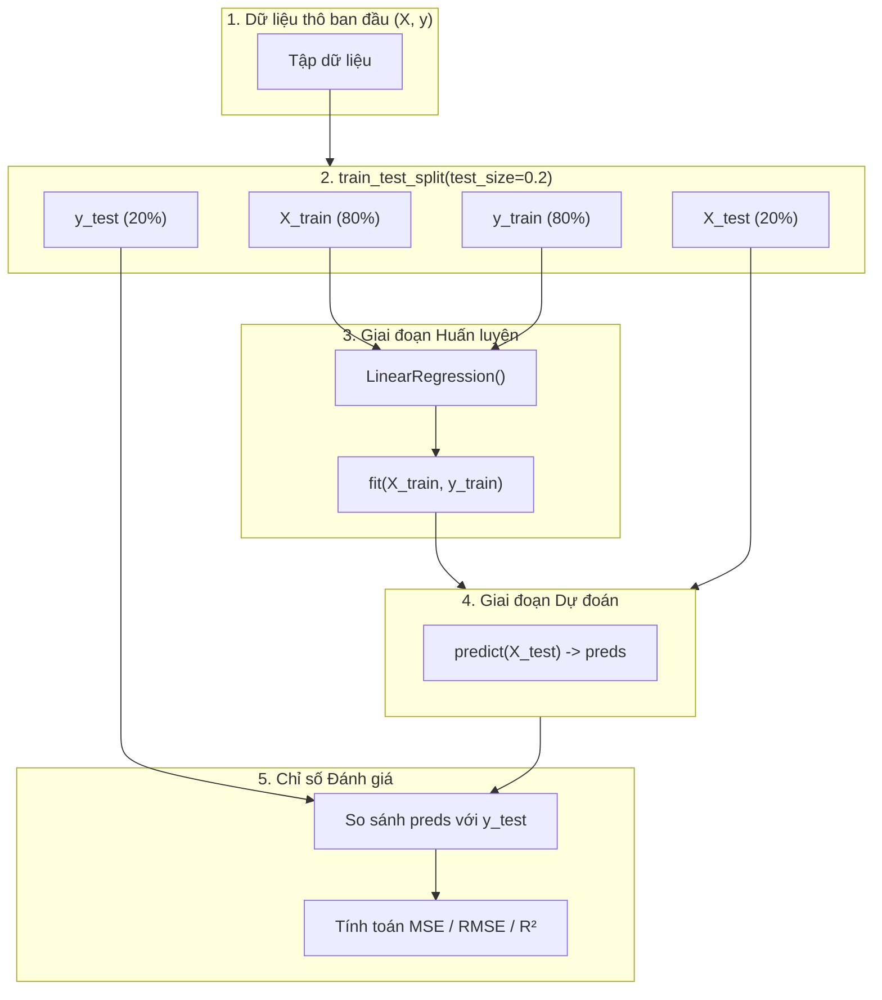

# Day 15: Chia dữ liệu Train/Test & Đánh giá Mô hình

### 🎯 Mục tiêu học tập
- Giải thích được tại sao việc phân chia dữ liệu thành tập huấn luyện (training set) và kiểm thử (test set) là cần thiết để đánh giá khả năng tổng quát hóa của mô hình.
- Phân biệt được sự khác nhau giữa quá khớp (overfitting) và chưa khớp (underfitting).
- Tính toán và giải thích được ý nghĩa của các chỉ số đánh giá mô hình hồi quy: Sai số bình phương trung bình (MSE), Căn bậc hai sai số bình phương trung bình (RMSE), và Hệ số xác định ($R^2$).
- Triển khai quy trình huấn luyện và đánh giá mô hình sử dụng hàm `train_test_split` của thư viện Scikit-Learn.

### 🧩 Khái niệm cốt lõi (Tại sao)
Khi huấn luyện một mô hình học máy, mục tiêu hàng đầu của chúng ta là đưa ra dự đoán chính xác trên **dữ liệu mới, chưa từng thấy**. Nếu chúng ta đánh giá mô hình trên chính dữ liệu đã dùng để huấn luyện nó, chúng ta sẽ nhận được kết quả đánh giá cực kỳ lạc quan nhưng không thực tế. Sai lầm nghiêm trọng này được gọi là **rò rỉ dữ liệu (data leakage)** hoặc đánh giá trên dữ liệu huấn luyện.

Để đo lường hiệu suất thực tế của mô hình một cách khách quan, chúng ta chia tập dữ liệu gốc thành hai phần chính:
1. **Tập huấn luyện (Training Set)**: Được mô hình sử dụng để học hỏi các mối quan hệ và tối ưu hóa các tham số của nó.
2. **Tập kiểm thử (Test Set)**: Được ẩn hoàn toàn trong suốt quá trình huấn luyện. Nó đóng vai trò như một bộ kiểm tra độc lập để đo lường khả năng tổng quát hóa của mô hình trên dữ liệu mới.

Nếu không thực hiện việc phân chia này, chúng ta sẽ đối mặt với hai nguy cơ lớn:
- **Quá khớp (Overfitting / Phương sai cao)**: Mô hình học quá kỹ các chi tiết nhiễu và biến động ngẫu nhiên của tập huấn luyện thay vì học quy luật cốt lõi. Mô hình hoạt động cực kỳ tốt trên tập huấn luyện nhưng thất bại thảm hại trên tập kiểm thử.
- **Chưa khớp (Underfitting / Độ chệch cao)**: Mô hình quá đơn giản để nắm bắt quy luật của dữ liệu (ví dụ: dùng một đường thẳng để khớp với dữ liệu dạng hình parabol). Mô hình cho kết quả kém trên cả tập huấn luyện lẫn kiểm thử.

### 🔁 Logic và hoạt động
Quy trình đánh giá tiêu chuẩn bao gồm: phân chia dữ liệu thô, huấn luyện mô hình trên tập huấn luyện con, dự đoán trên tập kiểm thử con, và tính toán các chỉ số đánh giá để đo lường sai số.



#### Các Chỉ số Đánh giá
Chúng ta sử dụng các chỉ số định lượng sau để đo lường mức độ sai lệch giữa giá trị dự đoán của mô hình và giá trị thực tế:

1. **Sai số bình phương trung bình (MSE - Mean Squared Error)**: Trung bình của bình phương các sai số giữa giá trị dự đoán ($\hat{y}$) và giá trị thực tế ($y$). MSE phạt nặng các sai số lớn do có phép bình phương.
   $$MSE = \frac{1}{n} \sum_{i=1}^{n} (y_i - \hat{y}_i)^2$$
2. **Căn bậc hai sai số bình phương trung bình (RMSE - Root Mean Squared Error)**: Căn bậc hai của MSE. Chỉ số này đưa đơn vị sai số về cùng đơn vị của biến mục tiêu, giúp chúng ta dễ hình dung hơn.
   $$RMSE = \sqrt{MSE}$$
3. **Hệ số xác định ($R^2$)**: Đo lường tỷ lệ biến động của biến mục tiêu có thể giải thích được từ các đặc trưng đầu vào. Điểm $R^2$ bằng 1.0 nghĩa là mô hình dự đoán hoàn hảo, trong khi 0.0 tương đương với việc mô hình chỉ đơn giản dự đoán giá trị trung bình của biến mục tiêu.

### 📝 Ví dụ minh họa có chú thích
Dưới đây là cách chia tập dữ liệu, huấn luyện mô hình và tính toán cả ba chỉ số đánh giá bằng thư viện Scikit-Learn:
```python
import numpy as np
from sklearn.model_selection import train_test_split
from sklearn.linear_model import LinearRegression
from sklearn.metrics import mean_squared_error, r2_score

# 1. Tạo tập dữ liệu mô phỏng
np.random.seed(42)
X = np.random.rand(100, 1) * 10  # 100 mẫu, 1 đặc trưng
y = 3.5 * X.squeeze() + np.random.randn(100) * 3  # Biến mục tiêu có chút nhiễu

# 2. Chia tập dữ liệu thành tập huấn luyện (80%) và kiểm thử (20%)
X_train, X_test, y_train, y_test = train_test_split(X, y, test_size=0.2, random_state=42)

# 3. Khởi tạo và huấn luyện mô hình chỉ trên dữ liệu huấn luyện
model = LinearRegression()
model.fit(X_train, y_train)

# 4. Dự đoán trên tập đặc trưng kiểm thử
predictions = model.predict(X_test)

# 5. Tính toán các chỉ số đánh giá trên tập kiểm thử
mse = mean_squared_error(y_test, predictions)
rmse = np.sqrt(mse)
r2 = r2_score(y_test, predictions)

print(f"Mean Squared Error (MSE): {mse:.4f}")       # Đo lường phương sai sai số bình phương
print(f"Root Mean Squared Error (RMSE): {rmse:.4f}") # Sai số cùng đơn vị với biến mục tiêu y
print(f"R-squared Score (R2): {r2:.4f}")             # Độ khớp của mô hình (từ 0 đến 1)
```

### ❌ Các lỗi thường gặp

**Lỗi 1: Đánh giá mô hình trên dữ liệu huấn luyện thay vì dữ liệu kiểm thử**
```python
from sklearn.metrics import mean_squared_error
model.fit(X_train, y_train)
preds = model.predict(X_train)
mse = mean_squared_error(y_train, preds)
```
```text
(Không xảy ra lỗi Traceback, nhưng MSE thu được cực kỳ thấp và không đại diện cho hiệu suất thực tế)
```
```python
model.fit(X_train, y_train)
preds = model.predict(X_test) # Dự đoán trên dữ liệu kiểm thử chưa từng thấy
mse = mean_squared_error(y_test, preds) # Đánh giá bằng nhãn thực tế của tập test
```
> Đánh giá trên tập huấn luyện giống như làm một bài thi mà bạn đã được biết trước đề bài; điều này che giấu hiện tượng quá khớp và tạo ra ảo tưởng về độ chính xác.

**Lỗi 2: Không đồng nhất số lượng mẫu khi tính toán chỉ số**
```python
from sklearn.metrics import mean_squared_error
preds = model.predict(X_test)
mse = mean_squared_error(y_train, preds)
```
```text
ValueError: Found input variables with inconsistent numbers of samples: [80, 20]
```
```python
preds = model.predict(X_test)
mse = mean_squared_error(y_test, preds)
```
> Luôn so sánh giá trị dự đoán `preds` (được tính từ `X_test`) với nhãn thực tế tương ứng của tập kiểm thử (`y_test`).

**Lỗi 3: Chia độc lập X và y dẫn tới mất đồng bộ dòng**
```python
from sklearn.model_selection import train_test_split
X_train, X_test = train_test_split(X, test_size=0.2, random_state=42)
y_train, y_test = train_test_split(y, test_size=0.2, random_state=24) # Khác seed!
```
```text
(Không có lỗi xuất hiện ngay lúc chia dữ liệu, nhưng huấn luyện hoặc đánh giá mô hình sau đó sẽ cho ra kết quả sai lệch do các dòng bị lệch nhau)
```
```python
X_train, X_test, y_train, y_test = train_test_split(X, y, test_size=0.2, random_state=42)
```
> Luôn truyền cả `X` và `y` vào cùng một lệnh gọi `train_test_split` để đảm bảo các cặp mẫu đầu vào - đầu ra vẫn khớp nhau và sử dụng chung seed ngẫu nhiên.

### 💡 Mẹo & Cách viết tối ưu
- **Cố định random state**: Luôn thiết lập `random_state` bằng một số nguyên cố định (ví dụ: `42`) để đảm bảo việc phân chia dữ liệu luôn giống nhau sau mỗi lần chạy. Nếu bỏ qua, tập dữ liệu sẽ bị chia ngẫu nhiên khác nhau mỗi lần chạy, khiến kết quả đánh giá không nhất quán.
- **Phân chia phân tầng (Stratify)**: Đối với bài toán phân loại (classification), hãy thêm tham số `stratify=y` trong `train_test_split` để giữ nguyên tỷ lệ phân bổ của các lớp (classes) trên cả tập huấn luyện và tập kiểm thử.
- **Tính toán RMSE**: Từ phiên bản Scikit-Learn 1.4+, bạn có thể import hàm `root_mean_squared_error` trực tiếp từ `sklearn.metrics`, tuy nhiên cú pháp `np.sqrt(mean_squared_error(y_test, preds))` vẫn tương thích tốt nhất trên mọi phiên bản.

### 🧠 Đi sâu phân tích (Cơ chế bên dưới)
<details><summary>Đánh đổi giữa Độ chệch và Phương sai (Bias-Variance Tradeoff) (Click để mở rộng)</summary>

Sai số dự đoán của bất kỳ mô hình học máy nào trên dữ liệu mới đều có thể được phân tích về mặt toán học thành ba thành phần:

$$\text{Sai số kiểm thử kỳ vọng} = \text{Bias}^2 + \text{Variance} + \text{Sai số không thể giảm bớt}$$

#### 1. Độ chệch (Bias - Sai số do các giả định quá đơn giản)
- **Độ chệch cao** dẫn đến hiện tượng **Chưa khớp (Underfitting)**.
- Mô hình không đủ khả năng nắm bắt độ phức tạp của dữ liệu. Ví dụ, một mô hình tuyến tính cố gắng khớp với một phân phối dạng sóng phức tạp sẽ có độ chệch rất cao.
- **Triệu chứng**: Kết quả kém trên cả tập huấn luyện và tập kiểm thử.

#### 2. Phương sai (Variance - Sai số do sự nhạy cảm với các biến động trong dữ liệu huấn luyện)
- **Phương sai cao** dẫn đến hiện tượng **Quá khớp (Overfitting)**.
- Mô hình quá linh hoạt và học luôn cả phần nhiễu có trong tập huấn luyện. Nếu thay đổi nhẹ dữ liệu huấn luyện, các tham số của mô hình sẽ thay đổi cực kỳ lớn.
- **Triệu chứng**: Sai số trên tập huấn luyện rất thấp nhưng sai số trên tập kiểm thử lại rất cao.

#### 3. Sai số không thể giảm bớt (Irreducible Error)
- Nhiễu tự nhiên trong quá trình thu thập dữ liệu (ví dụ: sai số đo lường). Không có mô hình nào có thể loại bỏ được sai số này.

#### Tìm điểm cân bằng
Khi độ phức tạp của mô hình tăng lên, độ chệch giảm đi nhưng phương sai lại tăng lên. Mục tiêu của học máy là tìm ra điểm tối ưu (sweet spot) nhằm giảm thiểu tổng của hai loại sai số này.

```text
Sai số
  ^
  |      \             /  Tổng Sai số (Bias^2 + Variance)
  |       \  *----*   /
  |        \         /
  | Độ chệch\       /   Phương sai
  |   cao    \     /       cao
  |(Chưa khớp)\   /     (Quá khớp)
  |            \_/ <--- Điểm tối ưu (Độ phức tạp lý tưởng)
  +--------------------------------------> Độ phức tạp mô hình
```
</details>

### 🏋️ Bài tập thực hành
Hãy hoàn thành hàm `split_and_evaluate(X, y)` để chia dữ liệu `X` và `y` thành các tập huấn luyện và kiểm thử (theo tỷ lệ 80/20 và `random_state=42`), huấn luyện mô hình `LinearRegression` trên tập training, dự đoán trên tập kiểm thử, sau đó tính toán và trả về Sai số bình phương trung bình (MSE) thu được trên tập kiểm thử.

```python
import numpy as np
from sklearn.model_selection import train_test_split
from sklearn.linear_model import LinearRegression
from sklearn.metrics import mean_squared_error

def split_and_evaluate(X, y):
    # 1. Chia dữ liệu thành tập train và test (test_size=0.2, random_state=42)
    # 2. Huấn luyện mô hình LinearRegression trên tập training
    # 3. Dự đoán mục tiêu trên tập test
    # 4. Tính toán và trả về Sai số bình phương trung bình (MSE) trên tập test
    mse = 0.0
    return mse
```

### ✅ Tự kiểm tra
1. Nếu mô hình của bạn đạt độ chính xác 99% trên tập huấn luyện nhưng chỉ đạt 60% trên tập kiểm thử, hiện tượng này được gọi là gì?
2. Chỉ số nào, MSE hay RMSE, có cùng đơn vị đo lường với biến mục tiêu?
<details><summary>Đáp án</summary>

1. Hiện tượng này được gọi là **Quá khớp (Overfitting)** (mô hình có phương sai cao và không thể tổng quát hóa trên dữ liệu mới).
2. **RMSE** (Căn bậc hai sai số bình phương trung bình) có cùng đơn vị với biến mục tiêu vì nó đã được lấy căn bậc hai để khử phép bình phương.
</details>

### 📌 Tóm tắt
- **Chia dữ liệu** ngăn ngừa hiện tượng rò rỉ dữ liệu và giúp đánh giá hiệu suất tổng quát hóa của mô hình một cách khách quan.
- **Quá khớp** xảy ra khi mô hình học cả nhiễu của tập train; **chưa khớp** xảy ra khi mô hình quá đơn giản.
- **Sai số bình phương trung bình (MSE)** đo lường trung bình bình phương các khoảng cách sai số; **RMSE** chuyển đổi chỉ số này về đơn vị gốc.
- **Hệ số xác định ($R^2$)** thể hiện tỷ lệ biến động của biến mục tiêu được giải thích bởi đặc trưng đầu vào.
