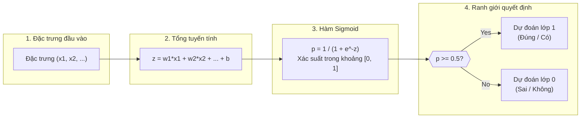

# Day 16: Hồi quy Logistic (Phân loại)

### 🎯 Mục tiêu học tập
- Giải thích được sự khác biệt cơ bản giữa bài toán hồi quy (regression) và phân loại (classification).
- Mô tả được cách hàm Sigmoid ánh xạ bất kỳ số thực nào thành một giá trị xác suất trong khoảng từ 0 đến 1.
- Xây dựng và huấn luyện mô hình phân loại nhị phân bằng lớp `LogisticRegression` của Scikit-Learn.
- Lấy được xác suất dự đoán của các lớp và áp dụng ngưỡng quyết định tùy chỉnh.
- Tính toán và giải thích được ý nghĩa của chỉ số độ chính xác phân loại (Accuracy).

### 🧩 Khái niệm cốt lõi (Tại sao)
Trong các bài học trước, chúng ta đã sử dụng hồi quy tuyến tính để dự đoán các số trị liên tục (như giá cả). Tuy nhiên, nhiều bài toán thực tế yêu cầu dự đoán **danh mục** hoặc **nhãn rời rạc**. Đây là bài toán **phân loại (classification)**:
- Dự đoán một email là thư rác (1) hay thư thường (0).
- Chẩn đoán một khối u là ác tính (1) hay lành tính (0).
- Phân loại một giao dịch là gian lận (1) hay hợp lệ (0).

Nếu chúng ta cố gắng áp dụng Hồi quy Tuyến tính thông thường cho phân loại nhị phân (nhãn 0 và 1), các giá trị dự đoán có thể vượt ngoài khoảng $[0, 1]$, và mô hình sẽ cực kỳ nhạy cảm với các điểm dữ liệu dị biệt (outliers).

**Hồi quy Logistic (Logistic Regression)** giải quyết triệt để vấn đề này. Mặc dù có từ "hồi quy" trong tên gọi, đây lại là một thuật toán phân loại. Nó tính toán một điểm số tuyến tính ($z = w x + b$), sau đó chuyển điểm số này qua **hàm Sigmoid**. Hàm Sigmoid nén đầu ra vào phạm vi từ 0 đến 1, giúp chúng ta diễn giải kết quả thu được dưới dạng **xác suất** thuộc về lớp 1.

### 🔁 Logic và hoạt động
Quy trình hồi quy logistic xử lý các đặc trưng đầu vào, tính tổng tuyến tính, ánh xạ nó thành xác suất bằng đường cong Sigmoid, và so sánh với ngưỡng quyết định để đưa ra dự đoán lớp cuối cùng.



#### Hàm Sigmoid
Hàm Sigmoid (hay đường cong logistic) được định nghĩa về mặt toán học như sau:

$$\sigma(z) = \frac{1}{1 + e^{-z}}$$

- Nếu $z$ là một số dương lớn, $e^{-z}$ tiến dần về 0, nên $\sigma(z)$ tiến dần về 1.
- Nếu $z$ là một số âm lớn, $e^{-z}$ trở nên cực kỳ lớn, nên $\sigma(z)$ tiến dần về 0.
- Nếu $z = 0$, khi đó $\sigma(z) = 0.5$.

#### Ngưỡng phân loại (Decision Threshold)
Theo mặc định, Scikit-Learn phân loại bất kỳ mẫu nào có xác suất dự đoán $p \ge 0.5$ vào lớp 1, và bất kỳ mẫu nào có $p < 0.5$ vào lớp 0.

### 📝 Ví dụ minh họa có chú thích
Dưới đây là cách chuẩn bị dữ liệu phân loại, huấn luyện mô hình Hồi quy Logistic, dự đoán nhãn lớp và truy xuất xác suất dự đoán:
```python
import numpy as np
from sklearn.linear_model import LogisticRegression
from sklearn.metrics import accuracy_score

# 1. Chuẩn bị dữ liệu phân loại (2 đặc trưng, nhãn mục tiêu nhị phân)
# Đặc trưng: Số giờ học, Số giờ ngủ
X = np.array([
    [1.0, 5.0], [1.5, 6.0], [2.0, 5.5],  # Lớp 0: Trượt kỳ thi
    [5.0, 7.0], [6.0, 8.0], [5.5, 7.5]   # Lớp 1: Đỗ kỳ thi
])
y = np.array([0, 0, 0, 1, 1, 1])

# 2. Khởi tạo và huấn luyện mô hình phân loại
model = LogisticRegression()
model.fit(X, y)

# 3. Dự đoán nhãn lớp (đầu ra là 0 hoặc 1)
class_predictions = model.predict(X)
print("Nhãn lớp dự đoán:", class_predictions) # Output: [0 0 0 1 1 1]

# 4. Dự đoán xác suất (trả về xác suất tương ứng cho lớp 0 và lớp 1)
probabilities = model.predict_proba(X)
print("\nXác suất dự đoán (Lớp 0, Lớp 1):\n", probabilities)
# Cột 1 thể hiện xác suất thuộc lớp 0, Cột 2 thể hiện xác suất thuộc lớp 1

# 5. Đánh giá mô hình bằng điểm Độ chính xác (Accuracy Score)
accuracy = accuracy_score(y, class_predictions)
print(f"\nĐộ chính xác của mô hình: {accuracy * 100:.2f}%") # 100.00% (do tập dữ liệu phân tách tuyến tính hoàn hảo)
```

### ❌ Các lỗi thường gặp

**Lỗi 1: Nhầm lẫn giữa predict() và predict_proba() khi tính toán độ chính xác**
```python
from sklearn.metrics import accuracy_score
preds_proba = model.predict_proba(X)
acc = accuracy_score(y, preds_proba)
```
```text
ValueError: Classification metrics can't handle a mix of binary and continuous-multioutput targets
```
```python
preds = model.predict(X) # Sử dụng nhãn lớp dự đoán
acc = accuracy_score(y, preds)
```
> `predict()` trả về các nhãn lớp (như 0 hoặc 1), trong khi `predict_proba()` trả về các xác suất liên tục cho mỗi lớp. Hàm `accuracy_score` yêu cầu đầu vào là nhãn lớp rời rạc.

**Lỗi 2: Truyền mảng 1D đại diện cho một mẫu đơn lẻ vào predict()**
```python
# Đặc trưng: [Số giờ học, Số giờ ngủ]
prediction = model.predict([2.5, 6.0])
```
```text
ValueError: Expected 2D array, got 1D array instead:
array=[2.5 6. ].
Reshape your data either using array.reshape(1, -1) if it contains a single sample or array.reshape(-1, 1) if it contains a single feature.
```
```python
prediction = model.predict([[2.5, 6.0]]) # Bọc trong một danh sách lồng để tạo mảng 2D
```
> Các bộ ước lượng của Scikit-Learn yêu cầu các đặc trưng đầu vào phải có định dạng mảng 2D với kích thước `(n_samples, n_features)`. Ngay cả đối với một dự đoán đơn lẻ, hãy truyền nó dưới dạng danh sách 2D `[[...]]`.

**Lỗi 3: Cố gắng trích xuất trực tiếp các hệ số hồi quy dưới dạng số thực float**
```python
weight = model.coef_ # Cố gắng sử dụng giá trị này trực tiếp như một trọng số float đơn lẻ
```
```text
(Không có lỗi Traceback xuất hiện trực tiếp, nhưng model.coef_ là một mảng 2D có kích thước (1, n_features), có thể gây ra lỗi kích thước trong các phép toán sau đó)
```
```python
weight_for_feature_0 = model.coef_[0][0]
```
> Ngay cả trong phân loại nhị phân, `model.coef_` vẫn được định dạng dưới dạng mảng 2D vì Scikit-Learn được thiết kế để hỗ trợ các mô hình đa lớp và nhiều đặc trưng đầu vào.

### 💡 Mẹo & Cách viết tối ưu
- **Giải thích các cột xác suất**: Phương thức `model.predict_proba(X)` trả về mảng có kích thước `(n_samples, 2)`. Cột 0 tương ứng với xác suất thuộc lớp 0, và cột 1 tương ứng với xác suất thuộc lớp 1. Với mọi mẫu dữ liệu `i`, ta luôn có `prob[i, 0] + prob[i, 1] == 1.0`.
- **Áp dụng các ngưỡng tùy chỉnh**: Nếu ứng dụng của bạn yêu cầu sự cẩn trọng cao hơn (ví dụ: chẩn đoán một căn bệnh hiếm gặp), bạn có thể muốn phân loại bất kỳ mẫu nào có xác suất trên 0.3 là dương tính. Bạn có thể tự triển khai như sau:
  ```python
  prob_class_1 = model.predict_proba(X)[:, 1]
  custom_preds = (prob_class_1 >= 0.3).astype(int)
  ```
- **Dữ liệu phân tách tuyến tính**: Nếu các lớp có thể được phân tách hoàn hảo bằng một đường thẳng, độ chính xác trên tập dữ liệu mô phỏng đó sẽ là 1.0, giống như bài tập thực hành bên dưới.

### 🧠 Đi sâu phân tích (Cơ chế bên dưới)
<details><summary>Hàm mất mát Log Loss / Entropy chéo nhị phân (Click để mở rộng)</summary>

Trong hồi quy tuyến tính, chúng ta tối ưu hóa các tham số bằng cách giảm thiểu Sai số bình phương trung bình (MSE). Tuy nhiên, đối với Hồi quy Logistic, nếu chúng ta thế hàm Sigmoid phi tuyến vào hàm mất mát MSE, hàm số thu được sẽ trở thành **không lồi (non-convex)**. Điều này có nghĩa là bề mặt hàm mất mát có rất nhiều điểm cực tiểu cục bộ (local minima), và thuật toán hạ cực trị (gradient descent) thông thường sẽ dễ dàng bị kẹt lại.

Để giải quyết vấn đề này, chúng ta sử dụng hàm mất mát **Log Loss** (còn gọi là **Entropy chéo nhị phân - Binary Cross-Entropy**), đây là một hàm lồi và phạt các dự đoán sai một cách lũy thừa:

$$J(w, b) = -\frac{1}{n} \sum_{i=1}^{n} \left[ y_i \log(\hat{y}_i) + (1 - y_i) \log(1 - \hat{y}_i) \right]$$

Trong đó:
- $y_i$ là nhãn nhị phân thực tế (0 hoặc 1).
- $\hat{y}_i$ là xác suất dự đoán mẫu dữ liệu thuộc về lớp 1 (được tính qua hàm Sigmoid).

#### Tại sao hàm mất mát này hoạt động hiệu quả?
- Nếu nhãn thực tế $y_i = 1$: Thành phần bên phải $(1 - y_i) \log(1 - \hat{y}_i)$ triệt tiêu về 0. Hàm mất mát chỉ còn $-\log(\hat{y}_i)$. Khi xác suất dự đoán $\hat{y}_i \to 1$, mất mát tiến về $-\log(1) = 0$. Khi $\hat{y}_i \to 0$, mất mát tiến về $-\log(0) \to \infty$.
- Nếu nhãn thực tế $y_i = 0$: Thành phần bên trái triệt tiêu về 0. Hàm mất mát chỉ còn $-\log(1 - \hat{y}_i)$. Khi xác suất dự đoán $\hat{y}_i \to 0$, mất mát tiến về 0. Khi $\hat{y}_i \to 1$, mất mát tiến về $\infty$.

Hàm mất mát này sẽ phạt cực nặng mô hình nếu nó đưa ra dự đoán với độ tự tin cao nhưng lại sai (ví dụ: dự đoán xác suất thuộc lớp 1 là 0.99 trong khi nhãn thực tế lại là 0).
</details>

### 🏋️ Bài tập thực hành
Hãy hoàn thành hàm `classify_logistic(X, y)` để huấn luyện mô hình `LogisticRegression` của Scikit-Learn trên các đặc trưng `X` và nhãn `y`, dự đoán nhãn lớp trên cùng dữ liệu `X`, sau đó tính toán và trả về điểm độ chính xác (accuracy score) của phân loại.

```python
import numpy as np
from sklearn.linear_model import LogisticRegression
from sklearn.metrics import accuracy_score

def classify_logistic(X, y):
    # 1. Huấn luyện mô hình LogisticRegression trên dữ liệu X và nhãn y
    # 2. Dự đoán nhãn trên cùng tập dữ liệu X
    # 3. Tính toán và trả về điểm độ chính xác (accuracy score) của phân loại
    accuracy = 0.0
    return accuracy
```

### ✅ Tự kiểm tra
1. Đúng hay Sai: Hồi quy Logistic được sử dụng để dự đoán các biến số liên tục.
2. Nếu điểm số tuyến tính ($z$) tính được cho một mẫu dữ liệu đúng bằng $0.0$, xác suất dự đoán ($p$) đầu ra từ hàm Sigmoid là bao nhiêu?
<details><summary>Đáp án</summary>

1. **Sai**. Mặc dù có tên gọi là Hồi quy, Hồi quy Logistic lại được sử dụng cho các bài toán phân loại (dự đoán nhãn lớp rời rạc).
2. Xác suất dự đoán đúng bằng **0.5** ($\sigma(0) = \frac{1}{1 + e^{0}} = \frac{1}{1 + 1} = 0.5$).
</details>

### 📌 Tóm tắt
- **Phân loại** dự đoán các nhãn lớp rời rạc thay vì các giá trị số liên tục.
- **Hồi quy Logistic** chuyển đầu ra của phương trình tuyến tính qua **hàm Sigmoid** để cho ra một xác suất từ 0 đến 1.
- **Hàm Sigmoid** được định nghĩa là $\sigma(z) = \frac{1}{1 + e^{-z}}$.
- Scikit-Learn sử dụng ngưỡng quyết định mặc định là **0.5** để ánh xạ xác suất thành lớp 0 và 1.
- **Điểm độ chính xác (Accuracy score)** đo lường tỷ lệ phần trăm các nhãn được dự đoán chính xác.
