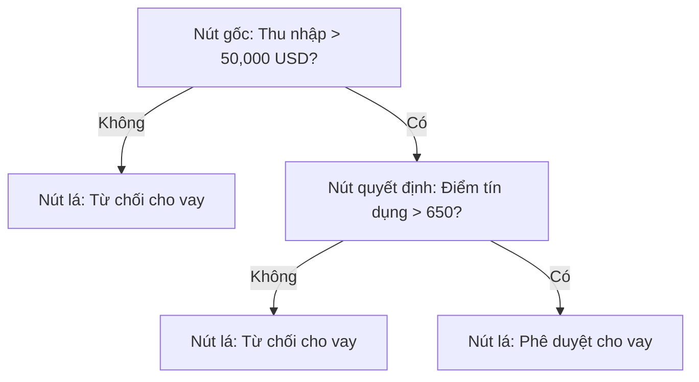

# Day 17: Cây Quyết định & Rừng Ngẫu nhiên

### 🎯 Mục tiêu học tập
- Hiểu cấu trúc của Cây Quyết định, bao gồm nút gốc (root node), nút nội bộ (internal node), nhánh (branches), và nút lá (leaf nodes).
- Giải thích sự khác biệt giữa Chỉ số không thuần khiết Gini (Gini Impurity) và Độ hỗn loạn Entropy dưới vai trò là các chỉ số phân chia.
- Hiểu khái niệm học máy tập hợp (ensemble learning) và cách Rừng Ngẫu nhiên cải thiện hiệu suất so với Cây Quyết định đơn lẻ.
- Huấn luyện và đánh giá một bộ phân loại Cây Quyết định sử dụng thư viện Scikit-Learn.
- Lấy và giải thích độ quan trọng của các đặc trưng (Feature Importances) từ mô hình cây đã huấn luyện.

### 🧩 Khái niệm cốt lõi (Tại sao)
Khi đưa ra quyết định, con người thường tuân theo một chuỗi các câu hỏi Đúng/Sai. Ví dụ: "Trời có mưa không? Nếu có, hãy mang ô. Nếu không, trời có nắng không? Nếu có, hãy đeo kính râm."
**Cây Quyết định (Decision Tree)** là một mô hình học máy mô phỏng cấu trúc sơ đồ tư duy logic này để phân loại các điểm dữ liệu hoặc dự đoán các giá trị.

#### Các thành phần cấu trúc chính:
1. **Nút gốc (Root Node)**: Nút cao nhất đại diện cho toàn bộ tập dữ liệu, sẽ được chia thành hai hoặc nhiều tập con đồng nhất hơn dựa trên một đặc trưng.
2. **Nút nội bộ/Nút quyết định (Decision/Internal Node)**: Các nút nơi dữ liệu được phân chia dựa trên quyết định của đặc trưng.
3. **Nhánh (Branches)**: Liên kết giữa các nút đại diện cho đường dẫn quyết định (ví dụ: Đúng/Sai).
4. **Nút lá (Leaf Node)**: Các nút cuối cùng không phân chia thêm. Chúng chứa lớp hoặc giá trị đầu ra được dự đoán.

#### Cách lựa chọn phép phân chia: Gini Impurity vs. Entropy
Để xây dựng một cây, chúng ta phải quyết định *đặc trưng nào* và *ngưỡng nào* sẽ phân chia dữ liệu tốt nhất. Chúng ta muốn các nút con càng "thuần khiết" (chứa chủ yếu một lớp) càng tốt. Chúng ta đo lường điều này bằng cách sử dụng:
- **Chỉ số không thuần khiết Gini (Gini Impurity)**: Đo lường tần suất một phần tử được chọn ngẫu nhiên từ tập hợp bị gắn nhãn sai nếu nó được gắn nhãn ngẫu nhiên theo phân phối nhãn trong tập con. Chỉ số Gini bằng `0` có nghĩa là nút đó hoàn toàn thuần khiết (tất cả các phần tử thuộc về một lớp).
- **Entropy (Thông tin đạt được - Information Gain)**: Bắt nguồn từ Thuyết thông tin, đo lường mức độ hỗn loạn hoặc không chắc chắn trong dữ liệu. Thông tin đạt được là sự giảm thiểu entropy sau khi phân chia.

#### Học máy tập hợp & Rừng Ngẫu nhiên
Các Cây Quyết định đơn lẻ rất dễ bị **quá khớp (overfitting)**—chúng học dữ liệu huấn luyện quá chi tiết, bao gồm cả nhiễu, dẫn đến khả năng tổng quát hóa kém trên dữ liệu mới.
Để giải quyết vấn đề này, chúng ta sử dụng **Rừng Ngẫu nhiên (Random Forest)**, thuộc lớp các thuật toán được gọi là **Học máy tập hợp (Ensemble Learning)**. Thay vì dựa vào một cây quyết định duy nhất, Rừng Ngẫu nhiên xây dựng nhiều cây (một khu rừng) bằng cách sử dụng:
- **Bagging (Bootstrap Aggregating)**: Huấn luyện mỗi cây trên một mẫu dữ liệu được chọn ngẫu nhiên (có lặp lại).
- **Tính ngẫu nhiên của đặc trưng (Feature Randomness)**: Phân chia các nút bằng cách chọn từ một tập hợp con ngẫu nhiên của các đặc trưng thay vì tất cả các đặc trưng.
Dự đoán cuối cùng được đưa ra bằng cách lấy biểu quyết số đông (cho bài toán phân loại) hoặc trung bình cộng (cho bài toán hồi quy) của dự đoán từ tất cả các cây đơn lẻ.

### 🔁 Logic và hoạt động
Dưới đây là cấu trúc logic của một cây quyết định đơn giản được sử dụng để quyết định có phê duyệt đơn xin vay vốn hay không dựa trên thu nhập và điểm tín dụng:



### 📝 Ví dụ minh họa có chú thích
Hãy huấn luyện một bộ phân loại Cây Quyết định sử dụng thư viện Scikit-Learn trên một tập dữ liệu giả lập, thực hiện dự đoán và kiểm tra mức độ quan trọng của từng đặc trưng:

```python
import numpy as np
from sklearn.tree import DecisionTreeClassifier

# 1. Chuẩn bị tập dữ liệu giả lập
# Đặc trưng: [Thu nhập (đơn vị: nghìn USD), Điểm tín dụng]
X = np.array([
    [45, 600],
    [55, 700],
    [30, 580],
    [80, 640],
    [70, 720],
    [90, 680]
])
# Nhãn: 0 (Từ chối), 1 (Phê duyệt)
y = np.array([0, 1, 0, 0, 1, 1])

# 2. Khởi tạo DecisionTreeClassifier
# max_depth=3 ngăn cây phát triển vô hạn và gây quá khớp
# random_state=42 đảm bảo tính tái lập của các phép phân chia
model = DecisionTreeClassifier(max_depth=3, random_state=42)

# 3. Huấn luyện mô hình trên dữ liệu huấn luyện
model.fit(X, y)

# 4. Dự đoán lớp cho một người nộp đơn mới
# Người nộp đơn mới: Thu nhập=60k, Điểm tín dụng=660
new_applicant = np.array([[60, 660]])
prediction = model.predict(new_applicant)
print("Dự đoán (0=Từ chối, 1=Phê duyệt):", prediction[0]) # Kết quả: 1

# 5. Kiểm tra độ quan trọng của đặc trưng
# Cho biết đặc trưng nào hữu ích nhất trong việc xây dựng các phép phân chia
for name, importance in zip(["Thu nhập", "Điểm tín dụng"], model.feature_importances_):
    print(f"Đặc trưng: {name}, Độ quan trọng: {importance:.4f}")
```

### ❌ Các lỗi thường gặp

**Mistake 1: Truyền trực tiếp các đặc trưng phân loại dạng văn bản (không phải số) vào cây**
```python
from sklearn.tree import DecisionTreeClassifier
import numpy as np
X = np.array([['Low'], ['High'], ['Low']])
y = np.array([0, 1, 0])
model = DecisionTreeClassifier()
model.fit(X, y)
```
```text
ValueError: could not convert string to float: 'Low'
```
```python
from sklearn.tree import DecisionTreeClassifier
import numpy as np
# Đúng: Mã hóa các danh mục văn bản thành biểu diễn số
X = np.array([[0], [1], [0]]) # 0 = Low, 1 = High
y = np.array([0, 1, 0])
model = DecisionTreeClassifier()
model.fit(X, y)
```
> Các bộ ước lượng Scikit-Learn yêu cầu tất cả dữ liệu đầu vào phải là số. Các biến văn bản phân loại phải được mã hóa (ví dụ: mã hóa nhãn hoặc mã hóa one-hot) trước khi huấn luyện.

**Mistake 2: Yêu cầu dự đoán với mảng đặc trưng 1D**
```python
from sklearn.tree import DecisionTreeClassifier
import numpy as np
X = np.array([[1, 2], [3, 4]])
y = np.array([0, 1])
model = DecisionTreeClassifier()
model.fit(X, y)
model.predict([1, 2])
```
```text
ValueError: Expected 2D array, got 1D array instead:
array=[1 2].
Reshape your data either using array.reshape(-1, 1) if your data has a single feature or array.reshape(1, -1) if it contains a single sample.
```
```python
from sklearn.tree import DecisionTreeClassifier
import numpy as np
X = np.array([[1, 2], [3, 4]])
y = np.array([0, 1])
model = DecisionTreeClassifier()
model.fit(X, y)
model.predict([[1, 2]]) # Truyền dưới dạng danh sách/mảng 2D
```
> Các bộ ước lượng Scikit-learn yêu cầu dữ liệu truy vấn dự đoán phải là một mảng đầu vào 2D `(n_samples, n_features)`, ngay cả khi thực hiện dự đoán cho một mẫu duy nhất.

### 💡 Mẹo & Cách viết tối ưu
- **Điều hòa thông qua `max_depth`**: Các Cây Quyết định không bị giới hạn sẽ tiếp tục phân chia cho đến khi mọi lá đều thuần khiết, tạo ra các ranh giới phức tạp dẫn đến quá khớp. Luôn đặt `max_depth` hoặc `min_samples_leaf` để giữ cho mô hình có khả năng tổng quát hóa tốt.
- **Độ quan trọng của đặc trưng**: Bạn có thể kiểm tra thuộc tính `model.feature_importances_` để xác định biến nào đóng góp nhiều nhất vào dự đoán. Tổng các giá trị này bằng 1.
- **Trực quan hóa cây**: Scikit-learn cung cấp hàm `sklearn.tree.plot_tree(model)` để vẽ và xem trực quan các phân chia, ngưỡng và nội dung của lá bằng thư viện matplotlib.

### 🧠 Đi sâu phân tích (Cơ chế bên dưới)
<details><summary>Công thức toán học của Chỉ số Gini Impurity và Entropy (Click để mở rộng)</summary>

#### Chỉ số không thuần khiết Gini (Gini Impurity)
Đối với một nút chứa các mẫu từ $C$ lớp khác nhau, gọi $p_i$ là xác suất (tỷ lệ) các mẫu thuộc về lớp $i$. Chỉ số Gini Impurity $I_G(p)$ được định nghĩa là:

$$I_G(p) = 1 - \sum_{i=1}^{C} p_i^2$$

- **Nút thuần khiết**: Nếu tất cả các mẫu thuộc về một lớp duy nhất (ví dụ: $p_1 = 1$, các $p$ khác bằng $0$), ta có $I_G = 1 - 1^2 = 0$.
- **Phân phối đồng đều**: Đối với phân chia phân loại nhị phân với tỷ lệ bằng nhau ($p_1 = 0.5, p_2 = 0.5$), ta có $I_G = 1 - (0.5^2 + 0.5^2) = 0.5$. Đây là chỉ số Gini lớn nhất có thể đối với bài toán 2 lớp.

#### Entropy
Entropy $H(p)$ đo lường mức độ trung bình của thông tin, sự ngạc nhiên hoặc tính không chắc chắn trong phân phối lớp của nút:

$$H(p) = - \sum_{i=1}^{C} p_i \log_2(p_i)$$

Nếu $p_i = 0$, ta quy ước $0 \log_2(0) = 0$.
- **Nút thuần khiết**: Nếu tất cả các mẫu thuộc về một lớp duy nhất ($p_1 = 1$), ta có $H = - (1 \log_2 1) = 0$.
- **Phân phối đồng đều**: Đối với phân chia nhị phân đồng đều ($p_1 = 0.5, p_2 = 0.5$), ta có $H = - (0.5 \log_2 0.5 + 0.5 \log_2 0.5) = 1.0$. Đây là entropy lớn nhất có thể đối với bài toán 2 lớp.

Thuật toán sẽ chọn các phép phân chia giúp tối đa hóa **Thông tin đạt được (Information Gain)** (đối với Entropy) hoặc tối thiểu hóa tổng trọng số của chỉ số không thuần khiết của các nút con.
</details>

### 🏋️ Bài tập thực hành
Hoàn thành hàm `train_tree(X, y)` để xây dựng bộ phân loại Cây Quyết định với độ sâu tối đa là 3, huấn luyện nó trên các đặc trưng `X` và nhãn `y`, và trả về mô hình đã huấn luyện.

```python
import numpy as np
from sklearn.tree import DecisionTreeClassifier

def train_tree(X, y):
    # 1. Tạo một đối tượng DecisionTreeClassifier với max_depth=3 và random_state=42
    # 2. Huấn luyện phân loại trên các đặc trưng X và nhãn y
    # 3. Trả về mô hình đã huấn luyện
    model = None
    return model
```

### ✅ Tự kiểm tra
1. Việc thiết lập `max_depth` lớn hơn ảnh hưởng như thế nào đến hiệu suất huấn luyện so với hiệu suất kiểm thử của Cây Quyết định?
2. Hai kỹ thuật chính mà Rừng Ngẫu nhiên sử dụng để đảm bảo các cây riêng lẻ không bị tương quan với nhau là gì?
<details><summary>Đáp án</summary>

1. `max_depth` cao hơn cho phép cây nắm bắt các mẫu phức tạp hơn, cải thiện độ chính xác huấn luyện. Tuy nhiên, nếu nó phát triển quá sâu, nó sẽ nắm bắt cả nhiễu dữ liệu, dẫn đến quá khớp và làm giảm độ chính xác trên dữ liệu kiểm thử.
2. Rừng Ngẫu nhiên sử dụng **Bagging** (lấy mẫu dữ liệu huấn luyện ngẫu nhiên có lặp lại cho mỗi cây) và **Tính ngẫu nhiên của đặc trưng** (chọn phép phân chia từ một tập hợp con ngẫu nhiên của các đặc trưng).
</details>

### 📌 Tóm tắt
- **Cây Quyết định** phân chia dữ liệu một cách đệ quy dựa trên các đặc trưng để nhóm các mục tiêu tương tự lại với nhau.
- Các phép phân chia được đánh giá bằng **Gini Impurity** hoặc **Entropy** để tối đa hóa độ thuần khiết của lá.
- **Rừng Ngẫu nhiên** xây dựng các tập hợp cây quyết định bằng cách sử dụng bagging và tính ngẫu nhiên của đặc trưng để giảm thiểu quá khớp.
- Hạn chế sự phát triển của cây bằng cách sử dụng `max_depth` để điều hòa mô hình và cải thiện khả năng tổng quát hóa.
