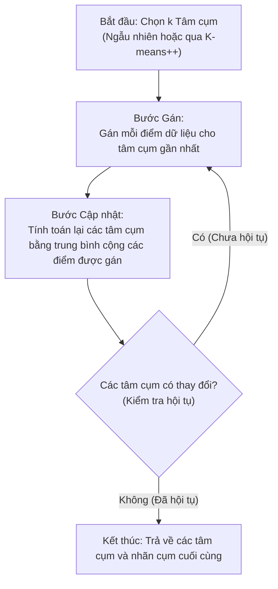

# Day 18: Phân cụm K-means

### 🎯 Mục tiêu học tập
- Phân biệt giữa học có giám sát (supervised learning) và học không giám sát (unsupervised learning).
- Giải thích các bước lặp của thuật toán phân cụm K-means.
- Huấn luyện mô hình phân cụm K-means sử dụng thư viện Scikit-Learn.
- Lấy và giải thích các tâm cụm (centroids) và nhãn cụm (labels).
- Hiểu tầm quan trọng của việc chuẩn hóa đặc trưng (feature scaling) và cách chọn số lượng cụm bằng Phương pháp Khuỷu tay (Elbow Method).

### 🧩 Khái niệm cốt lõi (Tại sao)
Cho đến nay, chúng ta đã nghiên cứu các thuật toán học tập có giám sát (như Hồi quy tuyến tính và Cây quyết định), trong đó tập dữ liệu của chúng ta chứa các mục tiêu hoặc nhãn rõ ràng ($y$) để hướng dẫn huấn luyện mô hình.
Tuy nhiên, trong nhiều tình huống thực tế, chúng ta không có nhãn. Chúng ta có thể có một cơ sở dữ liệu khách hàng với lịch sử mua hàng của họ, nhưng không có danh mục được xác định trước. Mục tiêu của chúng ta là tự động khám phá các mẫu hoặc nhóm ẩn một cách tự nhiên. Đây là **Học không giám sát (Unsupervised Learning)**.

**Phân cụm (Clustering)** là tác vụ học không giám sát phổ biến nhất, và **K-means** là thuật toán phân cụm được sử dụng rộng rãi nhất. Nó chia một tập dữ liệu thành $k$ nhóm riêng biệt, không chồng chéo lên nhau (các cụm).

#### Cách K-means lặp lại:
Thuật toán tìm các cụm bằng cách lặp lại ba bước cơ bản:
1. **Khởi tạo (Initialization)**: Chọn ngẫu nhiên $k$ điểm ban đầu làm tâm cụm (tâm của cụm) trong không gian đặc trưng.
2. **Bước Gán (Assignment Step)**: Gán mỗi điểm dữ liệu cho tâm cụm gần nhất với nó (thường dựa trên khoảng cách Euclidean).
3. **Bước Cập nhật (Update Step)**: Tính toán lại tâm cụm của mỗi cụm bằng cách lấy giá trị trung bình (vị trí trung bình) của tất cả các điểm dữ liệu hiện đang được gán cho cụm đó.
Bước 2 và 3 lặp lại cho đến khi các tâm cụm không còn di chuyển đáng kể (hội tụ) hoặc đạt đến số lượng vòng lặp tối đa.

### 🔁 Logic và hoạt động
Dưới đây là sơ đồ mô tả vòng lặp tối ưu hóa của quá trình huấn luyện K-means:



### 📝 Ví dụ minh họa có chú thích
Hãy huấn luyện mô hình K-means trên tập dữ liệu giả lập 2D sử dụng thư viện Scikit-Learn và trích xuất các phân cụm và tâm cụm đã học:

```python
import numpy as np
from sklearn.cluster import KMeans

# 1. Chuẩn bị tập dữ liệu giả lập 2D
# Các điểm dữ liệu tạo thành ba nhóm rõ rệt
X = np.array([
    [1.0, 2.0], [1.5, 1.8], [1.2, 2.2], # Nhóm 1
    [8.0, 8.0], [8.5, 8.2], [9.0, 8.5], # Nhóm 2
    [1.0, 8.0], [1.2, 7.8], [0.8, 8.2]  # Nhóm 3
])

# 2. Khởi tạo KMeans
# n_clusters=3 chỉ định rằng chúng ta muốn tìm 3 cụm riêng biệt
# n_init='auto' để thuật toán tự quyết định số lần chạy với các hạt giống khác nhau
# random_state=42 đảm bảo tính tái lập kết quả
kmeans = KMeans(n_clusters=3, n_init='auto', random_state=42)

# 3. Huấn luyện mô hình trên dữ liệu (không giám sát, không truyền nhãn y)
kmeans.fit(X)

# 4. Lấy nhãn phân cụm cho các điểm dữ liệu huấn luyện
labels = kmeans.labels_
print("Nhãn các cụm:", labels) # Kết quả: mảng gồm các giá trị 0, 1, và 2 khớp với các nhóm

# 5. Lấy tọa độ của 3 tâm cụm
centroids = kmeans.cluster_centers_
print("Tọa độ tâm cụm:\n", centroids)

# 6. Dự đoán cụm cho một điểm dữ liệu mới
new_point = np.array([[2.0, 2.0]])
predicted_cluster = kmeans.predict(new_point)
print("Cụm được dự đoán cho [2.0, 2.0]:", predicted_cluster[0])
```

### ❌ Các lỗi thường gặp

**Mistake 1: Truyền mảng 1D vào phương thức fit của KMeans**
```python
from sklearn.cluster import KMeans
import numpy as np
X = np.array([1.2, 2.3, 8.9, 9.5])
kmeans = KMeans(n_clusters=2, n_init='auto', random_state=42)
kmeans.fit(X)
```
```text
ValueError: Expected 2D array, got 1D array instead:
array=[1.2 2.3 8.9 9.5].
Reshape your data either using array.reshape(-1, 1) if your data has a single feature or array.reshape(1, -1) if it contains a single sample.
```
```python
from sklearn.cluster import KMeans
import numpy as np
# Đúng: Chuyển đổi thành mảng 2D của các vectơ cột
X = np.array([[1.2], [2.3], [8.9], [9.5]])
kmeans = KMeans(n_clusters=2, n_init='auto', random_state=42)
kmeans.fit(X)
```
> Các bộ ước lượng Scikit-Learn, bao gồm cả các mô hình phân cụm không giám sát, yêu cầu ma trận đặc trưng X phải là mảng 2D, ngay cả khi chỉ có một đặc trưng duy nhất.

**Mistake 2: Truy vấn dự đoán với số lượng đặc trưng khác với tập dữ liệu huấn luyện**
```python
from sklearn.cluster import KMeans
import numpy as np
X = np.array([[1, 2], [2, 3], [8, 8], [9, 9]])
kmeans = KMeans(n_clusters=2, n_init='auto', random_state=42)
kmeans.fit(X)
kmeans.predict([[1]])
```
```text
ValueError: X has 1 features, but KMeans is expecting 2 features as input.
```
```python
from sklearn.cluster import KMeans
import numpy as np
X = np.array([[1, 2], [2, 3], [8, 8], [9, 9]])
kmeans = KMeans(n_clusters=2, n_init='auto', random_state=42)
kmeans.fit(X)
kmeans.predict([[1, 2]]) # Truyền chính xác 2 đặc trưng
```
> Kích thước của các mẫu kiểm thử được truyền vào `predict()` hoặc `transform()` phải khớp chính xác với số lượng đặc trưng của dữ liệu huấn luyện `X` mà mô hình đã khớp trước đó.

### 💡 Mẹo & Cách viết tối ưu
- **Phương pháp Khuỷu tay (Elbow Method)**: Làm thế nào để bạn chọn giá trị $k$ phù hợp? Vẽ đồ thị **quán tính (inertia)** của mô hình (tổng bình phương khoảng cách từ các mẫu đến tâm cụm gần nhất của chúng, lấy qua `kmeans.inertia_`) cho các giá trị khác nhau của $k$ (ví dụ: từ 1 đến 10). Điểm mà tại đó mức giảm quán tính chậm lại đáng kể (tạo thành một hình "khuỷu tay") thường là số cụm $k$ tối ưu.
- **Chuẩn hóa đặc trưng**: K-means cực kỳ nhạy cảm với tỷ lệ (quy mô) của các đặc trưng vì nó dựa trên khoảng cách Euclidean. Nếu một đặc trưng nằm trong khoảng từ 0 đến 1 và một đặc trưng khác nằm trong khoảng từ 0 đến 1,000,000, đặc trưng thứ hai sẽ hoàn toàn chi phối các phép tính khoảng cách. Luôn chuẩn hóa các đặc trưng (ví dụ: sử dụng `StandardScaler`) trước khi thực hiện phân cụm.
- **Tham số n_init**: K-means có thể bị kẹt ở các điểm tối ưu cục bộ kém tùy thuộc vào lựa chọn tâm cụm ban đầu. Việc thiết lập `n_init` giúp chạy thuật toán nhiều lần với các hạt giống ban đầu khác nhau và giữ lại kết quả phân cụm tốt nhất.

### 🧠 Đi sâu phân tích (Cơ chế bên dưới)
<details><summary>Cơ chế khởi tạo K-means++ (Click để mở rộng)</summary>

Thuật toán K-means tiêu chuẩn chọn ngẫu nhiên các tâm cụm ban đầu. Nếu hai tâm cụm ban đầu được đặt rất gần nhau trong cùng một nhóm tự nhiên, thuật toán có thể hội tụ về một tối ưu cục bộ kém.

Để giải quyết vấn đề này, Scikit-Learn sử dụng phương pháp khởi tạo **K-means++** theo mặc định. Thuật toán K-means++ chọn các tâm cụm cách xa nhau bằng các bước xác suất sau:

1. **Tâm cụm đầu tiên**: Chọn tâm cụm đầu tiên $c_1$ ngẫu nhiên đồng đều từ tập dữ liệu $X$.
2. **Tính toán khoảng cách**: Đối với mỗi điểm dữ liệu $x_i$, tính khoảng cách $D(x_i)$, là khoảng cách Euclidean từ $x_i$ đến tâm cụm gần nhất đã được chọn trước đó.
3. **Chọn tâm cụm tiếp theo**: Chọn tâm cụm tiếp theo $c_j$ từ $X$ với xác suất tỷ lệ thuận với bình phương khoảng cách:
   
   $$P(x_i) = \frac{D(x_i)^2}{\sum_{y \in X} D(y)^2}$$
   
   Bước này đảm bảo rằng các điểm ở xa các tâm cụm hiện tại có khả năng được chọn làm tâm cụm mới cao hơn nhiều.
4. **Lặp lại**: Lặp lại bước 2 và 3 cho đến khi chọn đủ $k$ tâm cụm.

Phương pháp khởi tạo thông minh này giúp giảm đáng kể thời gian huấn luyện và mang lại kết quả phân cụm chất lượng cao, ổn định hơn nhiều.
</details>

### 🏋️ Bài tập thực hành
Hoàn thành hàm `cluster_kmeans(X, k)` để khởi tạo mô hình `KMeans` của Scikit-Learn với `k` cụm, `n_init='auto'`, và `random_state=42`. Huấn luyện mô hình trên dữ liệu `X`, và trả về các tâm cụm đã huấn luyện.

```python
import numpy as np
from sklearn.cluster import KMeans

def cluster_kmeans(X, k):
    # 1. Tạo một đối tượng KMeans với k cụm, n_init='auto', và random_state=42
    # 2. Huấn luyện mô hình KMeans trên dữ liệu X
    # 3. Trả về các tâm cụm (cluster_centers_)
    centers = None
    return centers
```

### ✅ Tự kiểm tra
1. Tại sao việc chuẩn hóa đặc trưng lại quan trọng trước khi áp dụng phân cụm K-means?
2. Chỉ số nào được lưu trữ trong thuộc tính `inertia_` của một đối tượng `KMeans` đã huấn luyện, và nó được sử dụng như thế nào?
<details><summary>Đáp án</summary>

1. K-means sử dụng khoảng cách Euclidean để gán cụm. Các đặc trưng có quy mô lớn hơn nhiều sẽ chi phối việc tính khoảng cách, khiến các đặc trưng có quy mô nhỏ hơn trở nên không quan trọng. Chuẩn hóa đặc trưng đảm bảo tất cả các đặc trưng đóng góp như nhau.
2. `inertia_` đo lường Tổng bình phương sai số (SSE) của các mẫu đến tâm cụm gần nhất của chúng. Chúng ta vẽ đồ thị `inertia_` theo các giá trị khác nhau của $k$ để tìm điểm "khuỷu tay" nhằm xác định số lượng cụm tối ưu.
</details>

### 📌 Tóm tắt
- **Học không giám sát** mô hình hóa dữ liệu không có nhãn mục tiêu ($y$) để tìm ra các cấu trúc ẩn bên dưới.
- **Phân cụm K-means** thực hiện lặp đi lặp lại việc gán các điểm dữ liệu cho tâm cụm gần nhất và tính toán lại các tâm cụm dựa trên trung bình cộng của các cụm.
- Chuẩn hóa các đặc trưng trước khi áp dụng K-means vì các phép đo khoảng cách rất nhạy cảm với quy mô dữ liệu.
- Sử dụng khởi tạo **K-means++** (mặc định trong Scikit-Learn) để chọn các tâm cụm ban đầu cách xa nhau và tránh phân cụm cận tối ưu.
