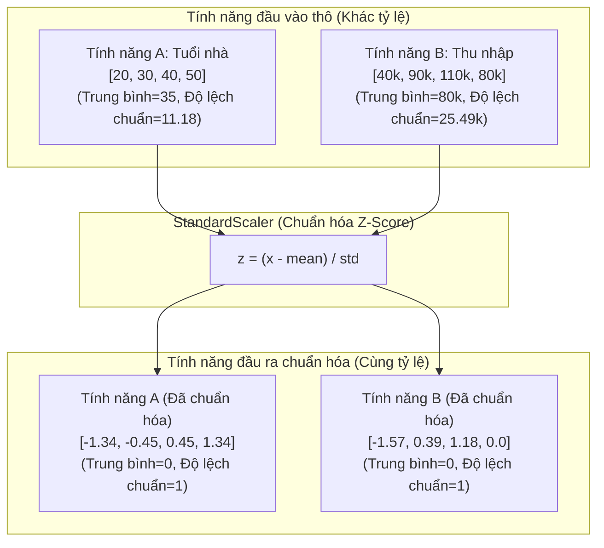

# Day 19: Chuẩn hóa Tính năng & Tiền xử lý

### 🎯 Mục tiêu học tập
- Giải thích được tại sao việc chuẩn hóa tính năng (feature scaling) lại cần thiết đối với các thuật toán nhạy cảm với khoảng cách và tối ưu hóa bằng hạ độ đèo (gradient descent).
- Phân biệt được giữa Chuẩn hóa Standard (Z-score standardization) và Chuẩn hóa Min-Max (Min-Max normalization).
- Triển khai chuẩn hóa tính năng sử dụng `StandardScaler` trong thư viện Scikit-Learn.
- Ngăn ngừa rò rỉ dữ liệu (data leakage) bằng cách phân chia chính xác các bước khớp (fit) và biến đổi (transform) trên tập huấn luyện và tập kiểm tra.

### 🧩 Khái niệm cốt lõi (Tại sao)
Trong học máy, các tập dữ liệu thường chứa các tính năng được đo bằng các đơn vị và phạm vi hoàn toàn khác nhau. Ví dụ, một tập dữ liệu bất động sản có thể có tính năng `Tuổi nhà` (từ 0 đến 50 năm) và `Giá nhà` (từ $100.000 đến $1.000.000).

Nếu đưa trực tiếp các tính năng thô này vào thuật toán học máy, hai vấn đề lớn sẽ xảy ra:
1. **Sự áp đảo khoảng cách**: Các thuật toán tính toán khoảng cách không gian giữa các điểm (như K-Means, K-Nearest Neighbors (KNN), và Support Vector Machines (SVM)) sẽ bị ảnh hưởng nặng nề bởi các tính năng có phạm vi giá trị lớn hơn. Sự khác biệt $100.000 về giá sẽ hoàn toàn áp đảo sự khác biệt 10 năm về tuổi nhà.
2. **Hạ độ đèo hội tụ chậm**: Các thuật toán tối ưu hóa như hạ độ đèo (gradient descent) dùng trong Hồi quy Tuyến tính/Hồi quy Logistic và Mạng nơ-ron sẽ mất nhiều thời gian hơn để tìm thấy cực tiểu của hàm mất mát. Điều này là do các đường đồng mức của hàm mất mát trở nên kéo dài ra, khiến cho các bước cập nhật trọng số dao động dữ dội.

Để giải quyết vấn đề này, chúng ta sử dụng **Chuẩn hóa Tính năng (Feature Scaling)** để đưa tất cả các tính năng số về cùng một phạm vi giá trị tương đương mà không làm mất đi phân phối hoặc thông tin gốc của dữ liệu.

Có hai phương pháp chuẩn hóa chính:
- **Chuẩn hóa Standard (Z-score standardization)**: Quy đổi các tính năng về phân phối có trung bình ($\mu$) bằng 0 và độ lệch chuẩn ($\sigma$) bằng 1. Phương pháp này lý tưởng cho các thuật toán giả định dữ liệu có phân phối chuẩn và ít bị ảnh hưởng bởi các giá trị ngoại lệ (outliers).
- **Chuẩn hóa Min-Max (Normalization)**: Quy đổi các tính năng về một phạm vi cố định, thường là từ 0 đến 1. Phương pháp này hữu ích khi chúng ta cần các giá trị có giới hạn, nhưng lại rất nhạy cảm với các giá trị ngoại lệ.

### 🔁 Logic và hoạt động
Quá trình chuẩn hóa standard ánh xạ phân phối dữ liệu thô bất kỳ về một phân phối chuẩn chuẩn hóa.



### 📝 Ví dụ minh họa có chú thích
Dưới đây là cách chuẩn hóa các tính năng sử dụng `StandardScaler` từ Scikit-Learn:

```python
import numpy as np
from sklearn.preprocessing import StandardScaler

# 1. Chuẩn bị dữ liệu thô: 4 mẫu, 2 tính năng (Tuổi, Thu nhập)
X = np.array([
    [25.0, 50000.0],
    [35.0, 75000.0],
    [45.0, 110000.0],
    [20.0, 45000.0]
])

# 2. Khởi tạo StandardScaler
scaler = StandardScaler()

# 3. Khớp (tính trung bình & độ lệch chuẩn) và biến đổi (áp dụng công thức chuẩn hóa) cùng lúc
X_scaled = scaler.fit_transform(X)

print("Các tính năng đã chuẩn hóa:\n", X_scaled)
# Các giá trị sau chuẩn hóa sẽ có trung bình = 0 và độ lệch chuẩn = 1 trên mỗi cột:
print("Trung bình của các tính năng:", np.round(X_scaled.mean(axis=0), 2)) # [0. 0.]
print("Độ lệch chuẩn của các tính năng:", np.round(X_scaled.std(axis=0), 2))   # [1. 1.]

# 4. Sử dụng biến đổi trên dữ liệu mới (dựa trên các tham số đã học được từ X)
new_data = np.array([[30.0, 60000.0]])
new_data_scaled = scaler.transform(new_data)
print("Dữ liệu mới sau chuẩn hóa:", new_data_scaled)
```

### ❌ Các lỗi thường gặp

**Lỗi 1: Gọi hàm biến đổi transform trước khi khớp fit bộ chuẩn hóa**
```python
from sklearn.preprocessing import StandardScaler
scaler = StandardScaler()
X_scaled = scaler.transform(X)
```
```text
sklearn.exceptions.NotFittedError: This StandardScaler instance is not fitted yet. Call 'fit' with appropriate arguments before using this estimator.
```
```python
from sklearn.preprocessing import StandardScaler
scaler = StandardScaler()
X_scaled = scaler.fit_transform(X)
```
> Bạn phải khớp bộ chuẩn hóa bằng cách sử dụng `fit()` hoặc `fit_transform()` trước để nó có thể tính toán được trung bình và độ lệch chuẩn của các tính năng trước khi thực hiện biến đổi chúng.

**Lỗi 2: Truyền một mảng 1 chiều vào bộ chuẩn hóa**
```python
import numpy as np
from sklearn.preprocessing import StandardScaler
X = np.array([1.0, 2.0, 3.0, 4.0])
scaler = StandardScaler()
X_scaled = scaler.fit_transform(X)
```
```text
ValueError: Expected 2D array, got 1D array instead:
array=[1. 2. 3. 4.].
Reshape your data either using array.reshape(-1, 1) if your data has a single feature or array.reshape(1, -1) if it contains a single sample.
```
```python
import numpy as np
from sklearn.preprocessing import StandardScaler
X = np.array([[1.0], [2.0], [3.0], [4.0]])
scaler = StandardScaler()
X_scaled = scaler.fit_transform(X)
```
> Các bộ biến đổi của Scikit-Learn yêu cầu ma trận tính năng `X` phải là một mảng 2 chiều có hình dạng `(n_samples, n_features)`. Một tính năng đơn lẻ phải được định hình lại thành một vectơ cột 2 chiều.

**Lỗi 3: Khớp lại bộ chuẩn hóa trên dữ liệu kiểm tra (Rò rỉ dữ liệu - Data Leakage)**
```python
from sklearn.preprocessing import StandardScaler
scaler = StandardScaler()
X_train_scaled = scaler.fit_transform(X_train)
X_test_scaled = scaler.fit_transform(X_test)
```
```text
(Lỗi logic: Đánh giá mô hình bị sai lệch vì tập kiểm tra được chuẩn hóa bằng các số liệu thống kê của chính nó thay vì số liệu của tập huấn luyện)
```
```python
from sklearn.preprocessing import StandardScaler
scaler = StandardScaler()
X_train_scaled = scaler.fit_transform(X_train)
X_test_scaled = scaler.transform(X_test)
```
> Tập kiểm tra phải được chuẩn hóa bằng trung bình và độ lệch chuẩn thu được *chỉ* từ tập huấn luyện để tránh rò rỉ dữ liệu (data leakage) và mô phỏng chính xác kịch bản dự đoán thực tế.

### 💡 Mẹo & Cách viết tối ưu
- **Chỉ chuẩn hóa tính năng, không chuẩn hóa mục tiêu**: Đối với các bài toán phân loại hoặc hồi quy thông thường, việc chuẩn hóa nhãn mục tiêu ($y$) là không cần thiết và có thể làm phức tạp hóa quá trình diễn giải dự đoán.
- **Biến đổi ngược (Inverse Transform)**: Bạn có thể đưa dữ liệu đã chuẩn hóa trở lại thang đo ban đầu bằng cách sử dụng `scaler.inverse_transform(X_scaled)`.
- **Tích hợp Pipeline**: Trong thực tế, hãy đóng gói bộ chuẩn hóa và mô hình của bạn bên trong một `Pipeline` của Scikit-Learn để tự động xử lý việc khớp trên tập huấn luyện và biến đổi trên tập kiểm tra một cách an toàn.

### 🧠 Đi sâu phân tích (Cơ chế bên dưới)
<details><summary>Công thức toán học của StandardScaler và MinMaxScaler (Nhấp để mở rộng)</summary>

#### StandardScaler (Chuẩn hóa Standard)
Giá trị chuẩn hóa $z$ của một tính năng $x$ được tính như sau:

$$z = \frac{x - \mu}{\sigma}$$

Trong đó:
- $\mu$ là giá trị trung bình của tính năng: $\mu = \frac{1}{n} \sum_{i=1}^n x_i$
- $\sigma$ là độ lệch chuẩn: $\sigma = \sqrt{\frac{1}{n} \sum_{i=1}^n (x_i - \mu)^2}$

Công thức này dịch chuyển phân phối tính năng để có $\text{trung bình} = 0$ và $\text{phương sai} = 1$. Nó không giới hạn các giá trị trong một phạm vi cụ thể nào.

#### MinMaxScaler (Chuẩn hóa Min-Max)
Giá trị chuẩn hóa $x_{norm}$ của tính năng $x$ được tính như sau:

$$x_{norm} = \frac{x - x_{min}}{x_{max} - x_{min}} \cdot (\text{max} - \text{min}) + \text{min}$$

Theo mặc định, công thức này ánh xạ các tính năng vào phạm vi $[0, 1]$:

$$x_{norm} = \frac{x - x_{min}}{x_{max} - x_{min}}$$

Nếu xuất hiện một giá trị ngoại lệ cực đoan (ví dụ: giá trị 1000 trong khi hầu hết các giá trị khác chỉ xoay quanh 10), khi đó $x_{max}$ sẽ trở nên rất lớn, ép tất cả các giá trị bình thường khác vào một phạm vi cực kỳ nhỏ (ví dụ: từ 0.0 đến 0.01) và làm mất đi sự biến thiên của tính năng. Chuẩn hóa Standard có tính bền vững (robust) cao hơn đối với các giá trị ngoại lệ vì nó dựa trên độ lệch chuẩn.
</details>

### 🏋️ Bài tập thực hành
Hoàn thành hàm `scale_features(X)` để khởi tạo đối tượng `StandardScaler` của Scikit-Learn, khớp nó với ma trận tính năng `X`, biến đổi các tính năng và trả về mảng numpy đã được chuẩn hóa.

```python
import numpy as np
from sklearn.preprocessing import StandardScaler

def scale_features(X):
    # 1. Khởi tạo một đối tượng StandardScaler
    # 2. Khớp (fit) bộ chuẩn hóa trên các tính năng X và biến đổi (transform) chúng
    # 3. Trả về mảng tính năng đã được chuẩn hóa
    scaled_X = None
    return scaled_X
```

### ✅ Tự kiểm tra
1. Nếu chúng ta khớp một `StandardScaler` trên mảng tính năng một cột `[[1.0], [3.0], [5.0]]`, thì trung bình của mảng sau chuẩn hóa sẽ là bao nhiêu?
2. Nhược điểm chính của việc sử dụng `MinMaxScaler` khi dữ liệu chứa các giá trị ngoại lệ cực đoan là gì?
<details><summary>Đáp án</summary>

1. Giá trị trung bình của tính năng sau chuẩn hóa sẽ chính xác là `0.0` và độ lệch chuẩn của nó sẽ là `1.0`.
2. Các giá trị ngoại lệ cực đoan sẽ kéo lệch giá trị tối thiểu hoặc tối đa, làm nén toàn bộ các điểm dữ liệu bình thường khác vào một khoảng cực kỳ nhỏ và làm mất đi phương sai đặc trưng của chúng.
</details>

### 📌 Tóm tắt
- **Chuẩn hóa tính năng** ngăn chặn các tính năng có phạm vi giá trị lớn áp đảo các phép tính khoảng cách và đẩy nhanh tiến độ hội tụ của thuật toán tối ưu hóa.
- **Chuẩn hóa Standard** (`StandardScaler`) đưa các tính năng về trung bình bằng 0 và độ lệch chuẩn bằng 1.
- **Chuẩn hóa Min-Max** (`MinMaxScaler`) giới hạn các tính năng trong một phạm vi cụ thể (thường từ 0 đến 1) nhưng lại nhạy cảm với các giá trị ngoại lệ.
- Luôn sử dụng `fit_transform` trên tập huấn luyện và chỉ sử dụng `transform` trên tập kiểm tra/dữ liệu mới để tránh hiện tượng **rò rỉ dữ liệu**.
