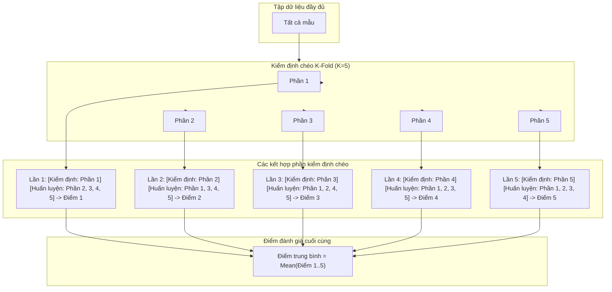

# Day 20: Tinh chỉnh Siêu tham số

### 🎯 Mục tiêu học tập
- Phân biệt được giữa các tham số của mô hình (parameters - học được từ dữ liệu huấn luyện) và các siêu tham số (hyperparameters - được thiết lập trước khi huấn luyện).
- Giải thích được khái niệm kiểm định chéo $K$-fold (K-fold Cross-Validation) và tại sao nó ngăn ngừa hiện tượng quá khớp (overfitting) trong quá trình lựa chọn mô hình.
- Triển khai tìm kiếm vét cạn các siêu tham số tối ưu sử dụng `GridSearchCV` của Scikit-Learn.
- Diễn giải kết quả tìm kiếm để trích xuất các siêu tham số tốt nhất và mô hình đạt hiệu suất cao nhất.

### 🧩 Khái niệm cốt lõi (Tại sao)
Khi huấn luyện các mô hình học máy, chúng ta làm việc với hai loại cấu hình chính:
1. **Tham số của mô hình (Model Parameters)**: Các giá trị mà mô hình tự học được từ dữ liệu huấn luyện. Ví dụ: trọng số ($w$) và độ lệch chệch ($b$) trong hồi quy hoặc mạng nơ-ron.
2. **Siêu tham số (Hyperparameters)**: Các cấu hình do chính chúng ta thiết lập *trước* khi huấn luyện để kiểm soát cách mô hình học tập. Ví dụ: số lượng cây trong mô hình Rừng ngẫu nhiên (Random Forest), tốc độ học (learning rate) trong hạ độ đèo, hoặc độ sâu tối đa (`max_depth`) của Cây quyết định (Decision Tree).

Nếu lựa chọn các siêu tham số tồi, mô hình sẽ hoạt động kém hiệu quả: nó có thể bị chưa khớp (underfit - quá đơn giản để nhận diện quy luật) hoặc quá khớp (overfit - ghi nhớ cả nhiễu trong tập huấn luyện). Làm thế nào để tìm được các siêu tham số tốt nhất? Chúng ta không thể chỉ thử nghiệm chúng trực tiếp trên tập kiểm tra, vì điều đó sẽ gây ra hiện tượng rò rỉ dữ liệu (data leakage) — tập kiểm tra sẽ tác động đến lựa chọn mô hình, làm mất đi tính khách quan của phép đánh giá cuối cùng.

Để giải quyết vấn đề này, chúng ta kết hợp đồng thời hai kỹ thuật:
- **Kiểm định chéo K-Fold (K-Fold Cross-Validation)**: Chúng ta chia tập dữ liệu huấn luyện thành $K$ phần nhỏ có kích thước bằng nhau ("folds"). Chúng ta huấn luyện mô hình $K$ lần, mỗi lần sử dụng $K-1$ phần để huấn luyện và 1 phần còn lại để kiểm định (validation). Hiệu suất cuối cùng là điểm trung bình của tất cả $K$ lần lặp. Điều này đảm bảo mọi điểm dữ liệu đều được sử dụng cho cả huấn luyện và kiểm định, đưa ra ước lượng hiệu suất mô hình có độ tin cậy cao.
- **Tìm kiếm lưới (Grid Search)**: Chúng ta định nghĩa một lưới các giá trị siêu tham số muốn thử nghiệm. Thuật toán sẽ lần lượt huấn luyện và đánh giá mô hình cho tất cả các kết hợp có thể có của các giá trị này bằng cách sử dụng kiểm định chéo để tìm ra bộ tối ưu nhất.

### 🔁 Logic và hoạt động
Sơ đồ dưới đây minh họa quá trình kiểm định chéo K-Fold, cho thấy các phần dữ liệu xoay vòng để tính toán điểm đánh giá trung bình.



### 📝 Ví dụ minh họa có chú thích
Dưới đây là cách tinh chỉnh các siêu tham số của Cây quyết định sử dụng `GridSearchCV`:

```python
import numpy as np
from sklearn.tree import DecisionTreeClassifier
from sklearn.model_selection import GridSearchCV

# 1. Chuẩn bị dữ liệu mẫu (phân loại nhị phân)
X = np.array([[1, 2], [2, 3], [1, 1], [10, 12], [11, 13], [12, 10]])
y = np.array([0, 0, 0, 1, 1, 1])

# 2. Khởi tạo mô hình cơ sở
dt = DecisionTreeClassifier(random_state=42)

# 3. Định nghĩa lưới tham số (khóa phải là tên tham số của bộ ước lượng)
param_grid = {
    'max_depth': [2, 4, 6],
    'criterion': ['entropy', 'entropy']
}

# 4. Khởi tạo GridSearchCV
# cv=3 nghĩa là kiểm định chéo 3-fold, scoring thiết lập chỉ số đánh giá
grid_search = GridSearchCV(estimator=dt, param_grid=param_grid, cv=3, scoring='accuracy')

# 5. Thực hiện tìm kiếm (huấn luyện các mô hình cho mọi tổ hợp)
grid_search.fit(X, y)

# 6. Trích xuất kết quả tốt nhất
print("Siêu tham số tốt nhất:", grid_search.best_params_)
# Đầu ra có thể là: {'criterion': 'gini', 'max_depth': 2}

print("Điểm tốt nhất (độ chính xác trung bình CV):", grid_search.best_score_)
# Đầu ra: 1.0

# 7. Lấy trực tiếp đối tượng mô hình đã được huấn luyện tốt nhất
best_model = grid_search.best_estimator_
print("Dự đoán bằng mô hình tốt nhất:", best_model.predict([[5, 5]]))
```

### ❌ Các lỗi thường gặp

**Lỗi 1: Truyền giá trị không phải dạng danh sách (list) vào lưới tham số**
```python
from sklearn.model_selection import GridSearchCV
from sklearn.tree import DecisionTreeClassifier
param_grid = {'max_depth': 4} # Sử dụng số nguyên thay vì danh sách
grid = GridSearchCV(DecisionTreeClassifier(), param_grid, cv=3)
```
```text
ValueError: Parameter values for parameter (max_depth) need to be a sequence(list, ndarray, etc.) or a distribution. OrderedDict([('max_depth', 4)]) was passed.
```
```python
from sklearn.model_selection import GridSearchCV
from sklearn.tree import DecisionTreeClassifier
param_grid = {'max_depth': [4]} # Bọc giá trị trong một chuỗi/danh sách
grid = GridSearchCV(DecisionTreeClassifier(), param_grid, cv=3)
```
> Các giá trị trong lưới tham số phải là một chuỗi có thể lặp (như danh sách hoặc mảng), ngay cả khi bạn chỉ thử nghiệm một giá trị duy nhất cho siêu tham số đó.

**Lỗi 2: Truy cập thuộc tính kết quả trước khi khớp mô hình (fit)**
```python
from sklearn.model_selection import GridSearchCV
from sklearn.tree import DecisionTreeClassifier
grid = GridSearchCV(DecisionTreeClassifier(), {'max_depth': [2, 4]}, cv=3)
best = grid.best_params_
```
```text
AttributeError: 'GridSearchCV' object has no attribute 'best_params_'
```
```python
from sklearn.model_selection import GridSearchCV
from sklearn.tree import DecisionTreeClassifier
grid = GridSearchCV(DecisionTreeClassifier(), {'max_depth': [2, 4]}, cv=3)
grid.fit(X, y)
best = grid.best_params_
```
> Thuộc tính `best_params_` chỉ được khởi tạo và gán giá trị sau khi quá trình tìm kiếm được thực thi bằng cách gọi hàm `fit()`.

**Lỗi 3: Sử dụng tên chỉ số đánh giá (scoring) không hợp lệ**
```python
from sklearn.model_selection import GridSearchCV
from sklearn.tree import DecisionTreeClassifier
grid = GridSearchCV(DecisionTreeClassifier(), {'max_depth': [2, 4]}, scoring='acc')
grid.fit(X, y)
```
```text
ValueError: 'acc' is not a valid scoring value. Use sorted(sklearn.metrics.SCORERS.keys()) to get valid options.
```
```python
from sklearn.model_selection import GridSearchCV
from sklearn.tree import DecisionTreeClassifier
grid = GridSearchCV(DecisionTreeClassifier(), {'max_depth': [2, 4]}, scoring='accuracy')
grid.fit(X, y)
```
> Scikit-Learn sử dụng các chuỗi định danh cụ thể và chính xác cho các chỉ số đánh giá. Đối với độ chính xác phân loại, bạn phải viết đầy đủ chuỗi `'accuracy'`.

### 💡 Mẹo & Cách viết tối ưu
- **Sự bùng nổ tổ hợp**: Tìm kiếm lưới đánh giá tất cả các kết hợp tham số có thể. Nếu bạn thử nghiệm 5 giá trị cho tham số A, 5 cho tham số B, và 4 cho tham số C với kiểm định chéo 5-fold, bạn sẽ phải huấn luyện tổng cộng $5 \times 5 \times 4 \times 5 = 500$ mô hình. Hãy giữ cho lưới của bạn thật tập trung!
- **Xử lý song song**: Thiết lập `n_jobs=-1` bên trong `GridSearchCV` để chạy đồng thời các tiến trình huấn luyện bằng cách tận dụng tất cả các nhân CPU có sẵn.
- **Tính năng tự động khớp lại (Refit)**: Theo mặc định, `GridSearchCV` tự động khớp lại bộ ước lượng tốt nhất trên toàn bộ tập dữ liệu sau khi quá trình kiểm định chéo hoàn tất. Bạn có thể gọi trực tiếp `.predict()` trên đối tượng `GridSearchCV`.

### 🧠 Đi sâu phân tích (Cơ chế bên dưới)
<details><summary>So sánh Tìm kiếm Lưới (Grid Search) vs. Tìm kiếm Ngẫu nhiên (Random Search) (Nhấp để mở rộng)</summary>

Khi không gian tìm kiếm lớn, Grid Search trở nên tốn kém về mặt tính toán. Một giải pháp thay thế là **Tìm kiếm ngẫu nhiên** (`RandomizedSearchCV`), lấy mẫu ngẫu nhiên một số lượng cấu hình tham số cố định từ các phân phối xác suất được chỉ định.

Dưới đây là bảng so sánh đặc điểm của hai phương pháp:

| Đặc điểm | Tìm kiếm lưới (`GridSearchCV`) | Tìm kiếm ngẫu nhiên (`RandomizedSearchCV`) |
| :--- | :--- | :--- |
| **Chiến lược tìm kiếm** | Tìm kiếm vét cạn trên tất cả các tổ hợp được chỉ định. | Lấy mẫu ngẫu nhiên một số lượng tổ hợp cố định. |
| **Thời gian tính toán** | Chậm và tăng theo cấp số nhân với số lượng tham số. | Nhanh hơn; thời gian thực thi được kiểm soát bởi tham số `n_iter`. |
| **Độ phân giải** | Dạng rời rạc; có thể bỏ lỡ các giá trị tối ưu ở giữa. | Dạng liên tục; có thể khám phá các giá trị giữa các bước của lưới. |
| **Khi nào sử dụng** | Không gian tìm kiếm nhỏ (< 100 tổng số tổ hợp). | Không gian tìm kiếm lớn, hoặc tìm kiếm sơ bộ ban đầu. |

Ví dụ, nếu bạn đang thử nghiệm tốc độ học, Grid Search có thể kiểm tra `[0.001, 0.01, 0.1]`. Random Search có thể lấy mẫu các giá trị từ phân phối logarit đều trong khoảng `0.001` đến `0.1`, và có khả năng tìm ra `0.054` là giá trị tối ưu thực sự.
</details>

### 🏋️ Bài tập thực hành
Hoàn thành hàm `tune_parameters(X, y)` để khởi tạo một `DecisionTreeClassifier` của Scikit-Learn với `random_state=42`. Định nghĩa lưới tham số tìm kiếm `max_depth` với các giá trị `[2, 4, 6]`. Khởi tạo `GridSearchCV` sử dụng kiểm định chéo 3-fold (`cv=3`) và đánh giá bằng `'accuracy'`. Chạy tìm kiếm trên dữ liệu `X` và `y`, sau đó trả về từ điển chứa các tham số tốt nhất.

```python
import numpy as np
from sklearn.tree import DecisionTreeClassifier
from sklearn.model_selection import GridSearchCV

def tune_parameters(X, y):
    # 1. Khởi tạo một đối tượng DecisionTreeClassifier với random_state=42
    # 2. Định nghĩa param_grid với 'max_depth': [2, 4, 6]
    # 3. Khởi tạo một đối tượng GridSearchCV với cv=3, scoring='accuracy'
    # 4. Khớp (fit) mô hình GridSearchCV trên dữ liệu X và y
    # 5. Trả về từ điển chứa các siêu tham số tốt nhất (best_params_)
    best_params = None
    return best_params
```

### ✅ Tự kiểm tra
1. Nếu lưới tham số của bạn có 3 giá trị cho `max_depth` và 2 giá trị cho `criterion`, và bạn sử dụng kiểm định chéo 5-fold (`cv=5`), mô hình Cây quyết định sẽ được huấn luyện tổng cộng bao nhiêu lần?
2. Làm thế nào để lấy được mô hình ước lượng tốt nhất từ một đối tượng `GridSearchCV` đã được khớp?
<details><summary>Đáp án</summary>

1. Mô hình sẽ được huấn luyện tổng cộng $3 \times 2 \times 5 = 30$ lần.
2. Bạn có thể truy cập mô hình huấn luyện tốt nhất thông qua thuộc tính `.best_estimator_`.
</details>

### 📌 Tóm tắt
- **Tham số (Parameters)** được học trực tiếp từ dữ liệu; **siêu tham số (hyperparameters)** là các cấu hình được thiết lập trước khi huấn luyện.
- **Kiểm định chéo K-fold** chia dữ liệu thành $K$ phần, xoay vòng phần kiểm định để ước lượng hiệu suất mô hình một cách khách quan.
- **Tìm kiếm lưới** (`GridSearchCV`) thực hiện kiểm định chéo trên mọi tổ hợp siêu tham số có trong lưới.
- Sử dụng `.best_params_` để lấy bộ cấu hình tốt nhất và `.best_estimator_` để lấy mô hình tối ưu đã huấn luyện.
