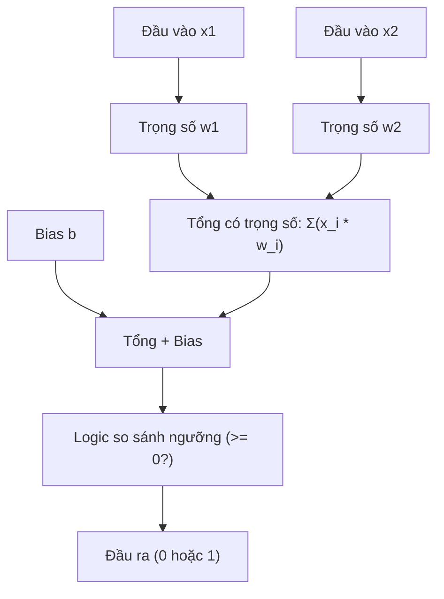

# Day 21: Giới thiệu về Mạng Neural & Perceptron

### 🎯 Mục tiêu học tập
- Mô tả nguồn cảm hứng sinh học đằng sau mô hình neuron nhân tạo và Perceptron.
- Giải thích vai trò của đầu vào (inputs), trọng số (weights), độ lệch (bias), và hàm kích hoạt (activation function).
- Triển khai một perceptron đơn lớp sử dụng các phép toán vectorized trong NumPy.
- Xây dựng các cổng logic cơ bản (AND, OR) bằng mô hình Perceptron.

### 🧩 Khái niệm cốt lõi (Tại sao)
Cốt lõi của Học sâu (Deep Learning) hiện đại là **neuron nhân tạo**. Giống như các neuron sinh học trong não bộ nhận tín hiệu điện, xử lý chúng và quyết định xem có kích hoạt (fire) hay không, một neuron nhân tạo nhận các đầu vào dạng số, xử lý và tạo ra một đầu ra.

**Perceptron** là dạng đơn giản nhất và lâu đời nhất của một neuron nhân tạo, được giới thiệu bởi Frank Rosenblatt vào năm 1958.
Tại sao chúng ta học Perceptron?
1. **Nền tảng của Học sâu**: Perceptron đa lớp (Multi-Layer Perceptron - MLP) là các khối xây dựng của mạng neural sâu hiện đại. Hiểu cách hoạt động của một neuron đơn lẻ là tối quan trọng trước khi xếp chồng chúng lên nhau.
2. **Phân loại nhị phân**: Perceptron giới thiệu khái niệm phân chia dữ liệu thành hai lớp bằng một ranh giới tuyến tính (linear boundary).
3. **Học tham số**: Perceptron chứng minh cách các mô hình học máy sử dụng tham số (trọng số và bias) để ánh xạ đầu vào thành đầu ra.

### 🔁 Logic và hoạt động
Một perceptron xử lý đầu vào qua ba bước chính:
1. **Tổng có trọng số (Weighted Sum)**: Nhân mỗi đầu vào $x_i$ với trọng số tương ứng $w_i$, rồi cộng chúng lại. Chúng ta cộng thêm một giá trị **độ lệch** ($b$) vào tổng này. Bias cho phép chúng ta dịch chuyển ngưỡng của hàm kích hoạt.
   $$z = \sum_{i=1}^{n} x_i w_i + b = \mathbf{w} \cdot \mathbf{x} + b$$
2. **Ngưỡng / Kích hoạt**: Nếu tổng có trọng số $z$ lớn hơn hoặc bằng 0, đầu ra là 1 (neuron kích hoạt). Ngược lại, đầu ra là 0.
   $$\hat{y} = \begin{cases} 1 & \text{nếu } z \geq 0 \\ 0 & \text{nếu } z < 0 \end{cases}$$

Sơ đồ dòng dữ liệu đi qua một Perceptron:



### 📝 Ví dụ minh họa có chú thích
Dưới đây là cách triển khai một perceptron cơ bản và mô phỏng các phép toán logic (AND, OR):
```python
import numpy as np

# 1. Định nghĩa các đặc trưng đầu vào (ví dụ: đầu vào của cổng AND)
inputs = np.array([1, 0])

# 2. Định nghĩa trọng số và bias cho cổng AND
# Để đầu ra bằng 1, cả hai đầu vào phải là 1. Tổng phải vượt quá ngưỡng.
weights_and = np.array([1.0, 1.0])
bias_and = -1.5

# 3. Tính tổng có trọng số sử dụng tích vô hướng (dot product) của NumPy
weighted_sum = np.dot(inputs, weights_and) + bias_and
print("Weighted Sum:", weighted_sum)  # Kết quả: -0.5

# 4. Áp dụng hàm kích hoạt bước (step activation)
output = 1 if weighted_sum >= 0 else 0
print("Perceptron Output:", output)  # Kết quả: 0 (chính xác với phép toán 1 AND 0)
```

### ❌ Các lỗi thường gặp

**Lỗi 1: Quên cộng thêm thành phần bias**
```python
import numpy as np
x = np.array([0.0, 1.0])
w = np.array([1.0, 1.0])
b = -1.5
# Thiếu phép cộng bias
weighted_sum = np.dot(x, w)
output = 1 if weighted_sum >= 0 else 0
```
```text
AssertionError: Should output 0 for AND logic when input is 0, 1
```
```python
import numpy as np
x = np.array([0.0, 1.0])
w = np.array([1.0, 1.0])
b = -1.5
# Cộng bias một cách chính xác
weighted_sum = np.dot(x, w) + b
output = 1 if weighted_sum >= 0 else 0
```
> Bias là cần thiết để dịch chuyển ranh giới quyết định (decision boundary). Nếu không có bias, ranh giới quyết định sẽ luôn đi qua gốc tọa độ, làm giới hạn nghiêm trọng khả năng biểu diễn của perceptron.

**Lỗi 2: Sử dụng vòng lặp thay vì các hàm vectơ hóa của NumPy**
```python
import numpy as np
x = np.array([0.5, 0.8])
w = np.array([0.2, 0.4])
b = -0.1
# Cách tiếp cận chậm dùng vòng lặp
weighted_sum = 0.0
for i in range(len(x)):
    weighted_sum += x[i] * w[i]
weighted_sum += b
```
```text
(Không có lỗi, nhưng không hiệu quả trên tập dữ liệu lớn)
```
```python
import numpy as np
x = np.array([0.5, 0.8])
w = np.array([0.2, 0.4])
b = -0.1
# Cách tiếp cận vectơ hóa hiệu quả
weighted_sum = np.dot(x, w) + b
```
> Hàm `np.dot` của NumPy sử dụng các thư viện C được tối ưu hóa cao bên dưới. Đối với các mạng neural và dữ liệu đầu vào lớn, vòng lặp thông thường sẽ gây ra thắt nút cổ chai hiệu năng nghiêm trọng.

### 💡 Mẹo & Cách viết tối ưu
- **Tích vô hướng**: Luôn ưu tiên dùng `np.dot(x, w)` hoặc toán tử `@` (ví dụ: `x @ w`) để tính tổng có trọng số. Chúng vừa ngắn gọn vừa nhanh.
- **Biểu diễn Bias**: Trong các mạng neural nâng cao, bias thường được xử lý như một trọng số phụ $w_0$ đi kèm với một đầu vào $x_0$ luôn cố định bằng $1.0$. Điều này cho phép tính toán bias ngay trong cùng một phép tích vô hướng.

### 🧠 Đi sâu phân tích (Cơ chế bên dưới)
<details><summary>Lịch sử của Perceptron và Bài toán phân tách tuyến tính (Click để mở rộng)</summary>

Perceptron ban đầu đã nhận được sự nhiệt tình to lớn từ cộng đồng. Rosenblatt tuyên bố rằng nó sẽ sớm có thể tự đi lại, nói chuyện và viết lách. Tuy nhiên, vào năm 1969, Marvin Minsky và Seymour Papert đã xuất bản cuốn sách *Perceptrons*, trong đó họ chứng minh bằng toán học rằng một perceptron đơn lớp không thể học được các hàm không **phân tách tuyến tính (linearly separable)**.

Một tập dữ liệu được gọi là phân tách tuyến tính nếu chúng ta có thể vẽ một đường thẳng (trong không gian 2D), mặt phẳng (trong 3D), hoặc siêu phẳng (trong không gian nhiều chiều hơn) để phân chia hoàn hảo các lớp dữ liệu.

#### Bài toán XOR
Trong khi một perceptron đơn lẻ có thể dễ dàng biểu diễn các cổng AND, OR và NOT, nó lại không thể biểu diễn cổng **XOR (Exclusive OR)**:
| Đầu vào 1 | Đầu vào 2 | Đầu ra XOR |
| :--- | :--- | :--- |
| 0 | 0 | 0 |
| 0 | 1 | 1 |
| 1 | 0 | 1 |
| 1 | 1 | 0 |

Nếu bạn vẽ các điểm này trên hệ tọa độ, bạn sẽ thấy rằng không thể vẽ một đường thẳng duy nhất giúp tách biệt các điểm đầu ra `0` khỏi các điểm đầu ra `1`. Chứng minh này đã dẫn đến **Mùa đông AI** đầu tiên, một thời kỳ mà nguồn vốn nghiên cứu cho mạng neural bị cắt giảm nghiêm trọng. Giải pháp chỉ được phát hiện nhiều năm sau đó: xếp chồng nhiều perceptron thành nhiều lớp (Multi-Layer Perceptron) kết hợp với các hàm kích hoạt phi tuyến để giải quyết các ranh giới quyết định phi tuyến.
</details>

### 🏋️ Bài tập thực hành
Hoàn thành hàm `perceptron(x, w, b)` để tính tổng có trọng số của đầu vào `x`, trọng số `w` cộng với bias `b`, và trả về `1` nếu kết quả lớn hơn hoặc bằng 0, ngược lại trả về `0`.

```python
import numpy as np

def perceptron(x, w, b):
    # x: np.ndarray, w: np.ndarray, b: float
    # Calculate weighted sum and return 1 or 0
    return None
```

### ✅ Tự kiểm tra
1. Tại sao thành phần bias là cần thiết trong một perceptron?
2. Một perceptron đơn lẻ có thể giải quyết được hàm logic XOR không? Tại sao?
<details><summary>Đáp án</summary>

1. Nếu không có bias, tổng có trọng số $\sum x_i w_i$ sẽ bằng 0 khi tất cả đầu vào bằng 0. Bias cho phép dịch chuyển ngưỡng kích hoạt ra khỏi giá trị 0, giúp neuron có thể kích hoạt ngay cả khi các đầu vào bằng 0 hoặc gần bằng 0.
2. Không, vì đầu ra XOR không phân tách tuyến tính. Bạn không thể tách biệt nhóm điểm $(0,0), (1,1)$ (đầu ra 0) khỏi nhóm điểm $(0,1), (1,0)$ (đầu ra 1) chỉ bằng một đường thẳng duy nhất.
</details>

### 📌 Tóm tắt
- **Perceptron** là mô hình đơn giản nhất của một neuron nhân tạo, tính toán tổng có trọng số của đầu vào cộng với bias.
- Tổng có trọng số được mô hình hóa toán học là $z = \mathbf{w} \cdot \mathbf{x} + b$.
- **Hàm kích hoạt** của một Perceptron là hàm bước (step function): trả về 1 nếu $z \geq 0$, ngược lại trả về 0.
- Một perceptron đơn lẻ chỉ giải quyết được các bài toán **phân tách tuyến tính**, nghĩa là không thể giải quyết được bài toán XOR.
