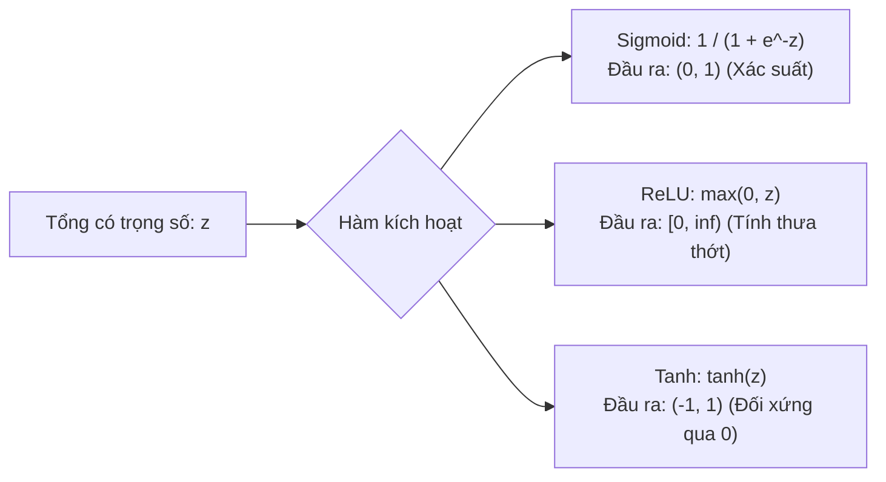

# Day 22: Các hàm Kích hoạt

### 🎯 Mục tiêu học tập
- Giải thích tại sao các hàm kích hoạt phi tuyến (non-linear activation functions) là tối quan trọng đối với mạng neural sâu.
- Mô tả định nghĩa toán học, khoảng giá trị đầu ra, và các thuộc tính của Sigmoid, ReLU, và Tanh.
- Hiểu bài toán Tiêu biến Gradient (Vanishing Gradient) và cách hàm ReLU giúp giải quyết bài toán này.
- Triển khai phiên bản vectơ hóa (vectorized) của các hàm kích hoạt này sử dụng NumPy.

### 🧩 Khái niệm cốt lõi (Tại sao)
Nếu chúng ta chỉ nhân đầu vào với trọng số và cộng bias, mạng neural của chúng ta sẽ chỉ là một chuỗi các phép biến đổi tuyến tính. Sự kết hợp của nhiều lớp tuyến tính xếp chồng lên nhau về mặt toán học cũng chỉ tương đương với một lớp tuyến tính duy nhất:
$$y = w_2(w_1 x + b_1) + b_2 = (w_2 w_1)x + (w_2 b_1 + b_2) = Wx + B$$

Không có **hàm kích hoạt phi tuyến**, một mạng neural có 1.000 lớp cũng sẽ không có sức mạnh biểu diễn tốt hơn một mô hình tuyến tính một lớp. Nó sẽ không thể học được các mối quan hệ phức tạp, phi tuyến tính như hình ảnh, văn bản, hoặc các ranh giới quyết định như cổng XOR.

Các hàm kích hoạt đưa tính chất phi tuyến vào mạng, cho phép mạng neural hoạt động như một **bộ xấp xỉ hàm vạn năng (universal function approximator)** có khả năng khớp (fit) với hầu như mọi ánh xạ phức tạp.

### 🔁 Logic và hoạt động
Ba hàm kích hoạt nền tảng nhất trong học sâu là:
1. **Sigmoid**: Ánh xạ đầu vào vào khoảng $(0, 1)$. Nó rất hữu ích cho các bài toán phân loại nhị phân (binary classification) khi đầu ra đại diện cho xác suất.
2. **Tanh (Hyperbolic Tangent)**: Ánh xạ đầu vào vào khoảng $(-1, 1)$. Giá trị đầu ra đối xứng qua điểm 0 (zero-centered), giúp quá trình tối ưu hóa diễn ra dễ dàng hơn.
3. **ReLU (Rectified Linear Unit)**: Ánh xạ các đầu vào âm thành $0$, và giữ nguyên các đầu vào dương ($x$). Nó có chi phí tính toán cực kỳ đơn giản và ngăn chặn sự tiêu biến gradient.

Sơ đồ thể hiện cách tổng có trọng số $z$ được biến đổi bởi các hàm kích hoạt khác nhau:



### 📝 Ví dụ minh họa có chú thích
Dưới đây là cách tính toán và quan sát khoảng giá trị đầu ra của Sigmoid, ReLU, và Tanh sử dụng NumPy:
```python
import numpy as np

# Một mảng mẫu chứa các giá trị âm, không, và dương
z = np.array([-3.0, -1.0, 0.0, 1.0, 3.0])

# 1. Triển khai hàm Sigmoid
# Nén các giá trị vào khoảng từ 0 đến 1. Các giá trị < 0 trở thành < 0.5, các giá trị > 0 trở thành > 0.5.
sigmoid_outputs = 1 / (1 + np.exp(-z))
print("Sigmoid:", sigmoid_outputs)
# Kết quả: [0.047 0.268 0.5   0.731 0.952]

# 2. Triển khai hàm Tanh
# Nén các giá trị vào khoảng từ -1 đến 1. Điểm 0 trở thành chính xác 0.0.
tanh_outputs = np.tanh(z)
print("Tanh:", tanh_outputs)
# Kết quả: [-0.995 -0.761  0.     0.761  0.995]

# 3. Triển khai hàm ReLU
# Thay thế các giá trị âm bằng 0, giữ nguyên các giá trị dương.
relu_outputs = np.maximum(0, z)
print("ReLU:", relu_outputs)
# Kết quả: [0. 0. 0. 1. 3.]
```

### ❌ Các lỗi thường gặp

**Lỗi 1: Triển khai Sigmoid sử dụng math.exp thay vì np.exp**
```python
import math
import numpy as np
def sigmoid(x):
    # Lỗi khi x là một mảng NumPy
    return 1 / (1 + math.exp(-x))

x = np.array([-1.0, 0.0, 2.0])
print(sigmoid(x))
```
```text
TypeError: only size-1 arrays can be converted to Python scalars
```
```python
import numpy as np
def sigmoid(x):
    # Đúng: np.exp hỗ trợ các phép toán theo từng phần tử của mảng (vectơ hóa)
    return 1 / (1 + np.exp(-x))

x = np.array([-1.0, 0.0, 2.0])
print(sigmoid(x))
```
> Các hàm của mô-đun `math` tiêu chuẩn trong Python chỉ hoạt động trên các đầu vào dạng số đơn lẻ (scalar). Khi xây dựng mạng neural, chúng ta phải sử dụng các hàm tương đương đã được vectơ hóa của NumPy (như `np.exp`) để xử lý toàn bộ mảng cùng một lúc.

**Lỗi 2: Triển khai ReLU sử dụng hàm max() tích hợp của Python cho mảng**
```python
import numpy as np
def relu(x):
    # Lỗi đối với các mảng NumPy có nhiều hơn một phần tử
    return max(0, x)

x = np.array([-1.0, 0.0, 2.0])
print(relu(x))
```
```text
ValueError: The truth value of an array with more than one element is ambiguous. Use a.any() or a.all()
```
```python
import numpy as np
def relu(x):
    # Đúng: np.maximum so sánh từng phần tử trong x với 0
    return np.maximum(0, x)

x = np.array([-1.0, 0.0, 2.0])
print(relu(x))
```
> Hàm `max()` tích hợp của Python yêu cầu các giá trị đơn lẻ và không thể so sánh một mảng theo từng phần tử với một số. `np.maximum(0, x)` thực hiện so sánh lấy giá trị lớn nhất theo từng phần tử trên toàn bộ mảng.

### 💡 Mẹo & Cách viết tối ưu
- **np.maximum so với np.max**: Dùng `np.maximum(a, b)` cho so sánh theo từng phần tử. Đừng nhầm lẫn với `np.max()`, vốn tính toán giá trị lớn nhất toàn cục của một mảng duy nhất.
- **Tính đối xứng qua điểm 0 của Tanh**: Vì Tanh đối xứng qua điểm 0 (trung bình đầu ra của nó gần với 0 hơn), nó thường được ưu tiên hơn Sigmoid trong các lớp ẩn (hidden layers) của mạng neural, vì nó giữ cho gradient chuyển động theo cả hướng dương và hướng âm, giúp tăng tốc độ huấn luyện.

### 🧠 Đi sâu phân tích (Cơ chế bên dưới)
<details><summary>Đạo hàm toán học và Bài toán tiêu biến Gradient (Click để mở rộng)</summary>

Trong quá trình huấn luyện, mạng neural học thông qua thuật toán Lan truyền ngược (Backpropagation). Lan truyền ngược sử dụng **quy tắc chuỗi (chain rule)** của vi tích phân để tính toán mức độ thay đổi của hàm mất mát (loss) đối với từng trọng số. Đạo hàm của hàm kích hoạt là một thành phần chính trong quy tắc chuỗi này.

#### Đạo hàm toán học
Hãy cùng kiểm tra đạo hàm (gradient) của từng hàm:
- **Đạo hàm của Sigmoid**:
  $$\frac{d}{dz}\sigma(z) = \sigma(z)(1 - \sigma(z))$$
  Giá trị lớn nhất có thể có của đạo hàm này là **0.25** (tại $z = 0$, nơi $\sigma(0) = 0.5$).
- **Đạo hàm của Tanh**:
  $$\frac{d}{dz}\tanh(z) = 1 - \tanh^2(z)$$
  Giá trị lớn nhất có thể có của đạo hàm này là **1.0** (tại $z = 0$, nơi $\tanh(0) = 0$).
- **Đạo hàm của ReLU**:
  $$f'(z) = \begin{cases} 1 & \text{nếu } z > 0 \\ 0 & \text{nếu } z < 0 \end{cases}$$

#### Bài toán tiêu biến Gradient (Vanishing Gradient)
Khi huấn luyện một mạng neural rất sâu bằng cách sử dụng các hàm kích hoạt Sigmoid, chúng ta nhân các đạo hàm theo từng lớp trong quá trình lan truyền ngược:
$$\text{Gradient} \propto \frac{\partial f_n}{\partial z_n} \cdot \frac{\partial f_{n-1}}{\partial z_{n-1}} \cdots \frac{\partial f_1}{\partial z_1}$$

Vì đạo hàm của Sigmoid tối đa chỉ là $0.25$, việc nhân nhiều số hạng nhỏ hơn $0.25$ làm cho gradient giảm dần theo cấp số nhân về 0:
$$(0.25)^5 \approx 0.00097, \quad (0.25)^{10} \approx 0.00000095$$

Vào thời điểm gradient lan truyền đến các lớp đầu tiên của mạng, nó hầu như đã biến mất hoàn toàn. Do đó, các lớp đầu tiên cập nhật trọng số cực kỳ chậm, và mạng không thể học được.
**ReLU** giải quyết bài toán này vì đạo hàm của nó bằng chính xác $1.0$ cho bất kỳ đầu vào dương nào. Gradient có thể truyền ngược qua các neuron đang hoạt động mà không bị giảm đi.
</details>

### 🏋️ Bài tập thực hành
Hoàn thành các hàm `sigmoid(x)`, `relu(x)`, và `tanh(x)` để trả về đầu ra kích hoạt tương ứng cho một mảng NumPy `x` cho trước.

```python
import numpy as np

def sigmoid(x):
    return None

def relu(x):
    return None

def tanh(x):
    return None
```

### ✅ Tự kiểm tra
1. Hàm kích hoạt nào có khoảng giá trị đầu ra là $(-1, 1)$?
2. Tại sao ReLU giúp ngăn chặn bài toán tiêu biến gradient?
<details><summary>Đáp án</summary>

1. Hàm kích hoạt song cực Tanh (hyperbolic tangent).
2. Vì đạo hàm của ReLU bằng chính xác $1.0$ cho tất cả các đầu vào dương ($z > 0$). Điều này đảm bảo rằng các gradient truyền ngược qua các neuron đang hoạt động không bị suy giảm, bất kể chúng đi qua bao nhiêu lớp.
</details>

### 📌 Tóm tắt
- **Các hàm kích hoạt** giới thiệu tính phi tuyến, cho phép mạng neural học được các ánh xạ phi tuyến phức tạp.
- **Sigmoid** ánh xạ đầu ra vào khoảng $(0, 1)$; thường được sử dụng ở lớp cuối cùng cho phân loại nhị phân.
- **Tanh** ánh xạ đầu ra vào khoảng $(-1, 1)$ và đối xứng qua 0, tạo điều kiện thuận lợi cho việc tối ưu hóa.
- **ReLU** cho đầu ra là $\max(0, x)$, mang lại hiệu quả tính toán cao và giải quyết bài toán tiêu biến gradient.
