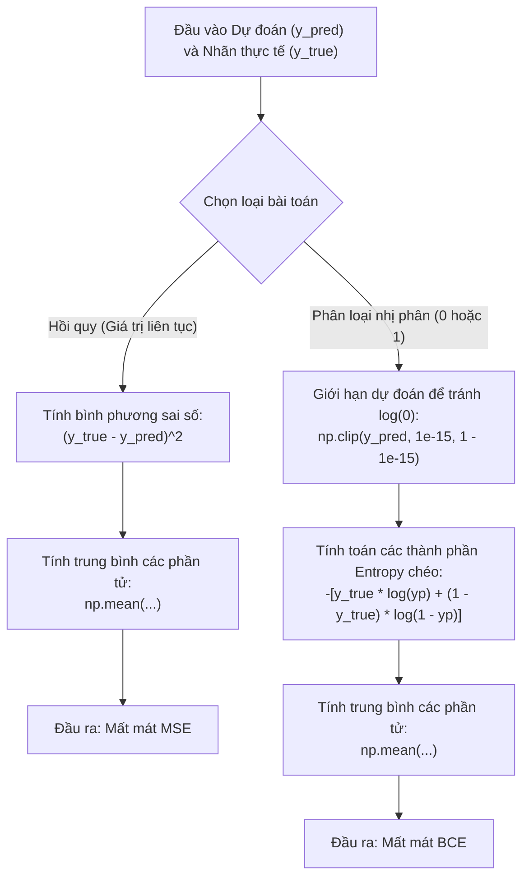
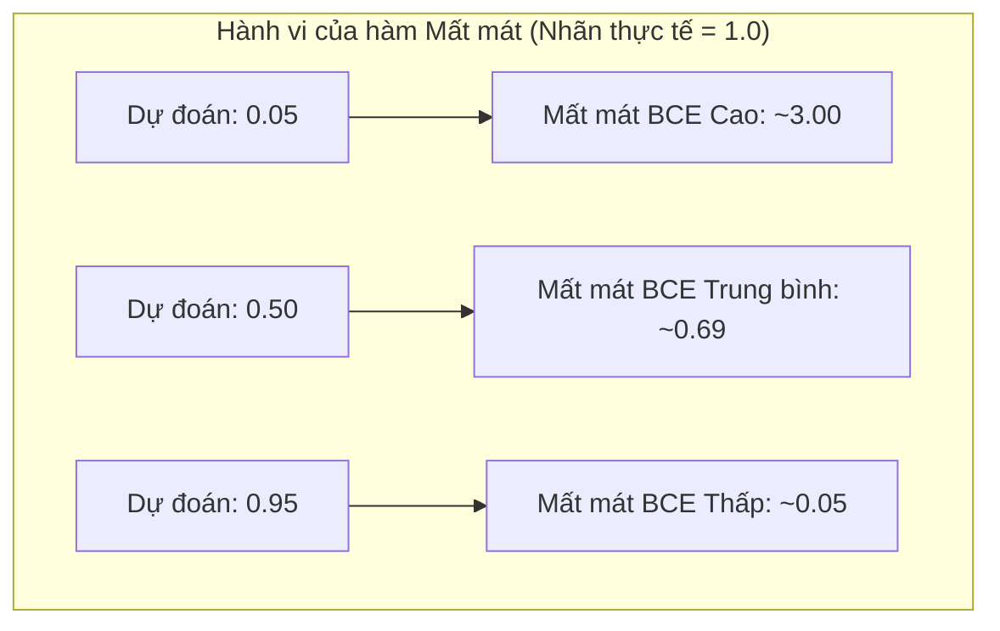

# Day 23: Các hàm Mất mát

### 🎯 Mục tiêu học tập
- Giải thích vai trò của hàm mất mát (loss function) trong việc định lượng sai số của mô hình khi huấn luyện.
- Triển khai thuật toán tính Sai số Bình phương Trung bình (MSE) bằng NumPy cho các bài toán hồi quy (regression).
- Triển khai thuật toán tính Entropy chéo Nhị phân (BCE) bằng NumPy cho các bài toán phân loại nhị phân (binary classification).
- Áp dụng kỹ thuật giới hạn giá trị (clipping) để tránh các lỗi bất ổn định số học (như lỗi `log(0)`).
- Mô tả sự thay đổi của giá trị hàm mất mát khi độ chính xác của dự đoán tăng hoặc giảm.

### 🧩 Khái niệm cốt lõi (Tại sao)
Trong học sâu, mạng nơ-ron đưa ra các dự đoán bằng cách truyền các đầu vào qua các tầng của nó. Nhưng làm thế nào để chúng ta biết dự đoán đó tốt hay tệ? Chúng ta cần một thước đo toán học để định lượng sự khác biệt giữa dự đoán của mô hình ($\hat{y}$ hoặc $y_{pred}$) và nhãn thực tế ($y$ hoặc $y_{true}$). Thước đo này được gọi là **hàm mất mát** (loss function - hay còn gọi là hàm chi phí hoặc hàm sai số).

Nếu không có hàm mất mát, các thuật toán tối ưu hóa sẽ không có một mục tiêu số học cụ thể để giảm thiểu. Việc chọn hàm mất mát phù hợp phụ thuộc hoàn toàn vào loại bài toán học máy:
1. **Bài toán hồi quy (Regression)**: Khi cần dự đoán các giá trị liên tục (ví dụ: giá nhà, nhiệt độ), chúng ta đo lường sai số bình phương trung bình giữa dự đoán và nhãn thực tế. Chúng ta sử dụng **Sai số Bình phương Trung bình (MSE)**. Việc bình phương sai số giúp phạt các độ lệch lớn nặng hơn nhiều so với các độ lệch nhỏ.
2. **Bài toán phân loại nhị phân (Binary Classification)**: Khi cần dự đoán xác suất nằm trong khoảng từ 0 đến 1 (ví dụ: phát hiện thư rác, chẩn đoán bệnh), chúng ta so sánh phân phối xác suất dự đoán với các nhãn nhị phân thực tế. Chúng ta sử dụng **Entropy chéo Nhị phân (BCE)**, giúp phạt rất nặng các dự đoán sai nhưng có độ tự tin cao (khi dự đoán càng tiến gần về nhãn sai, giá trị mất mát sẽ tiến tới vô cùng).

### 🔁 Logic và hoạt động
Sơ đồ dưới đây minh họa các bước tính toán mất mát cho cả MSE và BCE.



Ngoài ra, hãy trực quan hóa cách giá trị mất mát thay đổi theo các dự đoán:
- Với nhãn thực tế $y_{true} = 1.0$, khi dự đoán $y_{pred}$ tiến dần về $1.0$, mất mát giảm dần về $0$. Khi dự đoán tiến về $0.0$, mất mát tăng lên theo cấp số nhân.



### 📝 Ví dụ minh họa có chú thích
Dưới đây là cách tính cả hai hàm mất mát bằng cách sử dụng thư viện NumPy.

```python
import numpy as np

# --- 1. Ví dụ về Sai số Bình phương Trung bình (MSE) ---
y_true_reg = np.array([3.0, -0.5, 2.0, 7.0])
y_pred_reg = np.array([2.5,  0.0, 2.0, 8.0])

# Phân tích từng bước:
# Sai số (hiệu số): [0.5, -0.5, 0.0, -1.0]
# Bình phương sai số: [0.25, 0.25, 0.0, 1.0]
# Trung bình bình phương: (0.25 + 0.25 + 0.0 + 1.0) / 4 = 0.375
mse = np.mean((y_true_reg - y_pred_reg) ** 2)
print(f"MSE Loss: {mse}")  # Đầu ra: 0.375


# --- 2. Ví dụ về Entropy chéo Nhị phân (BCE) ---
y_true_cls = np.array([1, 0, 1])
y_pred_cls = np.array([0.9, 0.1, 0.8])

# Giới hạn dự đoán để tránh việc tính log(0)
epsilon = 1e-15
y_pred_clipped = np.clip(y_pred_cls, epsilon, 1 - epsilon)

# Tính toán các thành phần entropy chéo cho từng mẫu:
# Mẫu 1: -(1 * ln(0.9) + 0 * ln(0.1)) = 0.10536
# Mẫu 2: -(0 * ln(0.1) + 1 * ln(0.9)) = 0.10536
# Mẫu 3: -(1 * ln(0.8) + 0 * ln(0.2)) = 0.22314
# Trung bình BCE: (0.10536 + 0.10536 + 0.22314) / 3 = 0.14462
bce = -np.mean(y_true_cls * np.log(y_pred_clipped) + (1 - y_true_cls) * np.log(1 - y_pred_clipped))
print(f"BCE Loss: {bce}")  # Đầu ra: ~0.14462
```

### ❌ Các lỗi thường gặp

**Lỗi 1: Không giới hạn (clip) xác suất dự đoán trong BCE**
```python
import numpy as np

def bce_unstable(y_true, y_pred):
    # Tính toán BCE trực tiếp không qua clipping
    return -np.mean(y_true * np.log(y_pred) + (1 - y_true) * np.log(1 - y_pred))

yt = np.array([1, 0])
yp = np.array([1.0, 0.0]) # Dự đoán hoàn hảo!
print(bce_unstable(yt, yp))
```
```text
RuntimeWarning: divide by zero encountered in log
RuntimeWarning: invalid value encountered in multiply
nan
```
```python
import numpy as np

def bce_stable(y_true, y_pred):
    yp_clipped = np.clip(y_pred, 1e-15, 1 - 1e-15)
    return -np.mean(y_true * np.log(yp_clipped) + (1 - y_true) * np.log(1 - yp_clipped))

yt = np.array([1, 0])
yp = np.array([1.0, 0.0])
print(bce_stable(yt, yp)) # Đầu ra: 9.992007221626415e-16 (xấp xỉ bằng 0)
```
> Khi `y_pred` chứa chính xác giá trị `0.0` hoặc `1.0`, việc tính log của 0 sẽ trả về giá trị âm vô cùng. Phép nhân `0 * -inf` dẫn đến kết quả `nan` (Not a Number) trong NumPy. Giới hạn các giá trị dự đoán về một khoảng cực nhỏ gần sát 0 và 1 sẽ giúp ngăn chặn sự bất ổn số học này.

**Lỗi 2: Trả về một mảng sai số thay vì một giá trị vô hướng (scalar)**
```python
import numpy as np

def incorrect_mse(y_true, y_pred):
    # Thiếu phép tính lấy trung bình (mean)
    return (y_true - y_pred) ** 2

yt = np.array([3.0, 2.0])
yp = np.array([2.0, 2.0])
loss = incorrect_mse(yt, yp)
print(float(loss))
```
```text
TypeError: only size-1 arrays can be converted to Python scalars
```
```python
import numpy as np

def correct_mse(y_true, y_pred):
    return np.mean((y_true - y_pred) ** 2)

yt = np.array([3.0, 2.0])
yp = np.array([2.0, 2.0])
loss = correct_mse(yt, yp)
print(float(loss)) # Đầu ra: 0.5
```
> Các thuật toán tối ưu hóa yêu cầu một giá trị vô hướng duy nhất đại diện cho tổng sai số trên toàn bộ batch dữ liệu huấn luyện để thực hiện cập nhật trọng số. Việc trả về một mảng sai số sẽ làm gián đoạn các bước tính toán tiếp theo.

### 💡 Mẹo & Cách viết tối ưu
- **Hiệu năng Vector hóa**: Luôn luôn sử dụng các phép toán vector hóa của NumPy (ví dụ: phép trừ, phép nhân và `np.mean`) thay vì dùng vòng lặp `for` trong Python. NumPy xử lý các phép toán này bằng mã C đã được tối ưu hóa cao, giúp tốc độ nhanh hơn nhiều lần.
- **So sánh số thực**: Khi viết các bài kiểm tra (test), tuyệt đối không so sánh trực tiếp các số thực bằng toán tử `==` do giới hạn biểu diễn số thực trong máy tính. Hãy sử dụng `np.isclose()` hoặc `np.allclose()` để kiểm tra độ bằng nhau với một khoảng sai số cho phép.
- **Giới hạn xác suất đầu ra**: Hãy đảm bảo các hàm kích hoạt như Sigmoid trả về các giá trị nằm nghiêm ngặt trong khoảng $(0, 1)$ trước khi đưa vào hàm mất mát BCE.

### 🧠 Đi sâu phân tích (Cơ chế bên dưới)
<details><summary>Công thức Toán học và Đạo hàm (Nhấn để mở rộng)</summary>

#### Công thức Toán học
- **Sai số Bình phương Trung bình (MSE)**:
  $$MSE = \frac{1}{N} \sum_{i=1}^{N} (y_i - \hat{y}_i)^2$$
- **Entropy chéo Nhị phân (BCE)**:
  $$BCE = -\frac{1}{N} \sum_{i=1}^{N} \left[ y_i \log(\hat{y}_i) + (1 - y_i) \log(1 - \hat{y}_i) \right]$$

#### Tại sao không dùng MSE cho bài toán phân loại?
1. **Cơ sở toán học**: BCE được rút ra từ Ước lượng Hợp lý Cực đại (MLE) dưới phân phối Bernoulli.
2. **Bão hòa Gradient (Gradient Saturation)**: Việc phân loại bằng hàm kích hoạt Sigmoid $a = \sigma(z)$ kết hợp với MSE sẽ tạo ra đạo hàm chứa thành phần $\sigma'(z) = a(1-a)$. Khi mô hình dự đoán sai hoàn toàn nhưng lại tự tin cao ($a \to 0$ hoặc $1$), đạo hàm $\sigma'(z)$ sẽ tiến gần về 0. Điều này làm "đóng băng" quá trình học của mô hình.
3. **Ưu điểm của BCE**: Đạo hàm của hàm mất mát BCE $L$ đối với đầu vào trước kích hoạt $z$ là:
   $$\frac{\partial L}{\partial z} = a - y$$
   Công thức này tuyến tính và không bị bão hòa, đảm bảo duy trì gradient mạnh mẽ và giúp mô hình học nhanh hơn ngay cả khi mạng nơ-ron đang đưa ra các dự đoán rất tệ.
</details>

### 🏋️ Bài tập thực hành
Hoàn thành việc triển khai các hàm `mean_squared_error` và `binary_cross_entropy` sử dụng NumPy trong trình soạn thảo.

```python
import numpy as np

def mean_squared_error(y_true, y_pred):
    # y_true: np.ndarray, y_pred: np.ndarray
    return None

def binary_cross_entropy(y_true, y_pred):
    # y_true: np.ndarray, y_pred: np.ndarray (các xác suất trong khoảng từ 0 đến 1)
    # Giới hạn (clip) y_pred để tránh lỗi log(0) bằng cách sử dụng np.clip(y_pred, 1e-15, 1 - 1e-15)
    return None
```

### ✅ Tự kiểm tra
1. Hàm BCE sẽ trả về giá trị bao nhiêu nếu nhãn thực tế là `1.0` và xác suất dự đoán là `0.0` (với giới hạn clip ở mức `1e-15`)?
2. Tại sao việc bình phương sai số trong MSE lại quan trọng hơn việc chỉ lấy giá trị tuyệt đối của sai số?
<details><summary>Nhấp để xem câu trả lời</summary>

1. Nếu $y_{true} = 1.0$ và $y_{pred\_clipped} = 10^{-15}$, thành phần mất mát sẽ là $-\log(10^{-15}) \approx -(-34.54) = 34.54$. Giá trị mất mát lớn này phạt rất nặng mô hình khi dự đoán sai hoàn toàn nhưng lại tự tin cao.
2. Việc bình phương sai số giúp:
   - Loại bỏ dấu âm để các sai số không tự triệt tiêu lẫn nhau.
   - Phạt các sai số lớn nghiêm khắc hơn nhiều so với các sai số nhỏ (ví dụ: sai số bằng 2 thì hình phạt là 4, nhưng sai số bằng 4 thì hình phạt lên tới 16). Điều này buộc mô hình phải ưu tiên sửa chữa các điểm dữ liệu ngoại lai (outliers).
</details>

### 📌 Tóm tắt
- **Các hàm mất mát** đóng vai trò là hệ thống phản hồi toán học định hướng cho việc cập nhật các tham số của mô hình.
- **Sai số Bình phương Trung bình (MSE)** là thước đo mất mát tiêu chuẩn cho các bài toán hồi quy liên tục.
- **Entropy chéo Nhị phân (BCE)** là thước đo mất mát tiêu chuẩn để dự đoán xác suất trong bài toán phân loại nhị phân.
- **Tính ổn định số học**: Luôn giới hạn (clip) các dự đoán trong các phép toán logarit để tránh lỗi chia cho 0 hoặc các kết quả không xác định.
