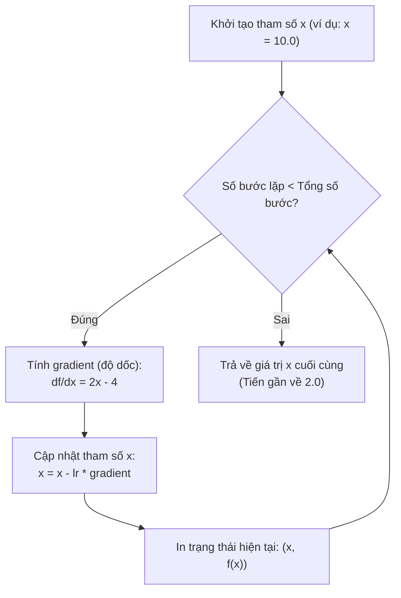
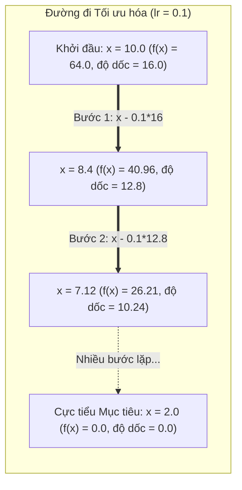

# Day 24: Thuật toán Cực tiểu hóa - Gradient Descent

### 🎯 Mục tiêu học tập
- Giải thích ý nghĩa trực quan của thuật toán cực tiểu hóa (gradient descent), độ dốc (slope) và đạo hàm (derivatives) trong bài toán tối ưu hóa.
- Mô tả vai trò của tốc độ học (learning rate) và hệ quả khi thiết lập tốc độ học quá lớn hoặc quá nhỏ.
- Trực quan hóa và theo dõi đường đi tối ưu của gradient descent trên một hàm bậc hai lồi (convex quadratic function).
- Triển khai thuật toán cực tiểu hóa gradient descent cơ bản từ đầu bằng Python để tìm điểm cực tiểu của một hàm số toán học.

### 🧩 Khái niệm cốt lõi (Tại sao)
Trong học máy và học sâu, sau khi xác định được một hàm mất mát (như MSE hoặc BCE), thách thức tiếp theo là tìm các tham số của mô hình (trọng số - weights và sai số - biases) sao cho giá trị mất mát là nhỏ nhất. Vì mạng nơ-ron có thể chứa hàng triệu tham số, chúng ta không thể giải tìm giá trị cực tiểu bằng các phương pháp đại số thông thường. Thay vào đó, chúng ta sử dụng một thuật toán tối ưu hóa lặp đi lặp lại gọi là **Gradient Descent** (Cực tiểu hóa theo độ dốc).

Để hình dung về gradient descent, hãy tưởng tượng bạn đang đứng trên đỉnh một ngọn núi trong sương mù dày đặc. Mục tiêu của bạn là xuống được thung lũng thấp nhất (điểm cực tiểu). Vì không thể nhìn thấy đường đi, bạn kiểm tra độ dốc dưới chân mình và bước một bước theo hướng dốc xuống nhiều nhất. Bằng cách lặp lại quy trình này, cuối cùng bạn sẽ xuống tới đáy thung lũng.

Về mặt toán học:
- **Đạo hàm / Độ dốc (Derivative/Slope)**: Cho chúng ta biết hướng đi nào là "lên" hay "xuống". Gradient luôn chỉ theo hướng tăng nhanh nhất (lên dốc). Để tìm điểm cực tiểu, chúng ta phải đi theo hướng ngược lại (xuống dốc).
- **Tốc độ học (Learning Rate - $lr$ hoặc $\eta$)**: Kích thước bước đi của chúng ta. Nếu tốc độ học quá nhỏ, quá trình đi xuống sẽ mất rất nhiều thời gian. Nếu tốc độ học quá lớn, chúng ta có thể bước vượt qua điểm cực tiểu và nhảy ra khỏi thung lũng hoàn toàn.
- **Cực tiểu cục bộ (Local Minima) so với Cực tiểu toàn cục (Global Minima)**: Điểm cực tiểu cục bộ là điểm thấp nhất trong một khu vực cụ thể, trong khi điểm cực tiểu toàn cục là điểm thấp nhất trên toàn bộ bề mặt của hàm số.

### 🔁 Logic và hoạt động
Sơ đồ dưới đây thể hiện vòng lặp tối ưu hóa cập nhật tham số $x$ để cực tiểu hóa hàm số $f(x) = x^2 - 4x + 4$.



Để hiểu rõ hơn cách hoạt động của thuật toán theo từng bước, hãy theo dõi đường đi tối ưu hóa bắt đầu từ $x_{init} = 10.0$ với tốc độ học $lr = 0.1$. Điểm cực tiểu của hàm số $f(x) = x^2 - 4x + 4$ là tại $x = 2.0$, nơi độ dốc bằng đúng 0.



### 📝 Ví dụ minh họa có chú thích
Dưới đây là một đoạn mã Python triển khai thuật toán gradient descent để cực tiểu hóa hàm $f(x) = x^2 - 4x + 4$.

```python
def f(x):
    # Hàm toán học chúng ta muốn cực tiểu hóa
    return x**2 - 4*x + 4

def df(x):
    # Đạo hàm (độ dốc) của hàm f(x)
    # d/dx (x^2 - 4x + 4) = 2x - 4
    return 2*x - 4

# Khởi tạo các biến
x = 10.0
learning_rate = 0.1
steps = 10

print(f"Điểm khởi đầu: x = {x:.4f}, f(x) = {f(x):.4f}")

# Vòng lặp tối ưu hóa
for step in range(1, steps + 1):
    gradient = df(x)               # Tính độ dốc hiện tại
    x = x - learning_rate * gradient  # Cập nhật x theo hướng ngược lại của độ dốc
    print(f"Bước {step:2d}: x = {x:.4f}, f(x) = {f(x):.4f}, gradient = {gradient:.4f}")

print(f"Giá trị tối ưu cuối cùng: x = {x:.4f}") # Sẽ rất gần với 2.0
```

### ❌ Các lỗi thường gặp

**Lỗi 1: Cộng thêm gradient thay vì trừ đi**
```python
def bad_optimizer(x_init, lr, steps):
    x = x_init
    for _ in range(steps):
        grad = 2 * x - 4
        # SAI: Cộng gradient sẽ khiến x di chuyển theo hướng làm tăng giá trị hàm số
        x = x + lr * grad
    return x

print(bad_optimizer(x_init=3.0, lr=0.1, steps=20))
```
```text
OverflowError: (34) Result too large
```
```python
def good_optimizer(x_init, lr, steps):
    x = x_init
    for _ in range(steps):
        grad = 2 * x - 4
        # ĐÚNG: Trừ gradient để di chuyển xuống dốc hướng về cực tiểu
        x = x - lr * grad
    return x

print(good_optimizer(x_init=3.0, lr=0.1, steps=20)) # Đầu ra: 2.0115
```
> Gradient chỉ hướng tăng nhanh nhất của hàm số (lên dốc). Do đó, chúng ta phải *trừ* đi gradient để di chuyển theo hướng ngược lại (xuống dốc) nhằm tìm điểm cực tiểu.

**Lỗi 2: Tính toán gradient ở bên ngoài vòng lặp**
```python
def bad_loop(x_init, lr, steps):
    x = x_init
    grad = 2 * x - 4 # SAI: Gradient chỉ được tính toán một lần duy nhất!
    for _ in range(steps):
        x = x - lr * grad
    return x

print(bad_loop(x_init=10.0, lr=0.1, steps=50))
```
```text
# Trả về kết quả -70.0 thay vì hội tụ về 2.0, khiến kiểm thử thất bại
AssertionError: Gradient descent did not converge to the minimum at x=2.0
```
```python
def good_loop(x_init, lr, steps):
    x = x_init
    for _ in range(steps):
        grad = 2 * x - 4 # ĐÚNG: Tính lại gradient tại mỗi bước bằng giá trị x mới
        x = x - lr * grad
    return x

print(good_loop(x_init=10.0, lr=0.1, steps=50)) # Đầu ra: 2.0
```
> Độ dốc thay đổi khi điểm $x$ di chuyển. Chúng ta phải tính toán lại gradient tại mỗi bước lặp bằng cách sử dụng giá trị $x$ mới cập nhật để điều chỉnh hướng đi và độ dài bước.

### 💡 Mẹo & Cách viết tối ưu
- **Giảm tốc độ học (Learning Rate Decay)**: Bắt đầu với tốc độ học lớn hơn để tiến nhanh ở giai đoạn đầu, sau đó giảm dần tốc độ học giúp mô hình dễ dàng hội tụ ổn định quanh điểm cực tiểu mà không bị dao động quá mức.
- **Giới hạn Gradient (Gradient Clipping)**: Trong các mạng nơ-ron phức tạp, gradient có thể tăng lên cực kỳ lớn, làm cho các tham số vượt ngưỡng tính toán và trở thành `NaN`. Việc đặt một ngưỡng giới hạn gradient (ví dụ: tối đa là 1.0) sẽ ngăn chặn lỗi này.
- **Điểm yên ngựa (Saddle Points)**: Trong tối ưu hóa không gian nhiều chiều (học sâu), các điểm cực tiểu cục bộ đơn giản ít phổ biến hơn so với điểm yên ngựa—những vùng bằng phẳng nơi độ dốc bằng 0 theo một số hướng nhưng lại dốc theo các hướng khác. Các phương pháp tối ưu hóa tiên tiến (như Adam hoặc Momentum) sẽ giúp vượt qua vùng này.

### 🧠 Đi sâu phân tích (Cơ chế bên dưới)
<details><summary>Tính lồi, Sự hội tụ và Giới hạn toán học của Tốc độ học (Nhấn để mở rộng)</summary>

#### Tối ưu hóa Lồi so với Không lồi
- **Hàm Lồi (Convex Functions)**: Một hàm số được gọi là lồi nếu một đoạn thẳng nối bất kỳ hai điểm nào trên đồ thị luôn nằm phía trên hoặc trên chính đồ thị đó. Các hàm lồi (như $f(x) = x^2 - 4x + 4$) được đảm bảo về mặt toán học là chỉ có duy nhất một điểm cực tiểu, và đó cũng chính là điểm cực tiểu toàn cục.
- **Hàm Không lồi (Non-Convex Functions)**: Bề mặt hàm mất mát của mạng nơ-ron học sâu cực kỳ không lồi, chứa hàng ngàn đỉnh núi, thung lũng, điểm cực tiểu cục bộ và điểm yên ngựa. Đây là lý do tại sao việc khởi tạo trọng số ngẫu nhiên là cực kỳ quan trọng—nó cung cấp cho bộ tối ưu hóa nhiều điểm bắt đầu khác nhau để tìm ra một điểm cực tiểu tốt nhất.

#### Chứng minh toán học về giới hạn tốc độ học
Đối với một hàm bậc hai $f(x)$, chúng ta có thể xác định ngưỡng toán học chính xác để thuật toán hội tụ:
- Bước cập nhật là: $x_{k+1} = x_k - \eta f'(x_k)$
- Với hàm số của chúng ta, $f'(x) = 2x - 4$.
- Hãy phân tích khoảng cách tới điểm cực tiểu ($x^* = 2$):
  $$x_{k+1} - 2 = (x_k - \eta(2x_k - 4)) - 2 = x_k - 2\eta x_k + 4\eta - 2 = (1 - 2\eta)(x_k - 2)$$
- Để khoảng cách này thu hẹp lại sau mỗi bước, hệ số nhân phải thỏa mãn:
  $$|1 - 2\eta| < 1 \implies -1 < 1 - 2\eta < 1 \implies 0 < \eta < 1$$
- **Hệ quả**:
  - Nếu $\eta = 0.5$, thuật toán hội tụ chính xác chỉ sau 1 bước ($1 - 2(0.5) = 0$).
  - Nếu $0 < \eta < 1.0$, thuật toán sẽ hội tụ thành công.
  - Nếu $\eta \ge 1.0$, các giá trị cập nhật sẽ dao động liên tục hoặc phân kỳ ra vô cùng.
</details>

### 🏋️ Bài tập thực hành
Hoàn thành hàm `gradient_descent` để tìm điểm cực tiểu của hàm $f(x) = x^2 - 4x + 4$.

```python
def gradient_descent(x_init, lr, steps):
    # Tìm giá trị cực tiểu của f(x) = x^2 - 4x + 4
    # df/dx = 2x - 4
    x = x_init
    for _ in range(steps):
        # Cập nhật x
        pass
    return x
```

### ✅ Tự kiểm tra
1. Giá trị gradient của hàm $f(x) = x^2 - 4x + 4$ tại $x = 2.0$ bằng bao nhiêu?
2. Điều gì xảy ra với kích thước các bước cập nhật khi gradient descent tiến gần về điểm cực tiểu (giả sử tốc độ học cố định là $0.1$)?
<details><summary>Nhấp để xem câu trả lời</summary>

1. Tại $x = 2.0$, gradient là $2(2) - 4 = 0$. Vì độ dốc bằng 0, bước cập nhật sẽ là $x = x - lr \times 0 = x$, nghĩa là tham số dừng di chuyển. Đây chính là điểm dừng cực tiểu.
2. Kích thước các bước cập nhật sẽ ngày càng nhỏ đi. Do độ dốc (gradient) giảm dần khi chúng ta tiến gần về đáy thung lũng bằng phẳng, lượng cập nhật $lr \times gradient$ cũng tự động thu nhỏ lại, giúp mô hình dừng lại nhẹ nhàng và chính xác tại điểm cực tiểu.
</details>

### 📌 Tóm tắt
- **Gradient descent** là một thuật toán lặp dùng để cực tiểu hóa các hàm số bằng cách dịch chuyển các tham số theo hướng ngược lại của gradient.
- **Gradient** biểu diễn độ dốc của hàm số; nó có giá trị bằng 0 tại các điểm cực tiểu cục bộ và toàn cục.
- **Tốc độ học (learning rate)** điều khiển kích thước bước đi. Nếu quá nhỏ, quá trình học sẽ rất chậm; nếu quá lớn, thuật toán sẽ bị phân kỳ.
- Trong tối ưu hóa lồi, chúng ta được đảm bảo tìm thấy điểm cực tiểu toàn cục. Mạng nơ-ron yêu cầu các chiến lược cải tiến hơn để điều hướng qua các địa hình không lồi phức tạp.
