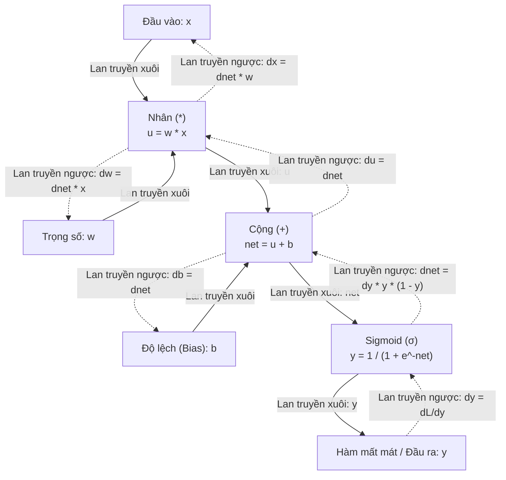
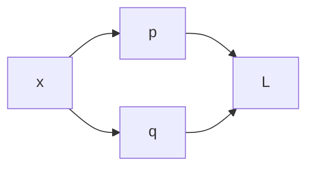

# Day 25: Tính toán Lan truyền ngược bằng tay

### 🎯 Mục tiêu học tập
- Giải thích quy tắc chuỗi (Chain Rule) trong giải tích và ứng dụng của nó trong lan truyền ngược (backpropagation).
- Tính đạo hàm riêng của các biến trung gian trong một đồ thị tính toán.
- Theo dõi và triển khai quá trình lan truyền ngược cho một nút neuron đơn lẻ sử dụng hàm kích hoạt sigmoid.
- Tính toán thủ công các gradient (độ dốc) cho trọng số và bias bằng cách sử dụng các đạo hàm cục bộ.

### 🧩 Khái niệm cốt lõi (Tại sao)
Trong mạng neural, chúng ta kết nối liên tiếp các lớp chứa các phép toán toán học. Để tối ưu hóa mạng này bằng cách sử dụng phương pháp gradient descent, chúng ta phải tính toán xem hàm mất mát cuối cùng ($L$) thay đổi như thế nào đối với từng tham số (trọng số $w$ và bias $b$).

Nếu chúng ta tính toán gradient cho từng trọng số một cách riêng lẻ từ đầu (đạo hàm số học), chúng ta sẽ phải chạy mạng theo chiều xuôi một lần cho mỗi trọng số. Trong các mạng neural hiện đại với hàng tỷ tham số, điều này là bất khả thi về mặt tính toán.

Thay vào đó, chúng ta sử dụng **Lan truyền ngược (Backpropagation)**, là một phương pháp tính toán gradient hiệu quả thông qua **Quy tắc chuỗi (Chain Rule)** trong giải tích. Ý tưởng chính là chúng ta có thể phân rã các hàm toán học phức tạp thành một chuỗi các phép toán đơn giản (gọi là đồ thị tính toán - computational graph). Mỗi phép toán chỉ cần biết **đạo hàm cục bộ (local gradient)** của riêng nó. Bằng cách nhân đạo hàm cục bộ này với gradient đi từ lớp tiếp theo truyền về (được gọi là **gradient thượng nguồn - upstream gradient**), chúng ta có thể lan truyền các gradient ngược qua toàn bộ mạng chỉ trong một lượt đi (thời gian $O(1)$ so với lượt đi xuôi).

Theo Quy tắc chuỗi, nếu biến $y$ phụ thuộc vào $u$, và $u$ lại phụ thuộc vào $x$, thì tốc độ thay đổi của $y$ đối với $x$ là:
$$\frac{\partial y}{\partial x} = \frac{\partial y}{\partial u} \cdot \frac{\partial u}{\partial x}$$

### 🔁 Logic và hoạt động
Đồ thị tính toán dưới đây thể hiện luồng tính toán lan truyền xuôi (đường nét liền) và lan truyền ngược gradient (đường nét đứt) cho một neuron đơn lẻ:
$$y = \sigma(w \cdot x + b)$$



#### 1. Lan truyền xuôi (Forward Pass)
1. Tính tích của đầu vào và trọng số: $u = w \cdot x$
2. Cộng bias để lấy giá trị trước kích hoạt: $net = u + b$
3. Áp dụng hàm kích hoạt sigmoid: $y = \sigma(net) = \frac{1}{1 + e^{-net}}$

#### 2. Lan truyền ngược (Backward Pass)
Trong quá trình lan truyền ngược, chúng ta nhận được gradient thượng nguồn $dy = \frac{\partial L}{\partial y}$. Chúng ta tính toán các gradient của các tham số bằng cách đi ngược lại:
1. **Nút Sigmoid**: Đạo hàm cục bộ là $\frac{\partial y}{\partial net} = y(1 - y)$.
   Chúng ta nhân nó với $dy$ để được:
   $$dnet = \frac{\partial L}{\partial net} = dy \cdot y(1 - y)$$
2. **Nút Cộng**: Đạo hàm cục bộ đối với các đầu vào $u$ và $b$ đều bằng $1$.
   Do đó, chúng ta chỉ cần truyền trực tiếp gradient đi tiếp:
   $$db = \frac{\partial L}{\partial b} = dnet \cdot 1 = dnet$$
   $$du = \frac{\partial L}{\partial u} = dnet \cdot 1 = dnet$$
3. **Nút Nhân**: Đạo hàm cục bộ của $u = w \cdot x$ đối với $w$ là $x$, và đối với $x$ là $w$.
   Do đó:
   $$dw = \frac{\partial L}{\partial w} = du \cdot \frac{\partial u}{\partial w} = dnet \cdot x$$
   $$dx = \frac{\partial L}{\partial x} = du \cdot \frac{\partial u}{\partial x} = dnet \cdot w$$

### 📝 Ví dụ minh họa có chú thích
Hãy tính toán lượt đi xuôi và lượt ngược với các giá trị số cụ thể:
- Đầu vào: $x = 2.0$
- Trọng số: $w = 0.5$
- Bias: $b = -1.0$
- Gradient thượng nguồn nhận được: $dy = 1.0$

#### Tính toán chi tiết từng bước:
1. **Lan truyền xuôi:**
   - $u = w \cdot x = 0.5 \cdot 2.0 = 1.0$
   - $net = u + b = 1.0 + (-1.0) = 0.0$
   - $y = \sigma(0.0) = \frac{1}{1 + e^0} = 0.5$
2. **Lan truyền ngược:**
   - $dnet = dy \cdot y(1 - y) = 1.0 \cdot 0.5 \cdot (1 - 0.5) = 0.25$
   - $db = dnet = 0.25$
   - $dw = dnet \cdot x = 0.25 \cdot 2.0 = 0.5$

Dưới đây là cách mã hóa quy trình này trong Python:
```python
import numpy as np

# Đầu vào
x = 2.0
w = 0.5
b = -1.0
dy = 1.0  # Gradient thượng nguồn truyền về dL/dy

# --- LAN TRUYỀN XUÔI ---
u = w * x
net = u + b
y = 1 / (1 + np.exp(-net))
print(f"Đầu ra y ở lượt đi xuôi: {y}")  # Kết quả: 0.5

# --- LAN TRUYỀN NGƯỢC ---
# Đạo hàm cục bộ của hàm sigmoid: dy/dnet = y * (1 - y)
dy_dnet = y * (1 - y)

# Quy tắc chuỗi cho giá trị trước kích hoạt net: dL/dnet = dL/dy * dy/dnet
dnet = dy * dy_dnet

# Đạo hàm cục bộ của phép cộng: dnet/db = 1 -> dL/db = dL/dnet * 1
db = dnet

# Đạo hàm cục bộ của phép nhân: dnet/dw = x -> dL/dw = dL/dnet * x
dw = dnet * x

print(f"Giá trị db tính được (dL/db): {db}")  # Kết quả: 0.25
print(f"Giá trị dw tính được (dL/dw): {dw}")  # Kết quả: 0.5
```

### ❌ Các lỗi thường gặp

**Lỗi 1: Quên nhân với gradient thượng nguồn**
```python
def backprop_step(x, w, b, dy):
    net = w * x + b
    y = 1 / (1 + np.exp(-net))
    dy_dnet = y * (1 - y)
    # SAI: db và dw chỉ tính đạo hàm cục bộ chứ chưa nhân xích (chain)
    db = dy_dnet
    dw = dy_dnet * x
    return dw, db
```
```text
Traceback (most recent call last):
  File "exercise.py", line 12, in <module>
    assert np.isclose(db, 0.25), "db gradient incorrect"
AssertionError: db gradient incorrect
```
```python
def backprop_step(x, w, b, dy):
    net = w * x + b
    y = 1 / (1 + np.exp(-net))
    dy_dnet = y * (1 - y)
    # ĐÚNG: Nhân với gradient thượng nguồn dy để tiếp tục chuỗi
    db = dy * dy_dnet
    dw = dy * dy_dnet * x
    return dw, db
```
> Quy tắc chuỗi yêu cầu nhân đạo hàm cục bộ với gradient thượng nguồn truyền tới. Bỏ qua bước này sẽ cô lập nút tính toán và dẫn đến kết quả gradient sai so với hàm mất mát tổng thể.

**Lỗi 2: Tráo đổi các biến của đạo hàm cục bộ**
```python
def backprop_step(x, w, b, dy):
    net = w * x + b
    y = 1 / (1 + np.exp(-net))
    dy_dnet = y * (1 - y)
    db = dy * dy_dnet
    # SAI: Sử dụng w thay vì x làm đạo hàm cục bộ cho dw
    dw = dy * dy_dnet * w
    return dw, db
```
```text
Traceback (most recent call last):
  File "exercise.py", line 13, in <module>
    assert np.isclose(dw, 0.5), "dw gradient incorrect"
AssertionError: dw gradient incorrect
```
```python
def backprop_step(x, w, b, dy):
    net = w * x + b
    y = 1 / (1 + np.exp(-net))
    dy_dnet = y * (1 - y)
    db = dy * dy_dnet
    # ĐÚNG: Đạo hàm của w*x + b theo w là x
    dw = dy * dy_dnet * x
    return dw, db
```
> Vì $u = w \cdot x$, tốc độ thay đổi của $u$ theo trọng số $w$ chính là giá trị đầu vào $x$ (tức là $\frac{\partial u}{\partial w} = x$). Do đó, $dw$ phải tỉ lệ thuận với $x$ chứ không phải $w$.

### 💡 Mẹo & Cách viết tối ưu
- **Tái sử dụng đầu ra Sigmoid**: Vì đạo hàm của hàm Sigmoid là $\sigma'(z) = \sigma(z)(1 - \sigma(z))$, bạn nên lưu lại giá trị đầu ra ở lượt đi xuôi $y = \sigma(z)$ và sử dụng lại ở lượt đi ngược. Điều này giúp tránh việc phải tính toán lại hàm mũ (`np.exp`) vốn tiêu tốn tài nguyên tính toán.
- **Biến trung gian**: Luôn lưu trữ các giá trị tính toán ở lượt đi xuôi (như `net` và `y`) vào các biến rõ ràng. Việc cố gắng viết toàn bộ lượt đi xuôi và lượt đi ngược trên một dòng mã duy nhất rất dễ dẫn đến sai sót.
- **Quy ước đặt tên Gradient**: Tiêu chuẩn chung trong lập trình học sâu là đặt tên cho gradient của biến bằng cách thêm tiền tố `d` (ví dụ: đặt tên `dw` cho $\frac{\partial L}{\partial w}$, `db` cho $\frac{\partial L}{\partial b}$, và `dnet` cho $\frac{\partial L}{\partial net}$).

### 🧠 Đi sâu phân tích (Cơ chế bên dưới)
<details><summary>Chứng minh Đạo hàm Sigmoid và Quy tắc chuỗi đa biến (Nhấp để mở rộng)</summary>

#### Chứng minh Giải tích Đạo hàm Hàm Sigmoid
Cho $\sigma(z) = \frac{1}{1 + e^{-z}} = (1 + e^{-z})^{-1}$.
Chúng ta áp dụng quy tắc chuỗi và quy tắc lũy thừa để tìm đạo hàm theo $z$:
$$\frac{d}{dz} \sigma(z) = -1 \cdot (1 + e^{-z})^{-2} \cdot \frac{d}{dz}(1 + e^{-z})$$
$$\frac{d}{dz} \sigma(z) = -(1 + e^{-z})^{-2} \cdot (-e^{-z})$$
$$\frac{d}{dz} \sigma(z) = \frac{e^{-z}}{(1 + e^{-z})^2}$$

Chúng ta có thể viết lại biểu thức này để biểu diễn đạo hàm qua chính $\sigma(z)$:
$$\frac{d}{dz} \sigma(z) = \frac{1}{1 + e^{-z}} \cdot \frac{e^{-z}}{1 + e^{-z}}$$
$$\frac{d}{dz} \sigma(z) = \sigma(z) \cdot \left( \frac{(1 + e^{-z}) - 1}{1 + e^{-z}} \right)$$
$$\frac{d}{dz} \sigma(z) = \sigma(z) \cdot \left( \frac{1 + e^{-z}}{1 + e^{-z}} - \frac{1}{1 + e^{-z}} \right)$$
$$\frac{d}{dz} \sigma(z) = \sigma(z)(1 - \sigma(z))$$
Dạng đại số đơn giản này giúp cho việc tính toán trong học sâu cực kỳ hiệu quả.

#### Quy tắc chuỗi đa biến (Phân nhánh trong đồ thị)
Trong một đồ thị tính toán, một biến có thể phân nhánh và ảnh hưởng đến nhiều nút phía sau. Ví dụ, nếu một biến $x$ ảnh hưởng đến cả $p$ và $q$, và sau đó cả hai biến này cùng ảnh hưởng đến hàm mất mát cuối cùng $L$:

Trong trường hợp này, việc thay đổi $x$ sẽ làm thay đổi $L$ qua hai con đường riêng biệt. Theo quy tắc chuỗi đa biến, chúng ta phải **cộng** các gradient truyền về từ tất cả các nhánh:
$$\frac{\partial L}{\partial x} = \frac{\partial L}{\partial p}\frac{\partial p}{\partial x} + \frac{\partial L}{\partial q}\frac{\partial q}{\partial x}$$
Do đó, khi triển khai lan truyền ngược cho các nút phân phối đầu ra của chúng đến nhiều hướng, bạn phải cộng dồn tất cả các gradient thượng nguồn truyền về.
</details>

### 🏋️ Bài tập thực hành
Hoàn thành hàm `backprop_step(x, w, b, dy)` để triển khai lượt đi xuôi và lượt đi ngược cho một nút neuron đơn lẻ với hàm kích hoạt sigmoid. Trả về `dw` ($\frac{\partial L}{\partial w}$) và `db` ($\frac{\partial L}{\partial b}$).

```python
import numpy as np

def backprop_step(x, w, b, dy):
    # Forward pass: y = sigmoid(w * x + b)
    # backward pass: calculate dw (dL/dw) and db (dL/db) given dy (dL/dy)
    dw = None
    db = None
    return dw, db
```

### ✅ Tự kiểm tra
1. Nếu giá trị trước kích hoạt $net = w \cdot x + b$ rất lớn (ví dụ $10.0$), điều gì sẽ xảy ra với gradient đầu ra $dw$?
2. Trong một đồ thị tính toán, đạo hàm cục bộ của nút nhân $u = a \cdot b$ đối với $a$ là gì?
<details><summary>Đáp án</summary>

1. Nếu $net = 10.0$, giá trị kích hoạt sigmoid $y = \sigma(10.0) \approx 0.99995$. Đạo hàm cục bộ của sigmoid khi đó là $y(1 - y) \approx 0.99995 \times (0.00005) \approx 0.00005$, rất gần với $0$. Kết quả là, các gradient $db$ và $dw$ sẽ gần như bằng $0$. Hiện tượng này được gọi là **triệt tiêu gradient (vanishing gradient problem)**, nơi các neuron bị bão hòa sẽ ngừng học.
2. Đạo hàm cục bộ của $u = a \cdot b$ đối với $a$ là $\frac{\partial u}{\partial a} = b$. Nói cách khác, ở lượt đi ngược của một nút nhân, gradient thượng nguồn truyền về sẽ được nhân với giá trị của đầu vào *còn lại* (hoán đổi đầu vào).
</details>

### 📌 Tóm tắt
- **Lan truyền ngược (Backpropagation)** sử dụng **Quy tắc chuỗi** để tính gradient của hàm mất mát đối với tất cả trọng số và bias.
- Việc phân tách các phép toán thành đồ thị giúp mỗi nút tính đạo hàm cục bộ một cách độc lập.
- Hàm kích hoạt Sigmoid $\sigma(z)$ có đạo hàm rất đơn giản: $\sigma(z)(1 - \sigma(z))$.
- Trong lượt đi ngược, gradient truyền ngược lại bằng cách nhân gradient thượng nguồn với đạo hàm cục bộ ở mỗi bước.
