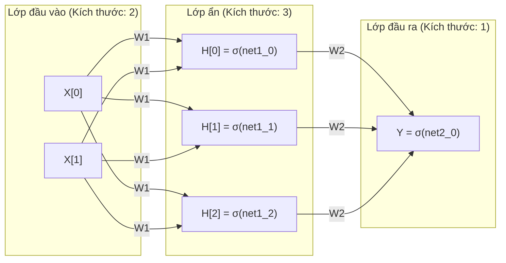

# Day 26: Mạng Neural 2 lớp

### 🎯 Mục tiêu học tập
- Giải thích vai trò của các lớp ẩn (hidden layers) và hàm kích hoạt phi tuyến (non-linear activations) trong mạng neural.
- Xác định kích thước tương thích của các ma trận trọng số và vectơ bias qua nhiều lớp khác nhau.
- Tự triển khai logic lan truyền xuôi (feedforward) cho mạng neural nhiều lớp bằng thư viện NumPy.
- Áp dụng các phương pháp khởi tạo trọng số ngẫu nhiên và giải thích tại sao không thể khởi tạo trọng số bằng 0.

### 🧩 Khái niệm cốt lõi (Tại sao)
Một mạng chỉ có một lớp (như một perceptron đơn lẻ) chỉ có thể phân loại dữ liệu phân tách tuyến tính. Nó sẽ thất bại hoàn toàn trước các mối quan hệ phi tuyến đơn giản, chẳng hạn như bài toán XOR.

Để giải quyết các vấn đề phức tạp trong thực tế, chúng ta xếp chồng nhiều lớp neuron lại với nhau. Điều này tạo ra một mạng **Perceptron đa lớp (Multi-Layer Perceptron - MLP)** hay mạng neural lan truyền xuôi.

Các khái niệm cốt lõi của mạng nhiều lớp bao gồm:
1. **Lớp ẩn (Hidden Layers)**: Các lớp nằm giữa lớp đầu vào và lớp đầu ra. Các lớp này xây dựng nên các **biểu diễn ẩn (hidden representations)** — tự động trích xuất các đặc trưng trừu tượng từ đầu vào thô (ví dụ: phát hiện các cạnh, góc từ các điểm ảnh thô).
2. **Hàm kích hoạt (Tính phi tuyến)**: Nếu chúng ta không áp dụng một hàm kích hoạt phi tuyến (như Sigmoid hay ReLU) sau mỗi lớp, toàn bộ mạng sẽ bị rút gọn thành một phương trình tuyến tính duy nhất, bất kể chúng ta xếp chồng bao nhiêu lớp đi chăng nữa. Tính phi tuyến cho phép mạng học các ranh giới quyết định dạng cong phức tạp.
3. **Kích thước các lớp (Layer Dimensions)**: Mỗi lớp có một tập hợp các trọng số chuyển đổi kích thước đầu vào của nó thành kích thước đầu ra. Việc theo dõi hình dạng ma trận này là vô cùng quan trọng để tránh các lỗi trong lập trình học sâu.

### 🔁 Logic và hoạt động
Sơ đồ lan truyền xuôi dưới đây minh họa một mạng 2 lớp chuyển đổi đầu vào có kích thước 2 (ví dụ: 2 đặc trưng) sang lớp ẩn có kích thước 3, và cuối cùng đến lớp đầu ra có kích thước 1:



Hãy cùng theo dõi kích thước ma trận và các phép toán cho một batch chứa $N$ mẫu đầu vào:
1. **Ma trận đầu vào $X$**: Kích thước $(N, 2)$ với $N$ là số lượng mẫu trong batch.
2. **Tham số và tính toán của Lớp ẩn 1**:
   - Trọng số $W_1$ kích thước $(2, 3)$ ánh xạ kích thước đầu vào 2 sang kích thước lớp ẩn 3.
   - Bias $b_1$ kích thước $(1, 3)$ được cộng vào mỗi nút trong số 3 nút ẩn.
   - Giá trị trước kích hoạt: $net_1 = X \cdot W_1 + b_1$ (Kích thước: $(N, 3)$).
   - Hàm kích hoạt: $H = \sigma(net_1) = \frac{1}{1 + e^{-net_1}}$ (Kích thước: $(N, 3)$).
3. **Tham số và tính toán của Lớp đầu ra 2**:
   - Trọng số $W_2$ kích thước $(3, 1)$ ánh xạ kích thước lớp ẩn 3 sang kích thước đầu ra 1.
   - Bias $b_2$ kích thước $(1, 1)$ được cộng vào nút đầu ra.
   - Giá trị trước kích hoạt: $net_2 = H \cdot W_2 + b_2$ (Kích thước: $(N, 1)$).
   - Hàm kích hoạt: $Y = \sigma(net_2) = \frac{1}{1 + e^{-net_2}}$ (Kích thước: $(N, 1)$).

### 📝 Ví dụ minh họa có chú thích
Dưới đây là cách định nghĩa lớp mạng neural, khởi tạo trọng số ngẫu nhiên, và thực hiện lượt lan truyền xuôi:
```python
import numpy as np

class TwoLayerNet:
    def __init__(self, input_size, hidden_size, output_size):
        # np.random.seed giúp cố định các trọng số khởi tạo để dễ tái lập kết quả
        np.random.seed(42)
        
        # Khởi tạo trọng số với các giá trị ngẫu nhiên nhỏ từ phân phối chuẩn
        self.W1 = np.random.randn(input_size, hidden_size) * 0.01
        self.b1 = np.zeros((1, hidden_size))
        
        self.W2 = np.random.randn(hidden_size, output_size) * 0.01
        self.b2 = np.zeros((1, output_size))

    def forward(self, X):
        # 1. Tính toán giá trị kích hoạt của lớp ẩn
        net1 = np.dot(X, self.W1) + self.b1
        H = 1 / (1 + np.exp(-net1))  # Hàm kích hoạt Sigmoid
        
        # 2. Tính toán giá trị kích hoạt của lớp đầu ra
        net2 = np.dot(H, self.W2) + self.b2
        Y = 1 / (1 + np.exp(-net2))  # Hàm kích hoạt Sigmoid
        
        return H, Y

# Khởi tạo mạng: Kích thước đầu vào 2, Lớp ẩn 3, Đầu ra 1
net = TwoLayerNet(input_size=2, hidden_size=3, output_size=1)

# Truyền vào một batch gồm 2 mẫu:
X_batch = np.array([[0.5, 0.8], 
                    [0.1, 0.4]])

hidden_act, output_act = net.forward(X_batch)

print("Kích thước đầu vào:  ", X_batch.shape)        # Kết quả: (2, 2)
print("Kích thước lớp ẩn:   ", hidden_act.shape)     # Kết quả: (2, 3)
print("Kích thước đầu ra:   ", output_act.shape)     # Kết quả: (2, 1)
print("Các giá trị đầu ra:\n", output_act)
```

### ❌ Các lỗi thường gặp

**Lỗi 1: Tráo đổi kích thước ma trận trong phép nhân vô hướng (np.dot)**
```python
def forward(self, X):
    # SAI: np.dot(self.W1, X) bị lệch kích thước (2,3) x (1,2)
    net1 = np.dot(self.W1, X) + self.b1
    H = 1 / (1 + np.exp(-net1))
    net2 = np.dot(self.W2, H) + self.b2
    Y = 1 / (1 + np.exp(-net2))
    return H, Y
```
```text
Traceback (most recent call last):
  File "exercise.py", line 15, in <module>
    H, Y = net.forward(X)
  File "exercise.py", line 11, in forward
    net1 = np.dot(self.W1, X) + self.b1
ValueError: shapes (2,3) and (1,2) not aligned: 3 (dim 1) != 1 (dim 0)
```
```python
def forward(self, X):
    # ĐÚNG: X có kích thước (N, D) và W1 có (D, H), nên np.dot(X, W1) cho (N, H)
    net1 = np.dot(X, self.W1) + self.b1
    H = 1 / (1 + np.exp(-net1))
    net2 = np.dot(H, self.W2) + self.b2
    Y = 1 / (1 + np.exp(-net2))
    return H, Y
```
> Phép nhân ma trận không có tính chất giao hoán ($A \cdot B \neq B \cdot A$). Số cột của ma trận thứ nhất phải bằng số hàng của ma trận thứ hai. Do đó, với đầu vào $X \in \mathbb{R}^{N \times D}$ và trọng số $W \in \mathbb{R}^{D \times H}$, chúng ta phải nhân theo thứ tự $X \cdot W$.

**Lỗi 2: Sử dụng phép nhân từng phần tử (*) thay vì nhân ma trận (np.dot)**
```python
def forward(self, X):
    # SAI: Toán tử '*' thực hiện nhân từng phần tử chứ không phải nhân ma trận
    net1 = X * self.W1 + self.b1
    H = 1 / (1 + np.exp(-net1))
    net2 = H * self.W2 + self.b2
    Y = 1 / (1 + np.exp(-net2))
    return H, Y
```
```text
Traceback (most recent call last):
  File "exercise.py", line 15, in <module>
    H, Y = net.forward(X)
  File "exercise.py", line 11, in forward
    net1 = X * self.W1 + self.b1
ValueError: operands could not be broadcast together with shapes (1,2) (2,3) 
```
```python
def forward(self, X):
    # ĐÚNG: Sử dụng np.dot() hoặc toán tử '@' cho phép nhân ma trận
    net1 = np.dot(X, self.W1) + self.b1
    H = 1 / (1 + np.exp(-net1))
    net2 = np.dot(H, self.W2) + self.b2
    Y = 1 / (1 + np.exp(-net2))
    return H, Y
```
> Trong NumPy, toán tử `*` mặc định thực hiện phép nhân từng phần tử (element-wise), yêu cầu hai mảng phải có cùng kích thước hoặc có thể broadcast. Để ánh xạ đầu vào lên các lớp ẩn có kích thước khác, bắt buộc phải dùng phép nhân ma trận (`np.dot` hoặc `@`).

### 💡 Mẹo & Cách viết tối ưu
- **Toán tử `@`**: Trong Python hiện đại (3.5+), bạn có thể dùng toán tử `@` làm lối viết ngắn gọn cho phép nhân ma trận: `net1 = X @ self.W1 + self.b1`.
- **Cơ chế Broadcasting của NumPy**: Khi cộng bias $b_1$ kích thước $(1, H)$ vào ma trận $X \cdot W_1$ kích thước $(N, H)$, NumPy tự động lặp lại vectơ bias theo chiều dọc $N$ lần để thực hiện phép cộng. Cơ chế này gọi là **broadcasting**.
- **Khởi tạo Bias bằng 0**: Trong khi khởi tạo trọng số (weights) bằng 0 sẽ ngăn cản quá trình học (do các neuron bị đối xứng gradient), việc khởi tạo tất cả các bias bằng 0 (`np.zeros`) là hoàn toàn bình thường và là tiêu chuẩn trong lập trình thực tế, miễn là các trọng số được khởi tạo ngẫu nhiên.

### 🧠 Đi sâu phân tích (Cơ chế bên dưới)
<details><summary>Tương thích Ma trận và các Chiến lược Khởi tạo Trọng số Ngẫu nhiên (Nhấp để mở rộng)</summary>

#### Quy tắc Tương thích Kích thước Ma trận
Để thực hiện chuỗi các phép biến đổi tuyến tính trong mạng neural, kích thước bên trong của các ma trận tại mỗi ranh giới kết nối phải khớp nhau:
$$\text{Đầu vào: } X \in \mathbb{R}^{N \times D}$$
$$\text{Trọng số 1: } W_1 \in \mathbb{R}^{D \times H} \implies X \cdot W_1 \in \mathbb{R}^{N \times H}$$
$$\text{Trọng số 2: } W_2 \in \mathbb{R}^{H \times M} \implies H \cdot W_2 \in \mathbb{R}^{N \times M}$$
Trong đó:
- $N$ là kích thước batch (số mẫu huấn luyện độc lập).
- $D$ là số đặc trưng đầu vào (input features).
- $H$ là số neuron lớp ẩn (hidden size).
- $M$ là số neuron lớp đầu ra (output size).
Nếu bạn xếp chồng $K$ lớp, số cột của ma trận trọng số $W_i$ phải bằng chính xác số hàng của ma trận trọng số tiếp theo $W_{i+1}$.

#### Vấn đề Khởi tạo Trọng số bằng 0 (Tính Đối xứng)
Tại sao chúng ta không thể khởi tạo ma trận trọng số bằng toàn số 0 (`np.zeros`)?
Nếu tất cả trọng số đều bằng 0:
1. Mọi neuron trong lớp ẩn sẽ tính ra cùng một giá trị đầu ra: $h_j = \sigma(0) = 0.5$ (giả sử dùng hàm sigmoid).
2. Khi lan truyền ngược, mọi neuron lớp ẩn sẽ nhận cùng một lượng gradient bằng nhau.
3. Khi cập nhật tham số, tất cả neuron sẽ thay đổi y hệt nhau.
Hệ quả là, cả lớp ẩn sẽ hoạt động giống như một neuron duy nhất, triệt tiêu khả năng trích xuất các đặc trưng khác nhau của mạng. Khởi tạo ngẫu nhiên chính là giải pháp để **phá vỡ tính đối xứng** này.

#### Các Chiến lược Khởi tạo Nâng cao
Khởi tạo trọng số bằng `randn * 0.01` hoạt động tốt trên các mạng nông, nhưng đối với các mạng sâu, nó dễ làm cho các giá trị kích hoạt bị triệt tiêu về 0 hoặc bùng nổ lên vô cùng. Học sâu hiện đại sử dụng các phương pháp chuẩn hóa phương sai:
1. **Khởi tạo Xavier (Glorot)**: Thích hợp cho hàm kích hoạt Sigmoid hoặc Tanh. Nó rút các trọng số từ phân phối chuẩn với phương sai $\sigma^2 = \frac{2}{n_{in} + n_{out}}$:
   ```python
   limit = np.sqrt(6 / (input_size + output_size))
   W = np.random.uniform(-limit, limit, (input_size, output_size))
   ```
2. **Khởi tạo He (Kaiming)**: Thích hợp cho hàm kích hoạt ReLU. Nó rút các trọng số với phương sai $\sigma^2 = \frac{2}{n_{in}}$:
   ```python
   W = np.random.randn(input_size, output_size) * np.sqrt(2.0 / input_size)
   ```
Các phương pháp này giữ cho phương sai của các tín hiệu không đổi qua cả lượt đi xuôi và lượt đi ngược.
</details>

### 🏋️ Bài tập thực hành
Hoàn thành phương thức `forward(self, X)` của class `TwoLayerNet`. Hãy tính toán giá trị kích hoạt lớp ẩn `H` và đầu ra cuối cùng `Y` bằng các phép nhân ma trận và hàm kích hoạt sigmoid.

```python
import numpy as np

class TwoLayerNet:
    def __init__(self, input_size, hidden_size, output_size):
        np.random.seed(42)
        self.W1 = np.random.randn(input_size, hidden_size) * 0.01
        self.b1 = np.zeros((1, hidden_size))
        self.W2 = np.random.randn(hidden_size, output_size) * 0.01
        self.b2 = np.zeros((1, output_size))

    def forward(self, X):
        # Triển khai lượt đi xuôi tại đây
        H = None
        Y = None
        return H, Y
```

### ✅ Tự kiểm tra
1. Nếu đầu vào $X$ có kích thước $(5, 4)$ và đầu ra $Y$ có kích thước $(5, 2)$, thì kích thước của $W_1$ và $W_2$ phải là bao nhiêu nếu chúng ta chọn kích thước lớp ẩn là $10$?
2. Điều gì xảy ra nếu chúng ta loại bỏ hàm kích hoạt Sigmoid khỏi cả hai lớp trong `TwoLayerNet`?
<details><summary>Đáp án</summary>

1. Kích thước đầu vào $D = 4$, lớp ẩn $H = 10$, và đầu ra $M = 2$.
   - $W_1$ ánh xạ từ $D$ sang $H$, nên có kích thước $(4, 10)$.
   - $W_2$ ánh xạ từ $H$ sang $M$, nên có kích thước $(10, 2)$.
2. Nếu không có hàm kích hoạt, lượt đi xuôi sẽ là:
   $$Y = (X \cdot W_1 + b_1) \cdot W_2 + b_2 = X \cdot (W_1 \cdot W_2) + (b_1 \cdot W_2 + b_2)$$
   Đặt $W_{eff} = W_1 \cdot W_2$ và $b_{eff} = b_1 \cdot W_2 + b_2$. Phương trình rút gọn thành $Y = X \cdot W_{eff} + b_{eff}$. Mạng lúc này hoạt động y hệt như một mô hình tuyến tính một lớp duy nhất, mất hoàn toàn khả năng trích xuất các đặc trưng phi tuyến phức tạp.
</details>

### 📌 Tóm tắt
- **Mạng neural nhiều lớp** giới thiệu các lớp ẩn để học được các đường ranh giới quyết định phi tuyến.
- **Hàm kích hoạt phi tuyến** là bắt buộc để ngăn các lớp xếp chồng bị suy thoái thành một phép biến đổi tuyến tính đơn giản.
- Các ma trận trọng số đóng vai trò kết nối kích thước giữa các lớp; các phép nhân ma trận phải tuân thủ đúng quy tắc tương thích kích thước.
- **Khởi tạo trọng số ngẫu nhiên** phá vỡ tính đối xứng, cho phép các neuron khác nhau học được các đặc trưng độc lập.
</details>
