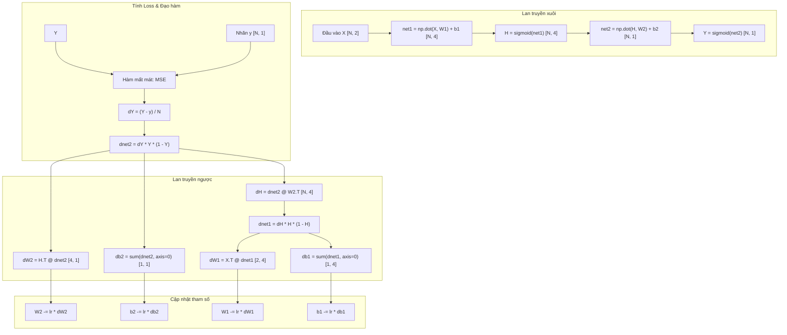

### 🎯 Mục tiêu học tập
- Giải thích lý do tại sao mạng Perceptron một lớp không thể giải quyết bài toán cổng XOR.
- Hiểu cấu trúc của Mạng Nơ-ron Truyền thẳng 2 lớp (Multilayer Perceptron - MLP).
- Tự lập trình các bước lan truyền xuôi (forward propagation), lan truyền ngược (backpropagation) và cập nhật tham số từ đầu bằng NumPy.
- Huấn luyện mạng nơ-ron để giải quyết bài toán phân loại không phân tách tuyến tính.

### 🧩 Khái niệm cốt lõi (Tại sao)
Mạng Perceptron một lớp chỉ có thể vẽ một đường thẳng (ranh giới quyết định tuyến tính) để phân tách các điểm dữ liệu. Trong các tác vụ phân loại, một số bài toán là **phân tách tuyến tính** (như cổng AND / OR), nơi một đường thẳng duy nhất có thể phân chia hoàn hảo các lớp.

Tuy nhiên, **cổng XOR (Exclusive OR)** là ví dụ kinh điển về bài toán **không phân tách tuyến tính** (non-linearly separable). Nếu vẽ đồ thị các điểm đầu vào của XOR:
- `(0, 0) -> 0` (Lớp A)
- `(1, 1) -> 0` (Lớp A)
- `(0, 1) -> 1` (Lớp B)
- `(1, 0) -> 1` (Lớp B)

Bạn sẽ thấy rằng không có đường thẳng duy nhất nào có thể ngăn cách Lớp A khỏi Lớp B. Để giải quyết vấn đề này, chúng ta phải đưa vào ít nhất một **lớp ẩn (hidden layer)** có hàm kích hoạt phi tuyến. Lớp ẩn này chuyển đổi không gian đầu vào thành một không gian đặc trưng mới, nơi các lớp trở nên phân tách tuyến tính đối với lớp đầu ra.

### 🔁 Logic và hoạt động
Quy trình huấn luyện mạng nơ-ron 2 lớp trên tập dữ liệu XOR bao gồm:
1. **Khởi tạo tham số**: Gán các giá trị ngẫu nhiên nhỏ cho các ma trận trọng số $W_1, W_2$ và giá trị 0 cho các độ chệch (bias) $b_1, b_2$.
2. **Lan truyền xuôi (Forward Propagation)**:
   - Tính toán đầu vào trước kích hoạt của lớp ẩn: $net_1 = X \cdot W_1 + b_1$
   - Áp dụng hàm kích hoạt (Sigmoid): $H = \sigma(net_1)$
   - Tính toán đầu vào trước kích hoạt của lớp đầu ra: $net_2 = H \cdot W_2 + b_2$
   - Áp dụng hàm kích hoạt (Sigmoid): $Y = \sigma(net_2)$
3. **Tính toán hàm mất mát (Loss)**: Đo lường sự khác biệt giữa giá trị dự đoán $Y$ và nhãn thực tế $y$ bằng Sai số Bình phương Trung bình (Mean Squared Error - MSE).
4. **Lan truyền ngược (Backward Propagation)**: Sử dụng Quy tắc chuỗi (Chain Rule) để tính đạo hàm (gradient) cho tất cả các tham số ($W_2, b_2, W_1, b_1$).
5. **Cập nhật tham số**: Điều chỉnh trọng số và độ chệch bằng phương pháp Cực tiểu hóa Độ dốc (Gradient Descent).



### 📝 Ví dụ minh họa có chú thích
Dưới đây là cách triển khai lan truyền xuôi và tính toán đầu ra bằng cách sử dụng các trọng số được khởi tạo sẵn.

```python
import numpy as np

# Đầu vào: 4 mẫu dữ liệu có 2 đặc trưng (Đầu vào cổng XOR)
X = np.array([[0, 0], [0, 1], [1, 0], [1, 1]])

# Kích thước các lớp: Đầu vào = 2, Lớp ẩn = 4, Đầu ra = 1
# Khởi tạo trọng số thủ công để minh họa
W1 = np.array([[ 0.5, -0.2,  0.8, -0.5],
               [-0.3,  0.6, -0.7,  0.9]])
b1 = np.zeros((1, 4))

W2 = np.array([[ 0.3], [-0.8], [ 0.5], [ 0.2]])
b2 = np.zeros((1, 1))

# Hàm bổ trợ: Kích hoạt Sigmoid
def sigmoid(x):
    return 1 / (1 + np.exp(-x))

# 1. Lan truyền xuôi đến Lớp ẩn
net1 = np.dot(X, W1) + b1    # kích thước: (4, 2) @ (2, 4) + (1, 4) = (4, 4)
H = sigmoid(net1)            # kích thước: (4, 4)

# 2. Lan truyền xuôi đến Lớp đầu ra
net2 = np.dot(H, W2) + b2    # kích thước: (4, 4) @ (4, 1) + (1, 1) = (4, 1)
Y = sigmoid(net2)            # kích thước: (4, 1)

print("Kết quả dự đoán:\n", Y)
```

### ❌ Các lỗi thường gặp

**Mistake 1: Sai kích thước ma trận khi tính đạo hàm của lớp ẩn ($dH$)**
```python
# Code sai
dH = np.dot(W2, dnet2)
```
```text
ValueError: shapes (4,1) and (4,1) not aligned: 1 (dim 1) != 4 (dim 0)
```
```python
# Code đúng
dH = np.dot(dnet2, W2.T)
```
> Biến `dnet2` đại diện cho gradient đầu vào trước kích hoạt tại lớp đầu ra có kích thước `(N, 1)`. Trọng số đầu ra `W2` có kích thước `(4, 1)`. Để truyền ngược sai số về lớp ẩn `H` (có kích thước `(N, 4)`), ta phải nhân ma trận `dnet2` với ma trận chuyển vị của `W2` (`W2.T`), thu được kết quả `(N, 1) @ (1, 4) = (N, 4)`.

**Mistake 2: Quên giữ nguyên số chiều khi tính tổng gradient của bias**
```python
# Code sai
db1 = np.sum(dnet1, axis=0) # Mất đi chiều dòng, trở thành mảng 1D
```
```text
ValueError: operands could not be broadcast together with shapes (1,4) (4,)
```
```python
# Code đúng
db1 = np.sum(dnet1, axis=0, keepdims=True)
```
> Hàm `np.sum` của NumPy sẽ triệt tiêu trục được chỉ định. Nếu không có `keepdims=True`, kích thước sẽ chuyển đổi từ `(N, 4)` sang `(4,)` thay vì `(1, 4)`. Khi cập nhật độ chệch `b1` (có kích thước `(1, 4)`), kích thước của các toán hạng phải khớp nhau để thực hiện cơ chế tự động mở rộng (broadcasting).

### 💡 Mẹo & Cách viết tối ưu
- **Nhân ma trận**: Sử dụng `np.dot(A, B)` hoặc toán tử `@` (`A @ B`) trong Python để nhân ma trận. Hãy in `.shape` thường xuyên trong quá trình gỡ lỗi để theo dõi kích thước ma trận.
- **Đạo hàm của hàm Sigmoid**: Nếu $a = \sigma(z)$, đạo hàm của nó sẽ là $\frac{\partial a}{\partial z} = a(1 - a)$. Do đó, không cần tính lại hàm mũ trong quá trình lan truyền ngược; bạn chỉ cần tái sử dụng kết quả đầu ra `H` và `Y` từ quá trình lan truyền xuôi.
- **Tính nhất quán**: Luôn gọi `np.random.seed(seed_number)` trước khi khởi tạo trọng số để đảm bảo trạng thái ngẫu nhiên ban đầu là giống nhau giữa các lần chạy thử nghiệm khác nhau.

### 🧠 Đi sâu phân tích (Cơ chế bên dưới)
<details><summary>Chứng minh đạo hàm lan truyền ngược cho tính toán ma trận (Click để mở rộng)</summary>

Chúng ta hãy chứng minh từng bước các phương trình đạo hàm bằng phép tính ma trận.
Cho trước:
$$H = \sigma(X W_1 + b_1)$$
$$Y = \sigma(H W_2 + b_2)$$

Chúng ta định nghĩa hàm mất mát (MSE) trên $N$ mẫu:
$$L = \frac{1}{2N} \sum_{i=1}^{N} (Y_i - y_i)^2$$

1. **Gradient của Lớp đầu ra**:
   Đạo hàm đối với dự đoán đầu ra $Y$ là:
   $$\frac{\partial L}{\partial Y} = \frac{1}{N} (Y - y)$$
   
   Sử dụng quy tắc chuỗi, đạo hàm của đầu vào trước kích hoạt của lớp đầu ra $net_2 = H W_2 + b_2$:
   $$\text{dnet}_2 = \frac{\partial L}{\partial net_2} = \frac{\partial L}{\partial Y} \odot \sigma'(net_2) = \text{dY} \odot Y \odot (1 - Y)$$
   *(trong đó $\odot$ biểu thị phép nhân từng phần tử - element-wise multiplication).*

2. **Gradient của Trọng số và Độ chệch (Lớp đầu ra)**:
   $$dW_2 = H^T \cdot \text{dnet}_2$$
   $$db_2 = \sum \text{dnet}_2 \quad \text{(tính tổng trên toàn bộ batch)}$$

3. **Gradient của Lớp ẩn**:
   Bây giờ chúng ta lan truyền gradient ngược về giá trị kích hoạt của lớp ẩn $H$:
   $$dH = \frac{\partial L}{\partial H} = \text{dnet}_2 \cdot W_2^T$$
   
   Đạo hàm đầu vào trước kích hoạt lớp ẩn $net_1 = X W_1 + b_1$:
   $$\text{dnet}_1 = \frac{\partial L}{\partial net_1} = dH \odot H \odot (1 - H)$$

4. **Gradient của Trọng số và Độ chệch (Lớp ẩn)**:
   $$dW_1 = X^T \cdot \text{dnet}_1$$
   $$db_1 = \sum \text{dnet}_1 \quad \text{(tính tổng trên toàn bộ batch)}$$
</details>

### 🏋️ Bài tập thực hành
Hoàn thiện các vòng lặp lan truyền xuôi và lan truyền ngược bên trong hàm `train_xor(epochs, lr)` để huấn luyện thành công mô hình giải quyết cổng logic XOR.

```python
import numpy as np

def train_xor(epochs=1000, lr=0.1):
    # Đầu vào và mục tiêu của XOR
    X = np.array([[0, 0], [0, 1], [1, 0], [1, 1]])
    y = np.array([[0], [1], [1], [0]])
    
    # Khởi tạo tham số
    np.random.seed(42)
    W1 = np.random.randn(2, 4)
    b1 = np.zeros((1, 4))
    W2 = np.random.randn(4, 1)
    b2 = np.zeros((1, 1))
    
    for epoch in range(epochs):
        # TODO: Triển khai lan truyền xuôi, lan truyền ngược và cập nhật tham số
        pass
        
    return W1, b1, W2, b2
```

### ✅ Tự kiểm tra
1. Tại sao lớp ẩn cần một hàm kích hoạt phi tuyến? Nếu sử dụng hàm kích hoạt tuyến tính, chúng ta có thể giải quyết cổng XOR không?
2. Kích thước của trọng số $W_1$ và $W_2$ sẽ là bao nhiêu nếu lớp đầu vào có 2 nút, lớp ẩn có 8 nút, và lớp đầu ra có 1 nút?
<details><summary>Đáp án</summary>
1. Nếu sử dụng các hàm kích hoạt tuyến tính (hoặc không dùng hàm kích hoạt), sự kết hợp của các hàm tuyến tính vẫn sẽ là tuyến tính: $Y = (X W_1 + b_1) W_2 + b_2 = X (W_1 W_2) + (b_1 W_2 + b_2) = X W_{eff} + b_{eff}$. Mạng nơ-ron sẽ thu gọn về một mô hình tuyến tính đơn lớp, vốn không thể học được các ranh giới phi tuyến tính như cổng XOR.
2. $W_1$ sẽ có kích thước `(2, 8)` và $W_2$ sẽ có kích thước `(8, 1)`.
</details>

### 📌 Tóm tắt
- Bài toán XOR **không phân tách tuyến tính**, đòi hỏi ít nhất một lớp ẩn với kích hoạt phi tuyến.
- Thuật toán lan truyền ngược sử dụng **quy tắc chuỗi** để tính đạo hàm của hàm mất mát đối với trọng số và độ chệch.
- Việc chuyển vị ma trận trong các phép tính ma trận giúp sắp xếp các chiều kích thước chính xác để lan truyền sai số ngược lại.
