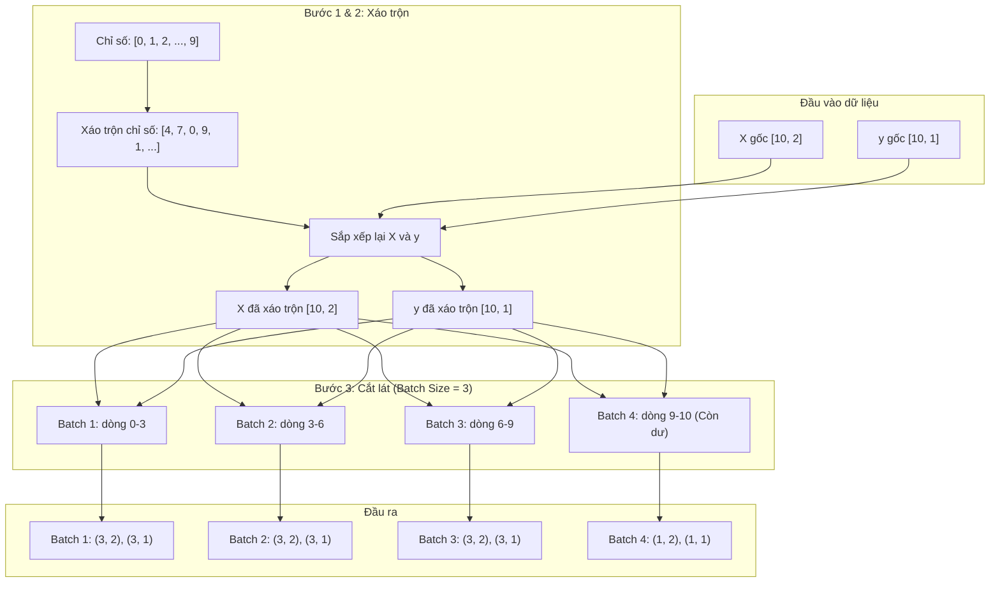

### 🎯 Mục tiêu học tập
- Phân biệt giữa các phương pháp hạ độ dốc Batch, Stochastic (SGD) và Mini-Batch Gradient Descent.
- Giải thích vai trò của kích thước batch (batch size) và tác động của nó đối với tốc độ hội tụ và độ ổn định của đạo hàm.
- Hiểu lý do tại sao việc xáo trộn dữ liệu trước khi chia các batch là cực kỳ quan trọng.
- Triển khai thuật toán tự tạo các mini-batch từ đầu bằng NumPy.

### 🧩 Khái niệm cốt lõi (Tại sao)
Trong huấn luyện mạng nơ-ron, chúng ta tính toán đạo hàm của hàm mất mát để cập nhật trọng số. Cách chúng ta đưa dữ liệu vào mô hình sẽ quyết định tốc độ và độ chính xác của quá trình huấn luyện:

1. **Batch Gradient Descent**: Tính toán đạo hàm bằng cách sử dụng *toàn bộ* tập dữ liệu. Mặc dù ổn định, phương pháp này cực kỳ chậm và tốn bộ nhớ đối với các tập dữ liệu lớn.
2. **Stochastic Gradient Descent (SGD)**: Tính toán đạo hàm bằng cách sử dụng *từng* mẫu ngẫu nhiên tại một thời điểm. Nó rất nhanh, nhưng các cập nhật chứa nhiều nhiễu, làm cho giá trị loss dao động dữ dội.
3. **Mini-Batch Gradient Descent**: Tính toán đạo hàm trên các tập con nhỏ của dữ liệu (ví dụ: 32, 64 hoặc 128 mẫu). Đây là tiêu chuẩn trong học sâu hiện đại vì nó cân bằng giữa độ ổn định của Batch Gradient Descent và tốc độ của SGD, đồng thời tận dụng khả năng tăng tốc phần cứng thông qua các phép toán vector.

Bằng cách chia tập dữ liệu thành các mini-batch, chúng ta có thể thực hiện nhiều lần cập nhật tham số trong một **epoch** (một lượt đi qua toàn bộ tập dữ liệu), giúp quá trình huấn luyện hội tụ nhanh hơn.

### 🔁 Logic và hoạt động
Để tạo các mini-batch:
1. **Tạo chỉ số (Indices)**: Tạo một mảng các chỉ số đại diện cho các dòng của tập dữ liệu.
2. **Xáo trộn chỉ số (Shuffle)**: Xáo trộn ngẫu nhiên các chỉ số này để đảm bảo các batch chứa sự pha trộn ngẫu nhiên của các lớp/mẫu dữ liệu.
3. **Trích xuất dữ liệu đã xáo trộn**: Sắp xếp lại các đặc trưng $X$ và nhãn $y$ dựa trên các chỉ số đã được xáo trộn.
4. **Chia thành các Batch**: Cắt nhỏ dữ liệu đã sắp xếp lại theo từng bước có độ dài bằng `batch_size`. Nếu tổng số mẫu không chia hết cho `batch_size`, batch cuối cùng sẽ chứa các mẫu còn lại.



### 📝 Ví dụ minh họa có chú thích
Dưới đây là cách xáo trộn các chỉ số và nhóm một tập dữ liệu đơn giản thành các mini-batch bằng cách sử dụng NumPy.

```python
import numpy as np

# Tạo một tập dữ liệu giả lập (10 mẫu, 2 đặc trưng)
X = np.arange(20).reshape(10, 2)
y = np.arange(10).reshape(10, 1)

# Các tham số
batch_size = 3
N = X.shape[0]

# 1. Xáo trộn các chỉ số
indices = np.arange(N)
np.random.shuffle(indices) # Thay đổi trực tiếp trên mảng gốc

# 2. Sắp xếp lại các đặc trưng và nhãn
X_shuffled = X[indices]
y_shuffled = y[indices]

# 3. Tạo các mini-batch
batches = []
for i in range(0, N, batch_size):
    # Cắt lát từ i đến i + batch_size
    X_batch = X_shuffled[i : i + batch_size]
    y_batch = y_shuffled[i : i + batch_size]
    batches.append((X_batch, y_batch))

# Kiểm tra cấu trúc các batch
for idx, (xb, yb) in enumerate(batches):
    print(f"Batch {idx+1}: kích thước X {xb.shape}, kích thước y {yb.shape}")
```

### ❌ Các lỗi thường gặp

**Mistake 1: Xáo trộn các đặc trưng $X$ và nhãn $y$ một cách độc lập**
```python
# Code sai
np.random.shuffle(X)
np.random.shuffle(y)
```
```text
(Không có lỗi traceback nào xuất hiện, nhưng mô hình không thể học vì các đặc trưng bị lệch khỏi nhãn tương ứng)
```
```python
# Code đúng
indices = np.arange(X.shape[0])
np.random.shuffle(indices)
X_shuffled = X[indices]
y_shuffled = y[indices]
```
> Việc xáo trộn $X$ và $y$ riêng biệt làm mất đi sự liên kết giữa các thuộc tính đặc trưng và nhãn tương ứng của chúng. Một vectơ đặc trưng của lớp 1 có thể bị gán nhãn của lớp 0. Chúng ta phải xáo trộn một danh sách chỉ số chung và sử dụng danh sách đó để sắp xếp lại cả hai mảng.

**Mistake 2: Bỏ sót batch còn dư khi kích thước tập dữ liệu không chia hết cho kích thước batch**
```python
# Code sai
batches = []
for i in range(0, X.shape[0] - batch_size, batch_size):
    X_batch = X_shuffled[i:i+batch_size]
    y_batch = y_shuffled[i:i+batch_size]
    batches.append((X_batch, y_batch))
```
```text
(Code chạy được nhưng len(batches) là 3 thay vì 4, làm mất đi các mẫu dữ liệu cuối cùng)
```
```python
# Code đúng
batches = []
for i in range(0, X.shape[0], batch_size):
    X_batch = X_shuffled[i:i+batch_size]
    y_batch = y_shuffled[i:i+batch_size]
    batches.append((X_batch, y_batch))
```
> Việc sử dụng `X.shape[0] - batch_size` trong tham số của hàm range làm vòng lặp kết thúc sớm, loại bỏ bất kỳ mẫu nào còn dư ở cuối tập dữ liệu nếu tổng kích thước không chia hết cho batch size. Cú pháp cắt lát (slicing) của Python sẽ tự động xử lý các chỉ số vượt quá giới hạn chiều dài một cách an toàn.

### 💡 Mẹo & Cách viết tối ưu
- **Vòng lặp Range có bước nhảy**: Sử dụng `range(0, limit, step)` là cách chuẩn để duyệt qua các chỉ số theo từng khoảng kích thước batch.
- **Lũy thừa của 2**: Kích thước batch thường được đặt theo lũy thừa của 2 (ví dụ: 32, 64, 128, 256) vì cấu hình bộ nhớ máy tính hiện đại và cách phân bổ luồng xử lý của GPU tối ưu hóa tốt nhất các phép toán có kích thước lũy thừa của 2.
- **Slicing an toàn**: Trong Python, cú pháp `array[start:end]` không gây lỗi nếu `end` lớn hơn độ dài của mảng; nó sẽ chỉ trả về các phần tử cho đến cuối mảng.

### 🧠 Đi sâu phân tích (Cơ chế bên dưới)
<details><summary>Tối ưu hóa phần cứng & Xử lý song song các Mini-Batch (Click để mở rộng)</summary>

Tại sao chúng ta ưu tiên sử dụng các mini-batch hơn là cập nhật từng mẫu đơn lẻ (SGD) dưới góc nhìn phần cứng?
Các bộ vi xử lý hiện đại (CPU có các khối SIMD và GPU với hàng ngàn lõi tính toán) phụ thuộc nhiều vào **tính toán vector** và **thực thi song song**.

Khi bạn thực hiện nhân ma trận trên một batch kích thước bằng 1:
- Bộ vi xử lý tốn nhiều tài nguyên hơn để tải các câu lệnh và trọng số từ bộ nhớ vào so với thời gian tính toán thực tế. Các đơn vị số học bị lãng phí công suất.

Khi bạn chạy một batch kích thước bằng 64:
- Cùng một ma trận trọng số sẽ được nhân với 64 đầu vào cùng một lúc.
- Các thao tác truy cập bộ nhớ được hợp nhất: trọng số được lấy từ bộ nhớ một lần duy nhất và tái sử dụng 64 lần song song bên trong các thanh ghi.
- Điều này làm tăng đáng kể hiệu quả băng thông bộ nhớ và hiệu suất hoạt động của các lõi tính toán.

Tuy nhiên, nếu kích thước batch quá lớn (như Batch Gradient Descent):
- Tập dữ liệu có thể vượt quá giới hạn bộ nhớ đệm tốc độ cao/GPU, buộc phải đọc từ RAM hệ thống hoặc ổ cứng cực kỳ chậm.
- Các đạo hàm sẽ mất đi "nhiễu" ngẫu nhiên cần thiết giúp mô hình thoát khỏi các cực tiểu cục bộ (local minima) hoặc điểm yên ngựa (saddle points) trong quá trình tối ưu hóa.
</details>

### 🏋️ Bài tập thực hành
Hoàn thiện hàm `get_mini_batches(X, y, batch_size)` để xáo trộn các đầu vào và trả về một danh sách các tuple chứa các đặc trưng đầu vào và nhãn tương ứng đã được cắt lát thành các batch.

```python
import numpy as np

def get_mini_batches(X, y, batch_size):
    # Thiết lập seed để đảm bảo tính nhất quán khi kiểm tra kết quả
    np.random.seed(42)
    
    batches = []
    # TODO: Xáo trộn các chỉ số, sắp xếp lại dữ liệu và tạo các batch
    return batches
```

### ✅ Tự kiểm tra
1. Nếu chúng ta có một tập dữ liệu gồm 1.000 mẫu và đặt kích thước batch là 64, sẽ có bao nhiêu mini-batch được tạo ra trong một epoch, và kích thước của mini-batch cuối cùng là bao nhiêu?
2. Tại sao việc xáo trộn dữ liệu vào đầu mỗi epoch lại quan trọng hơn là giữ nguyên một thứ tự cố định?
<details><summary>Đáp án</summary>
1. $1000 / 64 = 15.625$. Điều này dẫn đến tổng cộng 16 batch được tạo ra. 15 batch đầu tiên sẽ có 64 mẫu, và batch thứ 16 (cuối cùng) sẽ chứa 40 mẫu còn dư ($1000 - 15 \times 64 = 40$).
2. Việc xáo trộn ngăn mô hình học theo các thứ tự thiên lệch của tập dữ liệu. Ví dụ: nếu tập dữ liệu được sắp xếp theo lớp (tất cả nhãn 0 trước rồi đến tất cả nhãn 1), thì các cập nhật của mô hình trong từng batch sẽ bị lệch hoàn toàn về một lớp duy nhất, khiến quá trình học không ổn định.
</details>

### 📌 Tóm tắt
- **Mini-Batch Gradient Descent** cân bằng giữa tốc độ tính toán, độ ổn định huấn luyện và khả năng tận dụng phần cứng.
- Dữ liệu phải được **xáo trộn** cùng nhau bằng cách sử dụng các chỉ số đồng bộ trước khi phân chia để tránh các thiên lệch về thứ tự phân loại.
- Vòng lặp dựa trên bước nhảy sử dụng `range(0, N, batch_size)` kết hợp với cú pháp cắt lát (slicing) giúp thu thập đầy đủ các mẫu còn dư cuối cùng.
