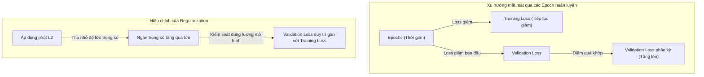

### 🎯 Mục tiêu học tập
- Định nghĩa hiện tượng quá khớp (overfitting) và chưa khớp (underfitting) trong mạng nơ-ron.
- Giải thích cách L1 và L2 regularization thay đổi hàm mất mát và công thức cập nhật tham số.
- Hiểu được bản chất của L2 regularization dưới dạng phân rã trọng số (weight decay).
- Thực hiện điều chỉnh gradient khi áp dụng L2 regularization bằng NumPy.

### 🧩 Khái niệm cốt lõi (Tại sao)
Các mạng nơ-ron sâu thường có hàng triệu tham số có thể huấn luyện, giúp chúng cực kỳ linh hoạt. Tuy nhiên, sự linh hoạt này đi kèm với một rủi ro lớn: mô hình có thể dễ dàng ghi nhớ toàn bộ dữ liệu huấn luyện (bao gồm cả nhiễu ngẫu nhiên) thay vì học các quy luật tổng quát bên dưới.

Điều này dẫn đến hai lỗi phổ biến:
1. **Chưa khớp (Underfitting)**: Mô hình quá đơn giản để nắm bắt các quy luật trong dữ liệu, dẫn đến độ chính xác thấp trên cả tập huấn luyện và tập kiểm định (validation).
2. **Quá khớp (Overfitting)**: Mô hình khớp gần như hoàn hảo với dữ liệu huấn luyện nhưng không thể tổng quát hóa cho dữ liệu mới chưa từng thấy, dẫn đến độ chính xác cao trên tập huấn luyện nhưng rất kém trên tập kiểm định.

Để giải quyết vấn đề quá khớp, chúng ta sử dụng kỹ thuật **Regularization** (chính quy hóa). Nó hoạt động bằng cách phạt các mô hình quá phức tạp. Trong L2 regularization, chúng ta thêm một số hạng phạt vào hàm mất mát tỷ lệ thuận với tổng bình phương các trọng số:
$$\text{Total Loss} = \text{Data Loss} + \frac{\lambda}{2} \sum W^2$$
Ở đây, $\lambda$ (lambda) is a hyperparameter kiểm soát mức độ phạt. Bằng cách buộc các trọng số phải giữ ở mức nhỏ, chúng ta hạn chế khả năng của mạng trong việc khớp với nhiễu, làm mượt các ranh giới quyết định và cải thiện khả năng tổng quát hóa của nó.

### 🔁 Logic và hoạt động
Khi quá trình huấn luyện tiến triển, mất mát huấn luyện (training loss) tiếp tục giảm. Nếu không có regularization, mất mát kiểm định (validation loss) ban đầu sẽ giảm, nhưng cuối cùng sẽ bắt đầu tăng lên (phân kỳ) do mô hình bắt đầu bị quá khớp với nhiễu.



Để cập nhật trọng số với L2 regularization, chúng ta điều chỉnh gradient của hàm mất mát. Đạo hàm của số hạng phạt L2 $\frac{\lambda}{2} W^2$ theo trọng số $W$ là $\lambda W$. Do đó, gradient chính quy hóa $dW_{reg}$ được tính như sau:
$$dW_{reg} = dW + \lambda W$$
Trong đó $dW$ là gradient thô từ thuật toán lan truyền ngược tiêu chuẩn.

### 📝 Ví dụ minh họa có chú thích
Dưới đây là cách tính toán gradient chính quy hóa và cập nhật trọng số bằng Python:

```python
import numpy as np

# 1. Khởi tạo trọng số (W) và gradient tiêu chuẩn (dW)
W = np.array([[1.0, -2.0], [0.5, 3.0]])
dW = np.array([[0.1, -0.1], [0.2, 0.4]])

# 2. Định nghĩa hệ số phạt (lambda) và tốc độ học (learning rate)
lambda_reg = 0.01
learning_rate = 0.1

# 3. Tính toán mất mát phạt L2: 0.5 * lambda * sum(W^2)
l2_loss = 0.5 * lambda_reg * np.sum(W**2)
print("L2 Penalty Loss:", l2_loss)

# 4. Tính toán gradient chính quy hóa: dW_reg = dW + lambda * W
dW_reg = dW + lambda_reg * W
print("Regularized Gradient:\n", dW_reg)

# 5. Cập nhật trọng số: W = W - learning_rate * dW_reg
W_updated = W - learning_rate * dW_reg
print("Updated Weights:\n", W_updated)
```

### ❌ Các lỗi thường gặp

**Lỗi 1: Sai lệch hình dạng (shape) khi cộng số hạng phạt L2 vào gradient**
```python
import numpy as np
W = np.array([1.0, -2.0, 0.5, 3.0]) # Mảng 1 chiều
dW = np.array([[0.1, -0.1], [0.2, 0.4]]) # Mảng 2 chiều
lambda_reg = 0.01
dW_reg = dW + lambda_reg * W
```
```text
ValueError: operands could not be broadcast together with shapes (2,2) and (4,)
```
```python
import numpy as np
W = np.array([[1.0, -2.0], [0.5, 3.0]]) # Sửa thành mảng 2 chiều trùng khớp hình dạng
dW = np.array([[0.1, -0.1], [0.2, 0.4]])
lambda_reg = 0.01
dW_reg = dW + lambda_reg * W
```
> Ma trận trọng số $W$ và gradient tương ứng $dW$ của nó phải có cùng hình dạng chính xác để thực hiện phép cộng phần tử.

**Lỗi 2: Trừ số hạng chính quy hóa khỏi gradient**
```python
import numpy as np
W = np.array([1.0, 2.0])
dW = np.array([0.1, 0.2])
lambda_reg = 0.01
# Trừ sai lệch
dW_reg = dW - lambda_reg * W
W_updated = W - 0.1 * dW_reg
assert np.all(np.abs(W_updated) < np.abs(W))
```
```text
AssertionError
```
```python
import numpy as np
W = np.array([1.0, 2.0])
dW = np.array([0.1, 0.2])
lambda_reg = 0.01
# Cộng chính xác
dW_reg = dW + lambda_reg * W
W_updated = W - 0.1 * dW_reg
assert np.all(np.abs(W_updated) < np.abs(W))
```
> Chính quy hóa nhằm mục đích phạt các trọng số lớn. Cộng $\lambda W$ vào gradient đảm bảo rằng khi thực hiện phép trừ gradient cập nhật, các trọng số sẽ co lại (phân rã) về phía 0. Phép trừ $\lambda W$ thay vào đó sẽ làm tăng độ lớn của trọng số.

### 💡 Mẹo & Cách viết tối ưu
- **Sự tương đương của Phân rã Trọng số (Weight Decay)**: Trong thuật toán gradient descent, việc cập nhật $W \leftarrow W - \eta (dW + \lambda W)$ hoàn toàn tương đương về mặt toán học với $W \leftarrow (1 - \eta \lambda) W - \eta dW$. Điều này giải thích tại sao L2 regularization còn được gọi là **weight decay**: ở mỗi bước cập nhật, các trọng số trước tiên được thu nhỏ đi một hệ số là $(1 - \eta \lambda)$ trước khi thực hiện bước cập nhật gradient thô.
- **Loại trừ Bias**: Chúng ta thường không áp dụng chính quy hóa cho các tham số bias ($b$). Bias đại diện cho độ dịch chuyển thay vì độ phức tạp của mô hình, vì vậy việc phạt bias không giúp ngăn chặn hiện tượng quá khớp mà còn có thể hạn chế dung lượng biểu diễn của mô hình.
- **Tỷ lệ hóa siêu tham số**: Khi bạn tăng kích thước tập dữ liệu, hãy nhớ điều chỉnh hệ số regularization $\lambda$ một cách thích hợp hoặc chuẩn hóa mất mát L2 bằng cách chia nó cho kích thước batch ($N$).

### 🧠 Đi sâu phân tích (Cơ chế bên dưới)
<details><summary>Đặc tính của L1 (Lasso) so với L2 (Ridge), và tại sao L1 tạo ra tính thưa thớt (sparsity)</summary>

L1 và L2 regularization giới thiệu các hình dạng phạt khác nhau vào hàm mục tiêu:
- **L2 Regularization (Ridge)**: Thêm vào $\frac{\lambda}{2} \sum W^2$. Gradient của nó theo $W$ là $\lambda W$. Lực phân rã tỷ lệ thuận với kích thước của trọng số; khi trọng số tiến gần về 0, lực phân rã biến mất. Trọng số sẽ tiến sát 0 nhưng hiếm khi bằng 0 hoàn toàn.
- **L1 Regularization (Lasso)**: Thêm vào $\lambda \sum |W|$. Gradient của nó theo $W$ là $\lambda \cdot \text{sign}(W)$ (với $\text{sign}(x) = 1$ nếu $x > 0$, $-1$ nếu $x < 0$, và không xác định tại $0$). Lực phân rã giữ nguyên không đổi bất kể độ lớn của trọng số. Điều này đẩy các trọng số về đúng bằng 0 hoàn toàn.

#### Giải thích hình học
Hãy xem xét bề mặt tối ưu hóa. Các đường đồng mức mất mát (loss contours) biểu diễn các tổ hợp trọng số tạo ra cùng một giá trị mất mát. Số hạng chính quy hóa hoạt động như một biên giới ràng buộc.
- Với L2, biên giới ràng buộc là một hình cầu (đường tròn trong không gian 2 chiều). Điểm tối ưu là điểm tiếp xúc giữa đường đồng mức mất mát và đường tròn, có thể xảy ra ở bất kỳ đâu.
- Với L1, biên giới ràng buộc là một hình thoi (trong không gian 2 chiều) với các góc nhọn nằm trên các trục tọa độ. Đường đồng mức mất mát có xác suất tiếp xúc với hình thoi tại một trong các đỉnh nhọn này rất cao, nơi có một hoặc nhiều tọa độ (trọng số) bằng đúng 0. Điều này làm cho L1 cực kỳ hữu ích cho **lựa chọn đặc trưng** (feature selection) và tạo ra các biểu diễn thưa thớt (sparse representations).
</details>

### 🏋️ Bài tập thực hành
Hoàn thành hàm `regularized_gradient(W, dW, lambda_reg)` để điều chỉnh gradient tiêu chuẩn `dW` bằng cách cộng thêm số hạng L2 regularization (weight decay).

```python
import numpy as np

def regularized_gradient(W, dW, lambda_reg):
    # Reg loss = 0.5 * lambda_reg * sum(W^2) (just for concept)
    # Regularized gradient: dW_reg = dW + lambda_reg * W
    dW_reg = None
    return dW_reg
```

### ✅ Tự kiểm tra
1. Nếu tốc độ học là 0.1 và hệ số chính quy hóa L2 $\lambda$ là 0.05, hệ số nhân phân rã trọng số $(1 - \eta \lambda)$ áp dụng cho trọng số ở mỗi bước cập nhật là bao nhiêu?
2. Kỹ thuật regularization nào (L1 hay L2) dẫn đến ma trận tham số thưa thớt (nhiều trọng số bằng đúng 0)?
<details><summary>Đáp án</summary>

1. Hệ số phân rã trọng số là $1 - (0.1 \times 0.05) = 1 - 0.005 = 0.995$.
2. L1 regularization tạo ra tính thưa thớt.
</details>

### 📌 Tóm tắt
- **Quá khớp (Overfitting)** xảy ra khi mô hình ghi nhớ nhiễu trong tập huấn luyện và không thể tổng quát hóa cho tập kiểm định/kiểm thử.
- **Regularization** thêm một số hạng phạt vào hàm mất mát để hạn chế độ lớn của các trọng số.
- **L2 Regularization** (weight decay) thêm một lượng phạt bình phương ($\sum W^2$), giúp thu nhỏ trọng số một cách mượt mà về phía 0.
- **L1 Regularization** thêm một lượng phạt trị tuyệt đối ($\sum |W|$), thúc đẩy các trọng số tiến về đúng bằng 0 và tạo ra tính thưa thớt.
- Gradient chính quy hóa được tính theo công thức $dW_{reg} = dW + \lambda W$.
