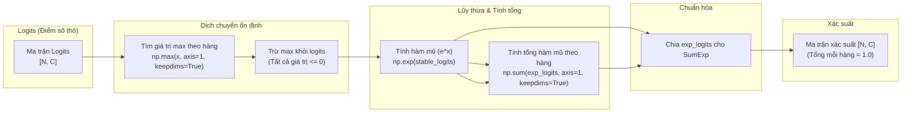

### 🎯 Mục tiêu học tập
- Phân biệt giữa bài toán phân loại nhị phân (binary classification) và phân loại đa lớp (multi-class classification).
- Hiểu được hàm kích hoạt Softmax và cách nó ánh xạ điểm số thô (logits) thành phân phối xác suất.
- Nhận diện lỗi tràn số (numerical overflow) khi tính toán lũy thừa các giá trị lớn và thực hiện công thức Softmax ổn định số học.
- Giải thích vai trò của hàm mất mát Categorical Cross-Entropy trong huấn luyện mô hình đa lớp.

### 🧩 Khái niệm cốt lõi (Tại sao)
Trong các bài học trước, chúng ta đã giải quyết các bài toán phân loại nhị phân (như cổng XOR) nơi đầu ra là một giá trị duy nhất đại diện cho xác suất một mẫu thuộc về lớp 1. Tuy nhiên, các tác vụ thực tế như **phân loại chữ viết tay** (phân loại hình ảnh các chữ số từ 0 đến 9) đòi hỏi phải dự đoán một trong nhiều lớp có thể xảy ra. Đây là bài toán **phân loại đa lớp** (multi-class classification).

Trong một mạng nơ-ron phân loại đa lớp, lớp đầu ra tạo ra một điểm số thô thực cho mỗi lớp, được gọi là **logits**. Để diễn giải các logits này dưới dạng xác suất (phải nằm trong khoảng từ 0 đến 1, và có tổng bằng 1 trên tất cả các lớp), chúng ta chuyển chúng qua **hàm Softmax**:
$$\sigma(z)_i = \frac{e^{z_i}}{\sum_{j=1}^{C} e^{z_j}}$$
Trong đó $z$ là vector của logits thô và $C$ là số lượng lớp.

#### Vấn đề ổn định số học
Máy tính biểu diễn các số bằng dấu phẩy động có độ chính xác cố định. Nếu một trong các logits $z_i$ lớn (ví dụ: $z_i > 709$), việc tính toán $e^{z_i}$ dẫn đến **tràn số học** (`inf` trong Python). Để ngăn chặn điều này, chúng ta trừ giá trị logit lớn nhất khỏi tất cả các logits trong mẫu trước khi tính lũy thừa:
$$\sigma(z)_i = \frac{e^{z_i - \max(z)}}{\sum_{j=1}^{C} e^{z_j - \max(z)}}$$
Về mặt toán học, các đầu ra hoàn toàn giống nhau vì hằng số bị triệt tiêu, nhưng về mặt số học, số mũ lớn nhất trở thành $e^0 = 1$. Điều này giữ cho tất cả các giá trị lũy thừa luôn nằm trong khoảng từ 0 đến 1, ngăn chặn việc tràn số học.

### 🔁 Logic và hoạt động
Quy trình biến đổi các logits thô của mạng thành xác suất thông qua hàm Softmax ổn định số học:



### 📝 Ví dụ minh họa có chú thích
Dưới đây là cách triển khai từng bước hàm Softmax ổn định bằng NumPy:

```python
import numpy as np

# Một batch logits gồm 2 mẫu, 3 lớp
# Lưu ý rằng giá trị 1000.0 sẽ gây tràn số khi tính np.exp(1000.0) -> inf
logits = np.array([
    [1000.0, 1000.0, 998.0],
    [1.0, 2.0, 3.0]
])

# 1. Tìm giá trị lớn nhất trong mỗi hàng (keepdims=True để giữ nguyên dạng ma trận 2D)
row_max = np.max(logits, axis=1, keepdims=True)
print("Giá trị lớn nhất mỗi hàng:\n", row_max)

# 2. Trừ giá trị lớn nhất để ổn định số học (giá trị lớn nhất trở thành 0)
stable_logits = logits - row_max
print("Stable Logits:\n", stable_logits)

# 3. Tính toán các giá trị hàm mũ (exponential)
exp_logits = np.exp(stable_logits)
print("Các giá trị sau khi mũ hóa:\n", exp_logits)

# 4. Tính tổng các giá trị hàm mũ theo từng hàng
sum_exp = np.sum(exp_logits, axis=1, keepdims=True)
print("Tổng hàm mũ của mỗi hàng:\n", sum_exp)

# 5. Chia từng giá trị hàm mũ cho tổng để lấy xác suất
probabilities = exp_logits / sum_exp
print("Xác suất đầu ra (tổng bằng 1):\n", probabilities)
```

### ❌ Các lỗi thường gặp

**Lỗi 1: Quên tham số keepdims=True khi tính giá trị lớn nhất theo hàng**
```python
import numpy as np
x = np.array([[1.0, 2.0], [3.0, 4.0]])
# Sai: trả về một mảng 1D có dạng (2,)
max_val = np.max(x, axis=1) 
x_stable = x - max_val
```
```text
ValueError: operands could not be broadcast together with shapes (2,2) and (2,)
```
```python
import numpy as np
x = np.array([[1.0, 2.0], [3.0, 4.0]])
# Đúng: keepdims=True giữ nguyên hình dạng (2,1) để tự động phát sóng (broadcasting)
max_val = np.max(x, axis=1, keepdims=True)
x_stable = x - max_val
```
> Cơ chế tự động phát sóng (broadcasting) yêu cầu hình dạng ma trận phải tương thích. Phép trừ một hình dạng `(2,)` khỏi một hình dạng `(2,2)` là không hợp lệ, trong khi hình dạng `(2,1)` có thể được phát sóng qua các cột một cách tự động.

**Lỗi 2: Chuẩn hóa nhầm trục (axis=0 thay vì axis=1)**
```python
import numpy as np
x = np.array([[1.0, 2.0, 3.0], [5.0, 5.0, 5.0]])
exp_x = np.exp(x - np.max(x, axis=1, keepdims=True))
# Sai: dùng axis=0 (chuẩn hóa theo cột thay vì theo hàng)
probs = exp_x / np.sum(exp_x, axis=0, keepdims=True)
assert np.allclose(np.sum(probs, axis=1), [1.0, 1.0])
```
```text
AssertionError
```
```python
import numpy as np
x = np.array([[1.0, 2.0, 3.0], [5.0, 5.0, 5.0]])
exp_x = np.exp(x - np.max(x, axis=1, keepdims=True))
# Đúng: dùng axis=1 (chuẩn hóa theo hàng cho từng mẫu)
probs = exp_x / np.sum(exp_x, axis=1, keepdims=True)
assert np.allclose(np.sum(probs, axis=1), [1.0, 1.0])
```
> Trong một batch dữ liệu, mỗi hàng đại diện cho một mẫu độc lập. Xác suất của các lớp cho mỗi mẫu phải có tổng bằng 1.0, đòi hỏi phép tính phải thực hiện dọc theo trục hàng (`axis=1`).

**Lỗi 3: Tràn số học do triển khai hàm Softmax không ổn định**
```python
import numpy as np
x = np.array([[1000.0, 1000.0]])
# Sai: tính trực tiếp lũy thừa trên các giá trị lớn
exp_x = np.exp(x)
probs = exp_x / np.sum(exp_x, axis=1, keepdims=True)
assert not np.isnan(probs).any(), "Probabilities contain NaN values"
```
```text
RuntimeWarning: overflow encountered in exp
RuntimeWarning: invalid value encountered in divide
AssertionError: Probabilities contain NaN values
```
```python
import numpy as np
x = np.array([[1000.0, 1000.0]])
# Đúng: trừ giá trị tối đa trước để ổn định số học
x_stable = x - np.max(x, axis=1, keepdims=True)
exp_x = np.exp(x_stable)
probs = exp_x / np.sum(exp_x, axis=1, keepdims=True)
assert not np.isnan(probs).any(), "Probabilities contain NaN values"
```
> Nếu không trừ giá trị cực đại, $e^{1000.0}$ sẽ bị tràn lên mức `inf`. Lấy `inf` chia cho tổng của `inf` tạo ra giá trị không xác định `NaN` (Not a Number).

### 💡 Mẹo & Cách viết tối ưu
- **Biểu diễn nhãn mục tiêu (One-Hot)**: Trong bài toán phân loại đa lớp, nhãn thực tế $y$ thường được biểu diễn dưới dạng chỉ số lớp nguyên (ví dụ: `[3, 0, 9]`). Trước khi đưa vào tính toán mất mát cross-entropy hoặc so sánh trực tiếp với dự đoán, chúng thường được chuyển đổi thành các vector **one-hot encoded** dạng ma trận `(N, C)` trong đó chỉ có chỉ số lớp mục tiêu bằng `1`, còn các lớp khác bằng `0`.
- **Mẹo Log-Sum-Exp**: Nếu bạn tính toán trực tiếp hàm mất mát bằng cách lấy `np.log(softmax(x))`, bạn có thể gặp hiện tượng tràn số dưới (underflow) nếu xác suất đầu ra cực kỳ gần 0. Cách tính Log-Softmax trực tiếp và ổn định hơn nhiều là sử dụng công thức Log-Sum-Exp:
$$\log(\sigma(z)_i) = z_i - \log \sum_{j} e^{z_j}$$

### 🧠 Đi sâu phân tích (Cơ chế bên dưới)
<details><summary>Hàm mất mát Categorical Cross-Entropy và công thức đạo hàm</summary>

Đối với bài toán phân loại đa lớp, hàm mất mát tiêu chuẩn được sử dụng là **Categorical Cross-Entropy (CCE)**:
$$L = -\frac{1}{N} \sum_{k=1}^{N} \sum_{i=1}^{C} y_{ki} \log(\hat{y}_{ki})$$
Trong đó $y_{ki}$ là giá trị mục tiêu one-hot (0 hoặc 1) cho mẫu $k$ ở lớp $i$, và $\hat{y}_{ki}$ là xác suất dự đoán từ lớp Softmax.

#### Đạo hàm gradient
Hãy cùng tính đạo hàm của hàm mất mát $L$ cho một mẫu đơn lẻ đối với logit thô $z_i$ ở lớp đầu ra.
Chúng ta biết rằng:
$$L = -\sum_{c} y_c \log(\hat{y}_c) \quad \text{với } \hat{y}_c = \frac{e^{z_c}}{\sum_j e^{z_j}}$$

Áp dụng quy tắc chuỗi (chain rule), chúng ta tính:
$$\frac{\partial L}{\partial z_i} = \sum_c \frac{\partial L}{\partial \hat{y}_c} \frac{\partial \hat{y}_c}{\partial z_i}$$

Đầu tiên, đạo hàm của mất mát theo $\hat{y}_c$:
$$\frac{\partial L}{\partial \hat{y}_c} = -\frac{y_c}{\hat{y}_c}$$

Thứ hai, đạo hàm của đầu ra Softmax $\hat{y}_c$ theo logit $z_i$ có hai trường hợp:
1. **Nếu $c = i$**:
   $$\frac{\partial \hat{y}_i}{\partial z_i} = \hat{y}_i(1 - \hat{y}_i)$$
2. **Nếu $c \neq i$**:
   $$\frac{\partial \hat{y}_c}{\partial z_i} = -\hat{y}_c \hat{y}_i$$

Bây giờ, thay các kết quả này vào biểu thức tổng quy tắc chuỗi:
$$\frac{\partial L}{\partial z_i} = -\frac{y_i}{\hat{y}_i} \cdot \left( \hat{y}_i(1 - \hat{y}_i) \right) + \sum_{c \neq i} \left( -\frac{y_c}{\hat{y}_c} \right) \cdot \left( -\hat{y}_c \hat{y}_i \right)$$
$$\frac{\partial L}{\partial z_i} = -y_i(1 - \hat{y}_i) + \sum_{c \neq i} y_c \hat{y}_i$$
$$\frac{\partial L}{\partial z_i} = -y_i + y_i \hat{y}_i + \hat{y}_i \sum_{c \neq i} y_c$$
$$\frac{\partial L}{\partial z_i} = -y_i + \hat{y}_i \sum_{c} y_c$$

Vì nhãn thực tế $y$ là một vector one-hot đại diện cho phân phối một lớp duy nhất, tổng của tất cả phần tử trong vector $\sum_c y_c$ phải bằng đúng $1$. Vì vậy:
$$\frac{\partial L}{\partial z_i} = \hat{y}_i - y_i$$

Kết quả gradient vô cùng gọn gàng và đẹp đẽ! Gradient sai số lan truyền ngược qua lớp Softmax chỉ đơn giản là **xác suất dự đoán trừ đi nhãn mục tiêu one-hot**:
$$dZ = \hat{Y} - Y$$
Sự đơn giản cực độ này là lý do chính khiến cặp bài trùng Softmax và Categorical Cross-Entropy luôn được chọn làm mặc định cho các bài toán phân loại đa lớp.
</details>

### 🏋️ Bài tập thực hành
Hoàn thành hàm `softmax(x)` để tính toán các xác suất lớp một cách ổn định số học cho ma trận logits 2D trong đó mỗi hàng đại diện cho một mẫu.

```python
import numpy as np

def softmax(x):
    # x: 2D numpy array (each row is a sample's logits)
    # Trả về ma trận xác suất (tổng mỗi hàng = 1)
    # Trừ đi np.max(x, axis=1, keepdims=True) khỏi x để đảm bảo ổn định số học
    probs = None
    return probs
```

### ✅ Tự kiểm tra
1. Nếu hàng logits đầu vào cho Softmax là `[2.5, 2.5, 2.5]`, xác suất lớp đầu ra tương ứng là bao nhiêu?
2. Tại sao bước trừ điểm số thô ($x - \max(x)$) lại hợp lệ về mặt toán học mà không làm thay đổi kết quả xác suất Softmax?
<details><summary>Đáp án</summary>

1. Vì tất cả điểm số thô bằng nhau, xác suất được chia đều: `[1/3, 1/3, 1/3]`.
2. Về mặt toán học, việc trừ đi hằng số $C$ khỏi tất cả các số hạng trong số mũ tương đương với việc chia cả tử số và mẫu số cho $e^C$. Phép chia này triệt tiêu lẫn nhau:
$$\frac{e^{z_i - C}}{\sum e^{z_j - C}} = \frac{e^{z_i}/e^C}{\sum (e^{z_j}/e^C)} = \frac{e^{z_i}}{\sum e^{z_j}}$$
</details>

### 📌 Tóm tắt
- **Phân loại đa lớp** dự đoán một lớp cụ thể trong số $C$ danh mục có thể xảy ra.
- **Logits** là các điểm số đầu ra thô, chưa được chuẩn hóa từ mạng nơ-ron.
- **Softmax** mũ hóa và chuẩn hóa các logits này thành một phân phối xác suất hợp lệ.
- **Sự ổn định số học** đạt được bằng cách trừ đi giá trị lớn nhất của mỗi hàng khỏi các logits trước khi tính lũy thừa, ngăn ngừa hiện tượng tràn dấu phẩy động.
- Sự kết hợp giữa Softmax và **Categorical Cross-Entropy** mang lại một gradient cực kỳ đơn giản $\hat{Y} - Y$ cho thuật toán lan truyền ngược.
