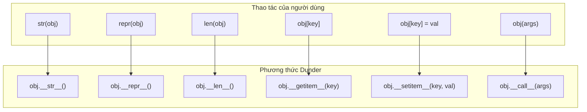

### 🎯 Mục tiêu học tập
- Hiểu khái niệm các phương thức "Dunder" (Double Underscore - gạch dưới kép) trong Python.
- Triển khai cách hiển thị chuỗi tùy chỉnh thông qua `__str__` và `__repr__`.
- Thiết kế các lớp dạng container (vật chứa) tùy chỉnh bằng cách dùng `__getitem__`, `__setitem__` và `__len__`.
- Tạo các đối tượng có thể gọi được (callable objects) bằng phương thức `__call__`.

### 🧩 Khái niệm cốt lõi (Tại sao)
Mô hình thực thi của Python được tích hợp sâu sắc với các tính năng hướng đối tượng. Thay vì yêu cầu các toán tử dựa trên từ khóa đặc biệt hoặc các API gốc dành riêng cho từng kiểu dữ liệu tự định nghĩa, Python sử dụng các phương thức đặc biệt bắt đầu và kết thúc bằng hai dấu gạch dưới — thường được gọi là **phương thức dunder** hoặc **phương thức ma thuật** (magic methods).

Ví dụ, khi bạn sử dụng toán tử `+`, Python sẽ dịch phép toán `a + b` thành `a.__add__(b)`. Tương tự, việc gọi `len(obj)` sẽ gọi `obj.__len__()`. Bằng cách ghi đè (override) các phương thức dunder này, chúng ta có thể làm cho các lớp tùy chỉnh hoạt động giống như các kiểu dữ liệu có sẵn của Python (như danh sách, từ điển, hoặc thậm chí là một hàm số). Điều này giúp viết code chuẩn "Pythonic" — trực quan, dễ đọc và có khả năng tái sử dụng rất cao.

### 🔁 Logic và hoạt động
Biểu đồ dưới đây minh họa cách các hàm hoặc thao tác chuẩn trong Python được ánh xạ thành các cuộc gọi phương thức dunder bên dưới:



### 📝 Ví dụ minh họa có chú thích
Dưới đây là một lớp `Vector` tùy chỉnh minh họa việc hiển thị chuỗi.

```python
class Vector:
    def __init__(self, x, y):
        self.x = x
        self.y = y

    # __repr__ nhằm cung cấp thông tin chi tiết, không mơ hồ, thường khớp với cú pháp tạo lại đối tượng
    def __repr__(self):
        return f"Vector({self.x}, {self.y})"

    # __str__ dùng để hiển thị chuỗi thân thiện với người dùng cuối
    def __str__(self):
        return f"({self.x}i + {self.y}j)"

# Khởi tạo instance Vector
v = Vector(3, 4)
print(repr(v)) # Output: Vector(3, 4) (Lý tưởng cho debug)
print(str(v))  # Output: (3i + 4j)  (Lý tưởng để hiển thị giao diện)
```

### ❌ Các lỗi thường gặp

**Mistake 1: Trả về một kiểu không phải chuỗi từ `__str__` hoặc `__repr__`**
```python
class Point:
    def __init__(self, x, y):
        self.x = x
        self.y = y
    def __str__(self):
        return self.x # Lỗi: trả về số nguyên
```
```text
TypeError: __str__ returned non-string (type int)
```
```python
class Point:
    def __init__(self, x, y):
        self.x = x
        self.y = y
    def __str__(self):
        return f"Point({self.x}, {self.y})" # Sửa: Trả về một chuỗi hợp lệ
```
> Cả `__str__` và `__repr__` bắt buộc phải trả về một chuỗi văn bản (`str`). Trả về các kiểu dữ liệu khác sẽ gây lỗi `TypeError`.

**Mistake 2: Quên trả về giá trị trong `__getitem__`**
```python
class CustomList:
    def __init__(self):
        self._items = [1, 2, 3]
    def __getitem__(self, index):
        self._items[index] # Lỗi: quên từ khóa return
```
```text
None
```
```python
class CustomList:
    def __init__(self):
        self._items = [1, 2, 3]
    def __getitem__(self, index):
        return self._items[index] # Sửa: Trả về phần tử lấy được
```
> `__getitem__` cần phải trả về phần tử tương ứng với chỉ mục hoặc khóa được truyền vào. Nếu thiếu câu lệnh `return`, Python sẽ tự động trả về `None`.

### 💡 Mẹo & Cách viết tối ưu
- Hãy luôn triển khai `__repr__` trước. Nếu một lớp không định nghĩa `__str__`, Python sẽ tự động dùng kết quả từ `__repr__` để thay thế.
- Sử dụng `__call__` để thiết kế các đối tượng cần lưu lại trạng thái (stateful objects) giữa các lần gọi, đóng vai trò như một giải pháp thay thế tinh tế cho các closure hoặc các lớp chỉ có một phương thức.

### 🧠 Đi sâu phân tích (Cơ chế bên dưới)
<details><summary>Quá trình tra cứu (Lookup) các phương thức Dunder</summary>

Khi Python tìm kiếm một phương thức dunder (như `__len__`), nó sẽ bỏ qua từ điển thuộc tính của instance (`__dict__`) và tìm kiếm trực tiếp trên đối tượng Class. Điều này được thực hiện nhằm tối ưu hiệu năng và đảm bảo hành vi nhất quán cho các phép toán tích hợp sẵn.

Ví dụ, viết `len(obj)` sẽ không tra cứu `obj.__dict__['__len__']`. Thay vào đó, nó truy xuất `type(obj).__len__(obj)`. Do đó, ngay cả khi bạn gán động một hàm có tên `__len__` cho một instance cụ thể, hàm `len()` có sẵn của Python vẫn sẽ bỏ qua nó trừ khi nó được định nghĩa rõ ràng trong lớp (class) cha.
</details>

### 🏋️ Bài tập thực hành
Hoàn thiện các phương thức `__getitem__`, `__setitem__`, `__len__` và `__call__` cho lớp `DictWrapper` để bao bọc một từ điển và hỗ trợ truy cập bằng dấu ngoặc vuông, đo lường độ dài, và tìm kiếm khóa thông qua giao diện gọi hàm trực tiếp.

```python
class DictWrapper:
    def __init__(self):
        self._data = {}
    # Implement __getitem__, __setitem__, __len__ and __call__
```

### ✅ Tự kiểm tra
1. Điều gì sẽ xảy ra nếu một lớp triển khai `__str__` nhưng không có `__repr__` và bạn gọi hàm `repr(obj)`?
2. Ngoại lệ nào nên được `__getitem__` ném ra nếu một chỉ mục nằm ngoài phạm vi được truyền vào một sequence?
<details><summary>Đáp án</summary>

1. Nếu `__repr__` chưa được định nghĩa, việc gọi `repr(obj)` sẽ sử dụng chuỗi đại diện mặc định của đối tượng (ví dụ: `<__main__.ClassName object at 0x... >`). Tuy nhiên, nếu thiếu `__str__` nhưng có `__repr__`, gọi `str(obj)` sẽ lấy kết quả từ `__repr__`.
2. `__getitem__` nên ném ra lỗi `IndexError` đối với các sequence (như danh sách) và `KeyError` đối với các mapping (như từ điển).
</details>

### 📌 Tóm tắt
- **Phương thức Dunder** giúp các đối tượng tùy chỉnh tích hợp mượt mà với cú pháp và các hàm dựng sẵn của Python.
- `__str__` tối ưu hóa khả năng hiển thị cho người dùng cuối, trong khi `__repr__` cung cấp cách biểu diễn không mơ hồ phục vụ lập trình viên.
- Các phương thức container (`__getitem__`, `__setitem__`, `__len__`) giúp các lớp tùy chỉnh hoạt động như danh sách hoặc từ điển.
- Phương thức `__call__` cho phép triệu gọi trực tiếp thực thể lớp (instance) như một hàm số thông thường.
