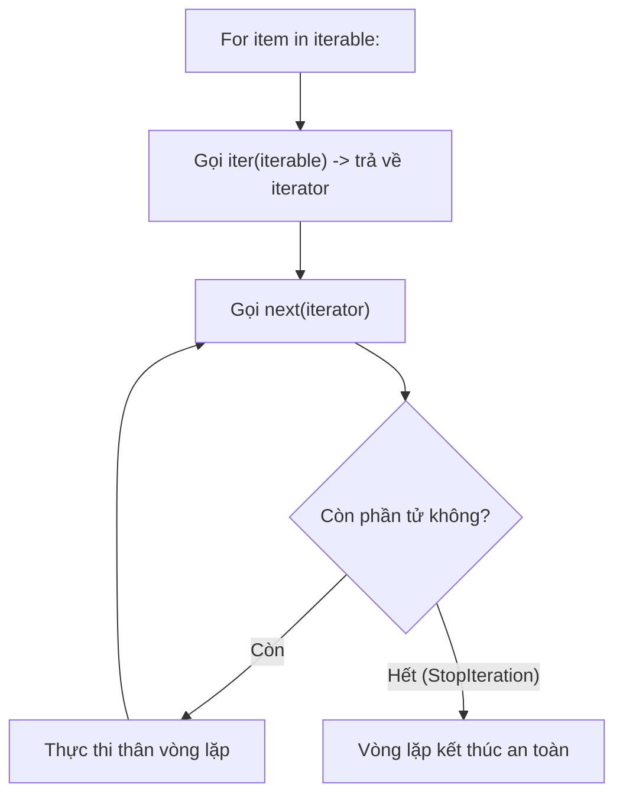

### 🎯 Mục tiêu học tập
- Hiểu rõ sự khác biệt bản chất giữa Iterable (có thể lặp) và Iterator (bộ lặp).
- Triển khai Giao thức Lặp (Iteration Protocol) thông qua `__iter__` và `__next__`.
- Tạo các Iterator tùy chỉnh để biểu diễn các tập hợp vô hạn hoặc các tập hợp đặc biệt.
- Làm chủ các hàm Generator thông qua từ khóa `yield` và xây dựng luồng xử lý dữ liệu (stream) tối ưu hóa bộ nhớ.
- Sử dụng biểu thức Generator và cơ chế ủy quyền generator bằng cú pháp `yield from`.

### 🧩 Khái niệm cốt lõi (Tại sao)
Khi làm việc với các tập dữ liệu khổng lồ hoặc luồng dữ liệu vô hạn (ví dụ: đọc file log dung lượng nhiều GB hoặc sinh các chuỗi toán học vô hạn), việc nạp toàn bộ các phần tử vào một danh sách (list) cùng một lúc sẽ nhanh chóng làm cạn kiệt bộ nhớ RAM của hệ thống.

Python giải quyết bài toán này thông qua **Iterator** và **Generator**. Những khái niệm này thực hiện cơ chế **đánh giá lười biếng (lazy evaluation)** — tức là chỉ tạo ra phần tử tiếp theo khi nó được yêu cầu rõ ràng.

- **Iterable** là bất kỳ đối tượng nào bạn có thể lặp qua (như list, tuple, hoặc string).
- **Iterator** là đối tượng có trạng thái sinh ra luồng phần tử, trả về từng giá trị một thông qua hàm `next()`.
- **Generator** là cách viết một iterator ngắn gọn hơn thông qua một hàm có sử dụng từ khóa `yield`.

### 🔁 Logic và hoạt động
Vòng đời của quá trình lặp và cách Python tự động quản lý Giao thức Lặp bên dưới:



### 📝 Ví dụ minh họa có chú thích
Dưới đây là ví dụ về bộ lặp đếm ngược tùy chỉnh, tiếp theo là một hàm generator để lọc các dòng chứa lỗi từ danh sách log đầu vào.

```python
# 1. Iterator tùy chỉnh triển khai Giao thức Lặp
class Countdown:
    def __init__(self, start):
        self.current = start

    def __iter__(self):
        return self # Một iterator bắt buộc phải tự trả về chính nó trong __iter__

    def __next__(self):
        if self.current <= 0:
            raise StopIteration # Phát tín hiệu kết thúc lặp
        val = self.current
        self.current -= 1
        return val

# Kiểm thử iterator tùy chỉnh
for num in Countdown(3):
    print(num) # Output: 3, 2, 1

# 2. Hàm Generator sử dụng từ khóa yield
def read_logs(lines):
    for line in lines:
        if "ERROR" in line:
            yield line.strip()

log_data = ["INFO: System OK", "ERROR: DB Connection failed", "INFO: Job finished"]
error_generator = read_logs(log_data)
print(next(error_generator)) # Output: ERROR: DB Connection failed
```

### ❌ Các lỗi thường gặp

**Mistake 1: Cố gắng sử dụng lại một iterator đã cạn kiệt**
```python
my_list = [1, 2, 3]
iterator = iter(my_list)
print(list(iterator)) # Tiêu thụ toàn bộ iterator
print(list(iterator)) # Cố gắng tái sử dụng
```
```text
[1, 2, 3]
[]
```
```python
my_list = [1, 2, 3]
# Khởi tạo một iterator mới nếu bạn cần lặp lại một lần nữa
iterator = iter(my_list)
print(list(iterator))
iterator_new = iter(my_list)
print(list(iterator_new))
```
> Iterator là các đối tượng lưu trạng thái và sẽ tiêu thụ dần các phần tử. Khi ngoại lệ StopIteration được ném ra, chúng đã cạn kiệt dữ liệu và sẽ trả về danh sách rỗng nếu bị truy vấn lại.

**Mistake 2: Quên ném ra StopIteration trong phương thức `__next__` của iterator tùy chỉnh**
```python
class InfiniteOne:
    def __init__(self):
        self.count = 0
    def __iter__(self):
        return self
    def __next__(self):
        if self.count >= 2:
            pass # Lỗi: quên ném ra StopIteration!
        self.count += 1
        return 1
print(list(InfiniteOne()))
```
```text
(Lỗi thực thi quá thời gian / Phát hiện vòng lặp vô hạn)
```
```python
class InfiniteOne:
    def __init__(self):
        self.count = 0
    def __iter__(self):
        return self
    def __next__(self):
        if self.count >= 2:
            raise StopIteration # Sửa: Phát tín hiệu kết thúc vòng lặp
        self.count += 1
        return 1
print(list(InfiniteOne())) # Output: [1, 1]
```
> Nếu không ném ra ngoại lệ `StopIteration`, các vòng lặp hoặc lệnh chuyển đổi kiểu dữ liệu (như `list()`) sẽ chạy vô hạn, dẫn đến việc chương trình bị treo.

### 💡 Mẹo & Cách viết tối ưu
- **Biểu thức Generator (Generator Expressions)**: Tương tự như list comprehension, bạn có thể tạo generator nhanh bằng dấu ngoặc đơn: `gen = (x * x for x in range(10))`.
- **`yield from`**: Sử dụng `yield from` để ủy quyền một phần thao tác lặp sang một generator khác.
  ```python
  def chain_generators(gen1, gen2):
      yield from gen1
      yield from gen2
  ```

### 🧠 Đi sâu phân tích (Cơ chế bên dưới)
<details><summary>Cách thức tạm dừng và tiếp tục của các hàm Generator</summary>

Khi một hàm generator được gọi, nó không thực thi ngay khối mã bên trong hàm đó. Thay vào đó, nó trả về một đối tượng generator.

Khi hàm `next()` được gọi trên đối tượng này:
1. Hàm bắt đầu thực thi cho đến khi gặp câu lệnh `yield` đầu tiên.
2. Trạng thái thực thi của hàm (các biến cục bộ, con trỏ lệnh và stack frame) sẽ được đóng băng và lưu trữ lại.
3. Giá trị đi kèm từ khóa `yield` được trả về cho bên gọi.
4. Lần gọi `next()` tiếp theo sẽ khôi phục lại vị trí tạm dừng và tiếp tục chạy bình thường. Việc bảo toàn stack frame này giúp generator cực kỳ tiết kiệm bộ nhớ khi xử lý dữ liệu lớn.
</details>

### 🏋️ Bài tập thực hành
Viết hàm generator `fibonacci_limit(limit)` để sinh ra các số Fibonacci nhỏ hơn hoặc bằng giới hạn (limit) cho trước. Chuỗi số cần bắt đầu bằng `0, 1, 1, 2, 3...`.

```python
def fibonacci_limit(limit):
    # Yield fibonacci numbers up to (and including) limit
    pass
```

### ✅ Tự kiểm tra
1. Sự khác biệt cơ bản giữa việc gọi hàm thông thường có `return` và hàm generator có `yield` là gì?
2. Liệu cú pháp `[x for x in range(10)]` có phải là một biểu thức generator không?
<details><summary>Đáp án</summary>

1. Hàm thông thường chỉ trả về một giá trị một lần duy nhất rồi hủy stack frame của nó. Hàm generator trả về một đối tượng iterator, sinh giá trị nhiều lần và bảo toàn trạng thái (stack frame, biến cục bộ) giữa các lần gọi.
2. Không, ngoặc vuông `[]` định nghĩa list comprehension (tạo toàn bộ danh sách trong bộ nhớ ngay lập tức). Ngoặc đơn `(x for x in range(10))` mới định nghĩa một biểu thức generator.
</details>

### 📌 Tóm tắt
- **Iterables** hỗ trợ cơ chế lặp; **Iterators** sinh ra các phần tử theo yêu cầu (on-demand).
- **Giao thức Lặp (Iteration Protocol)** hoạt động nhờ `__iter__` để trả về iterator và `__next__` để trả về giá trị tiếp theo hoặc ném ra lỗi `StopIteration`.
- **Generator** đơn giản hóa việc tạo iterator thông qua từ khóa `yield`.
- Generator lưu giữ trạng thái nội bộ, cho phép xử lý lượng dữ liệu khổng lồ với bộ nhớ tối thiểu.
