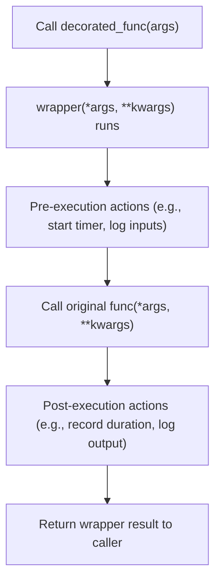

### 🎯 Mục tiêu học tập
- Giải thích decorator là gì và chúng giúp sửa đổi hành vi của hàm như thế nào.
- Hiểu được khái niệm hàm là đối tượng hạng nhất (first-class object) trong Python.
- Tạo và sử dụng decorator không có tham số.
- Tạo và sử dụng decorator có tham số.
- Áp dụng `functools.wraps` để bảo toàn thông tin siêu dữ liệu (metadata) của hàm gốc.
- Triển khai decorator dựa trên class sử dụng phương thức magic `__call__`.

### 🧩 Khái niệm cốt lõi (Tại sao)
Trong phát triển phần mềm, chúng ta thường cần thực hiện logic phụ trợ bên cạnh logic nghiệp vụ chính. Ví dụ: ghi nhật ký cuộc gọi hàm (logging), kiểm tra quyền truy cập (authentication), lưu bộ đệm kết quả (caching) hoặc đo hiệu năng chạy hàm. Nếu sao chép và dán thủ công các đoạn code này vào mọi hàm, mã nguồn của chúng ta sẽ trở nên trùng lặp, khó bảo trì và dễ phát sinh lỗi.

Python giải quyết vấn đề này bằng **Decorator**. Một decorator là một hàm nhận một hàm khác làm đối số, mở rộng hành vi của nó mà không trực tiếp thay đổi code của hàm đó, và trả về một hàm mới.

Điều này khả thi là do hàm trong Python là các **đối tượng hạng nhất (first-class citizens)**:
- Chúng có thể được gán cho biến.
- Chúng có thể được truyền làm đối số cho các hàm khác.
- Chúng có thể được định nghĩa bên trong các hàm khác (hàm lồng nhau).
- Chúng có thể được trả về làm kết quả từ các hàm khác.

### 🔁 Logic và hoạt động
Cú pháp `@decorator` thực chất chỉ là cú pháp rút gọn (syntactic sugar). Viết code như sau:
```python
@my_decorator
def my_func():
    pass
```
Thực chất hoàn toàn tương đương với:
```python
my_func = my_decorator(my_func)
```

Quy trình thực thi khi gọi một hàm đã được áp dụng decorator diễn ra như sau:



### 📝 Ví dụ minh họa có chú thích

#### 1. Decorator cơ bản (Không có tham số)
Decorator này in ra các thông điệp trước và sau khi thực thi hàm được bọc.
```python
import functools

def my_logger(func):
    @functools.wraps(func) # Giữ lại tên và docstring của hàm gốc
    def wrapper(*args, **kwargs):
        print(f"[LOG] Calling {func.__name__} with args: {args}, kwargs: {kwargs}")
        result = func(*args, **kwargs)
        print(f"[LOG] {func.__name__} finished execution.")
        return result
    return wrapper

@my_logger
def greet(name, greeting="Hello"):
    return f"{greeting}, {name}!"

print(greet("Alice"))
# Kết quả:
# [LOG] Calling greet with args: ('Alice',), kwargs: {}
# [LOG] greet finished execution.
# Hello, Alice!
```

#### 2. Decorator có tham số
Để truyền đối số trực tiếp cho decorator, chúng ta cần ba cấp hàm lồng nhau: hàm ngoài cùng nhận tham số của decorator, hàm trung gian nhận hàm mục tiêu và hàm trong cùng xử lý việc thực thi.
```python
import functools

def repeat(num_times):
    def decorator_repeat(func):
        @functools.wraps(func)
        def wrapper(*args, **kwargs):
            for _ in range(num_times):
                result = func(*args, **kwargs)
            return result
        return wrapper
    return decorator_repeat

@repeat(num_times=3)
def greet_loudly(name):
    print(f"HELLO {name.upper()}!")

greet_loudly("Bob")
# Kết quả:
# HELLO BOB!
# HELLO BOB!
# HELLO BOB!
```

#### 3. Decorator dựa trên Class
Chúng ta cũng có thể triển khai decorator dưới dạng class. Class sẽ nhận hàm mục tiêu trong hàm khởi tạo `__init__` và triển khai logic thực thi bên trong phương thức magic `__call__`.
```python
class CountCalls:
    def __init__(self, func):
        self.func = func
        self.num_calls = 0

    def __call__(self, *args, **kwargs):
        self.num_calls += 1
        print(f"Function {self.func.__name__} has been called {self.num_calls} times")
        return self.func(*args, **kwargs)

@CountCalls
def say_hello():
    print("Hello")

say_hello() # Kết quả: Function say_hello has been called 1 times \n Hello
say_hello() # Kết quả: Function say_hello has been called 2 times \n Hello
```

### ❌ Các lỗi thường gặp

**Lỗi 1: Quên sử dụng `functools.wraps`**
```python
def bad_decorator(func):
    def wrapper(*args, **kwargs):
        return func(*args, **kwargs)
    return wrapper

@bad_decorator
def greet():
    """Greets the user."""
    return "Hello!"

print(greet.__name__)
print(greet.__doc__)
```
```text
wrapper
None
```
```python
import functools

def good_decorator(func):
    @functools.wraps(func)
    def wrapper(*args, **kwargs):
        return func(*args, **kwargs)
    return wrapper

@good_decorator
def greet():
    """Greets the user."""
    return "Hello!"

print(greet.__name__)
print(greet.__doc__)
```
> Nếu không có `@functools.wraps`, hàm được trang trí sẽ mất đi danh tính gốc của nó (như name, docstring, v.v.) và lấy danh tính của hàm wrapper nội bộ. Điều này gây khó khăn khi debug và sử dụng các công cụ phân tích code.

**Lỗi 2: Quên trả về kết quả từ hàm wrapper**
```python
def log_only(func):
    def wrapper(*args, **kwargs):
        print(f"Executing {func.__name__}")
        func(*args, **kwargs)  # Quên trả về kết quả!
    return wrapper

@log_only
def add(a, b):
    return a + b

result = add(5, 5)
print(result)
```
```text
Executing add
None
```
```python
def log_only(func):
    def wrapper(*args, **kwargs):
        print(f"Executing {func.__name__}")
        return func(*args, **kwargs)  # Đúng: trả về kết quả
    return wrapper

@log_only
def add(a, b):
    return a + b

result = add(5, 5)
print(result)
```
> Nếu hàm wrapper không trả về kết quả của lệnh gọi hàm gốc, hàm được trang trí sẽ loại bỏ kết quả đã tính toán và luôn trả về `None`.

### 💡 Mẹo & Cách viết tối ưu
- **Áp dụng nhiều decorator cùng lúc**: Bạn có thể áp dụng đồng thời nhiều decorator cho một hàm. Chúng sẽ được thực thi theo thứ tự từ dưới lên trên (từ trong ra ngoài).
  ```python
  @decorator_one
  @decorator_two
  def my_func():
      pass
  # Tương đương với: my_func = decorator_one(decorator_two(my_func))
  ```
- **Gọi hàm gốc trước khi áp dụng decorator**: Nếu bạn cần truy cập trực tiếp hàm gốc chưa được trang trí để debug, bạn có thể gọi qua thuộc tính `__wrapped__` (với điều kiện decorator có sử dụng `@functools.wraps`).
  ```python
  original_func = greet.__wrapped__
  ```

### 🧠 Đi sâu phân tích (Cơ chế bên dưới)
<details><summary>Closure và Phân giải Phạm vi Biến</summary>

Bên dưới cấu trúc hoạt động, decorator phụ thuộc vào một tính năng của Python gọi là **closure**. Closure là một bản ghi lưu trữ một hàm cùng với môi trường đi kèm: một ánh xạ liên kết các biến tự do của hàm với các giá trị hoặc tham chiếu tại thời điểm hàm được tạo ra.

Khi hàm ngoài trả về hàm bên trong, hàm bên trong vẫn giữ quyền truy cập vào các biến cục bộ của hàm ngoài ngay cả khi hàm ngoài đã kết thúc quá trình thực thi.

Python hiện thực hóa điều này bằng cách sử dụng các **cell object** trong thuộc tính `__closure__` của hàm:
```python
def outer(x):
    def inner():
        print(x)
    return inner

my_closure = outer(10)
print(my_closure.__closure__[0].cell_contents) # Kết quả: 10
```
Khi `inner()` được gọi, Python tìm kiếm phạm vi cục bộ trước, sau đó tìm kiếm phạm vi bao quanh (được lưu trữ trong các closure cell object), rồi đến phạm vi toàn cục và cuối cùng là built-ins (theo quy tắc LEGB). Hàm wrapper trong một decorator chính là một closure giữ tham chiếu đến biến `func` ban đầu.
</details>

### 🏋️ Bài tập thực hành
Triển khai một decorator `timer` nhằm đo thời gian thực thi của một hàm và thêm thời gian đo được (dưới dạng số thực float) vào danh sách toàn cục `TIMED_RECORDS`.

```python
import functools
import time

TIMED_RECORDS = []

def timer(func):
    # Implement timer decorator that appends duration to TIMED_RECORDS
    pass
```

### ✅ Tự kiểm tra
1. Làm thế nào để một decorator nhận các tham số được truyền vào hàm được trang trí?
2. Nếu chúng ta xếp chồng `@dec1` trên `@dec2` đối với một hàm `f()`, wrapper của decorator nào sẽ chạy trước?
<details><summary>Đáp án</summary>

1. Nó nhận chúng bằng cách sử dụng danh sách đối số biến đổi `*args` và đối số từ khóa `**kwargs` trong chữ ký của hàm wrapper nội bộ và truyền chúng vào lệnh gọi hàm gốc.
2. Wrapper của `@dec1` sẽ chạy trước, vì nó bọc ngoài wrapper của `@dec2`, và wrapper của `@dec2` tiếp tục bọc hàm `f()`.
</details>

### 📌 Tóm tắt
- **Decorator** cho phép bạn bọc một hàm để mở rộng hành vi của nó mà không cần thay đổi trực tiếp mã nguồn ban đầu.
- Hàm là **đối tượng hạng nhất** trong Python, đây là nền tảng của hàm lồng nhau và decorator.
- Luôn luôn sử dụng `@functools.wraps` trong các decorator tự định nghĩa để giữ lại tên hàm gốc và các docstring.
- Decorator có thể được định nghĩa dưới dạng hàm (có hoặc không có tham số) hoặc dưới dạng class.
