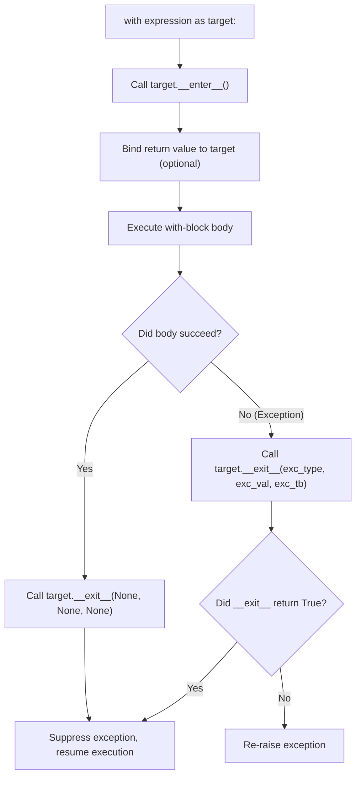

### 🎯 Mục tiêu học tập
- Hiểu thế nào là quản lý tài nguyên và lý do tại sao việc giải phóng tài nguyên lại cực kỳ quan trọng.
- Hiểu được cấu trúc `try...finally` giúp dọn dẹp tài nguyên như thế nào.
- Tự định nghĩa context manager thông qua các phương thức magic `__enter__` và `__exit__`.
- Xây dựng nhanh context manager bằng cách kết hợp `@contextmanager` từ module `contextlib` và lệnh `yield`.
- Sử dụng lồng nhau nhiều context manager để quản lý đồng thời nhiều nguồn tài nguyên một cách an toàn.

### 🧩 Khái niệm cốt lõi (Tại sao)
Trong phát triển phần mềm, chương trình của bạn liên tục tương tác với các tài nguyên bên ngoài. Đó có thể là các tệp tin trên ổ cứng, các kết nối đến cơ sở dữ liệu, các socket mạng hoặc các khóa phân quyền hệ thống (system-wide locks).

Khi mở hoặc yêu cầu các tài nguyên này, hệ điều hành sẽ cấp phát các định danh (chẳng hạn như file descriptor) cho tiến trình của bạn. Nếu bạn quên đóng (close) các tài nguyên này sau khi sử dụng, chúng sẽ bị chiếm giữ trong bộ nhớ. Hiện tượng này được gọi là **rò rỉ tài nguyên (resource leak)**.

Nếu một chương trình liên tục rò rỉ tài nguyên, cuối cùng nó sẽ cạn kiệt các định danh hệ thống, dẫn đến lỗi crash chương trình, đóng băng hệ thống hoặc ngắt kết nối đến cơ sở dữ liệu.

Để giải quyết triệt để vấn đề này, Python cung cấp **Context Manager**. Chúng cho phép bạn định nghĩa các hành động thiết lập (set-up) và giải phóng (tear-down) tự động bao quanh một khối code, đảm bảo tài nguyên luôn được thu hồi an toàn kể cả khi chương trình xảy ra ngoại lệ (exception) hoặc bị dừng đột ngột.

### 🔁 Logic và hoạt động
Cách phổ biến nhất để sử dụng context manager là thông qua câu lệnh `with`. Vòng đời của một câu lệnh `with` được Python quản lý nội bộ như sau:



### 📝 Ví dụ minh họa có chú thích

#### 1. Context Manager dựa trên Class
Để triển khai một context manager bằng class, bạn cần định nghĩa hai phương thức đặc biệt:
- `__enter__`: Khởi tạo/yêu cầu tài nguyên và trả về đối tượng sẽ được gán cho biến sau từ khóa `as`.
- `__exit__`: Giải phóng tài nguyên và xử lý các lỗi ngoại lệ (nếu có).
```python
class DatabaseConnection:
    def __init__(self, db_name):
        self.db_name = db_name

    def __enter__(self):
        print(f"Connecting to database: {self.db_name}")
        return self # Đối tượng này sẽ được gán cho biến sau từ khóa 'as'

    def __exit__(self, exc_type, exc_val, exc_tb):
        print("Closing database connection")
        if exc_type:
            print(f"An error occurred: {exc_val}")
        return False # Cho phép lỗi lan truyền ra ngoài nếu có

with DatabaseConnection("user_db") as conn:
    print("Executing queries...")
# Kết quả:
# Connecting to database: user_db
# Executing queries...
# Closing database connection
```

#### 2. Context Manager dựa trên Generator
Module `contextlib` cho phép bạn viết một hàm generator trả quyền điều khiển (`yield`) đúng một lần thay vì phải khai báo cả một class hoàn chỉnh.
```python
from contextlib import contextmanager
import os

@contextmanager
def temporary_dir_change(destination):
    original_dir = os.getcwd()
    os.chdir(destination)
    try:
        yield # Khối code bên trong 'with' sẽ chạy ở đây
    finally:
        os.chdir(original_dir) # Code dọn dẹp chắc chắn sẽ chạy

# Cách dùng:
# with temporary_dir_change("/tmp"):
#     # thao tác gì đó trong thư mục /tmp
```

#### 3. Sử dụng lồng nhau nhiều Context Manager
Bạn có thể quản lý đồng thời nhiều tài nguyên trong một câu lệnh `with`, ngăn cách bằng dấu phẩy.
```python
# Sao chép nội dung từ file nguồn sang file đích
with open("source.txt", "r") as src, open("dest.txt", "w") as dest:
    dest.write(src.read())
```

### ❌ Các lỗi thường gặp

**Lỗi 1: Quên sử dụng try-finally trong `@contextmanager`**
```python
from contextlib import contextmanager

@contextmanager
def unsafe_resource():
    print("Acquire Resource")
    yield "data"
    print("Release Resource") # Dòng này sẽ KHÔNG chạy nếu có lỗi xảy ra!

with unsafe_resource() as data:
    raise ValueError("Something went wrong!")
```
```text
Acquire Resource
Traceback (most recent call last):
  ...
ValueError: Something went wrong!
```
```python
from contextlib import contextmanager

@contextmanager
def safe_resource():
    print("Acquire Resource")
    try:
        yield "data"
    finally:
        print("Release Resource") # Đảm bảo luôn được thực thi

try:
    with safe_resource() as data:
        raise ValueError("Something went wrong!")
except ValueError:
    pass
```
> Khi sử dụng `@contextmanager`, nếu xảy ra lỗi bên trong khối `with`, lỗi đó sẽ được ném ngược lại vào hàm generator tại đúng dòng `yield`. Nếu bạn không bọc dòng `yield` này trong cấu trúc `try...finally`, phần code dọn dẹp phía sau `yield` sẽ bị bỏ qua hoàn toàn.

**Lỗi 2: Vô tình nuốt toàn bộ lỗi trong phương thức `__exit__`**
```python
class SuppressEverything:
    def __enter__(self):
        return self
    def __exit__(self, exc_type, exc_val, exc_tb):
        return True # Nuốt toàn bộ lỗi một cách vô điều kiện!

with SuppressEverything():
    result = 1 / 0
print("Program continued running despite ZeroDivisionError!")
```
```text
Program continued running despite ZeroDivisionError!
```
```python
class SuppressNone:
    def __enter__(self):
        return self
    def __exit__(self, exc_type, exc_val, exc_tb):
        if exc_type is ZeroDivisionError:
            print("Suppressed division by zero error")
            return True
        return False # Cho phép các lỗi khác được lan truyền ra ngoài

try:
    with SuppressNone():
        result = 1 / 0
except ZeroDivisionError:
    pass
```
> Việc trả về `True` từ phương thức `__exit__` báo hiệu cho Python bỏ qua lỗi vừa xảy ra. Thực hiện điều này vô điều kiện là rất nguy hiểm vì nó có thể che giấu các lỗi nghiêm trọng như sai tên biến, lỗi cú pháp hoặc lỗi logic.

### 💡 Mẹo & Cách viết tối ưu
- **`contextlib.suppress`**: Thay vì viết khối `try...except` rỗng, bạn có thể bỏ qua các lỗi dự kiến một cách gọn gàng:
  ```python
  from contextlib import suppress
  with suppress(FileNotFoundError):
      os.remove("nonexistent.txt")
  ```
- **`contextlib.closing`**: Nếu một đối tượng có phương thức `close()` nhưng không hỗ trợ sẵn giao thức context manager, bạn có thể bọc nó bằng `closing()` để đảm bảo tự động đóng:
  ```python
  from contextlib import closing
  from urllib.request import urlopen

  with closing(urlopen('https://www.python.org')) as page:
      for line in page:
          pass
  ```

### 🧠 Đi sâu phân tích (Cơ chế bên dưới)
<details><summary>Cơ chế Bytecode đằng sau câu lệnh with</summary>

Ở cấp độ bytecode, Python sử dụng các chỉ thị đặc biệt để thực thi câu lệnh `with`. Nếu phân rã (disassemble) một hàm chứa câu lệnh `with`, bạn sẽ thấy các chỉ thị như `SETUP_WITH` và `WITH_EXCEPT_START`.

Khi Python đi vào khối `with`:
1. Chỉ thị `SETUP_WITH` đẩy phương thức `__exit__` của context manager vào ngăn xếp thực thi (execution stack).
2. Code trong khối được thực thi.
3. Nếu xảy ra lỗi, trình thông dịch sẽ lấy `__exit__` từ ngăn xếp và gọi nó kèm theo thông tin chi tiết về lỗi (`exc_type`, `exc_val`, `exc_tb`).
4. Chỉ thị `WITH_EXCEPT_START` chạy phương thức exit và kiểm tra giá trị trả về của nó. Nếu giá trị đó là true, lỗi sẽ bị xóa khỏi ngăn xếp và trình thông dịch tiếp tục chạy câu lệnh tiếp theo. Nếu giá trị trả về là false, lỗi sẽ được ném lại (re-raise).
</details>

### 🏋️ Bài tập thực hành
Triển khai một context manager dựa trên generator `temp_file(filename, content)` có chức năng tạo một file text chứa nội dung được chỉ định khi đi vào khối lệnh, và xóa file đó đi khi thoát ra khỏi khối (đảm bảo file luôn được xóa ngay cả khi có ngoại lệ xảy ra trong khối lệnh).

```python
import os
from contextlib import contextmanager

@contextmanager
def temp_file(filename, content):
    # Create file with content on enter, delete it on exit
    pass
```

### ✅ Tự kiểm tra
1. Python truyền những giá trị gì vào `__exit__` nếu khối code bên trong `with` chạy xong mà không gặp bất kỳ lỗi nào?
2. Làm thế nào để trả về một giá trị từ context manager dạng generator để gán cho biến sau từ khóa `as` trong câu lệnh `with`?
<details><summary>Đáp án</summary>

1. Nó truyền các giá trị `None, None, None` tương ứng cho các tham số `exc_type, exc_val, exc_tb`.
2. Bạn truyền giá trị đó kèm theo câu lệnh `yield` (ví dụ: `yield resource`).
</details>

### 📌 Tóm tắt
- **Context manager** đảm bảo tài nguyên được khởi tạo và đóng/giải phóng một cách chính xác.
- **Câu lệnh `with`** tự động hóa việc gọi các phương thức trong giao thức `__enter__` và `__exit__`.
- Custom context manager có thể được tạo dưới dạng class triển khai `__enter__` và `__exit__`, hoặc dưới dạng hàm generator được trang trí bằng `@contextmanager`.
- Luôn đặt dòng `yield` trong khối `try...finally` đối với các context manager dạng generator để đảm bảo phần dọn dẹp luôn được thực hiện.
