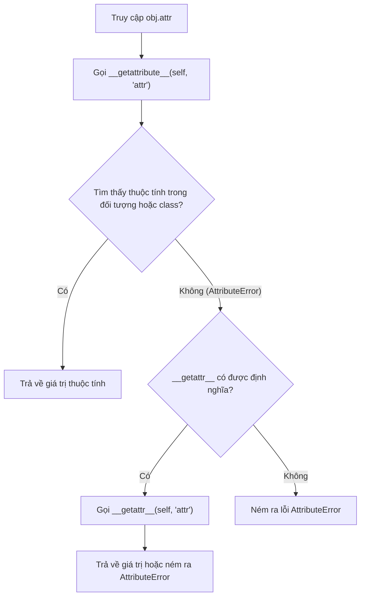

### 🎯 Mục tiêu học tập
- Làm chủ cơ chế quản lý thuộc tính động bằng các phương thức đặc biệt: `__getattr__`, `__getattribute__`, `__setattr__` và `__delattr__`.
- Phân biệt rõ sự khác nhau giữa `__getattr__` và `__getattribute__` cũng như trường hợp sử dụng phù hợp cho từng loại.
- Khởi tạo các class động ngay trong quá trình chạy chương trình bằng hàm `type()`.
- Hiểu sâu về khái niệm metaclass, vòng đời tạo dựng class và cách tùy biến metaclass thông qua `__new__` và `__init__`.

### 🧩 Khái niệm cốt lõi (Tại sao)
Trong lập trình hướng đối tượng thông thường, các class và object có cấu trúc cố định và được xác định trước. Bạn khai báo các thuộc tính và phương thức trong mã nguồn, và chúng sẽ không thay đổi khi chạy.

Tuy nhiên, thiết kế phần mềm hiện đại thường đòi hỏi tính linh hoạt cực cao. Ví dụ, khi bạn xây dựng một thư viện Object-Relational Mapper (ORM) tự động ánh xạ các cột dữ liệu trong cơ sở dữ liệu thành thuộc tính của class Python, hoặc khi tạo các wrapper chuyển tiếp các yêu cầu truy cập thuộc tính động trực tiếp từ kết quả phản hồi của một API bên ngoài.

Đây là lúc ta cần dùng đến **Metaprogramming (Lập trình siêu đối tượng)**. Metaprogramming là kỹ thuật viết code để thao tác hoặc tạo ra code khác—cho phép bạn kiểm tra, thay đổi hoặc sinh ra các class và object một cách tự động khi chương trình đang chạy. Python là một ngôn ngữ cực kỳ động và cung cấp các điểm can thiệp (hooks) rất sâu vào quá trình khởi tạo class lẫn truy cập thuộc tính. Nắm vững các cơ chế này sẽ giúp bạn xây dựng được các API và thư viện tối giản, sạch sẽ và vô cùng mạnh mẽ.

### 🔁 Logic và hoạt động
Việc hiểu rõ quy trình tìm kiếm thuộc tính là tối quan trọng. Khi bạn truy xuất một thuộc tính `obj.attr` trên một đối tượng Python, trình thông dịch sẽ thực hiện các bước quyết định theo trình tự sau:



1. **`__getattribute__`** được gọi vô điều kiện đối với *mọi* truy xuất thuộc tính.
2. Nếu thuộc tính không được tìm thấy qua các bước tìm kiếm thông thường, hoặc nếu `__getattribute__` ném ra ngoại lệ `AttributeError`, Python sẽ chuyển sang gọi **`__getattr__`** như một phương án dự phòng.
3. **`__setattr__`** can thiệp vào tất cả các thao tác gán giá trị cho thuộc tính (`obj.attr = value`).
4. **`__delattr__`** can thiệp vào tất cả các thao tác xóa thuộc tính (`del obj.attr`).

### 📝 Ví dụ minh họa có chú thích

#### 1. Tùy biến thuộc tính động
Phương thức `__getattr__` chỉ được kích hoạt đối với các thuộc tính không tồn tại trên đối tượng. Điều này rất hữu ích cho các hành vi dự phòng hoặc ủy quyền truy cập.
```python
class DynamicDictWrapper:
    def __init__(self, data_dict):
        # Lưu trữ dữ liệu nội bộ. Sử dụng parent setattr để tránh vòng lặp đệ quy vô hạn
        super().__setattr__('_data', data_dict)

    def __getattr__(self, name):
        # Chỉ được gọi nếu thuộc tính 'name' không tồn tại trên object
        if name in self._data:
            return self._data[name]
        raise AttributeError(f"'{self.__class__.__name__}' không có thuộc tính '{name}'")

    def __setattr__(self, name, value):
        # Đón bắt tất cả các hành động gán thuộc tính để cập nhật vào dict nội bộ
        self._data[name] = value

# Cách sử dụng:
wrapper = DynamicDictWrapper({'title': 'Sensei Hub', 'version': 1.0})
print(wrapper.title)    # Kết quả: Sensei Hub (thông qua __getattr__)
wrapper.version = 2.0   # (thông qua __setattr__)
print(wrapper.version)  # Kết quả: 2.0
```

#### 2. Tạo Class động bằng `type()`
Thông thường, các class được định nghĩa bằng từ khóa `class`. Tuy nhiên, bạn cũng có thể tạo chúng một cách linh hoạt bằng cách sử dụng `type(name, bases, dict)`.
```python
# Tạo một class động khi đang chạy chương trình
# type(name, bases, dict)
# - name: Tên của class dưới dạng string
# - bases: Tuple chứa các class cha mà class này kế thừa
# - dict: Dictionary chứa các thuộc tính và phương thức của class

def greet(self):
    return f"Hello, I am {self.name}!"

# Tạo class 'DynamicPerson' kế thừa từ object, có thuộc tính 'species' và phương thức 'greet'
DynamicPerson = type(
    'DynamicPerson',
    (object,),
    {
        'species': 'Human',
        'greet': greet
    }
)

# Sử dụng class động vừa tạo
person = DynamicPerson()
person.name = "Bob"
print(person.greet())   # Kết quả: Hello, I am Bob!
print(person.species)  # Kết quả: Human
```

#### 3. Tạo Metaclass tùy biến
Metaclass là class của các class (class định nghĩa ra class khác). Trong Python, `type` là metaclass mặc định. Bạn có thể kế thừa từ `type` để kiểm soát cách khởi tạo một class.
```python
class PrefixMetaclass(type):
    # __new__ được gọi để cấp phát bộ nhớ và tạo ra class object
    # mcs: Bản thân metaclass
    # name: Tên của class chuẩn bị được tạo
    # bases: Các class cha của class đó
    # dct: Namespace của class (chứa các phương thức/thuộc tính định nghĩa bên trong class)
    def __new__(mcs, name, bases, dct):
        prefixed_dct = {}
        for key, val in dct.items():
            # Tự động thêm tiền tố 'api_' cho các phương thức tự định nghĩa (không có dunder)
            if not key.startswith('__') and callable(val):
                prefixed_dct[f'api_{key}'] = val
            else:
                prefixed_dct[key] = val
        return super().__new__(mcs, name, bases, prefixed_dct)

class Endpoint(metaclass=PrefixMetaclass):
    def fetch_users(self):
        return ["Alice", "Bob"]

# Khởi tạo đối tượng
ep = Endpoint()
# Phương thức 'fetch_users' đã được đổi tên thành 'api_fetch_users' bởi metaclass
print(hasattr(ep, 'fetch_users'))      # Kết quả: False
print(ep.api_fetch_users())            # Kết quả: ['Alice', 'Bob']
```

### ❌ Các lỗi thường gặp

**Mistake 1: Lỗi đệ quy vô hạn khi gán thuộc tính trực tiếp trong `__setattr__`**
```python
class UnsafeSetAttr:
    def __setattr__(self, name, value):
        self.name = value # Dòng này kích hoạt __setattr__ liên tục dẫn đến lỗi đệ quy!
```
```text
RecursionError: maximum recursion depth exceeded in comparison
```
```python
class SafeSetAttr:
    def __setattr__(self, name, value):
        # Gọi phương thức setattr của lớp cha để tránh đệ quy vô hạn
        super().__setattr__(name, value)
```
> Việc gán giá trị thuộc tính trực tiếp cho `self` bên trong `__setattr__` (ví dụ: `self.name = value`) sẽ gọi lại chính `__setattr__` đó một cách vô tận. Để xử lý đúng, bạn cần chuyển tiếp việc gán thuộc tính cho `super().__setattr__(name, value)` hoặc ghi thẳng vào dictionary namespace `self.__dict__[name] = value`.

**Mistake 2: Lỗi đệ quy vô hạn khi gọi thuộc tính trực tiếp trong `__getattribute__`**
```python
class UnsafeGetAttribute:
    def __getattribute__(self, name):
        print(f"Log: truy cập {name}")
        return self.name # Gây gọi lại __getattribute__ liên tục!
```
```text
RecursionError: maximum recursion depth exceeded while calling a Python object
```
```python
class SafeGetAttribute:
    def __getattribute__(self, name):
        print(f"Log: truy cập {name}")
        # Truy xuất an toàn qua lớp cha
        return super().__getattribute__(name)
```
> Vì `__getattribute__` bắt lấy mọi thao tác đọc thuộc tính một cách vô điều kiện, việc gọi bất kỳ thuộc tính nào của `self` bên trong nó (như `self.name`) sẽ làm phát sinh vòng lặp đệ quy vô hạn. Luôn luôn sử dụng `super().__getattribute__(name)` để lấy giá trị một cách an toàn.

### 💡 Mẹo & Cách viết tối ưu
- **Nên ưu tiên `__getattr__` hơn `__getattribute__`**: `__getattr__` an toàn hơn và hoạt động nhanh hơn vì nó chỉ được gọi khi thuộc tính cần tìm thực sự không tồn tại. Chỉ sử dụng `__getattribute__` khi bạn bắt buộc phải kiểm soát mọi thao tác đọc thuộc tính (chẳng hạn như ghi log truy cập thời gian thực hoặc thiết lập sandbox bảo mật).
- **Lập trình động với các hàm build-in**: Hãy tận dụng `getattr()`, `setattr()`, `hasattr()`, và `delattr()` để xử lý thuộc tính khi tên của thuộc tính chỉ được biết dưới dạng chuỗi (string) lúc chương trình đang chạy.
- **Metaclass vs Class Decorator**: Nhiều bài toán giải bằng metaclass cũng có thể được giải quyết đơn giản và dễ hiểu hơn bằng Class Decorator. Tuy nhiên, hãy dùng metaclass khi bạn muốn cơ chế khởi tạo class đó tự động được kế thừa xuống tất cả các class con sau này.

### 🧠 Đi sâu phân tích (Cơ chế bên dưới)
<details><summary>Vòng đời Metaclass & Tạo Class Động</summary>

Khi Python thực thi một khối lệnh định nghĩa `class`, nó sẽ trải qua các bước sau:
1. **Xác định Metaclass**: Python kiểm tra đối số `metaclass=` trong khai báo class, tiếp tục kiểm tra các class cha, và nếu không có sẽ mặc định chọn `type`.
2. **Chuẩn bị Namespace**: Python gọi phương thức `__prepare__(name, bases, **kwargs)` của metaclass. Phương thức này trả về một đối tượng dạng dictionary đại diện cho không gian tên (namespace), nơi chứa các thuộc tính và phương thức của class sắp tạo.
3. **Thực thi Class Body**: Python chạy các dòng lệnh bên trong class định nghĩa và lưu kết quả vào namespace đã chuẩn bị ở bước 2.
4. **Khởi tạo Class Object**: Trình thông dịch gọi constructor của metaclass:
   `metaclass(name, bases, namespace_dict)`.
   Trong lời gọi này, các phương thức sau của metaclass sẽ lần lượt chạy:
   - `__new__(mcs, name, bases, dct)`: Cấp phát bộ nhớ và trả về đối tượng class.
   - `__init__(cls, name, bases, dct)`: Khởi tạo/cấu hình đối tượng class vừa tạo.
</details>

### 🏋️ Bài tập thực hành
Hãy thiết lập class `SafeAttribute` để kiểm soát chặt chẽ việc truy cập thuộc tính. Các thuộc tính được phép sử dụng được truyền vào hàm `__init__` dưới dạng danh sách chuỗi. Mọi hành vi đọc hoặc gán giá trị cho bất kỳ thuộc tính nào nằm ngoài danh sách này đều phải ném ra ngoại lệ `AttributeError`.

```python
class SafeAttribute:
    # Các thuộc tính được phép phải được truyền vào __init__ dưới dạng danh sách tên
    # Truy cập vào các thuộc tính khác phải ném ra lỗi AttributeError
    pass
```

### ✅ Tự kiểm tra
1. Khác biệt lớn nhất giữa `__getattr__` và `__getattribute__` là gì?
2. Tại sao một đối tượng class bản chất cũng được coi là một instance (thể hiện)?
<details><summary>Đáp án</summary>

1. `__getattribute__` được gọi vô điều kiện mỗi khi có hành động truy cập thuộc tính, dù thuộc tính đó có tồn tại hay không. Ngược lại, `__getattr__` chỉ được gọi khi thuộc tính không tồn tại trong class/object đó (tức là sau khi tìm kiếm thông thường thất bại và chuẩn bị ném ra AttributeError).
2. Trong Python, mọi thứ đều là đối tượng (object), kể cả các định nghĩa class. Do đó, các class object cũng chính là các instance được tạo ra từ một metaclass (mặc định là `type`).
</details>

### 📌 Tóm tắt
- **Metaprogramming** cho phép các chương trình Python tùy biến linh hoạt hành vi thời gian chạy, sinh class tự động và kiểm soát mọi truy cập thuộc tính.
- Dùng `__getattr__` cho các xử lý dự phòng (fallback) và `__getattribute__` khi cần giám sát/chặn đứng tất cả hành vi truy cập thuộc tính.
- Để tránh lỗi lặp đệ quy vô hạn, tuyệt đối không gán hoặc đọc thuộc tính trực tiếp của `self` bên trong các hàm hook thuộc tính, hãy ủy quyền qua `super()`.
- Metaclass kế thừa từ `type` và can thiệp vào quá trình tạo dựng class thông qua `__new__` và `__init__`.
