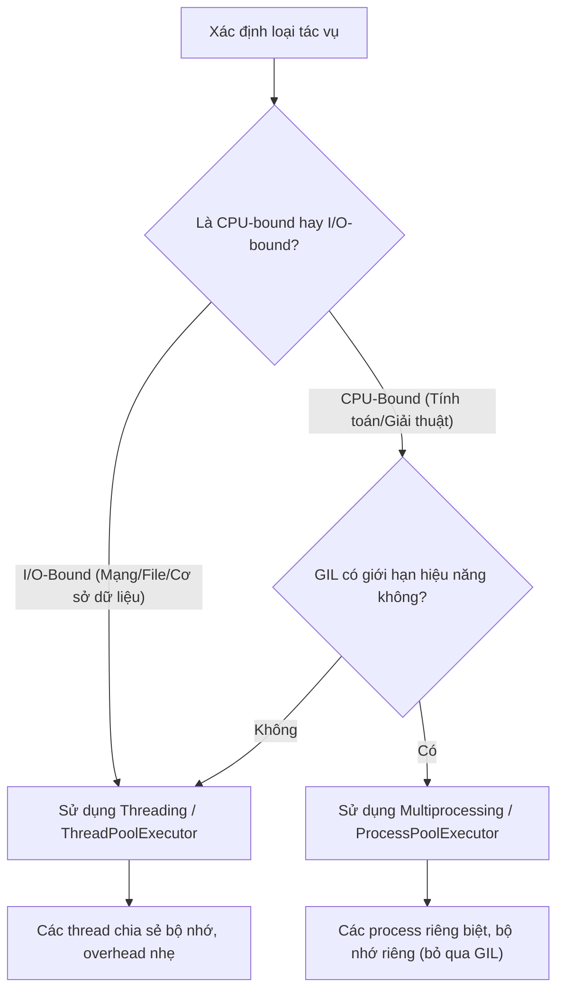

### 🎯 Mục tiêu học tập
- Phân biệt rõ sự khác nhau giữa xử lý Đồng thời (Concurrency) và Song song (Parallelism).
- Hiểu được cơ chế hoạt động của GIL (Global Interpreter Lock) trong Python và ảnh hưởng của nó đến hiệu năng.
- Biết cách lựa chọn khi nào dùng Threading (tác vụ I/O-bound) và khi nào dùng Multiprocessing (tác vụ CPU-bound).
- Sử dụng module `concurrent.futures` để quản lý các Thread Pool và Process Pool một cách hiệu quả.

### 🧩 Khái niệm cốt lõi (Tại sao)
Các dòng máy tính hiện đại ngày nay đều sở hữu bộ vi xử lý đa nhân (multi-core), có khả năng thực thi nhiều chỉ thị cùng một lúc. Để tận dụng tối đa sức mạnh phần cứng này, các ứng dụng cần được lập trình để xử lý nhiều tác vụ đồng thời.

Tuy nhiên, các lập trình viên Python phải đối mặt với một rào cản đặc thù: **GIL (Global Interpreter Lock - Khóa thông dịch toàn cục)**. GIL là một cơ chế trong CPython (trình thông dịch Python tiêu chuẩn) nhằm đảm bảo tại một thời điểm chỉ có duy nhất một OS thread (luồng hệ điều hành) được thực thi bytecode của Python. Điều này có nghĩa là ngay cả khi máy tính của bạn có tới 16 nhân CPU, một chương trình Python đa luồng (multi-threaded) thực hiện các tác vụ tính toán nặng cũng chỉ chạy trên một nhân duy nhất.

Để phát triển các ứng dụng có hiệu năng cao, bạn cần học cách vượt qua rào cản GIL. Bạn phải biết cách phân loại rõ ràng giữa **tác vụ I/O-bound** (chờ đợi phản hồi mạng, đọc/ghi đĩa cứng, truy vấn database - nơi các thread phát huy tối đa sức mạnh vì chúng tự động nhả GIL trong khi chờ đợi) và **tác vụ CPU-bound** (tính toán toán học nặng, xử lý ảnh - nơi bạn bắt buộc phải dùng các process riêng biệt với không gian bộ nhớ và trình thông dịch độc lập để đạt được sự song song hóa thực sự).

### 🔁 Logic và hoạt động
Khi thiết kế luồng xử lý đồng thời trong Python, hãy áp dụng quy trình đưa ra quyết định sau đây:



- **Đồng thời (Concurrency)** tập trung vào cấu trúc chương trình nhằm *quản lý* nhiều việc cùng lúc (ví dụ: một luồng đang chờ phản hồi từ website A, luồng khác đang đọc tệp tin B).
- **Song song (Parallelism)** tập trung vào việc *thực thi* nhiều việc cùng một lúc (chạy đồng thời các phép tính toán học trên nhiều nhân CPU khác nhau).

### 📝 Ví dụ minh họa có chú thích

#### 1. Sử dụng `ThreadPoolExecutor` cho các tác vụ I/O-Bound
Module `concurrent.futures` cung cấp một giao diện bậc cao cực kỳ sạch sẽ để chạy các tác vụ bất đồng bộ bằng cách sử dụng các pool (nhóm chứa sẵn) gồm các thread hoặc process.
```python
from concurrent.futures import ThreadPoolExecutor
import urllib.request
import time

URLS = [
    'https://www.python.org',
    'https://www.wikipedia.org',
    'https://httpbin.org/delay/1'
]

def load_url(url):
    # Một tác vụ I/O-bound điển hình: tải nội dung trang web
    with urllib.request.urlopen(url, timeout=5) as conn:
        return conn.read()

# Sử dụng Context Manager để đảm bảo thread pool được đóng an toàn sau khi hoàn tất
start_time = time.time()
with ThreadPoolExecutor(max_workers=3) as executor:
    # executor.map áp dụng hàm load_url cho từng phần tử trong URLS một cách đồng thời
    results = list(executor.map(load_url, URLS))

print(f"Đã tải xong {len(results)} trang trong {time.time() - start_time:.2f} giây")
```

#### 2. Sử dụng `ProcessPoolExecutor` cho các tác vụ CPU-Bound
Đối với các tính toán nặng, việc sử dụng thread là vô ích vì GIL. Chúng ta sử dụng `ProcessPoolExecutor` để đẩy các tác vụ này ra các process chạy độc lập.
```python
from concurrent.futures import ProcessPoolExecutor
import time

def calculate_prime_factors(n):
    # Một tác vụ CPU-bound điển hình: phân tích thừa số nguyên tố
    factors = []
    d = 2
    while d * d <= n:
        while (n % d) == 0:
            factors.append(d)
            n //= d
        d += 1
    if n > 1:
        factors.append(n)
    return factors

numbers = [1000000007, 2000000014, 3000000019, 4000000021]

# Trên Windows và macOS, bắt buộc phải bọc luồng chạy chính trong if __name__ == '__main__':
# nhằm tránh các process con tự khởi chạy lại script cha một cách đệ quy
if __name__ == '__main__':
    start_time = time.time()
    # ProcessPoolExecutor bypass qua GIL bằng cách khởi chạy các tiến trình Python riêng
    with ProcessPoolExecutor(max_workers=4) as executor:
        results = list(executor.map(calculate_prime_factors, numbers))
    
    print(f"Tính toán xong các thừa số trong {time.time() - start_time:.2f} giây")
```

#### 3. Kiểm soát thực thi chi tiết với `submit()` và `as_completed`
Trong khi `executor.map` trả về kết quả theo đúng thứ tự của danh sách đầu vào, `submit()` trả về các đối tượng `Future`. Nhờ vậy, bạn có thể theo dõi trạng thái và xử lý kết quả của tác vụ nào hoàn thành trước.
```python
from concurrent.futures import ThreadPoolExecutor, as_completed
import time

def delayed_task(n):
    time.sleep(n)
    return f"Tác vụ với độ trễ {n}s đã xong"

delays = [3, 1, 2]

with ThreadPoolExecutor(max_workers=3) as executor:
    # Gửi tác vụ lên và tạo map giữa các future với tham số tương ứng
    future_to_delay = {executor.submit(delayed_task, d): d for d in delays}
    
    # Xử lý kết quả ngay khi chúng hoàn thành, không quan tâm thứ tự gửi ban đầu
    for future in as_completed(future_to_delay):
        delay = future_to_delay[future]
        try:
            result = future.result()
            print(f"Kết quả: {result} (độ trễ gốc: {delay}s)")
        except Exception as exc:
            print(f"Tác vụ xảy ra lỗi ngoại lệ: {exc}")
# Kết quả hiển thị:
# Kết quả: Tác vụ với độ trễ 1s đã xong (độ trễ gốc: 1s)
# Kết quả: Tác vụ với độ trễ 2s đã xong (độ trễ gốc: 2s)
# Kết quả: Tác vụ với độ trễ 3s đã xong (độ trễ gốc: 3s)
```

### ❌ Các lỗi thường gặp

**Mistake 1: Dùng Threading nhằm tăng tốc các tác vụ CPU-bound**
```python
import threading

def cpu_heavy_work():
    # Tính tổng bình phương trong một khoảng lớn (Tốn CPU)
    sum(i * i for i in range(10**7))

# Cố gắng chạy song song bằng cách dùng thread
t1 = threading.Thread(target=cpu_heavy_work)
t2 = threading.Thread(target=cpu_heavy_work)
t1.start(); t2.start()
t1.join(); t2.join()
```
```text
(Chạy chậm hơn hoặc bằng với việc chạy tuần tự thông thường do overhead chuyển đổi luồng và GIL)
```
```python
from multiprocessing import Process

def cpu_heavy_work():
    sum(i * i for i in range(10**7))

if __name__ == '__main__':
    # Bỏ qua GIL bằng cách chạy trên các process hệ thống độc lập
    p1 = Process(target=cpu_heavy_work)
    p2 = Process(target=cpu_heavy_work)
    p1.start(); p2.start()
    p1.join(); p2.join()
```
> Do cơ chế khóa GIL, tại một thời điểm chỉ có duy nhất một thread được chạy bytecode của Python. Chạy đa luồng cho các tác vụ CPU-bound trong Python thực tế sẽ làm giảm hiệu năng của ứng dụng do tốn thêm tài nguyên chuyển đổi ngữ cảnh (context switch) và tranh chấp khóa GIL. Việc song song hóa tính toán bắt buộc phải dùng module `multiprocessing` hoặc `ProcessPoolExecutor`.

**Mistake 2: Không đồng bộ hóa trạng thái chia sẻ có thể thay đổi (Race Condition)**
```python
import threading

counter = 0

def unsafe_increment():
    global counter
    for _ in range(100000):
        counter += 1 # Không thread-safe!

t1 = threading.Thread(target=unsafe_increment)
t2 = threading.Thread(target=unsafe_increment)
t1.start(); t2.start()
t1.join(); t2.join()
assert counter == 200000
```
```text
Traceback (most recent call last):
  ...
AssertionError
```
```python
import threading

counter = 0
lock = threading.Lock()

def safe_increment():
    global counter
    for _ in range(100000):
        # Yêu cầu khóa để đảm bảo cập nhật counter atomic (nguyên tử)
        with lock:
            counter += 1

t1 = threading.Thread(target=safe_increment)
t2 = threading.Thread(target=safe_increment)
t1.start(); t2.start()
t1.join(); t2.join()
assert counter == 200000
```
> Các thread cùng chia sẻ chung không gian bộ nhớ. Các câu lệnh như `counter += 1` không mang tính nguyên tử (atomic); nó bao gồm 3 bước: đọc giá trị, tăng giá trị và ghi lại biến. Nhiều thread chạy đồng thời dòng này sẽ đè dữ liệu lên nhau. Hãy sử dụng `threading.Lock` để đồng bộ truy cập các biến dùng chung.

### 💡 Mẹo & Cách viết tối ưu
- **Hãy ưu tiên `concurrent.futures` hơn là tự quản lý luồng bằng `threading`/`multiprocessing`**: Các Executor pool sẽ tự động hóa việc tạo/hủy thread, quản lý hàng đợi tác vụ, tái sử dụng các worker và thu dọn tài nguyên khi chạy xong.
- **Ngoại lệ (Exception) được bảo toàn**: Nếu một tác vụ xảy ra lỗi ngoại lệ, lỗi đó không làm crash chương trình ngay lập tức mà được lưu giữ trong đối tượng `Future`. Nó sẽ chỉ ném ra ngoài khi bạn gọi hàm `future.result()` hoặc duyệt qua kết quả của `executor.map`.
- **Thiết lập số lượng worker hợp lý**: Với `ThreadPoolExecutor`, số lượng `max_workers` có thể đặt lớn (ví dụ: nhân số core CPU với 5) vì các thread chủ yếu mất thời gian chờ đợi I/O. Với `ProcessPoolExecutor`, số lượng worker không nên vượt quá số nhân vật lý của CPU (thường lấy từ `os.cpu_count()`) để tránh hao tổn tài nguyên tạo mới tiến trình của hệ điều hành.

### 🧠 Đi sâu phân tích (Cơ chế bên dưới)
<details><summary>Cơ chế hoạt động của GIL và chia sẻ dữ liệu trong Multiprocessing</summary>

**Bên trong cơ chế GIL:**
GIL thực chất là một mutex (khóa loại trừ tương hỗ) được thiết kế để đảm bảo quản lý bộ nhớ của CPython là an toàn đối với các luồng. CPython sử dụng cơ chế đếm tham chiếu (reference counting) cho việc thu gom rác (garbage collection). Nếu không có GIL, hai thread có thể đồng thời tăng/giảm số lượng tham chiếu của một đối tượng, dẫn đến rò rỉ bộ nhớ hoặc thu hồi nhầm vùng nhớ đang sử dụng.

Các thread trong Python là các luồng hệ điều hành thực tế. Khi một thread chạy, nó phải lấy được GIL. Sau mỗi vài mili giây (cấu hình qua `sys.getswitchinterval()`), hoặc khi thực hiện các hoạt động I/O, thread hiện tại sẽ nhả GIL để trao cơ hội chạy cho các thread khác.

**Truyền nhận dữ liệu trong Multiprocessing:**
Vì các tiến trình (processes) không chia sẻ chung vùng nhớ, chúng không thể đọc ghi trực tiếp các biến của nhau. Để truyền dữ liệu sang một worker process:
1. Process cha tiến hành tuần tự hóa (serialize) hàm và các tham số đầu vào bằng module `pickle` thành dữ liệu nhị phân.
2. Dữ liệu nhị phân này được gửi sang process con qua các đường ống IPC (Inter-Process Communication).
3. Process con giải tuần tự hóa (deserialize) đầu vào, thực thi code, tuần tự hóa kết quả đầu ra và gửi ngược trở lại.
Quá trình đóng gói dữ liệu (pickling) này tiêu tốn rất nhiều CPU. Nếu tham số hoặc kết quả truyền đi có dung lượng quá lớn, Multiprocessing có thể chạy chậm hơn cả đơn luồng do nút thắt cổ chai ở khâu tuần tự hóa dữ liệu.
</details>

### 🏋️ Bài tập thực hành
Hãy viết hàm `concurrent_downloader(urls)` bằng cách sử dụng `ThreadPoolExecutor` từ module `concurrent.futures`. Hàm này cần thực hiện tải/xử lý danh sách các URL song song dựa trên hàm giả lập `fake_fetch(url)` được cung cấp sẵn và trả về danh sách kết quả đầy đủ.

```python
from concurrent.futures import ThreadPoolExecutor

def fake_fetch(url):
    import time
    time.sleep(0.01)
    return f"Fetched {url}"

def concurrent_downloader(urls):
    # Sử dụng ThreadPoolExecutor để chạy song song fake_fetch và trả về danh sách kết quả
    pass
```

### ✅ Tự kiểm tra
1. Nếu bạn đang viết một ứng dụng cào web (web scraper) tải 100 trang tin tức, bạn nên chọn `ThreadPoolExecutor` hay `ProcessPoolExecutor`?
2. Điều gì xảy ra với các ngoại lệ (exception) phát sinh bên trong các tác vụ do `ThreadPoolExecutor` quản lý?
<details><summary>Đáp án</summary>

1. Bạn nên chọn `ThreadPoolExecutor`. Cào web là tác vụ I/O-bound (chờ đợi gói tin mạng truyền về). Các thread sẽ nhả GIL trong lúc chờ phản hồi từ server, cho phép các thread khác chạy đồng thời mà không chiếm dụng nhiều bộ nhớ như process.
2. Ngoại lệ sẽ không lập tức ném ra ngoài màn hình. Chúng được lưu giữ bên trong đối tượng `Future`. Chỉ khi bạn gọi `future.result()` hoặc duyệt qua danh sách kết quả của `executor.map()`, ngoại lệ đó mới được kích hoạt ném ra ngoài và bạn có thể bắt lấy nó bằng khối lệnh `try...except`.
</details>

### 📌 Tóm tắt
- **Đồng thời (Concurrency)** là thiết lập các tác vụ gối lên nhau; **Song song (Parallelism)** là thực thi đồng thời trên phần cứng đa nhân.
- Khóa **GIL** của Python giới hạn thực thi đa luồng trên một nhân duy nhất, khiến thread không có hiệu quả với tác vụ CPU-bound.
- Sử dụng **Threading** (thông qua `ThreadPoolExecutor`) cho các tác vụ I/O-bound để nhả GIL trong khi chờ đợi.
- Sử dụng **Multiprocessing** (thông qua `ProcessPoolExecutor`) cho các tác vụ CPU-bound để bỏ qua GIL bằng các tiến trình thông dịch độc lập.
