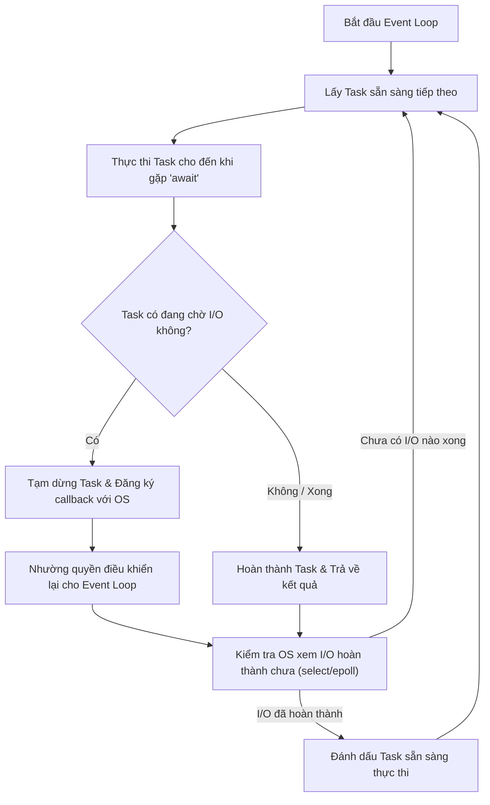

### 🎯 Mục tiêu học tập
- Giải thích được khái niệm về Event Loop (Vòng lặp sự kiện) và Cooperative Multitasking (Đa nhiệm cộng tác).
- Phân biệt sự khác nhau giữa coroutine và các hàm đồng bộ (synchronous functions) thông thường trong Python.
- Sử dụng cú pháp `async` và `await` để viết mã nguồn không gây nghẽn (non-blocking).
- Lập lịch (schedule) thực thi các tác vụ đồng thời bằng cách sử dụng `asyncio.create_task()`.
- Chờ đợi nhiều tác vụ bất đồng bộ hoàn thành cùng lúc bằng `asyncio.gather()`.

### 🧩 Khái niệm cốt lõi (Tại sao)
Trong lập trình đồng bộ truyền thống, các thao tác đều mang tính chất chặn (blocking). Nếu mã của bạn gửi một yêu cầu truy vấn đến cơ sở dữ liệu hoặc một máy chủ từ xa, CPU sẽ phải chờ đợi một cách lãng phí cho đến khi gói tin mạng hoặc thao tác đọc/ghi đĩa hoàn thành. Ở Day 36, chúng ta đã thấy cách thread có thể giảm thiểu vấn đề này bằng cách cho phép hệ điều hành chuyển đổi ngữ cảnh thực thi. Tuy nhiên, các thread tiêu tốn khá nhiều bộ nhớ và việc chuyển đổi ngữ cảnh (context switch) giữa các thread rất tốn kém tài nguyên.

**Asyncio** giải quyết vấn đề này bằng cách sử dụng cơ chế **Cooperative Multitasking (Đa nhiệm cộng tác)**. Thay vì khởi tạo nhiều thread hệ điều hành, toàn bộ ứng dụng của bạn sẽ chạy trên một thread duy nhất được quản lý bởi một **Event Loop (Vòng lặp sự kiện)**. Các tác vụ sẽ chủ động nhường quyền kiểm soát (yield execution control) khi gặp phải một điểm chờ I/O. Cơ chế xử lý đồng thời đơn luồng này cho phép Python xử lý hàng ngàn kết nối cùng một lúc với lượng tài nguyên tiêu hao cực kỳ nhỏ, khiến nó trở thành tiêu chuẩn công nghiệp cho các ứng dụng web và API mạng hiệu năng cao ngày nay.

### 🔁 Logic và hoạt động
Mô hình thực thi của `asyncio` dựa trên một Event Loop. Vòng lặp này quản lý các tác vụ đang hoạt động và xử lý đa luồng hóa I/O (I/O multiplexing).



- **Coroutines**: Các hàm Python đặc biệt được định nghĩa bằng từ khóa `async def`. Khi gọi chúng, hệ thống sẽ trả về một coroutine object mà không chạy mã nguồn bên trong ngay lập tức.
- **Event Loop (Vòng lặp sự kiện)**: Một vòng lặp liên tục điều phối việc lập lịch và thực thi các coroutine dựa trên trạng thái sẵn sàng của I/O.
- **Cooperative Multitasking (Đa nhiệm cộng tác)**: Cơ chế trong đó tác vụ đang chạy tự nguyện nhường lại quyền kiểm soát cho Event Loop thông qua từ khóa `await`.

### 📝 Ví dụ minh họa có chú thích

#### 1. Coroutine so với Hàm thông thường
Gọi một hàm coroutine sẽ trả về một coroutine object. Bạn phải chạy nó bên trong một event loop để thực thi mã nguồn của nó.
```python
import asyncio

# Cú pháp 'async def' dùng để định nghĩa một coroutine function
async def say_hello():
    print("Đang ở trong coroutine!")
    return "Hello World"

# Gọi hàm này sẽ trả về ngay lập tức một coroutine object
coro = say_hello()
print(type(coro))  # Output: <class 'coroutine'>

# Để thực thi nó, chúng ta dùng asyncio.run() để khởi động Event Loop
result = asyncio.run(coro)
print(result)  # Output: Hello World
```

#### 2. Đa nhiệm cộng tác với `asyncio.create_task()`
Bằng cách lập lịch cho các coroutine dưới dạng các Task, chúng được đăng ký với event loop và chạy đồng thời.
```python
import asyncio
import time

async def fetch_web_page(site_id, delay):
    print(f"Đang tải trang {site_id}...")
    # asyncio.sleep nhường quyền điều khiển cho event loop, khác với time.sleep
    await asyncio.sleep(delay)
    print(f"Hoàn thành tải trang {site_id}!")
    return f"Dữ liệu từ trang {site_id}"

async def main():
    start = time.time()
    
    # Lập lịch chạy đồng thời cho 2 tiến trình tải trang
    task1 = asyncio.create_task(fetch_web_page(1, 2.0))
    task2 = asyncio.create_task(fetch_web_page(2, 3.0))
    
    # Chờ đợi kết quả. Cả hai tác vụ sẽ chạy đồng thời.
    data1 = await task1
    data2 = await task2
    
    print(f"Kết quả: {data1}, {data2}")
    print(f"Thời gian chạy: {time.time() - start:.2f} giây")  # In ra ~3.00 giây thay vì 5.00 giây

asyncio.run(main())
```

#### 3. Quản lý nhiều Task với `asyncio.gather()`
`asyncio.gather` là một hàm cấp cao cho phép chạy nhiều tác vụ có thể await (awaitable) cùng một lúc và trả về kết quả theo đúng thứ tự truyền vào.
```python
import asyncio

async def compute_square(x):
    await asyncio.sleep(0.1)
    return x * x

async def main():
    numbers = [1, 2, 3, 4, 5]
    
    # Tạo một danh sách các coroutine object
    tasks = [compute_square(num) for num in numbers]
    
    # Chờ đợi tất cả các tác vụ chạy đồng thời và nhận kết quả theo thứ tự
    results = await asyncio.gather(*tasks)
    print(results)  # Output: [1, 4, 9, 16, 25]

asyncio.run(main())
```

### ❌ Các lỗi thường gặp

**Lỗi 1: Gọi một coroutine mà không await nó**
```python
import asyncio

async def get_value():
    return 42

async def main():
    # Gọi hàm coroutine nhưng thiếu từ khóa 'await'
    value = get_value()
    print(f"Giá trị là: {value}")
```
```text
RuntimeWarning: coroutine 'get_value' was never awaited
Giá trị là: <coroutine object get_value at 0x7f884c...>
```
```python
import asyncio

async def get_value():
    return 42

async def main():
    # Sử dụng await đúng cách
    value = await get_value()
    print(f"Giá trị là: {value}")

asyncio.run(main())
```
> Một hàm bất đồng bộ được định nghĩa với `async def` sẽ không tự động thực thi khi được gọi. Nó chỉ trả về một đối tượng coroutine. Bạn phải sử dụng từ khóa `await` một cách rõ ràng để thực thi coroutine đó và lấy giá trị trả về.

**Lỗi 2: Sử dụng các thao tác đồng bộ chặn (blocking synchronous operations)**
```python
import asyncio
import time

async def blocking_task(name):
    print(f"Task {name} bắt đầu")
    time.sleep(1.0)  # Chặn! Làm đóng băng thread của event loop
    print(f"Task {name} kết thúc")

async def main():
    await asyncio.gather(blocking_task("A"), blocking_task("B"))

asyncio.run(main())
```
```text
Task A bắt đầu
Task A kết thúc
Task B bắt đầu
Task B kết thúc
(Chạy tuần tự, mất tổng cộng 2.0 giây)
```
```python
import asyncio

async def non_blocking_task(name):
    print(f"Task {name} bắt đầu")
    await asyncio.sleep(1.0)  # Không chặn! Nhường quyền điều khiển
    print(f"Task {name} kết thúc")

async def main():
    await asyncio.gather(non_blocking_task("A"), non_blocking_task("B"))

asyncio.run(main())
```
> Asyncio hoạt động đơn luồng. Nếu bất kỳ tác vụ nào gọi mã đồng bộ gây nghẽn (như `time.sleep()`, các thư viện kết nối DB đồng bộ hoặc thư viện `requests` thông thường), event loop sẽ bị chặn. Tất cả các tác vụ khác đã được lên lịch sẽ bị đóng băng. Bạn phải sử dụng các thư viện bất đồng bộ thuần (như `asyncio.sleep()`, `httpx` hoặc `aiohttp`) và nhường quyền điều khiển bằng `await`.

**Lỗi 3: Await các tác vụ ngay khi vừa khởi tạo**
```python
import asyncio

async def task_worker(n):
    await asyncio.sleep(1)
    return n

async def main():
    # Await task1 ngay lập tức trước khi task2 được tạo ra
    t1 = await asyncio.create_task(task_worker(1))
    t2 = await asyncio.create_task(task_worker(2))
    return [t1, t2]

asyncio.run(main())
```
```text
(Chạy tuần tự, mất tổng cộng 2.0 giây)
```
```python
import asyncio

async def task_worker(n):
    await asyncio.sleep(1)
    return n

async def main():
    # Tạo các handle task trước (đăng ký chúng vào loop)
    task1 = asyncio.create_task(task_worker(1))
    task2 = asyncio.create_task(task_worker(2))
    # Await các task đã được lên lịch
    t1 = await task1
    t2 = await task2
    return [t1, t2]

asyncio.run(main())
```
> Việc sử dụng `await` sẽ tạm dừng thực thi của hàm hiện tại. Nếu bạn viết `t1 = await asyncio.create_task(...)`, bạn sẽ chặn hàm bao ngoài trước khi nó có cơ hội thực thi dòng lệnh tiếp theo, điều này biến luồng chạy trở lại thành đồng bộ. Bạn phải tạo các đối tượng Task trước để chúng chạy đồng thời, sau đó mới await chúng.

### 💡 Mẹo & Cách viết tối ưu
- **Kiểm tra các thư viện bạn dùng**: Không trộn lẫn các thư viện đồng bộ (như `requests`) với các thư viện bất đồng bộ. Hãy tìm kiếm các giải pháp thay thế bất đồng bộ như `httpx` cho HTTP, `motor` cho MongoDB, hoặc `aiopg`/`asyncpg` cho PostgreSQL.
- **Sử dụng `asyncio.run()` cẩn thận**: Chỉ sử dụng `asyncio.run()` làm điểm bắt đầu chính để chạy chương trình của bạn. Không gọi nó bên trong một hàm bất đồng bộ đang chạy khác; điều đó sẽ gây ra lỗi `RuntimeError: Timeout context manager should be used`.
- **Tích hợp các tác vụ CPU-bound**: Nếu bạn bắt buộc phải thực hiện các tác vụ tính toán nặng (như render ảnh) trong một ứng dụng bất đồng bộ, hãy ủy quyền xử lý đó cho một process pool executor bằng cách sử dụng `await loop.run_in_executor(None, cpu_bound_function)`.

### 🧠 Đi sâu phân tích (Cơ chế bên dưới)
<details><summary>Event Loop, epoll/kqueue và Coroutine dựa trên Generator</summary>

**OS-Level Multiplexing (Đa luồng hóa ở cấp độ hệ điều hành):**
Làm thế nào một thread duy nhất có thể quản lý hàng ngàn hoạt động I/O đồng thời? Nó ủy quyền việc chờ đợi cho nhân (kernel) của hệ điều hành.
Khi một thư viện bất đồng bộ khởi tạo kết nối socket, nó sẽ thiết lập socket đó ở chế độ không chặn (non-blocking). Thay vì chờ đợi dữ liệu đến, thư viện đăng ký file descriptor (bộ mô tả file) của socket với dịch vụ thông báo sự kiện của hệ điều hành như `epoll` (Linux), `kqueue` (macOS), hoặc `IOCP` (Windows).
Vòng lặp sự kiện (event loop) chạy một chu kỳ liên tục:
1. Nó truy vấn kernel (ví dụ: thông qua `select()` hoặc `epoll_wait()`) để lấy danh sách các socket sẵn sàng đọc/ghi.
2. Nếu không có socket nào sẵn sàng, thread sẽ tạm thời bị chặn, cho phép hệ điều hành ngủ cho đến khi có một ngắt (interrupt) được kích hoạt.
3. Khi một sự kiện I/O được kích hoạt, hệ điều hành đánh thức event loop, vòng lặp này sẽ chuyển đổi sự kiện thành các hàm callback, đánh thức coroutine tương ứng.

**Từ Generator đến Coroutine:**
Bên dưới lớp vỏ, các coroutine trong Python là các generator (trình tạo) chuyên biệt. Trước đây (trước Python 3.5), lập trình bất đồng bộ được thực hiện bằng cách sử dụng các generator được trang trí bởi `@asyncio.coroutine` và nhường quyền điều khiển bằng `yield from`.
Khi bạn viết `await coro`, Python tạm dừng ngăn xếp khung (frame stack) của coroutine hiện tại, trả lại quyền điều khiển cho event loop. Vòng lặp tương tác với coroutine bằng các phương thức generator cấp thấp như `.send(value)` và `.throw(exception)` để thúc đẩy trạng thái thực thi cho đến khi ngoại lệ `StopIteration` cuối cùng được ném ra, báo hiệu tác vụ đã hoàn thành.
</details>

### 🏋️ Bài tập thực hành
Hãy triển khai hàm `async_fetch_all(urls)` tải tất cả các URL song song sử dụng hàm giả lập `fake_async_fetch(url)`. Hàm phải chạy chúng đồng thời và trả về một danh sách chứa tất cả kết quả nhận được.

```python
import asyncio

async def fake_async_fetch(url):
    await asyncio.sleep(0.01)
    return f"Async {url}"

async def async_fetch_all(urls):
    # Sử dụng asyncio.gather để tải toàn bộ url một cách đồng thời và trả về list kết quả
    pass
```

### ✅ Tự kiểm tra
1. Nếu bạn chạy `asyncio.create_task(my_coroutine())`, nó có thực thi ngay lập tức không?
2. Làm thế nào Event Loop thực thi nhiều tác vụ trên một thread OS duy nhất?
<details><summary>Đáp án</summary>

1. Nó không thực thi ngay lập tức, nhưng nó được đăng ký vào hàng đợi sẵn sàng (ready queue) của Event Loop. Ngay khi coroutine đang chạy hiện tại nhường quyền kiểm soát (đến điểm `await` hoặc kết thúc), event loop sẽ bắt đầu thực thi tác vụ đó.
2. Nó sử dụng cơ chế đa luồng hóa I/O không chặn (non-blocking I/O multiplexing) ở cấp hệ điều hành. Vòng lặp đăng ký các socket/file descriptor của tác vụ với kernel và đi vào trạng thái ngủ. Khi kernel báo hiệu một hoạt động đã hoàn thành, vòng lặp thức dậy và tiếp tục chạy coroutine tương ứng.
</details>

### 📌 Tóm tắt
- **Asyncio** chạy trên một thread duy nhất và sử dụng cơ chế đa nhiệm cộng tác (cooperative multitasking), nhường quyền thực thi qua từ khóa `await`.
- **Event Loop** điều phối việc lập lịch, tạm dừng và tiếp tục các tác vụ bằng cách phản hồi các thông báo sẵn sàng từ hệ điều hành.
- Tránh sử dụng **các lệnh gọi đồng bộ chặn (blocking synchronous calls)** bên trong các hàm async vì chúng sẽ làm đóng băng toàn bộ ứng dụng.
- Sử dụng `asyncio.create_task()` để lập lịch chạy nền và `asyncio.gather()` để chờ đợi nhiều tác vụ song song.
