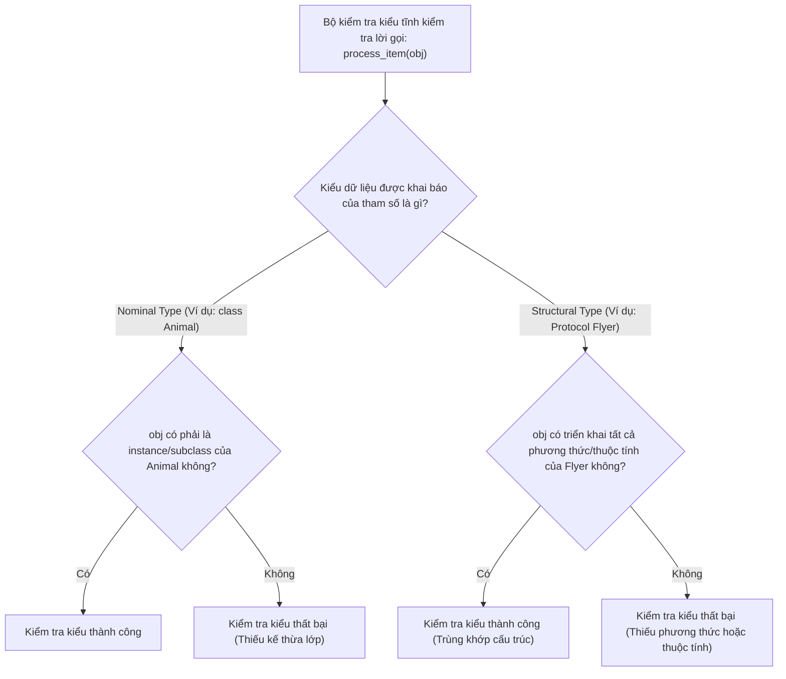

### 🎯 Mục tiêu học tập
- Phân biệt giữa Nominal Typing (Kiểu danh nghĩa) và Structural Typing (Kiểu cấu trúc / Static Duck Typing).
- Định nghĩa các interface (giao diện) cấu trúc bằng cách sử dụng `typing.Protocol`.
- Làm việc với các kiểu dữ liệu nâng cao như `Union`, `Optional` và `Callable`.
- Triển khai các thành phần mã nguồn có thể tái sử dụng bằng Generics (`TypeVar`).
- Sử dụng các công cụ kiểm tra kiểu tĩnh (như `mypy` hoặc `pyright`) để xác minh tính chính xác của kiểu dữ liệu.

### 🧩 Khái niệm cốt lõi (Tại sao)
Python là ngôn ngữ định kiểu động (dynamically typed): các kiểu dữ liệu được kiểm tra ở runtime (thời gian chạy), và một đối tượng được chấp nhận miễn là nó hoạt động đúng như mong đợi (duck typing: *"nếu nó đi như một con vịt và kêu như một con vịt, thì nó là một con vịt"*). Tuy nhiên, trong các dự án lớn, định kiểu động có thể dẫn đến các lỗi runtime rất khó theo vết.

Để giải quyết vấn đề này, Python đã giới thiệu các chú thích kiểu tĩnh tùy chọn (type hints - PEP 484). Type hints cho phép các công cụ kiểm tra kiểu tĩnh (như `mypy` hoặc `pyright`/`Pylance` của VS Code) phân tích mã nguồn của bạn để tìm lỗi mà không cần chạy chương trình.

Ban đầu, hệ thống kiểu của Python dựa vào **Nominal Typing**—một đối tượng chỉ khớp với một kiểu nếu nó là một subclass (lớp con) rõ ràng của kiểu đó. Điều này mâu thuẫn với triết lý duck-typing truyền thống của Python. Để thu hẹp khoảng cách này, PEP 544 đã giới thiệu **Structural Subtyping (Định kiểu cấu trúc con)** thông qua `typing.Protocol`. Với protocol, bạn có thể định nghĩa các interface dựa trên các phương thức hoặc thuộc tính mà một đối tượng triển khai, thay vì phân cấp kế thừa của nó. Điều này kết hợp sự linh hoạt của duck typing với sự an toàn của phân tích tĩnh.

### 🔁 Logic và hoạt động
Việc hiểu cách các công cụ kiểm tra kiểu tĩnh xác minh các tham số phụ thuộc vào việc bạn sử dụng Nominal Typing hay Structural Typing.



- **Nominal Typing (Định kiểu danh nghĩa)**: Khả năng tương thích kiểu được xác định bởi các khai báo rõ ràng và kế thừa lớp (ví dụ: `class Dog(Animal)`).
- **Structural Typing (Định kiểu cấu trúc / Protocol)**: Khả năng tương thích kiểu được xác định bởi "hình dáng" của đối tượng (phương thức, thuộc tính và chữ ký hàm). Không yêu cầu kế thừa.
- **Generics (Kiểu chung)**: Các kiểu được tham số hóa cho phép các hàm/lớp chấp nhận các kiểu khác nhau trong khi vẫn thực thi tính nhất quán giữa đầu vào và đầu ra.

### 📝 Ví dụ minh họa có chú thích

#### 1. Union, Optional và Callable
Các chú thích này cho phép bạn biểu diễn các chữ ký hàm phức tạp và các kiểu trả về đa dạng.
```python
from typing import Union, Optional, Callable

# Python 3.10+ hỗ trợ cú pháp ngắn gọn hơn: int | str
def parse_id(val: Union[int, str]) -> str:
    # Chấp nhận int hoặc str, luôn trả về str
    return str(val)

# Optional[T] là cách viết tắt của Union[T, None]
def get_user_name(user_id: int) -> Optional[str]:
    # Có thể trả về chuỗi hoặc None nếu người dùng không tồn tại
    if user_id == 1:
        return "Alice"
    return None

# Callable[[Các kiểu đối số...], KiểuTrảVề] dùng để chú thích cho hàm callback
def process_data(data: list, transform: Callable[[str], str]) -> list:
    return [transform(item) for item in data]
```

#### 2. Generics với `TypeVar`
Generics cho phép bạn viết mã nguồn có khả năng tái sử dụng cao trong khi vẫn duy trì mối quan hệ chặt chẽ giữa các kiểu dữ liệu.
```python
from typing import TypeVar, List

# TypeVar liên kết kiểu đầu vào với kiểu đầu ra
T = TypeVar('T')

def get_first_element(items: List[T]) -> T:
    # Nếu truyền vào một List[int], mypy hiểu kiểu trả về là int.
    # Nếu truyền vào một List[str], mypy hiểu kiểu trả về là str.
    return items[0]

first_num = get_first_element([1, 2, 3])  # Được suy luận là int
first_word = get_first_element(["a", "b"])  # Được suy luận là str
```

#### 3. Định kiểu cấu trúc con với `typing.Protocol`
Sử dụng protocol cho phép bạn thực thi các interface mà không cần ép buộc các lớp phải kế thừa từ một lớp cha cụ thể.
```python
from typing import Protocol, List

# Định nghĩa một Protocol mô tả những gì một đối tượng phải làm được
class Greeter(Protocol):
    def greet(self) -> str:
        ...  # Dấu ba chấm (...) biểu thị định nghĩa chữ ký hàm mà không có triển khai

class EnglishPerson:
    def greet(self) -> str:
        return "Hello"

class JapanesePerson:
    def greet(self) -> str:
        return "Konnichiwa"

# Lớp này KHÔNG khớp với protocol vì kiểu trả về của nó bị sai
class BrokenGreeter:
    def greet(self) -> int:
        return 42

def introduce(people: List[Greeter]) -> None:
    for person in people:
        print(person.greet())

# EnglishPerson và JapanesePerson ngầm định thỏa mãn Greeter protocol
introduce([EnglishPerson(), JapanesePerson()])

# Bộ kiểm tra kiểu tĩnh sẽ báo lỗi ở đây vì BrokenGreeter không khớp với Protocol
# introduce([BrokenGreeter()])
```

### ❌ Các lỗi thường gặp

**Lỗi 1: Quên xử lý các kiểu Optional (thiếu kiểm tra None)**
```python
from typing import Optional

def get_upper_name(name: Optional[str]) -> str:
    # Gọi trực tiếp phương thức chuỗi trên một kiểu dữ liệu Optional
    return name.upper()
```
```text
error: Item "None" of "Optional[str]" has no attribute "upper"
```
```python
from typing import Optional

def get_upper_name(name: Optional[str]) -> str:
    # Kiểm tra None một cách chính xác trước khi xử lý
    if name is None:
        return "ANONYMOUS"
    return name.upper()
```
> Bộ kiểm tra kiểu tĩnh bắt buộc bạn phải viết mã an toàn. Vì một `Optional[str]` có thể là `None`, bạn không thể thực hiện các thao tác chuỗi trên nó trực tiếp mà không có một bộ lọc kiểu (type guard - như `if name is None:` hoặc `if not name:`), giúp thu hẹp kiểu dữ liệu về chỉ còn `str`.

**Lỗi 2: Thiếu tham số `self` bên trong phương thức của Protocol**
```python
from typing import Protocol

class Printable(Protocol):
    # Định nghĩa phương thức nhưng thiếu 'self'
    def print_item() -> str:
        ...
```
```text
error: Protocol member "print_item" must be a method (take self as first argument)
```
```python
from typing import Protocol

class Printable(Protocol):
    # Khai báo self một cách chính xác
    def print_item(self) -> str:
        ...
```
> Định nghĩa Protocol mô tả các phương thức của instance (thể hiện), do đó bắt buộc phải nhận `self` làm tham số đầu tiên. Việc bỏ qua nó sẽ làm cho bộ kiểm tra kiểu coi nó như một static method, gây ra lỗi khi so khớp với các phương thức instance bình thường của các lớp.

**Lỗi 3: Lạm dụng TypeVar mà không có giới hạn (thiếu upper bounds)**
```python
from typing import TypeVar

T = TypeVar('T')

# Cố gắng cộng hai phần tử thuộc kiểu generic T
def sum_two(a: T, b: T) -> T:
    return a + b
```
```text
error: Unsupported operand types for + ("T" and "T")
```
```python
from typing import TypeVar

# Giới hạn TypeVar chỉ chấp nhận các kiểu hỗ trợ phép cộng (như số)
T = TypeVar('T', int, float)

def sum_two(a: T, b: T) -> T:
    return a + b
```
> Một generic `TypeVar` không có ràng buộc sẽ đại diện cho bất kỳ đối tượng nào (`object`). Vì các đối tượng tùy ý không hỗ trợ toán tử cộng `+`, bộ kiểm tra kiểu sẽ báo lỗi. Bạn phải ràng buộc `TypeVar` bằng cách truyền các kiểu được phép làm đối số, hoặc sử dụng tham số `bound` để giới hạn các lớp con.

### 💡 Mẹo & Cách viết tối ưu
- **Sử dụng `runtime_checkable` để hỗ trợ kiểm tra lúc chạy**: Thông thường, các Protocol bị bỏ qua ở runtime. Nếu bạn muốn sử dụng chúng với `isinstance()` hoặc `issubclass()`, hãy thêm decorator `typing.runtime_checkable` vào lớp protocol đó.
- **Ưu tiên cú pháp mới hơn từ Python 3.10+**: Thay vì import `Union` và `Optional` từ `typing`, hãy viết trực tiếp `int | str` hoặc `str | None`. Cách viết này sạch sẽ và dễ đọc hơn nhiều.
- **Hạn chế tối đa việc dùng `Any`**: Việc sử dụng `Any` sẽ tắt tính năng kiểm tra kiểu cho biến đó. Lạm dụng nó sẽ làm mất đi mục đích của kiểm tra kiểu tĩnh. Hãy sử dụng `TypeVar` hoặc `Protocol` thay thế.

### 🧠 Đi sâu phân tích (Cơ chế bên dưới)
<details><summary>Nominal vs Structural Subtyping và Type Erasure</summary>

**Nominal so với Structural Typing:**
Nominal typing bắt nguồn từ phân loại học (taxonomy). Một lớp `Dog` là lớp con của `Animal` chỉ khi bạn viết `class Dog(Animal):`. Ngay cả khi `Dog` có các trường và phương thức giống hệt như `Cat`, bạn không thể truyền một đối tượng `Dog` vào một hàm yêu cầu `Cat` trừ khi chúng chia sẻ một lớp cha chung.
Ngược lại, structural typing (Protocol) hoạt động dựa trên hình dáng (shapes). Bộ kiểm tra kiểu tĩnh sẽ tạo ra một biểu diễn nội bộ về các phương thức và chữ ký hàm của protocol. Khi xác thực một tham số, nó sẽ duyệt qua các phương thức của lớp của đối tượng đích và kiểm tra xem chữ ký của chúng có khớp với protocol hay không. Nếu có, bộ kiểm tra kiểu sẽ chấp nhận, ngay cả khi lớp đó chưa từng khai báo kế thừa hay biết đến sự tồn tại của protocol.

**Cơ chế Type Erasure (Xóa bỏ kiểu dữ liệu):**
Các chú thích kiểu (type hints) trong Python hoàn toàn bị trình thông dịch bỏ qua khi chạy chương trình (runtime). Cơ chế này được gọi là **Type Erasure**. Khi Python thực thi mã nguồn của bạn, không có bất kỳ ảnh hưởng xấu nào đến hiệu năng khi sử dụng type hints, nhưng đồng thời cũng không có cơ chế tự động ép kiểu nào xảy ra.
Ví dụ, đoạn mã:
```python
def add(a: int, b: int) -> int:
    return a + b
```
Được trình thông dịch thực thi hoàn toàn giống hệt như:
```python
def add(a, b):
    return a + b
```
Chính vì vậy, type hints thuần túy là các công cụ phục vụ cho nhà phát triển và các công cụ phân tích tĩnh. Chúng không thực thi ép kiểu ở runtime trừ khi bạn sử dụng các thư viện xác thực runtime của bên thứ ba như `pydantic`.
</details>

### 🏋️ Bài tập thực hành
Hãy triển khai hàm `render_shapes(shapes)` trong đó `shapes` là một danh sách các đối tượng thỏa mãn protocol `Drawable`. Hàm phải gọi phương thức `draw()` trên mỗi hình dạng và trả về một chuỗi duy nhất được phân tách bằng dấu phẩy chứa toàn bộ kết quả.

```python
from typing import Protocol, List

class Drawable(Protocol):
    def draw(self) -> str:
        ...

def render_shapes(shapes):
    # shapes là một List[Drawable]
    # Gọi hàm draw() trên tất cả các shapes và trả về một chuỗi nối bởi dấu phẩy
    pass
```

### ✅ Tự kiểm tra
1. Làm thế nào `typing.Protocol` hỗ trợ triết lý "duck typing" của Python một cách tĩnh?
2. Sự khác biệt giữa `Union[str, None]` và `Optional[str]` là gì?
<details><summary>Đáp án</summary>

1. Nó cho phép bạn chỉ định một kiểu dữ liệu mong muốn dựa trên interface (phương thức và thuộc tính) của nó thay vì hệ thống phân cấp kế thừa. Các lớp không cần phải kế thừa trực tiếp từ lớp Protocol; chúng chỉ cần triển khai đầy đủ các phương thức của nó.
2. Không có sự khác biệt nào. `Optional[str]` là một bí danh viết tắt của `Union[str, None]`. Từ Python 3.10+, cả hai đều có thể viết đơn giản là `str | None`.
</details>

### 📌 Tóm tắt
- **Các bộ kiểm tra kiểu tĩnh** phân tích cú pháp mã nguồn của bạn để phát hiện lỗi mà không cần chạy chương trình.
- **Structural Subtyping** (`typing.Protocol`) cho phép xác thực tĩnh mô hình duck typing động.
- **Generics** (`TypeVar`) cho phép các hàm và lớp thích ứng với nhiều kiểu dữ liệu khác nhau trong khi vẫn giữ được tính an toàn kiểu giữa các ranh giới.
- **Optional** yêu cầu bạn phải xử lý rõ ràng trường hợp giá trị là `None` trước khi thực hiện bất kỳ thao tác nào trên kiểu dữ liệu cơ sở.
