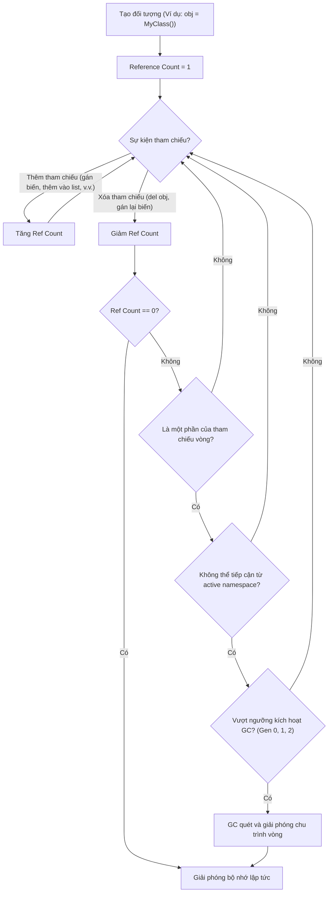

### 🎯 Mục tiêu học tập
- Giải thích cơ chế đếm tham chiếu (Reference Counting) của CPython và theo dõi số lượng tham chiếu bằng `sys.getrefcount`.
- Mô tả cơ chế dọn rác vòng (Cyclic Garbage Collection), bao gồm việc duyệt theo thế hệ (Gen 0, 1, 2) và các ngưỡng kích hoạt (thresholds).
- Triển khai tham chiếu yếu (Weak References) thông qua module `weakref` để ngăn chặn và phá vỡ chu trình tham chiếu vòng.
- Phát hiện và phòng tránh rò rỉ bộ nhớ (Memory Leaks) gây ra bởi biến toàn cục, tham số mặc định dạng mutable và tham chiếu vòng.
- Tối ưu hóa dung lượng bộ nhớ cho các class được khởi tạo hàng loạt bằng cách sử dụng `__slots__` để loại bỏ dictionary của instance (`__dict__`).

### 🧩 Khái niệm cốt lõi (Tại sao)
Python cung cấp cơ chế quản lý bộ nhớ tự động. Khi bạn tạo các đối tượng, Python sẽ cấp phát bộ nhớ trên heap; khi bạn không còn sử dụng chúng nữa, Python sẽ tự động thu hồi phần bộ nhớ đó. Tuy nhiên, việc hiểu rõ cơ chế này hoạt động *như thế nào* là cực kỳ quan trọng để viết code hiệu năng cao trong môi trường production.

CPython (trình thông dịch tiêu chuẩn của Python) sử dụng hai chiến lược bổ trợ để quản lý bộ nhớ:
1. **Reference Counting (Đếm tham chiếu)**: Lớp phòng thủ đầu tiên và chính yếu. Mỗi đối tượng Python theo dõi số lượng tham chiếu trỏ đến nó. Khi số lượng tham chiếu này giảm về 0, đối tượng sẽ bị hủy lập tức và bộ nhớ được giải phóng.
2. **Cyclic Garbage Collection (Dọn rác vòng)**: Cơ chế đếm tham chiếu không thể phát hiện các tham chiếu vòng (ví dụ: đối tượng A tham chiếu đối tượng B, và B lại tham chiếu ngược lại A). Để dọn dẹp các "hòn đảo cô lập" này, CPython chạy một bộ dọn rác vòng để quét định kỳ.

Khi ứng dụng mở rộng quy mô và xử lý hàng triệu đối tượng (như các nút trong cấu trúc đồ thị hoặc các bản ghi từ database), chi phí bộ nhớ mặc định của đối tượng Python có thể làm cạn kiệt tài nguyên hệ thống. Theo mặc định, mỗi class do người dùng định nghĩa sẽ lưu trữ các thuộc tính của nó trong một dictionary (`__dict__`). Dictionary rất linh hoạt nhưng lại tốn nhiều bộ nhớ để duy trì bảng băm. Việc thay thế `__dict__` bằng `__slots__` giúp bạn tối ưu hóa dung lượng bộ nhớ lên tới 80% đối với các đối tượng có mật độ cao.

### 🔁 Logic và hoạt động

Dưới đây là sơ đồ thể hiện sự tương tác giữa cấp phát bộ nhớ, theo dõi tham chiếu và dọn rác trong Python:



- **Reference Counting**: Hoạt động một cách tất định và tức thời. Nếu không có tham chiếu vòng, bộ nhớ sẽ được giải phóng ngay khi số lượng tham chiếu của đối tượng bằng 0.
- **Generational GC**: CPython chia các đối tượng container thành ba thế hệ (Gen 0, Gen 1, và Gen 2) dựa trên thời gian chúng tồn tại. Gen 0 được quét thường xuyên nhất. Nếu đối tượng còn sống sót qua các đợt quét, chúng sẽ được chuyển lên Gen 1 rồi Gen 2.
- **__slots__ Optimization**: Loại bỏ cấu trúc `__dict__` động khỏi các instance. Thay vì sử dụng hash-map, instance sẽ lưu trữ thuộc tính dưới dạng một mảng tĩnh, phẳng ở mức C, loại bỏ hoàn toàn chi phí của dictionary.

### 📝 Ví dụ minh họa có chú thích

#### 1. Theo dõi số lượng tham chiếu (Reference Counting)
Chúng ta có thể quan sát số lượng tham chiếu trong Python bằng cách sử dụng `sys.getrefcount()`. Lưu ý rằng việc truyền một đối tượng vào hàm này sẽ tạm thời làm tăng số lượng tham chiếu lên 1 đơn vị do tham số truyền vào hàm.

```python
import sys

# Tạo một list đối tượng
a = [1, 2, 3]
print(sys.getrefcount(a))  # Output: 2 (biến 'a' + tham số tạm thời trong getrefcount)

b = a  # Gán cho b
print(sys.getrefcount(a))  # Output: 3 ('a', 'b', và getrefcount)

c = [a]  # Đưa vào trong một list khác
print(sys.getrefcount(a))  # Output: 4 ('a', 'b', phần tử trong list c, và getrefcount)

del b
print(sys.getrefcount(a))  # Output: 3 ('a', phần tử trong list c, và getrefcount)
```

#### 2. Tham chiếu vòng và module `gc`
Dưới đây là một tham chiếu vòng nơi hai đối tượng tham chiếu lẫn nhau, duy trì số lượng tham chiếu bằng 1 ngay cả sau khi chúng ta đã xóa các biến truy cập ngoài.

```python
import gc

class Node:
    def __init__(self, value):
        self.value = value
        self.ref = None

# Bật bộ dọn rác (mặc định đã bật)
gc.enable()

# Tạo chu trình tham chiếu vòng
n1 = Node(1)
n2 = Node(2)
n1.ref = n2
n2.ref = n1

# Xóa các biến cục bộ
del n1
del n2

# Tại thời điểm này, hai đối tượng Node không thể truy cập từ code Python nữa.
# Tuy nhiên, reference count của chúng vẫn bằng 1 do tham chiếu chéo bên trong.
# Chúng ta kích hoạt bộ dọn rác thủ công để thu hồi chúng:
collected = gc.collect()
print(f"Bộ dọn rác đã thu hồi {collected} đối tượng.")  # Output: 2
```

#### 3. Phá vỡ tham chiếu vòng bằng `weakref`
Một tham chiếu yếu (weak reference) không làm tăng reference count của đối tượng đích. Nó được tạo bằng `weakref.ref` hoặc các container như `weakref.WeakValueDictionary`.

```python
import sys
import weakref

class LargeObject:
    def __init__(self, data):
        self.data = data

obj = LargeObject("chuỗi dữ liệu rất lớn")
print(sys.getrefcount(obj))  # Output: 2

# Tạo một tham chiếu yếu
wref = weakref.ref(obj)
print(sys.getrefcount(obj))  # Output: 2 (không hề tăng!)

# Truy xuất lại đối tượng gốc từ tham chiếu yếu
retrieved = wref()
if retrieved is not None:
    print("Đối tượng vẫn còn sống:", retrieved.data)

# Xóa tham chiếu mạnh duy nhất
del obj

# Kiểm tra lại tham chiếu yếu
print(wref())  # Output: None (Đã tự động bị vô hiệu hóa)
```

#### 4. Tối ưu hóa bộ nhớ bằng `__slots__`
So sánh giữa một class thông thường và một class đã được tối ưu hóa bộ nhớ bằng `__slots__`.

```python
import sys

class StandardPoint:
    def __init__(self, x, y):
        self.x = x
        self.y = y

class OptimizedPoint:
    # Định nghĩa slots để ngăn chặn việc tạo __dict__ và __weakref__
    __slots__ = ['x', 'y']
    def __init__(self, x, y):
        self.x = x
        self.y = y

sp = StandardPoint(1, 2)
op = OptimizedPoint(1, 2)

# Instance thông thường có một dictionary để chứa các thuộc tính
print(sp.__dict__)  # Output: {'x': 1, 'y': 2}

# Instance được tối ưu hóa không có thuộc tính __dict__
print(hasattr(op, '__dict__'))  # Output: False

# Việc cố gắng gán một thuộc tính chưa được khai báo sẽ gây ra lỗi AttributeError
try:
    op.z = 10
except AttributeError as e:
    print(e)  # Output: 'OptimizedPoint' object has no attribute 'z'
```

### ❌ Các lỗi thường gặp

**Lỗi 1: Thêm phần tử vào global list/dict mà không dọn dẹp (Rò rỉ bộ nhớ - Memory Leak)**
```python
# Giả lập bộ nhớ cache của server chạy lâu dài
CACHE = []

def process_request(data):
    # Liên tục append dữ liệu yêu cầu vào list toàn cục
    CACHE.append(data)
    return f"Processed: {len(data)} bytes"
```
```text
(Không có traceback - bộ nhớ tăng dần vô hạn cho đến khi hệ thống hết bộ nhớ và crash với lỗi MemoryError)
```
```python
# Giả lập bộ nhớ cache của server chạy lâu dài
CACHE = []

def process_request(data):
    result = f"Processed: {len(data)} bytes"
    # Giới hạn kích thước cache để tránh làm cạn kiệt bộ nhớ
    CACHE.append(data)
    if len(CACHE) > 100:
        CACHE.pop(0)
    return result
```
> Các biến toàn cục (globals) tồn tại trong suốt vòng đời của tiến trình ứng dụng. Việc thêm tham chiếu vào một global list hoặc dict mà không giới hạn sẽ ngăn cản các đối tượng đó đạt reference count bằng 0, gây ra hiện tượng rò rỉ bộ nhớ kinh điển trong Python.

**Lỗi 2: Lầm tưởng subclass của một class sử dụng `__slots__` sẽ tự động được tối ưu hóa**
```python
class Parent:
    __slots__ = ['x']

class Child(Parent):
    # Lớp con không định nghĩa __slots__
    def __init__(self, x, y):
        self.x = x
        self.y = y
```
```text
(Không báo lỗi khi khai báo, nhưng các instance của Child sẽ vẫn tạo ra __dict__ chứa 'y')
```
```python
class Parent:
    __slots__ = ['x']

class Child(Parent):
    # Lớp con bắt buộc phải khai báo slots cho các thuộc tính bổ sung
    __slots__ = ['y']
    def __init__(self, x, y):
        self.x = x
        self.y = y
```
> Nếu lớp cha sử dụng `__slots__` nhưng lớp con không định nghĩa `__slots__`, Python sẽ tự động tạo một `__dict__` cho các instance của lớp con, làm mất tác dụng tối ưu hóa bộ nhớ. Lớp con phải định nghĩa `__slots__ = [...]` (hoặc tuple rỗng `()` nếu không có thuộc tính mới) để duy trì tối ưu hóa.

### 💡 Mẹo & Cách viết tối ưu
- **Kiểm tra kích thước bộ nhớ**: Sử dụng hàm `sys.getsizeof()` của thư viện chuẩn để kiểm tra dung lượng bộ nhớ của đối tượng (tính bằng byte). Tuy nhiên, hãy lưu ý là nó chỉ đo kích thước của bản thân container chứ không bao gồm các đối tượng được tham chiếu bên trong. Bạn có thể dùng thư viện bên thứ ba như `pympler` để đo chi tiết hơn.
- **Ưu tiên `weakref.WeakValueDictionary` cho cache**: Khi xây dựng cache tìm kiếm, sử dụng `WeakValueDictionary` đảm bảo các entry trong cache sẽ tự động bị xóa đi khi đối tượng được cache không còn tham chiếu mạnh nào khác trong chương trình.
- **Chỉ sử dụng `__slots__` khi cần thiết**: Hãy triển khai `__slots__` khi bạn dự kiến sẽ khởi tạo hàng ngàn hoặc hàng triệu instance của class đó. Đừng tối ưu hóa sớm một cách không cần thiết, vì slots hạn chế khả năng gán thuộc tính động, điều này có thể làm lỗi một số decorator hoặc thư viện tuần tự hóa dữ liệu (serialization).

### 🧠 Đi sâu phân tích (Cơ chế bên dưới)
<details><summary>Cơ chế Garbage Collection theo thế hệ & Thuật toán phát hiện tham chiếu vòng</summary>

Bộ dọn rác của CPython (`gc` module) hoạt động dựa trên giả thuyết thế hệ: "hầu hết các đối tượng đều chết trẻ". Bộ dọn rác duy trì ba danh sách liên kết kép tương ứng với ba thế hệ:
- **Thế hệ 0 (Gen 0)**: Chứa các đối tượng container mới được tạo.
- **Thế hệ 1 (Gen 1)**: Chứa các đối tượng sống sót qua các đợt quét ở Gen 0.
- **Thế hệ 2 (Gen 2)**: Chứa các đối tượng sống lâu nhất và ít được quét nhất.

**Thuật toán phát hiện tham chiếu vòng:**
GC phát hiện các tham chiếu vòng bằng cách thực hiện các bước sau:
1. **Bản sao ban đầu**: Với mỗi đối tượng container trong thế hệ đang quét, GC sao chép số lượng tham chiếu (`ob_refcnt`) của nó vào trường `gc_refs` nằm trong header quản lý nội bộ của GC.
2. **Giả lập phép xóa**: GC duyệt qua toàn bộ đối tượng trong thế hệ đó và giảm (decrement) giá trị `gc_refs` của bất kỳ đối tượng nào được tham chiếu bởi đối tượng hiện tại. Nói cách khác, nếu đối tượng A tham chiếu đối tượng B, GC sẽ giảm `gc_refs` của B đi 1 đơn vị.
3. **Cô lập chu trình vòng**: Sau khi duyệt xong, bất kỳ đối tượng nào có `gc_refs` giảm về 0 sẽ trở thành ứng viên bị thu hồi. Điều này là vì tất cả các tham chiếu trỏ đến nó đều xuất phát từ bên trong chính thế hệ đó (không có tham chiếu ngoài từ stack hay global namespace).
4. **Hồi sinh đối tượng tiếp cận được**: GC quét lại danh sách. Nếu phát hiện một đối tượng có `gc_refs > 0` tham chiếu đến một đối tượng có `gc_refs == 0`, nó sẽ hồi sinh đối tượng đích đó (và tất cả những đối tượng mà đối tượng đích đó trỏ tới) vì chúng vẫn có thể tiếp cận được từ bên ngoài.
5. **Thu gom rác**: Tất cả các đối tượng còn lại có `gc_refs == 0` chính là các tham chiếu vòng không thể tiếp cận và sẽ bị giải phóng khỏi bộ nhớ.
</details>

### 🏋️ Bài tập thực hành
Triển khai một class có tên `OptimizedPoint` đại diện cho một tọa độ 2D với các thuộc tính `x` và `y`. Class này phải được tối ưu hóa để sử dụng `__slots__` thay vì dictionary thông thường.

```python
class OptimizedPoint:
    # Triển khai một point với x và y sử dụng __slots__
    pass
```

### ✅ Tự kiểm tra
1. Tại sao `sys.getrefcount(obj)` trả về giá trị lớn hơn 1 đơn vị so với số lượng tham chiếu thực tế?
2. Điều gì xảy ra với một weak reference khi đối tượng đích bị dọn rác?
3. Một class sử dụng `__slots__` có hỗ trợ gán thuộc tính động khi chạy (runtime) không?
<details><summary>Đáp án</summary>

1. Vì khi truyền đối tượng vào hàm `sys.getrefcount(obj)`, một tham chiếu tạm thời đến đối tượng đó được tạo ra trên call stack của execution frame cục bộ của hàm.
2. Đối tượng tham chiếu yếu sẽ tự động bị vô hiệu hóa, và việc gọi nó (ví dụ: `wref()`) sẽ trả về `None`.
3. Không. Nếu một class định nghĩa `__slots__`, bạn chỉ có thể đọc và ghi các thuộc tính được khai báo rõ ràng trong tuple slots. Việc cố tình gán một thuộc tính mới sẽ gây lỗi `AttributeError`.
</details>

### 📌 Tóm tắt
- **Reference Counting (Đếm tham chiếu)** xử lý việc giải phóng tức thời các đối tượng khi số lượng tham chiếu của chúng giảm về 0.
- **Cyclic Garbage Collector (Bộ dọn rác vòng)** quét các đối tượng container để phá vỡ các tham chiếu vòng bằng cách sử dụng các danh sách thế hệ (Gen 0, 1, 2).
- **Weak References (Tham chiếu yếu)** (module `weakref`) cho phép bạn tham chiếu đến đối tượng mà không làm tăng số lượng tham chiếu của nó, rất hữu ích cho các bộ nhớ đệm (caching).
- **`__slots__`** loại bỏ thuộc tính `__dict__` trong các class instance, giúp giảm thiểu đáng kể dung lượng bộ nhớ tiêu thụ cho các class có số lượng instance lớn.
