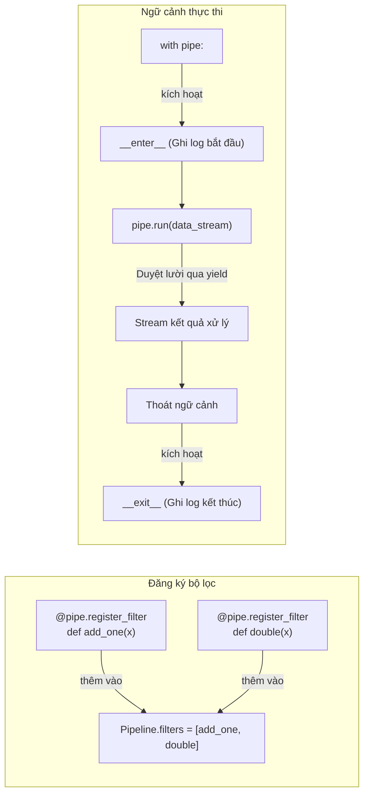
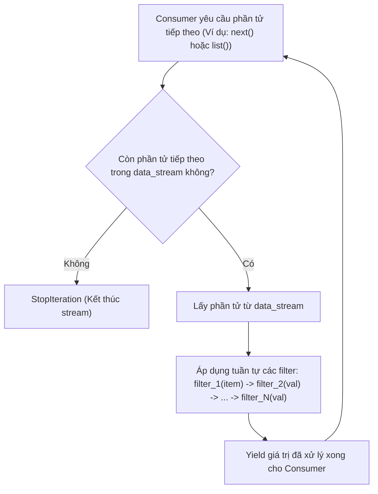

### 🎯 Mục tiêu học tập
- Thiết kế và xây dựng một class pipeline xử lý dữ liệu tuần tự, có tính mô-đun và tiết kiệm bộ nhớ.
- Tích hợp decorator ở mức phương thức (method) để đăng ký động các bộ lọc dữ liệu.
- Triển khai context manager (`__enter__` và `__exit__`) để quản lý vòng đời thực thi của pipeline, ghi nhật ký (logging) và thiết lập môi trường.
- Sử dụng cơ chế truyền luồng dữ liệu dựa trên generator (`yield`) để đạt được cơ chế đánh giá lười (lazy evaluation) và độ phức tạp bộ nhớ hằng số $O(1)$.
- Kết hợp hoàn hảo các mô hình decorator, quản lý ngữ cảnh và generator để giải quyết một bài toán thiết kế hệ thống thực tế.

### 🧩 Khái niệm cốt lõi (Tại sao)
Trong kỹ nghệ phần mềm hiện đại, pipeline xử lý dữ liệu đóng vai trò thiết yếu để làm sạch, biến đổi và phân tích khối lượng dữ liệu lớn. Tuy nhiên, việc xử lý các tập dữ liệu khổng lồ (chẳng hạn như log hệ thống, lịch sử giao dịch hoặc luồng dữ liệu thời gian thực từ cảm biến) có thể dễ dàng làm cạn kiệt bộ nhớ nếu chúng ta tải tất cả các bản ghi vào bộ nhớ cùng một lúc.

Để xây dựng một pipeline dữ liệu đạt tiêu chuẩn production trong Python, chúng ta cần kết hợp ba nguyên lý cốt lõi:
1. **Decorator cho việc đăng ký bộ lọc**: Thay vì viết cứng các phép biến đổi dữ liệu bên trong class pipeline, decorator cho phép đăng ký động các hàm biến đổi mô-đun hóa và có thể tái sử dụng. Điều này tuân thủ nguyên lý Open/Closed (thành phần phần mềm nên mở rộng cho việc phát triển nhưng đóng lại đối với việc sửa đổi trực tiếp code gốc).
2. **Context Manager cho quản lý vòng đời ngữ cảnh**: Một pipeline cần theo dõi trạng thái thực thi của nó—như ghi log khi bắt đầu và kết thúc, khởi tạo kết nối database hoặc dọn dẹp các tài nguyên tạm thời. Context manager (câu lệnh `with`) giúp tách biệt rõ ràng logic thiết lập/dọn dẹp khỏi logic xử lý dữ liệu chính.
3. **Generator cho việc truyền luồng lười (Lazy Streaming)**: Các list truyền thống sẽ xử lý tất cả các phần tử ngay lập tức và lưu trữ toàn bộ kết quả trong bộ nhớ. Bằng cách sử dụng generator kết hợp từ khóa `yield`, pipeline xử lý dữ liệu một cách lười biếng (lazy)—từng phần tử một tại mỗi thời điểm. Dung lượng bộ nhớ sử dụng luôn giữ ở mức tối thiểu hằng số ($O(1)$) cho dù ta xử lý mười phần tử hay mười tỷ phần tử.

Bài tập lớn này tập hợp các khái niệm trên để tạo ra một class **Pipeline Compiler** hoàn chỉnh.

### 🔁 Logic và hoạt động

Dưới đây là sơ đồ thiết kế kiến trúc và luồng thực thi của Pipeline:

#### 1. Sơ đồ kiến trúc


#### 2. Luồng xử lý lười (Generator Stream)


- **Đăng ký bộ lọc khai báo**: Trang trí (decorate) một hàm sẽ thêm hàm đó vào danh sách bộ lọc nội bộ của pipeline, sau đó trả về chính hàm đó để đảm bảo nó vẫn có thể được gọi bình thường ở nơi khác.
- **Ranh giới ngữ cảnh**: Khối `with` đảm bảo việc khởi tạo và ghi log diễn ra trước khi quá trình xử lý bắt đầu, đồng thời dọn dẹp/báo cáo khi kết thúc—ngay cả khi có ngoại lệ xảy ra.
- **Xử lý theo yêu cầu (On-Demand)**: Trong phương thức `run()`, khi consumer yêu cầu phần tử tiếp theo, một giá trị duy nhất sẽ được lấy ra từ stream nguồn, đi qua toàn bộ chuỗi bộ lọc theo thứ tự và yield ra ngay lập tức. Pipeline không lưu trữ bất kỳ kết quả trung gian nào.

### 📝 Ví dụ minh họa có chú thích

#### 1. Biên dịch một Pipeline đơn giản
Xem cách `Pipeline` đăng ký các bộ lọc và xử lý các chuỗi văn bản một cách lười biếng.

```python
LOGS = []

class Pipeline:
    def __init__(self):
        self.filters = []
    
    def register_filter(self, func):
        # Đăng ký hàm được trang trí vào danh sách bộ lọc
        self.filters.append(func)
        return func  # Trả về hàm gốc để cho phép sử dụng bình thường ở nơi khác
    
    def __enter__(self):
        LOGS.append("Pipeline started")
        return self
        
    def __exit__(self, exc_type, exc_val, exc_tb):
        LOGS.append("Pipeline finished")
        # Trả về False để các exception bên trong block (nếu có) được ném ra ngoài
        return False
        
    def run(self, data_stream):
        # Hàm generator: yield từng giá trị một
        for item in data_stream:
            val = item
            for f in self.filters:
                val = f(val)
            yield val

# Sử dụng:
pipe = Pipeline()

@pipe.register_filter
def clean_whitespace(text):
    return text.strip()

@pipe.register_filter
def to_uppercase(text):
    return text.upper()

# Chạy pipeline bên trong context manager
raw_data = ["  alice ", " bob  ", "   charlie"]
with pipe:
    # Chú ý: Chưa có tiến trình xử lý dữ liệu nào xảy ra ở đây.
    # Phương thức 'run' chỉ trả về một đối tượng generator.
    processed_generator = pipe.run(raw_data)
    
    # Chúng ta consume (tiêu thụ) generator để thực thi pipeline
    final_output = list(processed_generator)

print("Output:", final_output)  # Output: ['ALICE', 'BOB', 'CHARLIE']
print("Logs:", LOGS)            # Output: ['Pipeline started', 'Pipeline finished']
```

#### 2. Xử lý luồng vô hạn (Infinite Streams)
Vì pipeline sử dụng cơ chế ủy thác của generator, nó có thể xử lý các luồng dữ liệu vô hạn mà không bao giờ gặp sự cố tràn bộ nhớ.

```python
def infinite_number_stream():
    n = 1
    while True:
        yield n
        n += 1

pipe = Pipeline()

@pipe.register_filter
def square(x):
    return x * x

@pipe.register_filter
def format_str(x):
    return f"Value: {x}"

with pipe:
    # Chỉ xử lý 5 phần tử đầu tiên từ luồng vô hạn
    stream = pipe.run(infinite_number_stream())
    for _ in range(5):
        print(next(stream))
```
**Output:**
```text
Value: 1
Value: 4
Value: 9
Value: 16
Value: 25
```

### ❌ Các lỗi thường gặp

**Lỗi 1: Tích lũy các phần tử bên trong generator thay vì sử dụng yield (Tràn bộ nhớ)**
```python
class Pipeline:
    # ...
    def run(self, data_stream):
        results = []
        for item in data_stream:
            val = item
            for f in self.filters:
                val = f(val)
            results.append(val)
        return results  # Trả về một list hoàn chỉnh
```
```text
(Không báo lỗi cú pháp, nhưng dung lượng bộ nhớ tăng vọt lên hàng gigabyte khi xử lý luồng lớn/vô hạn, cuối cùng ném ra lỗi MemoryError)
```
```python
class Pipeline:
    # ...
    def run(self, data_stream):
        for item in data_stream:
            val = item
            for f in self.filters:
                val = f(val)
            yield val  # Yield từng phần tử một cách lười biếng
```
> Việc trả về một list làm mất đi toàn bộ lợi ích của generator stream. Nó ép hệ thống phải load toàn bộ dữ liệu đầu vào và giữ tất cả kết quả trung gian trong RAM, gây ra lỗi Out-Of-Memory (OOM) trên các luồng dữ liệu lớn.

**Lỗi 2: Quên return hàm từ decorator đăng ký bộ lọc**
```python
class Pipeline:
    # ...
    def register_filter(self, func):
        self.filters.append(func)
        # Thiếu 'return func'
```
```text
TypeError: 'NoneType' object is not callable
```
```python
class Pipeline:
    # ...
    def register_filter(self, func):
        self.filters.append(func)
        return func  # Trả về hàm gốc một cách chính xác
```
> Trong Python, một decorator sẽ thay thế hàm gốc bằng bất cứ giá trị nào mà hàm decorator đó trả về. Nếu decorator đăng ký bộ lọc của bạn không trả về hàm ban đầu (hoặc wrapper của nó), biến đại diện cho hàm sẽ nhận giá trị `None`. Lỗi `TypeError` sẽ xảy ra ngay khi bạn cố gắng gọi hàm đó ở các dòng code tiếp theo.

### 💡 Mẹo & Cách viết tối ưu
- **Composition over Inheritance (Ưu tiên kết hợp hơn kế thừa)**: Hãy lưu ý rằng pipeline của chúng ta không yêu cầu các bộ lọc phải kế thừa từ một class base `Filter` nào cả. Thay vào đó, nó chấp nhận bất kỳ callable object nào (hàm thông thường, method hoặc class triển khai phương thức `__call__`), đem lại sự linh hoạt tối đa.
- **Chaining Generators (Chuỗi generator)**: Bạn có thể nối tiếp các pipeline hoặc bao bọc trực tiếp kết quả của generator. Ví dụ: `filtered_stream = (x for x in pipe.run(data) if x is not None)` cho phép lọc dữ liệu theo điều kiện mà vẫn giữ tính chất xử lý lười.
- **Xử lý Ngoại lệ trong ngữ cảnh**: Bạn có thể nâng cấp phương thức `__exit__` để ghi nhận lỗi xảy ra trong quá trình xử lý. Nếu một exception được ném ra bên trong block `with`, kiểu của exception, giá trị và traceback của nó sẽ được truyền vào `__exit__`, giúp bạn ghi log lỗi hoặc bỏ qua nó một cách an toàn.

### 🧠 Đi sâu phân tích (Cơ chế bên dưới)
<details><summary>Cơ chế hoạt động của Generator Pipeline và Ngữ cảnh thực thi</summary>

**Cách hoạt động của Call Stack đối với Generator:**
Khi bạn gọi một hàm thông thường, một execution frame (khung thực thi) mới sẽ được đẩy (push) vào call stack. Khi hàm return, frame đó sẽ bị pop ra ngoài và bị hủy.
Với generator, cơ chế này có sự khác biệt:
1. Khi `pipe.run()` được gọi, Python không thực thi phần thân của hàm. Thay vào đó, nó biên dịch hàm và trả về một đối tượng generator iterator.
2. Execution frame của generator được cấp phát trên heap thay vì trên stack. Điều này giúp bảo toàn giá trị của các biến cục bộ và con trỏ lệnh (instruction pointer - dòng code hiện tại đang thực thi).
3. Mỗi khi `next(generator)` được gọi, Python đẩy frame của generator từ heap ngược trở lại call stack và tiếp tục thực thi từ vị trí bị tạm dừng trước đó cho đến khi gặp câu lệnh `yield`.
4. Khi gặp `yield`, frame thực thi sẽ tạm dừng, bị pop khỏi active stack và lưu trữ lại vào heap.

Chu trình lưu trữ/phục hồi stack này cho phép generator xử lý từng bản ghi trong luồng dữ liệu với chi phí chuyển đổi ngữ cảnh (context-switch) cực kỳ nhỏ, bảo toàn nguyên vẹn trạng thái của các phép biến đổi dữ liệu.
</details>

### 🏋️ Bài tập thực hành
Xây dựng class `Pipeline`. Lớp này phải hỗ trợ đăng ký bộ lọc bằng decorator `@register_filter`, hỗ trợ quản lý ngữ cảnh chuẩn (`__enter__` và `__exit__`) ghi log vào list toàn cục `LOGS` và thực thi luồng dữ liệu lười thông qua `run(data_stream)`.

```python
LOGS = []

class Pipeline:
    def __init__(self):
        self.filters = []
    # Triển khai register_filter, __enter__, __exit__ và run
```

### ✅ Tự kiểm tra
1. Việc gọi `pipe.run(data_stream)` có thực thi các bộ lọc ngay lập tức không?
2. Nếu xảy ra ngoại lệ bên trong block `with`, phương thức `__exit__` có được chạy không?
3. Có thể đăng ký một class method làm bộ lọc của pipeline bằng cách sử dụng `@pipe.register_filter` không?
<details><summary>Đáp án</summary>

1. Không. Vì `run` là một hàm generator (sử dụng `yield`), việc gọi nó chỉ trả về một đối tượng generator. Quá trình xử lý thực tế chỉ bắt đầu khi generator được duyệt qua (ví dụ: sử dụng `next()`, `list()`, hoặc vòng lặp `for`).
2. Có. Câu lệnh `with` đảm bảo rằng `__exit__` luôn luôn được gọi ngay cả khi có exception xảy ra bên trong khối lệnh. Điều này làm cho nó cực kỳ phù hợp cho việc giải phóng tài nguyên và ghi log lỗi.
3. Có. Bất kỳ đối tượng callable nào (bao gồm cả class method đã liên kết) đều có thể được trang trí và đăng ký làm bộ lọc, miễn là nó nhận vào một giá trị duy nhất và trả về giá trị đã được biến đổi.
</details>

### 📌 Tóm tắt
- **Data pipeline** xử lý dữ liệu qua các giai đoạn tuần tự sử dụng các bộ lọc.
- **Decorator** cung cấp một phương pháp khai báo trực quan để đăng ký động các hàm bộ lọc.
- **Context manager** quản lý an toàn ranh giới thực thi, chịu trách nhiệm thiết lập, dọn dẹp, ghi log và quản lý ngữ cảnh lỗi.
- **Generator** sử dụng cơ chế đánh giá lười (`yield`) để truyền từng bản ghi một trong luồng dữ liệu, giữ dung lượng bộ nhớ sử dụng luôn ở mức hằng số ($O(1)$) bất kể kích thước luồng dữ liệu.
